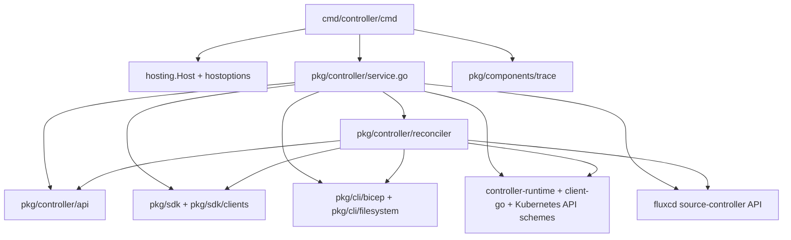
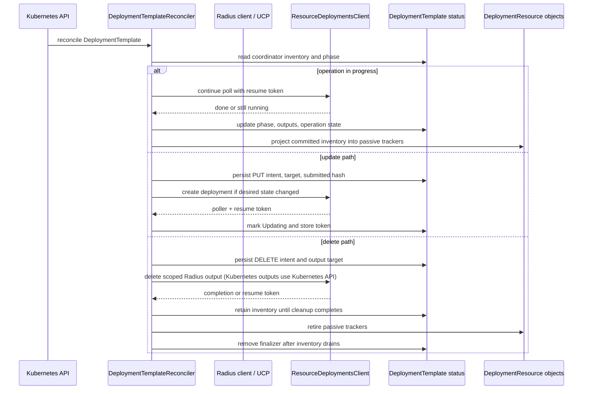

# Controller Architecture

The `controller` binary runs the Kubernetes controller-manager-based workflows
for Radius. It watches cluster resources, reconciles them, and drives Radius
APIs where Kubernetes-native automation is required.

The controller owns Kubernetes reconciliation for template deployment and Flux GitOps. It is not the primary home of resource-type authoring or UCP routing logic.

## Entry Points

- Binary entry: [cmd/controller/main.go](../../cmd/controller/main.go)
- Cobra root: [cmd/controller/cmd/root.go](../../cmd/controller/cmd/root.go)
- Main service: [pkg/controller/service.go](../../pkg/controller/service.go)
- Reconcilers: [pkg/controller/reconciler](../../pkg/controller/reconciler)
- API types: [pkg/controller/api](../../pkg/controller/api)

## Quick Reference

| Topic            | Start Here                   |
|------------------|------------------------------|
| Startup          | `cmd/controller/cmd/root.go` |
| Manager setup    | `pkg/controller/service.go`  |
| Reconciler logic | `pkg/controller/reconciler`  |
| CRD types        | `pkg/controller/api`         |

| Test Focus         | Packages                          |
|--------------------|-----------------------------------|
| Reconcile behavior | `./pkg/controller/reconciler/...` |
| Broad safety check | `./pkg/controller/...`            |

## Core Packages

| Package                     | Responsibility                                                 |
|-----------------------------|----------------------------------------------------------------|
| `pkg/controller/service.go` | controller manager bootstrap                                   |
| `pkg/controller/reconciler` | deployment template, deployment resource, and Flux reconcilers |
| `pkg/controller/api`        | CRD-backed Kubernetes API types                                |
| `pkg/sdk`                   | clients used to call back into Radius APIs                     |

## How It Works

The root command builds shared host options, creates the logger, and starts a
single `controller.Service` through shared hosting.

Inside [pkg/controller/service.go](../../pkg/controller/service.go), the service creates a controller-runtime manager, registers API schemes, configures metrics and health probes, then registers `DeploymentTemplateReconciler`, `DeploymentResourceReconciler`, and `FluxController`. The template reconciler is the sole dispatcher of deployment and output deletion requests. The resource reconciler maintains passive inventory objects; it cannot call the deployment client.

Some reconcilers call back into Radius APIs using SDK clients configured with
the current UCP connection. That is the main architectural bridge between the
controller and the rest of the control plane.

The authoritative output inventory is `DeploymentTemplate.status.coordinator.outputs`, with full resource IDs and explicit `Current` or `PendingDelete` state. A completed PUT commits this inventory before creating any `DeploymentResource` projections. `status.outputResources` remains the latest successful PUT's output list, and `status.statusHash` is only a spec hash, not a lifecycle marker. New tracker names hash the full, case-sensitive output identity, so resources sharing a name across kinds or namespaces do not collide. Existing owned trackers are found by exact resource ID rather than renamed. Reads bypass informer lag, and existing trackers are checked before Create to avoid duplicate POSTs failing quota admission.

Before each PUT or DELETE request, the coordinator persists and verifies a dispatch intent containing its phase and target. The submitted spec hash is captured before a PUT; a spec edit while the HTTP request is outstanding cannot change which spec its result acknowledges. Resume tokens remain in the template's existing `status.operation`. Responses are attached only to the same persisted intent, using optimistic concurrency; a spec-only edit does not discard the response or cause the request to be sent again.

| Coordinator phase   | Meaning and next action                                                                                                       |
|---------------------|-------------------------------------------------------------------------------------------------------------------------------|
| `Idle`              | Plan cleanup, submit a changed deployment, or project current inventory into trackers.                                        |
| `PutDispatching`    | PUT intent is durable; the response has not yet been saved. A later reconcile blocks rather than replaying the request.       |
| `PutRunning`        | Poll the saved PUT token; commit returned inventory before projecting trackers.                                               |
| `DeleteDispatching` | DELETE intent and target are durable; do not infer safety from a missing token.                                               |
| `DeleteRunning`     | Poll the saved UCP token, or issue the next Kubernetes DELETE after its persisted poll deadline.                              |
| `RetryWaiting`      | A request was definitively rejected or an operation ended in failure. Retain inventory and wait for `retryAfter`.             |
| `Blocked`           | The request outcome or legacy state is uncertain. Report `Failed` with a message and warning event; dispatch nothing further. |

PUTs do not overlap an active DELETE. Cleanup processes leaf outputs before applications/environments using the complete inventory, including outputs with no tracker. A pending dependency DELETE that has not been dispatched may wait while a changed template removes its retained dependents. Reintroducing that dependency changes its inventory state back to `Current` without deleting it or repeatedly submitting PUTs. A tracker deletion request first becomes durable inventory state; the passive tracker can then be retired without losing cleanup responsibility. If the requested output remains desired, clearing the spec hash requires a repair PUT after cleanup.

Template deletion marks its inventory for cleanup and retains the template finalizer until that inventory drains. Namespace termination uses exactly the same path; no new child objects are needed to record or delete outputs in a terminating namespace. Local Kubernetes outputs use DELETE/discovery handling with background propagation, including cross-namespace and cluster-scoped outputs. The exception is an output Namespace containing the template: once confirmed terminating, it can leave inventory so namespace content deletion does not form a finalizer cycle. Removed APIs require fresh discovery; unrelated partial discovery failures are tolerated, but target-group and global failures remain retryable. No arbitrary output GET permission is required.

On upgrade, the coordinator imports the old template output list and eligible owned children. Controller owner references must match API version, kind, name, and UID. Kubernetes legacy provenance uses controller-written `status.provisionedResourceID`, or the old protected inventory when that field is absent; a recorded mismatch never falls back to another output. Known legacy child DELETE tokens are adopted and polled serially before any new operation. Tokenless legacy trackers already marked `Deleting` or `Failed` block adoption because their requests may already have been sent. Orphan trackers cannot authorize external deletion.

The Helm controller Deployment uses `Recreate` with one replica, preventing the old independent child dispatcher from overlapping the new coordinator during an upgrade. Custom installations must likewise stop the old controller before starting the new one and establish the outcome of outstanding old requests. Requests that an older controller never recorded cannot be reconstructed automatically.

An ambiguous transport failure, or a restart between dispatch intent and response persistence, deliberately trades availability for safety: `Blocked` prevents a late DELETE from removing a replacement output. Operator recovery must establish the outstanding request's outcome, preserve the full inventory, and resume any known operation with the matching target and token. Never blindly clear the coordinator or its finalizer to retry. Polling failures preserve existing tokens. Definitive failures and accepted Kubernetes deletes waiting on finalizers use persisted retry/poll deadlines so self-generated status events cannot bypass the delay.

Helm does not upgrade CRDs shipped under `crds/`. Before starting its reconcilers, the controller performs an additive migration of both deployment CRDs in [schema_upgrade.go](../../pkg/controller/schema_upgrade.go). It adds resource provenance and the template coordinator schema without replacing unrelated fields or versions. Migration failures prevent startup. Each dispatch also verifies its intent survived the status round trip, so schema pruning cannot silently remove coordination state. The migration grants `patch` only on the named `deploymentresources.radapp.io` and `deploymenttemplates.radapp.io` CRDs.

Generic templates can provision arbitrary built-in or custom Kubernetes resource types, including across namespaces and at cluster scope. The controller's ClusterRole therefore grants `delete` across resource types for cleanup, but does not add wildcard read, create, update, patch, list, or watch permissions. Namespace termination checks use the existing Namespace read grant; generic cleanup does not require reading Secret values. This is a privileged capability: deployments must restrict writes to `deploymentresources/status` and `deploymenttemplates/status` to trusted controllers, independently of access to the ordinary resources. Ordinary create/update requests cannot set or overwrite status provenance. A fixed resource allowlist would change which template outputs Radius supports rather than safely implementing generic cleanup.

## Invariants And Constraints

- Reconciler logic should stay idempotent.
- Only the template coordinator dispatches external operations; passive tracker removal is not proof of output deletion.
- Persist operation intent before dispatch and preserve uncertain outcomes rather than replaying them.
- Do not deploy replacements while an earlier DELETE can still affect their resource ID.
- Cluster watch logic should stay in reconcilers, not in provider HTTP layers.
- Radius API calls from reconcilers should use the configured UCP connection.
- Manager registration is the single place to confirm which controllers are part
  of the binary.

## Change This Safely

### Packages That Usually Move Together

- `pkg/controller/service.go` and `pkg/controller/reconciler` when adding or
  removing controllers
- `pkg/controller/api` and reconcilers when CRD shape or status handling changes
- SDK client usage and reconciler tests when Radius API calls change

### Suggested Test Scope

- `go test ./pkg/controller/...`
- Pay particular attention to deployment template, deployment resource, and Flux tests in `pkg/controller/reconciler/...`.

## Package Dependency View

The important static seam is `root -> service -> manager/reconcilers`. The
service package owns manager assembly and registration, while the reconciler
packages own the real cluster automation logic.

## Representative Flow

The representative controller flow is the `DeploymentTemplateReconciler` state
machine. It shows the controller's real role in the system: reconcile cluster
state, use Radius deployment APIs as the backend executor, and project outputs
back into Kubernetes resources.

## Related Docs

- [service-interaction-map.md](service-interaction-map.md)
- [rad-cli.md](rad-cli.md)
