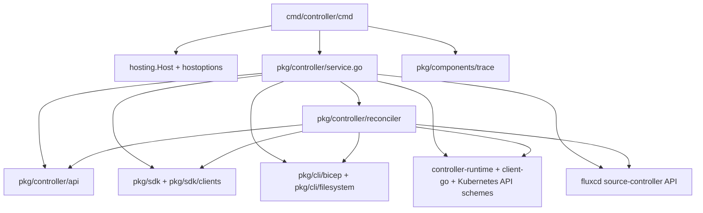
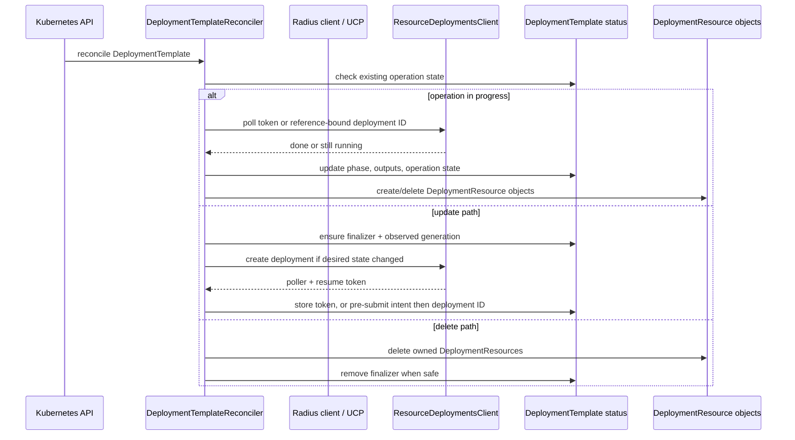

# Controller Architecture

The `controller` binary runs the Kubernetes controller-manager-based workflows
for Radius. It watches cluster resources, reconciles them, and drives Radius
APIs where Kubernetes-native automation is required.

The controller owns Kubernetes reconciliation for template deployment and Flux GitOps. It is not the primary home of resource-type authoring or UCP routing logic.

## Entry Points

- Binary entry: [cmd/controller/main.go](../../cmd/controller/main.go)
- Cobra root: [cmd/controller/cmd/root.go](../../cmd/controller/cmd/root.go)
- Main service: [pkg/controller/service.go](../../pkg/controller/service.go)
- Reconcilers: [pkg/controller/reconciler](../../pkg/controller/reconciler)
- API types: [pkg/controller/api](../../pkg/controller/api)

## Quick Reference

| Topic            | Start Here                   |
|------------------|------------------------------|
| Startup          | `cmd/controller/cmd/root.go` |
| Manager setup    | `pkg/controller/service.go`  |
| Reconciler logic | `pkg/controller/reconciler`  |
| CRD types        | `pkg/controller/api`         |

| Test Focus         | Packages                          |
|--------------------|-----------------------------------|
| Reconcile behavior | `./pkg/controller/reconciler/...` |
| Broad safety check | `./pkg/controller/...`            |

## Core Packages

| Package                     | Responsibility                                                 |
|-----------------------------|----------------------------------------------------------------|
| `pkg/controller/service.go` | controller manager bootstrap                                   |
| `pkg/controller/reconciler` | deployment template, deployment resource, and Flux reconcilers |
| `pkg/controller/api`        | CRD-backed Kubernetes API types                                |
| `pkg/sdk`                   | clients used to call back into Radius APIs                     |

## How It Works

The root command builds shared host options, creates the logger, and starts a
single `controller.Service` through shared hosting.

Inside [pkg/controller/service.go](../../pkg/controller/service.go), the service creates a controller-runtime manager, registers API schemes, configures metrics and health probes, then registers `DeploymentTemplateReconciler`, `DeploymentResourceReconciler`, and `FluxController`. The shared operation types in [operation_types.go](../../pkg/controller/api/radapp.io/v1alpha3/operation_types.go) preserve asynchronous operation tracking for both deployment CRDs.

Some reconcilers call back into Radius APIs using SDK clients configured with
the current UCP connection. That is the main architectural bridge between the
controller and the rest of the control plane.

### Secret-backed deployment inputs (draft)

[Shared parameter translation](../../pkg/controller/parameters/parameters.go) converts compiled Bicep external inputs into `DeploymentTemplate.spec.parameterReferences`. Flux and `rad bicep generate-kubernetes-manifest` use this translation without reading Secrets. Argo CD can sync the same generated manifest without installing Flux; there is no separate Argo CD resolver. Existing literal parameters remain unchanged, including their existing visibility in the manifest.

Keep `radius-gitops-config.yaml` selecting the linked parameter file through `params: app.bicepparam`. Use Bicep 0.37.4 or newer (the repository pins 0.46.1). Declare the template input as `@secure()` with no default, then bind it in the parameter file:

```bicep
using './app.bicep'

param databasePassword = externalInput('radius.secretKeyRef', {
  name: 'database-credentials'
  key: 'password'
})
```

For CLI generation, run `rad bicep generate-kubernetes-manifest app.bicep -g default -p @app.bicepparam -d app.yaml`, then sync/apply the manifest in the destination namespace. Only direct references to declared secure strings are supported; compositions, unsupported kinds, namespace fields, defaults, literal/reference conflicts, and unused or missing definitions fail explicitly. Provision Secrets separately using SOPS, an external operator, or another existing mechanism; Radius does not decrypt source artifacts.

**Trust boundary:** repository authors and deployment templates must be trusted. Radius automatically processes watched `GitRepository` objects containing `radius-gitops-config.yaml`, so registering or modifying a source is deployment authority. A central source in `flux-system` may deploy to `my-app`; no source/destination namespace equality restriction is imposed. Destination reader RBAC is not source authorization and does not provide hostile multi-tenant isolation. Platform operators must control sources, destination namespaces, service accounts, and RBAC. Deployment authors in a namespace share all Secret access approved for its reader identity, and trusted templates can expose inputs through downstream resources.

The [shared resolver](../../pkg/controller/reconciler/secret_inputs.go) verifies a platform-managed `radius-deployer` service account exists in the destination namespace, then performs uncached, impersonated Secret GETs as that account. The controller never falls back to its own Secret credentials. Each Secret is fetched once per resolution attempt; no Secret informer, list, or watch is used. Missing accounts, denied access, missing Secrets/keys, invalid UTF-8, and constraint failures set `Failed` and retry without changing previously deployed resources. Present empty keys are empty strings, not missing keys; whitespace is preserved.

Operators provision the following namespace-local permissions, changing `radius-system` if the Radius controller is installed elsewhere. These are deliberately not blanket permissions in the Helm controller ClusterRole:

```yaml
apiVersion: v1
kind: ServiceAccount
metadata:
  name: radius-deployer
  namespace: my-app
---
apiVersion: rbac.authorization.k8s.io/v1
kind: Role
metadata:
  name: radius-secret-inputs
  namespace: my-app
rules:
  - apiGroups: [""]
    resources: ["secrets"]
    resourceNames: ["database-credentials"]
    verbs: ["get"]
---
apiVersion: rbac.authorization.k8s.io/v1
kind: RoleBinding
metadata:
  name: radius-secret-inputs
  namespace: my-app
roleRef:
  apiGroup: rbac.authorization.k8s.io
  kind: Role
  name: radius-secret-inputs
subjects:
  - kind: ServiceAccount
    name: radius-deployer
    namespace: my-app
---
apiVersion: rbac.authorization.k8s.io/v1
kind: Role
metadata:
  name: radius-reader-impersonation
  namespace: my-app
rules:
  - apiGroups: [""]
    resources: ["serviceaccounts"]
    resourceNames: ["radius-deployer"]
    verbs: ["get", "impersonate"]
---
apiVersion: rbac.authorization.k8s.io/v1
kind: RoleBinding
metadata:
  name: radius-reader-impersonation
  namespace: my-app
roleRef:
  apiGroup: rbac.authorization.k8s.io
  kind: Role
  name: radius-reader-impersonation
subjects:
  - kind: ServiceAccount
    name: controller
    namespace: radius-system
```

Ready deployments poll inputs on a 60-second baseline with up to 20% jitter. `InputPollInterval` is injectable on the reconciler; a user-facing configuration option is not yet wired. Controller concurrency remains bounded by controller-runtime's default single worker, and lookup errors use its rate-limited retries. Revisions hash the desired spec plus Secret UID/resourceVersion metadata, never resolved Secret bytes. Metadata-only changes can redeploy. `attemptedInputRevision` accompanies an operation; `appliedInputRevision` advances only after successful deployment and output tracking. Inputs changing during an operation are handled after that operation finishes.

Reference-bound PUTs persist a value-free deployment ID in `pendingSubmission` before submission, then track the deployment through GET rather than SDK resume tokens. A lost acknowledgement or status-write failure therefore resumes tracking the same deployment, not a second PUT. If the deployment remains missing or unreadable, submission stays blocked and visibly fails: a 404 cannot prove that a timed-out request will never be accepted. A crash between saving intent and sending the PUT also needs operator recovery. Inspect the recorded deployment ID and engine state before repairing status; do not clear tracking while an operation may still be running. Failed terminal deployments retry fresh authorized inputs even when the spec matches an earlier successful deployment. Deletion waits for tracked operations but does not resolve inputs or modify externally managed Secrets.

**Draft limits and release gates:** at most 64 references, 64 KiB per resolved value, and 256 KiB total resolved inputs are accepted; these conservative proof-of-concept limits have not been scale-qualified. Upgrade CRDs and controller together before using references; do not run mixed controller versions or downgrade with reference-bound objects present. Before downgrade, migrate and converge those objects under the new controller, considering the disclosure risk of inline values. Rotate any credentials previously stored inline; this feature does not erase historical Git, manifests, status, backups, or engine records. Full deployment-engine persistence/diagnostic/provider redaction and memory erasure are not verified. Full SOPS/operator and Argo CD sync scenarios, multi-replica recovery, production load, and a user-facing recovery/configuration workflow remain release gates. This is not a complete security audit or production-readiness claim.

## Invariants And Constraints

- Reconciler logic should stay idempotent.
- Cluster watch logic should stay in reconcilers, not in provider HTTP layers.
- Radius API calls from reconcilers should use the configured UCP connection.
- Manager registration is the single place to confirm which controllers are part
  of the binary.

## Change This Safely

### Packages That Usually Move Together

- `pkg/controller/service.go` and `pkg/controller/reconciler` when adding or
  removing controllers
- `pkg/controller/api` and reconcilers when CRD shape or status handling changes
- SDK client usage and reconciler tests when Radius API calls change

### Suggested Test Scope

- `go test ./pkg/controller/...`
- Pay particular attention to deployment template, deployment resource, and Flux tests in `pkg/controller/reconciler/...`.

## Package Dependency View



The important static seam is `root -> service -> manager/reconcilers`. The
service package owns manager assembly and registration, while the reconciler
packages own the real cluster automation logic.

## Representative Flow



The representative controller flow is the `DeploymentTemplateReconciler` state
machine. It shows the controller's real role in the system: reconcile cluster
state, use Radius deployment APIs as the backend executor, and project outputs
back into Kubernetes resources.

## Related Docs

- [service-interaction-map.md](service-interaction-map.md)
- [rad-cli.md](rad-cli.md)
