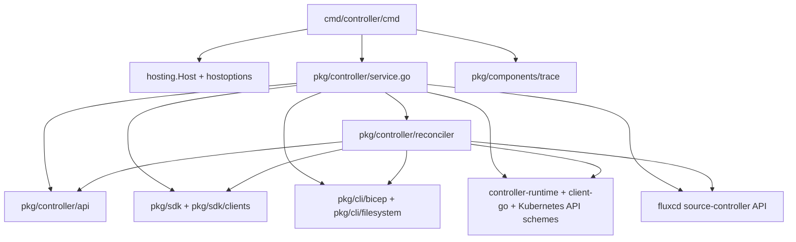
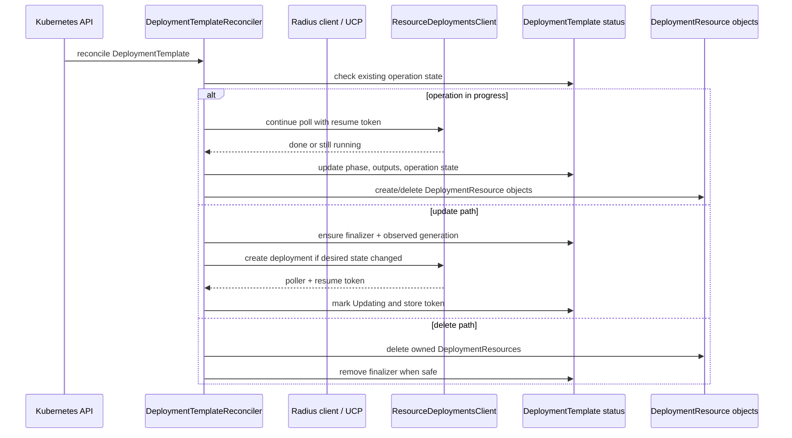

# Controller Architecture

The `controller` binary runs the Kubernetes controller-manager-based workflows
for Radius. It watches cluster resources, reconciles them, and drives Radius
APIs where Kubernetes-native automation is required.

The controller owns Kubernetes reconciliation for template deployment and Flux GitOps. It is not the primary home of resource-type authoring or UCP routing logic.

## Entry Points

- Binary entry: [cmd/controller/main.go](../../cmd/controller/main.go)
- Cobra root: [cmd/controller/cmd/root.go](../../cmd/controller/cmd/root.go)
- Main service: [pkg/controller/service.go](../../pkg/controller/service.go)
- Reconcilers: [pkg/controller/reconciler](../../pkg/controller/reconciler)
- API types: [pkg/controller/api](../../pkg/controller/api)

## Quick Reference

| Topic            | Start Here                   |
|------------------|------------------------------|
| Startup          | `cmd/controller/cmd/root.go` |
| Manager setup    | `pkg/controller/service.go`  |
| Reconciler logic | `pkg/controller/reconciler`  |
| CRD types        | `pkg/controller/api`         |

| Test Focus         | Packages                          |
|--------------------|-----------------------------------|
| Reconcile behavior | `./pkg/controller/reconciler/...` |
| Broad safety check | `./pkg/controller/...`            |

## Core Packages

| Package                     | Responsibility                                                 |
|-----------------------------|----------------------------------------------------------------|
| `pkg/controller/service.go` | controller manager bootstrap                                   |
| `pkg/controller/reconciler` | deployment template, deployment resource, and Flux reconcilers |
| `pkg/controller/api`        | CRD-backed Kubernetes API types                                |
| `pkg/sdk`                   | clients used to call back into Radius APIs                     |

## How It Works

The root command builds shared host options, creates the logger, and starts a
single `controller.Service` through shared hosting.

Inside [pkg/controller/service.go](../../pkg/controller/service.go), the service creates a controller-runtime manager, registers API schemes, configures metrics and health probes, then registers `DeploymentTemplateReconciler`, `DeploymentResourceReconciler`, and `FluxController`. The shared operation types in [operation_types.go](../../pkg/controller/api/radapp.io/v1alpha3/operation_types.go) preserve asynchronous operation tracking for both deployment CRDs.

Some reconcilers call back into Radius APIs using SDK clients configured with
the current UCP connection. That is the main architectural bridge between the
controller and the rest of the control plane.

`DeploymentResourceReconciler` deletes Radius-scoped outputs through UCP. Local Kubernetes outputs are deleted through the Kubernetes client only when the owning `DeploymentTemplate` UID matches and `spec.id` exactly matches the child's controller-recorded `status.provisionedResourceID`. The template controller records this identity through the status subresource and backfills older children from its output inventory before removing outputs on redeploy. An unrecorded child can use the template's current inventory, but a recorded mismatch is never authorized through that fallback. Caller-writable annotations are not used as provenance.

The controller retains the child finalizer until the Kubernetes object is gone, including when the object has its own finalizers. The exception is an output Namespace containing the child itself: once that Namespace is terminating, the child releases its finalizer so Kubernetes can finish deleting the namespace's contents without a finalizer cycle. If discovery cannot map an output's kind, a successful fresh discovery must confirm the API is absent before cleanup can complete; discovery failures remain retryable. A NotFound response against a cached mapping also refreshes discovery and retries against a served version before concluding that the output is gone.

Helm does not upgrade CRDs shipped under `crds/`. Before starting its reconcilers, the controller therefore performs an additive migration of the DeploymentResource status schema in [schema_upgrade.go](../../pkg/controller/schema_upgrade.go). This covers CLI and direct Helm upgrades. Migration failures prevent startup, and the template reconciler verifies identity persistence before replacing the template inventory, so schema pruning cannot silently bypass cleanup. The migration grants `patch` only on the named `deploymentresources.radapp.io` CRD and leaves other schema fields and versions unchanged.

Generic templates can provision arbitrary built-in or custom Kubernetes resource types, including across namespaces and at cluster scope. The controller's ClusterRole therefore grants `get` and `delete` across resource types for cleanup, but does not add wildcard create, update, patch, list, or watch permissions. This is a privileged capability: deployments must restrict writes to `deploymentresources/status` and `deploymenttemplates/status` to trusted controllers, independently of access to the ordinary resources. Ordinary create/update requests cannot set or overwrite status provenance. A fixed resource allowlist would change which template outputs Radius supports rather than safely implementing generic cleanup.

## Invariants And Constraints

- Reconciler logic should stay idempotent.
- Cluster watch logic should stay in reconcilers, not in provider HTTP layers.
- Radius API calls from reconcilers should use the configured UCP connection.
- Manager registration is the single place to confirm which controllers are part
  of the binary.

## Change This Safely

### Packages That Usually Move Together

- `pkg/controller/service.go` and `pkg/controller/reconciler` when adding or
  removing controllers
- `pkg/controller/api` and reconcilers when CRD shape or status handling changes
- SDK client usage and reconciler tests when Radius API calls change

### Suggested Test Scope

- `go test ./pkg/controller/...`
- Pay particular attention to deployment template, deployment resource, and Flux tests in `pkg/controller/reconciler/...`.

## Package Dependency View

The important static seam is `root -> service -> manager/reconcilers`. The
service package owns manager assembly and registration, while the reconciler
packages own the real cluster automation logic.

## Representative Flow

The representative controller flow is the `DeploymentTemplateReconciler` state
machine. It shows the controller's real role in the system: reconcile cluster
state, use Radius deployment APIs as the backend executor, and project outputs
back into Kubernetes resources.

## Related Docs

- [service-interaction-map.md](service-interaction-map.md)
- [rad-cli.md](rad-cli.md)
