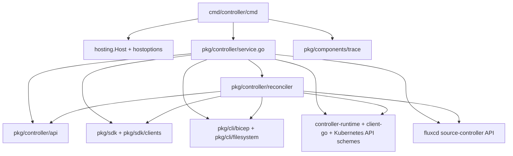
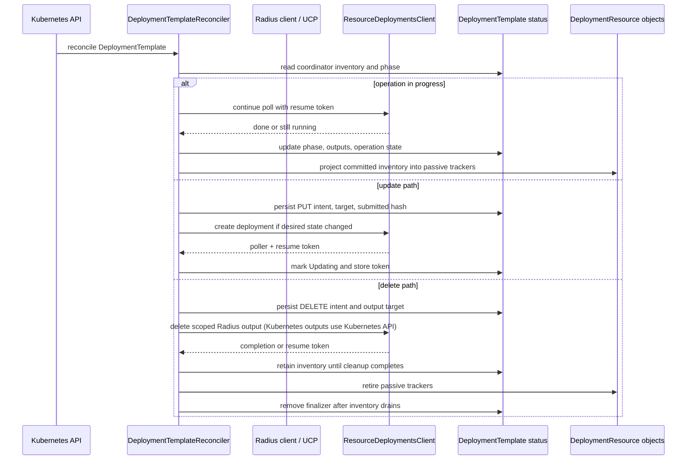

# Controller Architecture

The `controller` binary runs the Kubernetes controller-manager-based workflows
for Radius. It watches cluster resources, reconciles them, and drives Radius
APIs where Kubernetes-native automation is required.

The controller owns Kubernetes reconciliation for template deployment and Flux GitOps. It is not the primary home of resource-type authoring or UCP routing logic.

## Entry Points

- Binary entry: [cmd/controller/main.go](../../cmd/controller/main.go)
- Cobra root: [cmd/controller/cmd/root.go](../../cmd/controller/cmd/root.go)
- Main service: [pkg/controller/service.go](../../pkg/controller/service.go)
- Reconcilers: [pkg/controller/reconciler](../../pkg/controller/reconciler)
- API types: [pkg/controller/api](../../pkg/controller/api)

## Quick Reference

| Topic            | Start Here                   |
|------------------|------------------------------|
| Startup          | `cmd/controller/cmd/root.go` |
| Manager setup    | `pkg/controller/service.go`  |
| Reconciler logic | `pkg/controller/reconciler`  |
| CRD types        | `pkg/controller/api`         |

| Test Focus         | Packages                          |
|--------------------|-----------------------------------|
| Reconcile behavior | `./pkg/controller/reconciler/...` |
| Broad safety check | `./pkg/controller/...`            |

## Core Packages

| Package                     | Responsibility                                                 |
|-----------------------------|----------------------------------------------------------------|
| `pkg/controller/service.go` | controller manager bootstrap                                   |
| `pkg/controller/reconciler` | deployment template, deployment resource, and Flux reconcilers |
| `pkg/controller/api`        | CRD-backed Kubernetes API types                                |
| `pkg/sdk`                   | clients used to call back into Radius APIs                     |

## How It Works

The root command builds shared host options, creates the logger, and starts a
single `controller.Service` through shared hosting.

Inside [pkg/controller/service.go](../../pkg/controller/service.go), the service creates a controller-runtime manager, registers API schemes, configures metrics and health probes, then registers `DeploymentTemplateReconciler`, `DeploymentResourceReconciler`, and `FluxController`. The template reconciler is the sole dispatcher of deployment and output deletion requests. The resource reconciler maintains passive inventory objects; it cannot call the deployment client.

Some reconcilers call back into Radius APIs using SDK clients configured with
the current UCP connection. That is the main architectural bridge between the
controller and the rest of the control plane.

The authoritative output inventory is `DeploymentTemplate.status.coordinator.outputs`, with full resource IDs and explicit `Current` or `PendingDelete` state. A completed PUT commits this inventory before creating any `DeploymentResource` projections. `status.outputResources` remains the latest successful PUT's output list, and `status.statusHash` is only a spec hash, not a lifecycle marker. New tracker names hash the full output identity, so resources sharing a name across kinds or namespaces do not collide. Identity matching and hashing fold Radius IDs to match storage semantics but preserve exact Kubernetes and AWS identities. Existing owned trackers are found by this identity rather than renamed. A tracker whose edited spec conflicts with its protected identity blocks cleanup instead of redirecting deletion to another output. Reads bypass informer lag, and existing trackers are checked before Create to avoid duplicate POSTs failing quota admission.

Before each PUT or DELETE request, the coordinator persists and verifies a dispatch intent containing its phase and target. SDK mutation calls disable automatic retries so a lost response cannot be hidden behind a later rejection; read and polling calls retain their normal retry policy. The submitted spec hash is captured before a PUT; a spec edit while the HTTP request is outstanding cannot change which spec its result acknowledges. Resume tokens remain in the template's existing `status.operation`. Responses are attached only to the same persisted intent, using optimistic concurrency; a spec-only edit does not discard the response or cause the request to be sent again.

| Coordinator phase     | Meaning and next action                                                                                                        |
|-----------------------|--------------------------------------------------------------------------------------------------------------------------------|
| `Idle`                | Plan cleanup, submit a changed deployment, or project current inventory into trackers.                                         |
| `PutDispatching`      | PUT intent is durable; the response has not yet been saved. A later reconcile blocks rather than replaying the request.        |
| `PutRunning`          | Poll the saved PUT token; commit returned inventory before projecting trackers.                                                |
| `PutInventoryPending` | A PUT failed; read partial output inventory by its durable deployment ID before clearing recovery state or permitting cleanup. |
| `DeleteDispatching`   | DELETE intent and target are durable; do not infer safety from a missing token.                                                |
| `DeleteRunning`       | Poll the saved UCP token, or issue the next Kubernetes DELETE after its persisted poll deadline.                               |
| `RetryWaiting`        | A request was definitively rejected or an operation ended in failure. Retain inventory and wait for `retryAfter`.              |
| `Blocked`             | The request outcome or legacy state is uncertain. Report `Failed` with a message and warning event; dispatch nothing further.  |

PUTs do not overlap an active DELETE. Cleanup processes leaf outputs before applications/environments using the complete inventory, including outputs with no tracker. A pending dependency DELETE that has not been dispatched may wait while a changed template removes its retained dependents. Reintroducing that dependency changes its inventory state back to `Current` without deleting it or repeatedly submitting PUTs. A tracker deletion request first becomes durable inventory state; the passive tracker can then be retired without losing cleanup responsibility. If the requested output remains desired, clearing the spec hash requires a repair PUT after cleanup.

Template deletion marks its inventory for cleanup and retains the template finalizer until that inventory drains. Namespace termination uses exactly the same path; no new child objects are needed to record or delete outputs in a terminating namespace. Local Kubernetes outputs use DELETE/discovery handling with background propagation, including cross-namespace and cluster-scoped outputs. The exception is an output Namespace containing the template: once confirmed terminating, it can leave inventory so namespace content deletion does not form a finalizer cycle. Removed APIs require fresh discovery; DELETE uses the discovered group/version/resource endpoint directly rather than resolving the kind through a stale mapper again. Unrelated partial discovery failures are tolerated, but target-group and global failures remain retryable. No arbitrary output GET permission is required.

On upgrade, the coordinator imports the old template output list and eligible owned children. Controller owner references must match API version, kind, name, and UID. Kubernetes legacy provenance uses controller-written `status.provisionedResourceID`, or the old protected inventory when that field is absent; a recorded mismatch never falls back to another output. Adopting a legacy child DELETE token requires an existing protected target identity matching its spec. If that identity is absent, adoption blocks for operator recovery: neither today's editable spec nor membership in template inventory proves which resource the older token targets. The coordinator does not manufacture provenance for an existing token. Verified tokens are polled serially before any new operation. Completion clears matching tokens independently of mutable tracker specs before retirement, so identity edits or another finalizer cannot cause repeated adoption. Tokenless legacy trackers already marked `Deleting` or `Failed` also block adoption because their requests may already have been sent. Orphan trackers cannot authorize external deletion.

The Helm controller Deployment uses `Recreate` with one replica, preventing the old independent child dispatcher from overlapping the new coordinator during an upgrade. Custom installations must likewise stop the old controller before starting the new one and establish the outcome of outstanding old requests. Requests that an older controller never recorded cannot be reconstructed automatically.

An ambiguous transport failure, or a restart between dispatch intent and response persistence, deliberately trades availability for safety: `Blocked` prevents a late DELETE from removing a replacement output. Operator recovery must establish the outstanding request's outcome, preserve the full inventory, and resume any known operation with the matching target and token. Never blindly clear the coordinator or its finalizer to retry. Polling failures preserve existing tokens. Failed Azure SDK pollers return no deployment inventory, so the coordinator reads the deployment resource through the SDK. An unavailable read or omitted/null `outputResources` retains `PutInventoryPending`, the deployment ID, token, existing inventory, and template finalizer; it cannot authorize another PUT or cleanup. Only an explicit output list, including an explicit empty array, allows recovery to finish. Backends that omit failed-deployment inventory therefore leave recovery pending until authoritative inventory is supplied; this controller guard prevents lost cleanup responsibility but does not add a backend partial-output contract. Definitive failures and accepted Kubernetes deletes waiting on finalizers use persisted retry/poll deadlines so self-generated status events cannot bypass the delay.

Helm does not upgrade CRDs shipped under `crds/`. Before starting its reconcilers, the controller performs an additive migration of both deployment CRDs in [schema_upgrade.go](../../pkg/controller/schema_upgrade.go). It adds resource provenance and the template coordinator schema without replacing unrelated fields or versions. Migration failures prevent startup. Each dispatch also verifies its intent survived the status round trip, so schema pruning cannot silently remove coordination state. The migration grants `patch` only on the named `deploymentresources.radapp.io` and `deploymenttemplates.radapp.io` CRDs.

Generic templates can provision arbitrary built-in or custom Kubernetes resource types, including across namespaces and at cluster scope. The controller's ClusterRole therefore grants `delete` across resource types for cleanup, but does not add wildcard read, create, update, patch, list, or watch permissions. Namespace termination checks use the existing Namespace read grant; generic cleanup does not require reading Secret values. This is a privileged capability: deployments must restrict writes to `deploymentresources/status` and `deploymenttemplates/status` to trusted controllers, independently of access to the ordinary resources. Ordinary create/update requests cannot set or overwrite status provenance. A fixed resource allowlist would change which template outputs Radius supports rather than safely implementing generic cleanup.

## Invariants And Constraints

- Reconciler logic should stay idempotent.
- Only the template coordinator dispatches external operations; passive tracker removal is not proof of output deletion.
- Persist operation intent before dispatch and preserve uncertain outcomes rather than replaying them.
- Do not deploy replacements while an earlier DELETE can still affect their resource ID.
- Cluster watch logic should stay in reconcilers, not in provider HTTP layers.
- Radius API calls from reconcilers should use the configured UCP connection.
- Manager registration is the single place to confirm which controllers are part
  of the binary.

## Change This Safely

### Recovering A Stalled Template

There is no automatic reset command for `Blocked`. Restarting the controller or editing the template does not unblock it. Recovery is an administrator operation requiring status-subresource access and evidence about the original external request, not just the current existence of an output.

1. Select the affected cluster explicitly. Save the template and its tracker objects in restricted local storage; resume tokens are sensitive operational data. Record the template UID, resource version, coordinator message, target/deployment ID, submitted hash, operation kind/token, complete ledger, and tracker provenance. For example:

   ```bash
   CONTEXT=your-cluster
   CONTROL_NAMESPACE=radius-system
   NAMESPACE=your-application-namespace
   TEMPLATE=your-template
   umask 077
   kubectl --context "$CONTEXT" -n "$NAMESPACE" get deploymenttemplate "$TEMPLATE" -o json > template-before.json
   kubectl --context "$CONTEXT" -n "$NAMESPACE" get deploymentresources -o json > trackers-before.json
   ```

2. Pause GitOps and other writers for the affected deployment and controller. Stop every controller instance before any manual status repair, including custom installations; with the standard chart, scale `deployment/controller` in the control-plane namespace to zero and wait for its Pods to exit. This stops reconciliation, not requests already running in UCP or Kubernetes. Keep the saved inventory and finalizers intact.
3. Establish the request outcome using the deployment/operation APIs and server-side request records for the exact target and operation. Check Kubernetes output identities in their actual namespaces and clusters where applicable. A missing object, an empty token, or membership in the template's inventory does not prove a request was never accepted or cannot complete later. Account for all outputs created before a failed PUT, and preserve the union of existing ledger entries and newly established outputs; do not replace the ledger with only the objects visible in one read.
4. Choose the recovery path below. If evidence cannot establish the target, outcome, and complete inventory, leave the template stopped in its recovery state and involve a Radius maintainer. There is no supported generic repair for that uncertainty.
5. After a reviewed repair, restart only the current coordinator version, restore the standard single replica, and keep other writers paused until verification completes. For a saved DELETE token, confirm polling continues without a replacement PUT until deletion finishes. For a PUT, confirm its inventory is committed before trackers appear. For a live template, verify `Ready`, a current spec hash, no outstanding operation or pending cleanup, and matching tracker provenance and external outputs. For a deleting template, verify its recorded outputs are gone before its finalizer/template disappears. Check events and logs for renewed recovery errors before resuming writers.

**Saved token example.** Suppose a `Blocked` template retains a verified Radius DELETE token and its original target remains `PendingDelete`. A maintainer has confirmed from the original request records that the token belongs to that target, and that no other blocking identity/schema issue needs repair. After stopping the controller, take a fresh snapshot and change only the phase to `DeleteRunning`; retain the operation, target, ledger, hash, and finalizers. The following guarded status patch illustrates this narrow case; it is not appropriate for Kubernetes DELETEs, tokenless requests, or unverified legacy tokens. It requires `jq` and a `kubectl` version supporting `--subresource=status`.

```bash
kubectl --context "$CONTEXT" -n "$NAMESPACE" get deploymenttemplate "$TEMPLATE" -o json > template-recovery.json
jq -e '
  .status.coordinator.phase == "Blocked" and
  .status.operation.operationKind == "DELETE" and
  ((.status.operation.resumeToken | length) > 0) and
  (.status.coordinator.resourceID | startswith("/planes/radius/")) and
  (.status.coordinator.resourceID as $target |
    any(.status.coordinator.outputs[]; .id == $target and .state == "PendingDelete"))
' template-recovery.json &&
jq '[
  {op:"test", path:"/metadata/uid", value:.metadata.uid},
  {op:"test", path:"/metadata/resourceVersion", value:.metadata.resourceVersion},
  {op:"test", path:"/status/coordinator", value:.status.coordinator},
  {op:"test", path:"/status/operation", value:.status.operation},
  {op:"replace", path:"/status/coordinator/phase", value:"DeleteRunning"}
]' template-recovery.json > recovery-patch.json &&
kubectl --context "$CONTEXT" -n "$NAMESPACE" patch deploymenttemplate "$TEMPLATE" \
  --subresource=status --type=json --patch-file=recovery-patch.json
```

The JSON checks protect against concurrent edits; they do not prove token provenance. If a check fails, investigate and repeat the evidence review rather than removing the checks. Read the object back before restarting the controller and verify that only the phase changed. A verified PUT token similarly belongs with `PutRunning`, its original deployment ID, submitted hash, and intact inventory, but requires a separately reviewed repair rather than reusing the DELETE example.

**Interrupted dispatch without a saved token.** Do not change `Blocked` to `Idle` to try the request again. Find the original request using the saved target/deployment ID and server-side records. If its matching resume token can be recovered, use a maintainer-reviewed status repair that binds that token to the original intent. Otherwise, a maintainer must establish terminal completion or definitive nonacceptance and reconcile the complete inventory before planning a repair. This version has no general-purpose tool for that procedure. If an earlier mutation might still complete, resuming new mutations is unsupported.

**Failed PUT with missing inventory.** `PutInventoryPending` is distinct from `Blocked`: it retries the deployment GET automatically while preserving the original token and ID. Repair read permissions/connectivity if those reads fail. If the backend omits or returns null `outputResources`, automatic recovery cannot proceed until it exposes authoritative inventory. Do not insert an empty array, clear the token, or remove the template finalizer just to make deletion finish. Once the backend supplies the complete explicit list, normal reconciliation retains those outputs and proceeds; confirm that transition and subsequent cleanup using the checks above.

### Downgrading The Controller

`Recreate` prevents concurrent controller versions during forward upgrade; it does not migrate coordinator state back to the old model. Older controllers do not understand `status.coordinator.outputs`. Downgrade during any active operation, `Blocked`/`PutInventoryPending` recovery, pending cleanup, template deletion, or incomplete tracker projection is unsupported and can lose cleanup responsibility.

This change provides no in-place downgrade procedure that preserves coordinator-managed workloads. For a planned rollback, use the current controller to drain the managed templates and verify their external outputs, outstanding operations, and tracker objects have been removed before installing an older controller. Deleting templates to drain them is destructive to their workloads, not a zero-downtime rollback. Unresolved recovery prevents a safe drain; do not bypass it by removing finalizers. Pause writers throughout the drain and version change, and do not strip the additive CRD status fields to force compatibility. If workloads must remain, obtain a separately reviewed state-migration procedure from a maintainer rather than using `helm rollback` alone. Runtime downgrade behavior has not been validated by the chart's rollout assertions.

### Packages That Usually Move Together

- `pkg/controller/service.go` and `pkg/controller/reconciler` when adding or
  removing controllers
- `pkg/controller/api` and reconcilers when CRD shape or status handling changes
- SDK client usage and reconciler tests when Radius API calls change

### Suggested Test Scope

- `go test ./pkg/controller/...`
- Pay particular attention to deployment template, deployment resource, and Flux tests in `pkg/controller/reconciler/...`.

## Package Dependency View



The important static seam is `root -> service -> manager/reconcilers`. The
service package owns manager assembly and registration, while the reconciler
packages own the real cluster automation logic.

## Representative Flow



The representative controller flow is the `DeploymentTemplateReconciler` state
machine. It shows the controller's real role in the system: reconcile cluster
state, use Radius deployment APIs as the backend executor, and project outputs
back into Kubernetes resources.

## Related Docs

- [service-interaction-map.md](service-interaction-map.md)
- [rad-cli.md](rad-cli.md)
