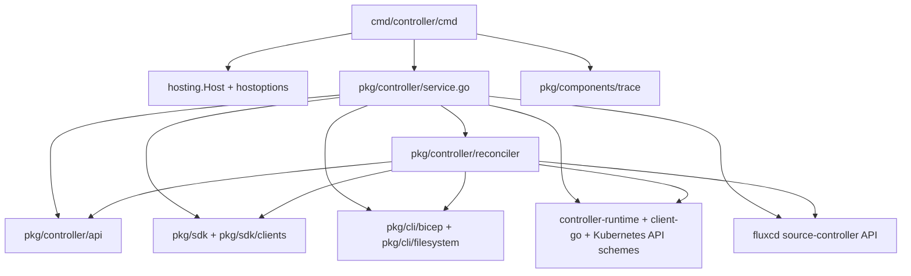
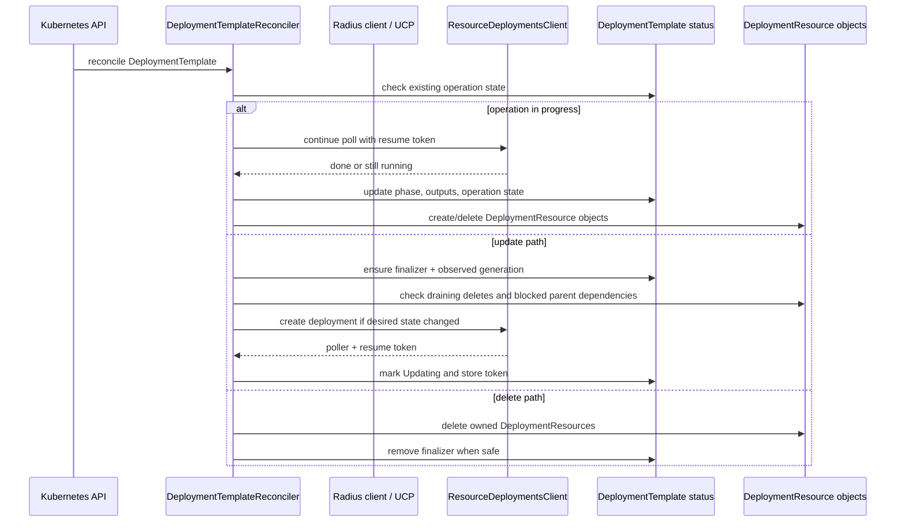

# Controller Architecture

The `controller` binary runs the Kubernetes controller-manager-based workflows
for Radius. It watches cluster resources, reconciles them, and drives Radius
APIs where Kubernetes-native automation is required.

The controller owns Kubernetes reconciliation for template deployment and Flux GitOps. It is not the primary home of resource-type authoring or UCP routing logic.

## Entry Points

- Binary entry: [cmd/controller/main.go](../../cmd/controller/main.go)
- Cobra root: [cmd/controller/cmd/root.go](../../cmd/controller/cmd/root.go)
- Main service: [pkg/controller/service.go](../../pkg/controller/service.go)
- Reconcilers: [pkg/controller/reconciler](../../pkg/controller/reconciler)
- API types: [pkg/controller/api](../../pkg/controller/api)

## Quick Reference

| Topic            | Start Here                   |
|------------------|------------------------------|
| Startup          | `cmd/controller/cmd/root.go` |
| Manager setup    | `pkg/controller/service.go`  |
| Reconciler logic | `pkg/controller/reconciler`  |
| CRD types        | `pkg/controller/api`         |

| Test Focus         | Packages                          |
|--------------------|-----------------------------------|
| Reconcile behavior | `./pkg/controller/reconciler/...` |
| Broad safety check | `./pkg/controller/...`            |

## Core Packages

| Package                     | Responsibility                                                 |
|-----------------------------|----------------------------------------------------------------|
| `pkg/controller/service.go` | controller manager bootstrap                                   |
| `pkg/controller/reconciler` | deployment template, deployment resource, and Flux reconcilers |
| `pkg/controller/api`        | CRD-backed Kubernetes API types                                |
| `pkg/sdk`                   | clients used to call back into Radius APIs                     |

## How It Works

The root command builds shared host options, creates the logger, and starts a
single `controller.Service` through shared hosting.

Inside [pkg/controller/service.go](../../pkg/controller/service.go), the service creates a controller-runtime manager, registers API schemes, configures metrics and health probes, then registers `DeploymentTemplateReconciler` and `DeploymentResourceReconciler`. `FluxController` is registered only when `controller.flux.enabled` is true and explicit source identities are selected. The shared operation types in [operation_types.go](../../pkg/controller/api/radapp.io/v1alpha3/operation_types.go) preserve asynchronous operation tracking for both deployment CRDs.

[FluxSourcePolicy](../../pkg/controller/reconciler/flux_source_policy.go) copies startup settings and uses the uncached API reader to check source identity and current-generation readiness. Flux preflights all resolved targets before compilation or target mutation, stores namespace/name/UID/generation and artifact attribution in `spec.sourceRef`, and uses complete source identity plus target namespace/name for update and pruning. `spec.repository` alone is legacy attribution, not a source-selection decision.

Preflight holds a same-template namespace move that retains its old deployment scope until the previous target and its cleanup are gone. When a current-generation source removes a target, pruning starts deletion before refreshing that target's source attribution. This permits current-generation cleanup without authorizing the obsolete content for a new deployment.

Both deployment reconcilers apply the same policy before new effects, including output-resource creation/deletion after a poll completes and resource cleanup. A source hold retains finalizers and operation state, reports `Held`, and requeues at a bounded interval. Polling previously accepted work does not cancel it; follow-on effects wait for a valid source. The submitted spec hash is kept separately while an operation runs so that its completion cannot mark a newer desired spec as executed. Source attribution is checked separately from that hash, so an attribution-only change does not redeploy unchanged content.

The template reconciler checks live output cleanup before submitting a new deployment. Independently draining or submitted deletes block newer deployments. A parent waiting on live same-owner children permits changed desired content, because its dependencies may need that update before cleanup can progress. Both reconcilers use uncached dependency reads. If a completed deployment restores such a parent before backend deletion starts, a resource-version-guarded update retires only its terminating tracker; reconciliation recreates the tracker without deleting the parent or retained children. A concurrent deletion-start status update prevents that retirement.

Other terminating desired outputs keep the template `ReadyPendingCleanup`, invalidate its settled hash when necessary, and require reapplication after deletion finishes. Completion ensures every output has a live same-owner tracker, including outputs recorded before cleanup. A resource without the controller's cleanup finalizer cannot submit another backend delete.

If the owning template enters deletion during output tracking, completion recovers missing trackers for cleanup before clearing the saved operation. It no longer retires trackers for restoration or waits on update-only cleanup dependencies. Owner deletion lists owned resources through the uncached reader and removes the template finalizer only after that inventory is empty. Recovery failures and source holds retain the operation until cleanup tracking is established.

Direct templates with no source attribution retain the installation-trusted Kubernetes-writer workflow. Operators must protect writes to source inputs and deployment CRDs; this policy is not a tenant execution sandbox. The [chart guide](../../deploy/Chart/README.md#flux-source-selection) documents the opt-in, non-overlapping restart, legacy association, and recovery contract.

Some reconcilers call back into Radius APIs using SDK clients configured with
the current UCP connection. That is the main architectural bridge between the
controller and the rest of the control plane.

## Invariants And Constraints

- Reconciler logic should stay idempotent.
- Cluster watch logic should stay in reconcilers, not in provider HTTP layers.
- Radius API calls from reconcilers should use the configured UCP connection.
- Manager registration is the single place to confirm which controllers are part
  of the binary.

## Change This Safely

### Packages That Usually Move Together

- `pkg/controller/service.go` and `pkg/controller/reconciler` when adding or
  removing controllers
- `pkg/controller/api` and reconcilers when CRD shape or status handling changes
- SDK client usage and reconciler tests when Radius API calls change

### Suggested Test Scope

- `go test ./pkg/controller/...`
- Pay particular attention to deployment template, deployment resource, and Flux tests in `pkg/controller/reconciler/...`.

## Package Dependency View

The important static seam is `root -> service -> manager/reconcilers`. The
service package owns manager assembly and registration, while the reconciler
packages own the real cluster automation logic.

## Representative Flow

The representative controller flow is the `DeploymentTemplateReconciler` state
machine. It shows the controller's real role in the system: reconcile cluster
state, use Radius deployment APIs as the backend executor, and project outputs
back into Kubernetes resources.

## Related Docs

- [service-interaction-map.md](service-interaction-map.md)
- [rad-cli.md](rad-cli.md)
