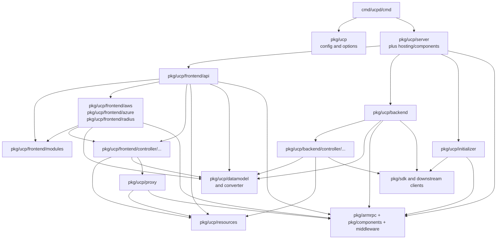
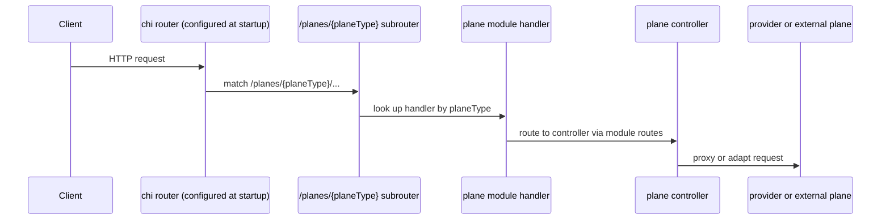

# UCP Architecture

UCP is the control-plane routing hub for Radius. It accepts ARM-style requests,
identifies the target plane or provider, and either serves UCP behavior,
reverse-proxies the request, or adapts it to an external system.

UCP owns request routing, plane-aware addressing, parts of protocol
translation, and shared control-plane concerns such as API version handling. It
is not the place for resource-type authoring or Kubernetes reconciliation
logic.

## Entry Points

- Binary entry: [cmd/ucpd/main.go](../../cmd/ucpd/main.go)
- Cobra root: [cmd/ucpd/cmd/root.go](../../cmd/ucpd/cmd/root.go)
- Config loading: [pkg/ucp/config.go](../../pkg/ucp/config.go)
- Option construction: [pkg/ucp/options.go](../../pkg/ucp/options.go)
- Server bootstrap: [pkg/ucp/server/server.go](../../pkg/ucp/server/server.go)
- API server wiring: [pkg/ucp/frontend/api/server.go](../../pkg/ucp/frontend/api/server.go)

`cmd/ucpd/cmd/root.go` reads a service config file, constructs UCP options,
creates a logger, builds the server, and hands execution to shared hosting.

## Quick Reference

| Topic | Start Here |
|------|------------|
| Startup | `cmd/ucpd/cmd/root.go` |
| HTTP/API wiring | `pkg/ucp/frontend/api/server.go` |
| Top-level routes | `pkg/ucp/frontend/api/routes.go` |
| Proxy/adaptation | `pkg/ucp/frontend/controller`, `pkg/ucp/proxy` |
| Resource IDs | `pkg/ucp/resources` |

| Test Focus | Packages |
|-----------|----------|
| Unit and route tests | `./pkg/ucp/frontend/...`, `./pkg/ucp/proxy/...` |
| Integration coverage | `./pkg/ucp/integrationtests/...` |
| Broad safety check | `./pkg/ucp/...` |

## Core Packages

| Package | Responsibility |
|--------|----------------|
| `pkg/ucp/frontend` | HTTP handlers, route registration, API surface |
| `pkg/ucp/proxy` | request forwarding and proxy helpers |
| `pkg/ucp/aws` | AWS-specific adaptation logic |
| `pkg/ucp/resources` | UCP resource ID parsing and construction |
| `pkg/ucp/datamodel` | version-agnostic UCP storage model |
| `pkg/ucp/server` | service startup and hosting integration |
| `pkg/ucp/config` | runtime configuration types |

## How It Works

The UCP process starts in [cmd/ucpd/cmd/root.go](../../cmd/ucpd/cmd/root.go),
loads config, constructs runtime options, and builds a multi-service host via
[pkg/ucp/server/server.go](../../pkg/ucp/server/server.go).

At request time, the frontend under `pkg/ucp/frontend` decides whether the
request terminates in UCP or is forwarded downstream. The architectural hinge
is `pkg/ucp/resources`: most routing logic is only correct if plane, scope, and
provider segments are parsed consistently.

For UCP-native or ARM-like targets, forwarding can be relatively direct. For
non-ARM targets such as AWS, UCP also performs protocol adaptation rather than
simple proxying.

AWS POST `/:get` reads accept a top-level `name`, which is used as the primary identifier, or, without `name`, the schema's primary identifier or a complete set of `additionalIdentifiers` in the properties. [Read identifier resolution](../../pkg/ucp/frontend/controller/awsproxy/readidentifier.go) sends only the selected secondary identifier set as JSON to Cloud Control `GetResource` and uses the primary identifier returned by AWS for the Radius resource address. It does not construct ARNs or require list permissions for a successful direct read. Only an explicit `UnsupportedActionException` enables paginated `ListResources` fallback, reading candidates whose list properties are incomplete. This compatibility fallback needs list permissions in addition to read permissions and passes request properties as `ResourceModel` for types that require parent scope. No match returns 404; multiple matching resources return 409 and require the caller to supply the primary identifier. Access, validation, and not-found errors from the direct read do not trigger listing. Primary-identifier reads, creates, updates, and deletes do not use this fallback.

GET `.../<alias>` reads UCP's record of the alias, then reads AWS by the identifier in the record. It returns 404 when there is no record. Use POST `/:get` with `name` or named properties to read a resource Radius did not create. See [AWS resource records](../ucp/aws.md#resource-records-and-alias-ids).

### Internal mTLS endpoint

The Kubernetes APIService endpoint (Service port 443 to container port 9443,
using the `ucp-cert` certificate) remains separate from internal authorization. When
the authorization mode is `dryRun` or `enforce`, UCP also serves the same routes
on a separate internal port, 9444 (Service port name `internal`, config
`server.internalPort`), for traffic from other Radius components. That endpoint
uses `mtls.ListenAndServe` with the mounted `ucp-mtls` certificate, accepts any
Radius component identity, and reloads certificates without a restart. See
[Shared Runtime And ARM-RPC](shared-runtime-and-armrpc.md#internal-component-authorization-mtls).

The aggregation server also uses a polling TLS Source for its mounted `ucp-cert` certificate, key and CA bundle. New handshakes capture one coherent serving certificate without replacing the aggregation endpoint's separate client-authentication policy. Outside pinned proof mode, invalid updates retain the previous material only while its full verified chain remains valid; pinned proof mode invalidates the serving Source instead. This enables serving-certificate renewal; it does not migrate the legacy CA, update APIService trust, acknowledge aggregator adoption or complete coordinated CA rotation. The old backend must remain available until separately observed aggregation trust can verify the new serving identity.

The selected A10 implementation separates issuance from public trust ownership: cert-manager issues and renews certificates, while Radius updates its own public bundles. It does not configure cainjector for the Radius APIService or disable the shared injector. The [rotation store](../../pkg/cli/helm/certificate_rotation.go) persists public phase intent outside Helm ownership, reads the target before the journal, and conditionally updates the APIService with the target's observed resourceVersion. The [chart guard](../../deploy/Chart/templates/_aggregation-trust.tpl) preserves completed managed trust, rejects unfinished transactions and refuses detected injector ownership. Removing injection annotations alone is not a safe handover.

The [consumer observer](../../pkg/cli/helm/certificate_rotation_consumers.go) checks the identities and convergence of UCP, both resource providers, the controller and deployment engine. It requires immutable public trust, current process evidence from every owned pod, no unaccounted component-Secret consumer, and an unchanged second inventory. It refuses terminating pods and controller surge. This is not an aggregation-transport acknowledgment or proof about a force-deleted process. The [phase driver](../../pkg/cli/helm/certificate_rotation_runner.go) connects these barriers to explicit `publish`, `adopt`, `issue` and `retire` commands; issuance stops at `ready` until the operator explicitly requests retirement.

The [public generation publisher](../../pkg/cli/helm/certificate_rotation_trust.go) creates immutable, content-addressed ConfigMaps for explicitly selected component CAs. Retries reuse matching independently owned generations without replacing their contents. Publishing new-only trust does not mutate or delete the overlap generation still mounted by older pods. Publication alone neither changes pod templates nor establishes adoption; the legacy aggregation root must not be supplied as component trust.

The [aggregation migration](../../pkg/cli/helm/certificate_rotation_aggregation.go) retains old UCP backends while candidates mount the newly issued serving identity. It routes the Service to a candidate, sends an authenticated aggregated API request and checks the returned pod UID. Failed-probe restoration uses the exact observed Service version; completed routing cannot regress. This tests the configured Kubernetes endpoint, not every hidden HA API server. The [recovery path](../../pkg/cli/helm/certificate_rotation_recovery.go) records explicit new-only intent for expiry or compromise, can replace an interrupted target, and requires final consumer and aggregation evidence. It may interrupt availability and never silently falls back to retired trust. See [operator commands and recovery boundaries](../../deploy/Chart/README.md#radius-owned-public-trust).

The [scope model](../../pkg/cli/helm/certificate_rotation_scope.go) also supports version-two journals with an explicit `aggregationOnly` scope and separate UCP serving identity. Version-one journals retain their five-component meaning and resource names. The aggregation-only planner reads the UCP Deployment, Service and selected local signer without requiring component certificates. Its [serving inventory](../../pkg/cli/helm/certificate_rotation_aggregation_inventory.go) requires immutable trust, converged UCP ownership and current evidence from the actual aggregation TLS Source; [aggregation evidence](../../pkg/authz/mtls/aggregation_proof.go) has a distinct proof kind and accepts server-auth-only UCP certificates. It cannot replace component proof, and an empty component inventory never counts as adoption.

UCP startup can opt into this separate serving evidence with `UCP_AGGREGATION_STARTUP_PROOF_ENABLED=true`, `UCP_AGGREGATION_EXPECTED_TRUST_SHA256` and the downward-API `UCP_AGGREGATION_POD_UID`. It requires an existing fixed-port metrics listener, the configured Radius namespace and the actual aggregation TLS directory, but no component certificate or enabled authorization mode. The metrics listener exposes `/healthz/ucp-aggregation-tls` using the same Source installed on the aggregation listener. Application and internal component routes do not expose that proof endpoint. Only aggregation responses receive the pod-identity header; internal routes keep their separate TLS policy and do not inherit that header. The old component-proof-controlled aggregation header remains compatible until chart integration changes its settings.

These aggregation-only helpers are not yet a supported external-provider rotation path. The public driver still rejects that scope; chart configuration, issuer-policy integration, fresh aggregation bootstrap and provider-aware phase execution remain required. The [provider-transition snapshot adapter](../../pkg/cli/helm/certificate_rotation_provider_snapshot.go) pins completed journal/APIService identity, dedicated trust, live issuer and Certificate configuration, serving projection and resource UIDs while allowing ordinary same-identity leaf renewal. Legacy state without a journal is explicitly incomplete. This adapter does not provide readiness evidence or mutual exclusion. The separate [operation guard](../../pkg/cli/helm/certificate_rotation_operation.go) acquires the shared `radius-identity-operation` Lease without expiry takeover, checks its UID and resourceVersion before guarded work, and releases only that exact Lease version. While holding it, the CA-side guard rejects unfinished provider journals and requires the provider's full validator before accepting a completed journal. This preserves exclusion between phase invocations, not just concurrent calls. Neither CLI path is connected to this shared guard yet; both must use it before provider transitions are enabled.

The [candidate trust-fence tests](../../pkg/cli/helm/certificate_fence_candidate_test.go) and [queued injector regression](../../pkg/cli/helm/certificate_fence_candidate_apiserver_test.go) remain historical experiments, not production admission policy or prerequisites for the selected Radius-owned writer. The [native writer tests](../../pkg/cli/helm/certificate_rotation_apiserver_test.go) cover delayed writes, ambiguous responses, replay and consecutive transactions without an admission policy. The [workload Helm regression](../../pkg/cli/helm/certificate_rotation_chart_apiserver_test.go) checks shipping templates with client-side and forced server-side apply, while [driver tests](../../pkg/cli/helm/certificate_rotation_runner_test.go) model controller progress using real cryptography. These local tests do not replace acceptance with actual cert-manager, compatible Radius/engine images, kubelet projections or HA aggregation.

## Invariants And Constraints

- UCP should stay focused on routing, identity of targets, and translation.
- Resource-type authoring logic should remain in provider processes, primarily
  `dynamic-rp`.
- Resource ID parsing and plane resolution need to stay consistent across all
  entry points.
- Changes in proxy behavior often require checking call flows, headers, and API
  version handling together.

## Change This Safely

### Packages That Usually Move Together

- `pkg/ucp/frontend/api`, `pkg/ucp/frontend/controller`, and `pkg/ucp/proxy`
  when routing behavior changes
- `pkg/ucp/resources` and controller code when resource ID parsing or provider
  resolution changes
- `pkg/ucp/datamodel` and `pkg/ucp/api` when persisted shape or API version
  conversions change

### Suggested Test Scope

- `go test ./pkg/ucp/...`
- Pay particular attention to route, proxy, and integration-style tests under:
  `pkg/ucp/frontend/...`, `pkg/ucp/proxy/...`, and `pkg/ucp/integrationtests/...`

## Package Dependency View

The important static seam is `root -> host -> frontend/api module dispatch`
versus `backend worker` and `initializer`. UCP does not use the builder-driven
namespace model used by the generic provider; it dispatches through plane
modules and then drops into controller, proxy, and resource-ID logic.

## Representative Flow

The representative UCP flow is plane dispatch. The frontend API service builds a
module map, registers a catch-all route under `/planes/{planeType}`, then hands
the request to the selected module handler. After that handoff, the plane module
owns the rest of the path: direct UCP behavior, reverse proxying, or adaptation.

## Related Docs

- [service-interaction-map.md](service-interaction-map.md)
- [state-persistence.md](state-persistence.md)
- [../ucp/overview.md](../ucp/overview.md)
- [../ucp/call_flows.md](../ucp/call_flows.md)
- [../ucp/code_walkthrough.md](../ucp/code_walkthrough.md)