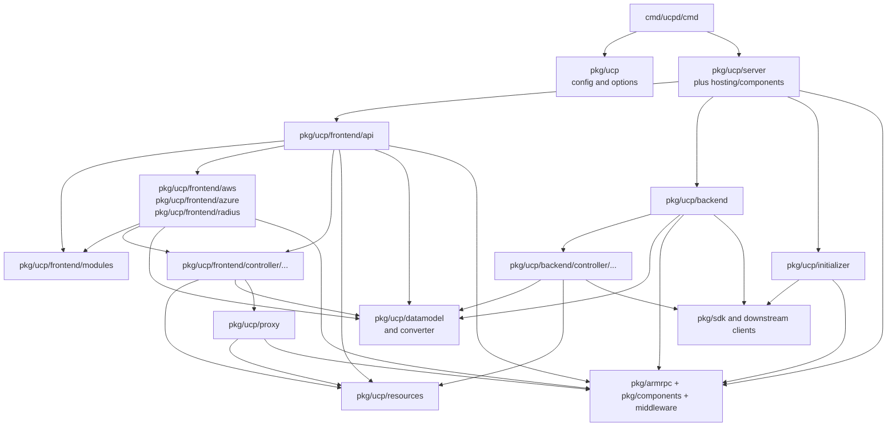
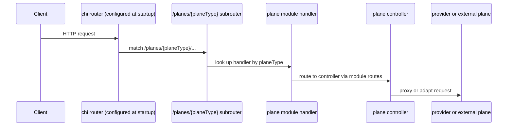

# UCP Architecture

UCP is the control-plane routing hub for Radius. It accepts ARM-style requests,
identifies the target plane or provider, and either serves UCP behavior,
reverse-proxies the request, or adapts it to an external system.

UCP owns request routing, plane-aware addressing, parts of protocol
translation, and shared control-plane concerns such as API version handling. It
is not the place for resource-type authoring or Kubernetes reconciliation
logic.

## Entry Points

- Binary entry: [cmd/ucpd/main.go](../../cmd/ucpd/main.go)
- Cobra root: [cmd/ucpd/cmd/root.go](../../cmd/ucpd/cmd/root.go)
- Config loading: [pkg/ucp/config.go](../../pkg/ucp/config.go)
- Option construction: [pkg/ucp/options.go](../../pkg/ucp/options.go)
- Server bootstrap: [pkg/ucp/server/server.go](../../pkg/ucp/server/server.go)
- API server wiring: [pkg/ucp/frontend/api/server.go](../../pkg/ucp/frontend/api/server.go)

`cmd/ucpd/cmd/root.go` reads a service config file, constructs UCP options,
creates a logger, builds the server, and hands execution to shared hosting.

## Quick Reference

| Topic            | Start Here                                     |
|------------------|------------------------------------------------|
| Startup          | `cmd/ucpd/cmd/root.go`                         |
| HTTP/API wiring  | `pkg/ucp/frontend/api/server.go`               |
| Top-level routes | `pkg/ucp/frontend/api/routes.go`               |
| Proxy/adaptation | `pkg/ucp/frontend/controller`, `pkg/ucp/proxy` |
| Resource IDs     | `pkg/ucp/resources`                            |

| Test Focus           | Packages                                        |
|----------------------|-------------------------------------------------|
| Unit and route tests | `./pkg/ucp/frontend/...`, `./pkg/ucp/proxy/...` |
| Integration coverage | `./pkg/ucp/integrationtests/...`                |
| Broad safety check   | `./pkg/ucp/...`                                 |

## Core Packages

| Package             | Responsibility                                 |
|---------------------|------------------------------------------------|
| `pkg/ucp/frontend`  | HTTP handlers, route registration, API surface |
| `pkg/ucp/proxy`     | request forwarding and proxy helpers           |
| `pkg/ucp/aws`       | AWS-specific adaptation logic                  |
| `pkg/ucp/resources` | UCP resource ID parsing and construction       |
| `pkg/ucp/datamodel` | version-agnostic UCP storage model             |
| `pkg/ucp/server`    | service startup and hosting integration        |
| `pkg/ucp/config`    | runtime configuration types                    |

## How It Works

The UCP process starts in [cmd/ucpd/cmd/root.go](../../cmd/ucpd/cmd/root.go),
loads config, constructs runtime options, and builds a multi-service host via
[pkg/ucp/server/server.go](../../pkg/ucp/server/server.go).

At request time, the frontend under `pkg/ucp/frontend` decides whether the
request terminates in UCP or is forwarded downstream. The architectural hinge
is `pkg/ucp/resources`: most routing logic is only correct if plane, scope, and
provider segments are parsed consistently.

For UCP-native or ARM-like targets, forwarding can be relatively direct. For
non-ARM targets such as AWS, UCP also performs protocol adaptation rather than
simple proxying.

AWS POST `/:get` reads accept a top-level `name`, which is used as the primary identifier, or, without `name`, the schema's primary identifier or a complete set of `additionalIdentifiers` in the properties. [Read identifier resolution](../../pkg/ucp/frontend/controller/awsproxy/readidentifier.go) sends only the selected secondary identifier set as JSON to Cloud Control `GetResource` and uses the primary identifier returned by AWS for the Radius resource address. It does not construct ARNs or require list permissions for a successful direct read. Only an explicit `UnsupportedActionException` enables paginated `ListResources` fallback, reading candidates whose list properties are incomplete. This compatibility fallback needs list permissions in addition to read permissions and passes request properties as `ResourceModel` for types that require parent scope. No match returns 404; multiple matching resources return 409 and require the caller to supply the primary identifier. Access, validation, and not-found errors from the direct read do not trigger listing. Primary-identifier reads, creates, updates, and deletes do not use this fallback.

GET `.../<alias>` reads UCP's record of the alias, then reads AWS by the identifier in the record. It returns 404 when there is no record. Use POST `/:get` with `name` or named properties to read a resource Radius did not create. See [AWS resource records](../ucp/aws.md#resource-records-and-alias-ids).

UCP calls AWS through Cloud Control, except for types a native handler in `pkg/ucp/aws/native` serves: types with no CloudFormation type, and types Cloud Control can't create in the request's region. Both use the same record and worker. See [Native handlers](../ucp/aws.md#native-handlers).

### Internal mTLS endpoint

The Kubernetes APIService endpoint (Service port 443 to container port 9443,
using the `ucp-cert` certificate) is unchanged by internal authorization. When
the authorization mode is `dryRun` or `enforce`, UCP also serves the same routes
on a separate internal port, 9444 (Service port name `internal`, config
`server.internalPort`), for traffic from other Radius components. That endpoint
uses `mtls.ListenAndServe` with the mounted `ucp-mtls` certificate, accepts any
Radius component identity, and reloads certificates without a restart. See
[Shared Runtime And ARM-RPC](shared-runtime-and-armrpc.md#internal-component-authorization-mtls).

### User Authorization Policy Lifecycle

`userAuthorization.enabled: true` in the UCP YAML configuration opts into the policy runtime and request-target observations; omission or `false` leaves `Options.UserAuthorization` nil. This switch is separate from internal component `authorization.mode` and does not enable workload enforcement or change caller-authentication requirements. Reserved policy mutations are rejected independently of this switch.

[NewOptions](../../pkg/ucp/options.go) constructs the existing `PolicyStore` and `PolicyCache` through [PolicyRuntime](../../pkg/ucp/authorization/runtime.go), using the configured `database.Client` (Postgres or API server store in production). The UCP host owns one blocking `PolicyRuntime.Run` call. Startup immediately loads policy and recovers pending intent through the existing store; each generation check has a five-second deadline, and checks repeat every five seconds. Cancellation stops in-flight reads and the refresh loop; the host joins the loop on shutdown. Local callers own their calls to `Refresh` or `Mutate`, which are also cancelled when the runtime stops.

The policy anchor must already have been initialized through `PolicyInitializer` with a trusted initialization verifier. This layer supplies neither bootstrap principals nor a production initializer or initialization endpoint. A missing anchor, corrupt policy, or failed startup recovery leaves the runtime `Unavailable`, logs the refresh error, and retries; it never creates an anchor, substitutes empty policy, or assumes `Disabled`. Construction errors fail startup. The default UCP wiring uses the release permission catalog, without dynamic registration extensions: persisted unregistered permissions remain inert while known permissions still work; new or updated role definitions must contain only known permissions. The runtime supplies no settings-change guard, so settings changes remain unavailable rather than bypassing rollout prerequisites. Existing trusted bootstrap assignments can support additive changes and explicit same-tuple imperative promotion through the store's safety checks; the runtime does not create them.

`Options.UserAuthorization.State()` is safe even on a nil runtime and returns typed `NotConfigured`, `Unavailable`, or `Fresh` status. `LastKnownMode` is distinct from availability: it is empty until a successful load and is diagnostic, potentially stale information while unavailable. `LastError` exposes the most recent refresh failure and clears after recovery. A failed check never renews freshness. At exactly thirty seconds since the start of the last successful check, `Ready` fails and `Evaluate` returns `ErrAuthorizationUnavailable` without decisions. Cancellation also makes the runtime unavailable immediately, even for a young cache.

`Mutate` requires fresh policy independently of workload mode, delegates access and safety checks to the existing store, and immediately checks the committed generation after successful or idempotent writes. A post-commit refresh failure returns `ErrAuthorizationUnavailable` with explicit committed-change context, not success; callers must inspect policy/history before retrying. No HTTP policy-write path is added here. Future handlers must derive identity and actor metadata from trusted server context, protect writes in every mode, and translate authorization unavailability to HTTP 503 rather than using a snapshot directly.

**Readiness scope differs from the design's global readiness proposal:** `Ready` describes authorization readiness only; it does not withdraw the pod from discovery or change the Helm readiness probe. Global withdrawal would also block ordinary `DryRun` workloads, contradicting their nonblocking error behavior. The request layer must choose ordinary workload error behavior explicitly while keeping policy writes protected and evaluator data unavailable; stale policy must never become an allowing decision.

### User Authorization Request Observations

[ObserveRequests](../../pkg/ucp/authorization/requests.go) runs after verified caller authentication and before ARM context construction, module routing, and cloud/Radius proxies. It removes the configured path base for mapping, without modifying request bodies, headers, query strings, or downstream responses. The release catalog maps the HTTP method and target to permission checks. `PolicyRuntime.EvaluateRequest` reads mode, generation, mapping, and target decisions from one fresh snapshot; unavailable policy returns neither a current mode nor decisions.

Fresh `Disabled` skips workload checks. Fresh `DryRun` logs each target check as `allow` or `wouldDeny`, with `coverage: targetOnly`, permission, target, policy generation, and verified principal when present. These are target-check observations, not complete request authorization grants. Unknown types/actions, unidentified callers, mixed-resource lists, operation polling that needs original request context, and denied parent-list checks requiring per-item filtering produce `indeterminate`, not invented allow/deny decisions. Bodies, query strings, credentials, granting assignment IDs, and role IDs are excluded from these events. Observation and protected-rejection logs run before resource-ID logger enrichment; protected policy targets are redacted even for read decisions, while downstream handlers retain their ordinary resource-ID logging. Discovery has no resource-content check.

**Unavailable configured policy is explicitly observation-only:** startup failure, missing initialization, stale data at the thirty-second boundary, and runtime cancellation log `AuthorizationUnavailable` and continue ordinary requests. The current mode is unknown, not `Disabled`; `LastKnownMode` is never used to decide. This preserves ordinary `DryRun` availability but is not an enforcement guarantee if a previously loaded mode was `Enforce`. Full enforcement rollout is unsupported: a fresh `Enforce` policy returns HTTP 503 `AuthorizationUnavailable` for workload requests instead of claiming partial enforcement. Discovery remains available.

**No public policy writer is installed.** Mutating methods targeting `Radius.Core/roleDefinitions`, `roleAssignments`, `authorizationSettings`, `accessChanges`, or the private `System.Authorization` namespace are rejected before generic/proxy dispatch in every mode, even when the runtime is absent or unavailable. Missing verified identity returns HTTP 401 `InvalidAuthenticationInfo`; verified callers, including administrators, receive HTTP 503 `AuthorizationUnavailable` because the safe writer is not available. Unknown actions, extension scopes, and encoded namespace spelling cannot bypass this guard. This intentionally keeps management unavailable rather than exposing generic writes to the policy store. In particular there is no settings bootstrap implementation: a future writer must require the specific Kubernetes SubjectAccessReview `update` on `authorizationsettings/default` in `api.ucp.dev` in `Disabled`/`DryRun`, plus the existing store safety checks; broad provider access is not a substitute.

The protected-target guard checks successive URL parses, matching the Azure proxy's interpretation of encoded separators and query/fragment delimiters rather than only unescaping percent sequences. It rejects protected targets at each step and fails closed if the target still changes after eight passes. A parse error ends inspection: an ordinary resource name containing a literal percent is not itself a policy mutation, and routing retains responsibility for rejecting invalid requests. The guard does not rewrite the forwarded URL.

Ordinary deployments and their payloads continue unchanged. This layer does not implement deployment delegation, template preflight, reference extraction, PATCH effective-state checks, or response filtering, and does not scan templates or promise atomic rejection of mixed workload/policy deployments before workload side effects. Any attempted policy mutation that returns through UCP, including a deployment's subrequest, hits the same protected guard; there is no public writer or mutable generic resource record that commits policy. Direct access to a downstream component or database remains outside this user-facing boundary and requires the separate internal component authorization boundary.

### User Authorization Inspection

[Inspection](../../pkg/ucp/authorization/inspection_http.go) serves `GET /providers/Radius.Core/whoAmI` and `POST {scope}/providers/Radius.Core/checkAccess` with API version `2025-08-01-preview`, before generic resource/proxy routing. These operations require verified caller identity in every workload mode, including `Disabled`. Missing identity returns HTTP 401; absent, stale, starting, or stopped policy returns HTTP 503 `AuthorizationUnavailable`, never a fabricated `Disabled` response. The observer defers only these inspection operations to their explicit handlers, so they also work with fresh `Enforce` policy without enabling workload enforcement. The protected policy-mutation boundary remains unchanged.

`WhoAmI` returns the stable principal, verified groups, issuer, mode, and whether an installation-wide built-in Radius Administrator assignment matches the caller or their groups. Its optional `warnings` field comes from the same fresh policy: disabled/observation-only/unsupported enforcement, bootstrap-only administrators, and unavailable recovery-grant management. Warnings disclose no assignments or other principals. This slice does not create recovery grants or provide recovery management.

`CheckAccess` evaluates every requested permission and concrete target, preserving request order and returning one generation and mode for the complete batch. Both the authorization to inspect someone else and all returned results use the same immutable snapshot, captured under short read locks; evaluation never holds refresh locks. Before publishing any result, inspection rechecks the captured snapshot's freshness and runtime cancellation, not a newer cache timestamp. Decisions reflect real grants even in `Disabled` and `DryRun`. The scope must be a supported assignment scope, and every target must be within it. Invalid scopes, unknown permissions, malformed or oversized JSON, empty batches, and caller-supplied group memberships fail explicitly. Granting role and assignment identifiers are not returned.

Access-check input is limited to 100 checks per request, 256 characters per principal issuer or permission, 512 per principal subject, 128 per display name, and 2048 per scope or target including its leading slash (2047 for the URL's scope parameter without that slash). Lengths count Unicode characters, matching the TypeSpec/OpenAPI constraints. Principal type is a closed enum (`user`, `group`, `workload`). The 128-character display-label bound follows the authorization resource-name convention; the larger subject bound accommodates Kubernetes service-account identities with a 63-character namespace and a 253-character account name. Issuer and permission bounds leave room for trust domains and catalog names; path bounds accommodate hierarchical IDs without permitting unbounded parsing. Batches and fields are validated before policy access in both the HTTP handler and runtime; violations return HTTP 400 `InvalidRequestContent` with the field and limit, including through the CLI. The 1 MiB JSON body cap remains a separate bound. Split larger batches into separate requests; each response has its own generation, not a cross-request consistency guarantee.

Omitting `principal`, or supplying the exact verified principal tuple, checks the caller with their current verified groups. A different principal first requires `Radius.Core/checkAccess/action` at the inspection scope in every mode; denial is HTTP 403. Another group can be evaluated against its own assignments without enumerating members. Another user or workload returns HTTP 503 `AuthorizationIndeterminate`: the forwarded request cannot establish that other identity's memberships, and dropping unknown groups would produce misleading denials. There is no directory resolver or impersonation delegation in this slice.

The read-only [`rad auth` commands](../../pkg/cli/cmd/auth/auth.go) use the current workspace's normal Kubernetes connection and generated authorization clients. All support `--workspace` and `--output json|table`:

```bash
rad auth whoami --output json
rad auth status
rad auth access check --action Radius.Core/applications/read
rad auth access check --scope / --action Radius.Core/applications/read --target /planes/radius/local --action Radius.Core/applications/write --target /planes/radius/local
rad auth access check --scope / --principal group:developers --action Radius.Core/applications/read
```

`access check` defaults scope and target to the workspace resource group. Repeat `--action` for a batch; either omit all `--target` flags or supply one per action in the same order. `--principal` takes `user:<subject>`, `group:<subject>`, or `workload:<subject>`; `--issuer` defaults to the current caller's verified issuer. A denied policy check is a successful inspection with `allowed: false`, not a command failure or a workload-enforcement decision. Transport, authentication, authorization, unavailable-policy, and indeterminate-membership errors are command failures with no success-shaped output.

#### Kubernetes access to inspection

The chart creates the unbound `ucp-inspection` ClusterRole for ordinary users of the aggregated API. It grants only `get` on `providers/whoAmI` (used by both `whoami` and `status`) and `create` on `providers/checkAccess`, with resource name `Radius.Core` in API group `api.ucp.dev`. Kubernetes classifies the read-only access-check POST as `create`, like its own access-review APIs; this does not grant policy or workload writes. The chart adds no binding, no `system:authenticated` grant, and no aggregation into Kubernetes' `view` role. A cluster administrator can opt in an existing Kubernetes user explicitly:

```bash
kubectl --context <cluster-context> create clusterrolebinding radius-inspection-alice \
  --clusterrole=ucp-inspection --user=alice
rad auth whoami --output json
rad auth status --output json
rad auth access check --scope / --action Radius.Core/applications/read \
  --target /planes/radius/local/resourceGroups/team-a
```

Replace `<cluster-context>` with the intended cluster; use the matching Radius workspace for the `rad` commands. `--scope /` selects the installation endpoint covered by this role, while `--target` can still select a concrete resource group or descendant. The default workspace-scoped POST is **not** covered: Kubernetes interprets that URL as `create` on `planes/local` named `radius`, which cannot be restricted to the inspection suffix and would grant unrelated plane writes. Such a caller receives Kubernetes HTTP 403 before reaching UCP. Other provider names/subresources and all plane mutations remain forbidden by `ucp-inspection`; an unbound ordinary user receives Kubernetes 403 even for inspection.

This Kubernetes role only permits transport to UCP. It does not configure trusted caller authentication, initialize user policy, assign Radius grants, or bypass the Radius permission required to inspect another principal. Those prerequisites remain separate; successful transport can still return the documented UCP 401/403/503 errors.

## Invariants And Constraints

- UCP should stay focused on routing, identity of targets, and translation.
- Resource-type authoring logic should remain in provider processes, primarily
  `dynamic-rp`.
- Resource ID parsing and plane resolution need to stay consistent across all
  entry points.
- Changes in proxy behavior often require checking call flows, headers, and API
  version handling together.

## Change This Safely

### Packages That Usually Move Together

- `pkg/ucp/frontend/api`, `pkg/ucp/frontend/controller`, and `pkg/ucp/proxy`
  when routing behavior changes
- `pkg/ucp/resources` and controller code when resource ID parsing or provider
  resolution changes
- `pkg/ucp/datamodel` and `pkg/ucp/api` when persisted shape or API version
  conversions change

### Suggested Test Scope

- Deterministic lifecycle and host-wiring checks: `go test -race ./pkg/ucp/authorization ./pkg/ucp ./pkg/ucp/server -short -count=1`. Lifecycle tests use `testing/synctest`, including startup failure/recovery, five-second polling, the exact thirty-second boundary, local refresh, and cancellation.
- `go test ./pkg/ucp/...`
- Pay particular attention to route, proxy, and integration-style tests under:
  `pkg/ucp/frontend/...`, `pkg/ucp/proxy/...`, and `pkg/ucp/integrationtests/...`

## Package Dependency View



The important static seam is `root -> host -> frontend/api module dispatch`
versus `backend worker` and `initializer`. UCP does not use the builder-driven
namespace model used by the generic provider; it dispatches through plane
modules and then drops into controller, proxy, and resource-ID logic.

## Representative Flow



The representative UCP flow is plane dispatch. The frontend API service builds a
module map, registers a catch-all route under `/planes/{planeType}`, then hands
the request to the selected module handler. After that handoff, the plane module
owns the rest of the path: direct UCP behavior, reverse proxying, or adaptation.

## Related Docs

- [service-interaction-map.md](service-interaction-map.md)
- [state-persistence.md](state-persistence.md)
- [../ucp/overview.md](../ucp/overview.md)
- [../ucp/call_flows.md](../ucp/call_flows.md)
- [../ucp/code_walkthrough.md](../ucp/code_walkthrough.md)
