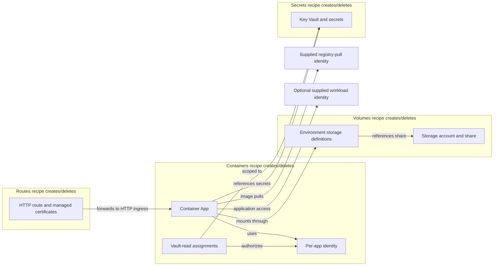
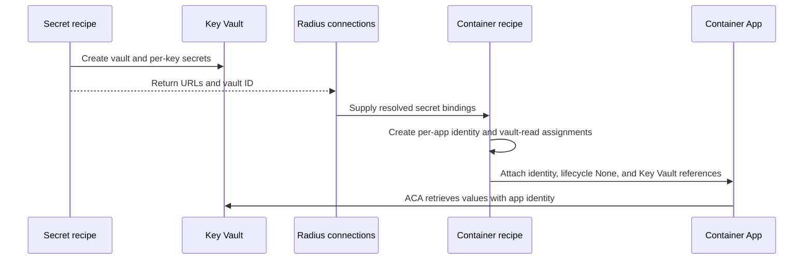

# Azure Container Apps recipe pack

Implement the ACA requirements in the [ACA specification](https://github.com/radius-project/radius/blob/7caf262e82d0eca944be4c0427b590e8764b713c/eng/design-notes/extensibility/2026-10-ecs-aca-core-resource-mappings.md) using four Bicep recipes in `radius-project/resource-types-contrib`. An exception is the implementation of TCP networking which would be through container `platformOptions`, not a separate Radius TCP route.

## Resource mapping and ownership

The platform engineer supplies an [ACA managed environment](https://learn.microsoft.com/en-us/cli/azure/containerapp/env#az-containerapp-env-create), workload profile, Azure deployment credentials, and per-type environment `recipeParameters`. The reusable `azure-aca` pack includes all four recipes; pack registration does not create Azure infrastructure or configure the Radius environment.

| Radius type                        | Recipe creates and owns                                                                                    |
|------------------------------------|------------------------------------------------------------------------------------------------------------|
| `Radius.Compute/containers`        | One Container App, a user-assigned identity for that app, and vault-read grants for its connected secrets. |
| `Radius.Compute/routes`            | An environment HTTP route configuration and managed certificates for exact hostnames.                      |
| `Radius.Compute/persistentVolumes` | Azure Files storage account/share and read-only/read-write environment storage definitions.                |
| `Radius.Security/secrets`          | A Key Vault and its per-data-key secrets, reusing existing Azure secret provisioning where compatible.     |

In Figure 1, groups identify resources created by each recipe. Arrows are references, not ownership.



**Figure 1: Resource ownership and identity boundaries**

Radius performs resource deletion from recipe inventories; no recipe-specific delete handler is required. Inventories must exclude the supplied environment, identities, and certificates.

## Container translation

One Radius `containers` resource becomes one ACA app, not one app per individual container. Its normal containers share networking, storage, replicas, and revision lifecycle; `initContainer: true` entries become init containers. Independent scaling or HTTP destinations require separate Radius resources.

Use a stable Azure name derived from scope and full Radius/application/environment IDs. Accept `acaEnvironment` and `workloadProfileName` as operator parameters, resolve the environment's actual location, and use single-revision mode. Default to internal HTTP ingress on the first non-UDP port in sorted container/port order. If no eligible port exists, omit ingress and return an empty `hosts`. Additional HTTP ports and UDP do not create endpoints; TCP exposure is an explicit native override below. Return `containerAppName`, selected ingress metadata, and `hosts[containerName]` only for reachable containers.

| Radius properties                                     | ACA mapping                                                                                                                                                                                                                                                                                                                                                                                                                                                                  |
|-------------------------------------------------------|------------------------------------------------------------------------------------------------------------------------------------------------------------------------------------------------------------------------------------------------------------------------------------------------------------------------------------------------------------------------------------------------------------------------------------------------------------------------------|
| `image`, `command`, `args`, `initContainer`           | Native normal/init container fields. Private images use explicit registry authentication.                                                                                                                                                                                                                                                                                                                                                                                    |
| `env.*.value`, `connections`, `disableDefaultEnvVars` | Literal values and generated `CONNECTION_<CONNECTION>_<PROPERTY>` variables for normal/init containers. Explicit entries override generated entries; disabled connections inject neither ordinary nor secret values. Detect generated-name collisions.                                                                                                                                                                                                                       |
| `env.*.valueFrom.secretKeyRef`                        | Select the connected Radius secret and key; create an app secret with Key Vault URL/identity and use `env[].secretRef`. Never substitute plaintext or silently drop a missing key.                                                                                                                                                                                                                                                                                           |
| `resources.requests.cpu`, `memoryInMib`               | Parse vCPUs and MiB; emit numeric CPU and ACA memory units. Default an omitted request to 0.25 vCPU/512 MiB per container. Round up to the smallest legal allocation meeting both requests for the selected profile, never down. Check aggregate regular/init allocation rules against the profile; impossible requests fail as invalid native configuration.                                                                                                                |
| Liveness/readiness `httpGet`, `tcpSocket`             | Emit `probes[]` with the corresponding type, schema `port`, path, HTTP/HTTPS scheme and valid named headers. Map delay, period, timeout, failure/success thresholds where the ACA API supports them. Document native bounds and ignored subfields, including probe-specific termination grace when unavailable. Declare header `name` in the shared schema if absent, preserving existing clients; a supplied header still needs a real name to form a valid native request. |
| `replicas`, `autoScaling`                             | Fixed count without usable scaling rules; otherwise the minimum/maximum and rules defined below.                                                                                                                                                                                                                                                                                                                                                                             |
| `volumes`, `volumeMounts`                             | Resolve named mounts to `AzureFile`, `Secret`, or disk `EmptyDir`; preserve mount paths. Azure Files references use the connected volume's storage definition.                                                                                                                                                                                                                                                                                                               |
| `extensions.daprSidecar`                              | Native Dapr enabled/app ID/app port. Resolve a named `config` through an operator map to supported ACA Dapr settings/components; do not claim an arbitrary Kubernetes Dapr Configuration resource works on ACA.                                                                                                                                                                                                                                                              |
| `platformOptions`                                     | Operator-enabled native property overrides with protected ownership and identity fields.                                                                                                                                                                                                                                                                                                                                                                                     |

Ignore and document `workingDir`, separate CPU/memory `limits`, exec probes, `restartPolicy`, UDP, additional HTTP ingress, and memory-backed `emptyDir`. Omit mounts to unsupported memory volumes as well as their declarations. These inputs must not fail deployment. Missing supported dependencies, invalid credentials, impossible allocations, and Azure errors still fail explicitly; a feature not yet implemented is not automatically an unsupported feature.

### Scaling

Without autoscaling, set min/max to `replicas` (default 1). With rules, `replicas` is the floor and `autoScaling.maxReplicas` the ceiling (default 10, never below the floor). CPU or memory rules require a floor of at least 1; only custom rules can use a floor of 0.

Map CPU/memory `averageUtilization` to KEDA utilization percentages. Map `averageValue` to native average quantity thresholds with explicit CPU/memory unit conversion. `customMetric` names an operator-supplied scaler entry containing type, metadata, target metadata key/units, declared target meaning, and secret-reference or managed-identity authentication. `averageValue` requires per-replica semantics; `value` requires absolute semantics. Missing scaler configuration fails explicitly.

**Native API constraint:** ACA `CustomScaleRule` exposes only `type`, `metadata`, `auth`, and `identity`; it does not expose KEDA's `metricType` selector. The operator's declared target mode is a compatibility check, not a field to send to Azure. Each supported mode needs documented scaler-specific mapping and behavioral verification. Do not map both targets to the same threshold and claim equivalence. If the native scaler cannot express a mode promised by the merged spec, record a conformance blocker for a spec/design decision; rejecting that input is not evidence that support is complete.

## Identity and environment prerequisites

The deployment identity acts for Radius; app identities act for the workload or ACA secret/image retrieval. None is inherited from the managed environment.

| Purpose                      | Identity and permission ownership                                                                                                                                                                                                                                                                                                       |
|------------------------------|-----------------------------------------------------------------------------------------------------------------------------------------------------------------------------------------------------------------------------------------------------------------------------------------------------------------------------------------|
| Deploy resources             | Operator registers a Radius credential scoped to the target resources/environment and permitted identity attachments. Creating per-app vault-read assignments also needs explicit, narrowly scoped authorization; Contributor alone is insufficient. Do not give this credential to workloads.                                          |
| Retrieve connected secrets   | Container recipe creates a dedicated user-assigned identity per ACA app and deterministic **Key Vault Secrets User** assignments on its connected vaults. The secret recipe returns vault references, not a shared secret-owned identity. Poll successful provisioning and honor Azure RBAC propagation before declaring the app ready. |
| Application code calls Azure | By default the generated identity is retrieval-only. Operator may supply a distinct `workloadIdentityId` and its service-specific grants; attach it and set `AZURE_CLIENT_ID` to its client ID. Supplied grants/identities remain operator-owned. Sharing across apps is explicit, not implicit in a Radius application or environment. |
| Pull private images          | Operator supplies registry-to-identity mappings and grants pull access: `AcrPull` for standard ACR RBAC, equivalent repository reader for ABAC registries. Attach/configure that identity for image pulls, without granting access on operator-owned registries. Other registries use separately supplied secret-backed credentials.    |
| Authenticate scalers         | Use an explicitly selected identity or app-secret reference, with operator-authorized access to the metric source. Never reuse deployment credentials.                                                                                                                                                                                  |

Merge app/pull/workload identities by ID. Set `identitySettings[].lifecycle: None` for retrieval-only identities and `Main` for application code by default. Init access requires explicit operator configuration and a supporting environment. Availability controls separate init/main phases, not individual normal containers; containers in one app share that identity boundary. Identity-only changes do not automatically create a revision, so roll application code when its selected identity changes.

No environment-level identity is required by this pack; any infrastructure/logging identity is independent. Operator networking must permit registries, Key Vault, and Azure Files. ACR must accept ARM-audience tokens for managed-identity pulls. Init managed identity is available in Consumption workload-profile environments, not consumption-only or Dedicated profiles. Azure Files SMB mounts here use storage-account keys inside environment storage definitions, not workload identity. External TCP requires a VNet-enabled environment.

## Secrets, volumes, and identifier handoffs

Azure APIs need cloud identifiers, not Radius IDs. Recipes return them through existing `result.values`; connected recipes read `context.resource.connections.<name>.properties.status.computedValues`. Match references by full Radius ID, never by arbitrary connection name.

| Recipe output | Contract                                                                                                              |
|---------------|-----------------------------------------------------------------------------------------------------------------------|
| Containers    | `containerAppName`, `hosts`, and primary ingress transport/target port for destination checks.                        |
| Secrets       | `secretBindings[dataKey] = { keyVaultUrl, keyVaultId }`; URLs are versionless.                                        |
| Volumes       | `storageNames = { ReadOnlyMany, ReadWriteMany }`, plus share/account identity and quota metadata, never account keys. |
| HTTP routes   | Existing `listener = { hostname, port, protocol }` using the route FQDN and HTTPS/443.                                |

Container secret/volume consumers declare explicit connections. Add the same optional `connections` map to routes to resolve destination outputs; an ID in `destinationContainer` alone does not load them. Declared secret references work without special connection names. Resource-dependent secret outputs must ultimately resolve to their managed Radius secret and ready cloud bindings; use a bounded generic loader/readiness extension only if that required handoff cannot use existing connections, not ACA networking logic in Dynamic RP.

Figure 2 shows the per-app identity grant after the secret exists, without circulating secret payloads.



**Figure 2: Per-app secret access**

Each app is granted read access only to its connected vaults; reference metadata, not secret values, passes between recipes.

Store `generic`, `certificate-pem`, and `certificate-pkcs12` data as per-key Key Vault secrets, preserving the original key mapping while generating legal collision-resistant Azure names. Preserve the core data-key requirements; certificate kind does not imply importing an Azure certificate. Ordinary strings stay strings; decode `encoding: base64` once for text values. Binary PKCS#12 content stays base64-encoded in Key Vault because native secret values are strings; include the encoding in binding metadata and document that the application must decode it. Do not claim raw binary file parity for native secret mounts. Ignore workload use of `basicAuthentication`, `azureWorkloadIdentity`, and `awsIRSA`; recipe-registry authentication is a separate existing feature.

Versionless Key Vault environment references refresh within about 30 minutes and restart active consuming revisions. Direct app-secret changes require explicit restart/new revision. Configure secret volumes using the same app secrets and declared data keys. Never put payloads in ordinary environment values, computed outputs, logs or test reports.

The volume recipe reuses Azure Files provisioning and creates two uniquely named environment definitions over the share: read-only and read-write. Honor `sizeInGib` as quota and the single `allowedAccessModes` value; do not allow a read-only volume to gain write access through a mount override. Ignore `ReadWriteOnce` exclusivity, documenting shared storage rather than promising a single writer. Deleting the Radius volume deletes its owned share/data, account and definitions; supplied environment remains.

## HTTP routes and hostnames

Only the HTTP routes recipe writes `managedEnvironments/httpRouteConfigs`; it does not update the workload app. Resolve each destination's app name and confirm its selected HTTP target port. Preserve rule order; matches in one rule are alternatives. Use `prefix: '/'` for root and `pathSeparatedPrefix` for nonroot segment prefixes, so `/api` matches `/api/orders` but not `/apix`. Ignore header/method/query matching without forwarding those unsupported fields.

Without hostnames, return the default environment-domain route FQDN. For exact custom hostnames, first deploy the route/default FQDN, expose the required DNS validation records, and let the operator configure DNS. Once DNS validates, the route recipe creates a managed certificate and binds the hostname. Wildcards require an existing operator-supplied certificate ID; never inventory that certificate for deletion. Document DNS validation, managed-certificate reachability/renewal prerequisites and the two-phase deployment; certificate failures remain explicit errors. All hostname entries must be handled, not only the first.

Environment routes can expose internally addressed apps. Route-write access is therefore permission to expose workloads within the environment trust boundary; `external: false` alone does not establish isolation.

### Implementation decision: TCP ingress through `platformOptions`

Configure native TCP on the container resource, keeping the container recipe the sole writer of its Azure app. `platformOptions` overrides the app's `properties` object:

```bicep
platformOptions: {
  configuration: {
    ingress: {
      transport: 'tcp'
      targetPort: 6379
      exposedPort: 6379
      external: true
    }
  }
}
```

Operator `allowPlatformOptions` defaults true; when false, ignore overrides. Recursively merge objects and merge named container/volume arrays by name, retaining unrelated generated entries. Native traffic-split arrays remain native replacement values when explicitly supplied. Reapply protected environment/resource identity, identity availability, ownership and secret/storage bindings last. Validate overrides cannot remove or redirect protected references. Removing overrides restores generated configuration on the next container update. Externally exposed TCP ports must be unique and respect ACA reserved ports; external TCP requires a VNet-enabled environment.

| Alternative                                                    | Why it is not selected                                                                                                                                                                                                         |
|----------------------------------------------------------------|--------------------------------------------------------------------------------------------------------------------------------------------------------------------------------------------------------------------------------|
| Route recipe updates the same app                              | Initial deployment can work, but later container writes can replace ingress. Bicep redeclaration can add the app to route deletion inventory; the existing contract provides no independent configuration-ownership lifecycle. |
| Container recipe reads route declarations; route has no recipe | Current context does not discover incoming references, and route changes/deletion do not rerun the container.                                                                                                                  |
| New Dynamic RP route reconciliation                            | Adds a dependency mechanism for ACA settings already expressible by the container recipe.                                                                                                                                      |
| Forwarding app                                                 | Adds a proxy workload, hop, cost and lifecycle not required for native ACA TCP ingress.                                                                                                                                        |

**Tradeoff: success does not guarantee route connectivity.** This user-approved deviation from the merged spec means `Radius.Compute/routes` kinds TCP/TLS/UDP are ignored: no Azure resource, no ingress mutation, no listener. A migrated application may deploy successfully without that connectivity. Document TCP punch-through as the alternative, not portable TCP-route conformance. HTTP routes require HTTP-configured app ingress; do not silently change a TCP app to HTTP.

## Lifecycle, delivery and acceptance

Keep resource names stable; app template changes create a new revision at the same ID. Radius performs deletion from recipe inventories, so no custom deletion handler belongs in the recipes. Return only owned IDs; include per-app identities/grants and route-managed certificates, but never supplied resources. App deletion must precede secret/volume dependencies; route deletion must precede destination app deletion. Verify this through automated Radius cleanup, not manual staged commands. If current concurrent CLI app/environment cleanup fails, make a separately bounded generic deletion-order change; no ACA-specific networking controller is introduced. Preserve existing managed-secret cascade behavior.

Publish four versioned OCI recipes and the pack using existing release conventions. Publication/release is a separate authorized action; preparing its source/workflow changes or using a local registry for validation is not evidence of a shipped pack. Add per-property comments and type/pack support READMEs, plus an ACA page in `radius-project/docs` covering registration, operator inputs, walkthrough, unsupported alternatives and cleanup. Audit required fields with no ACA meaning; keep `sizeInGib` required for ACA, and do not change shared schemas without owner agreement and existing-recipe compatibility tests.

Acceptance uses a two-container application with a connection, declared secret, persistent volume and **Radius-managed HTTP route**, not an operator inspection route. Verify secret injection, file persistence across revision replacement, internal discovery, `/api` versus `/apix`, init completion, allocation/probes/scaling/Dapr/native overrides, and invalid/ignored-property mixtures. Test custom metrics/targets, exact/wildcard hostname wiring and certificate prerequisites, private-registry identity settings, override removal and identity isolation. Pair exact rendered-output tests for every spec property/subfield with representative real Azure checks; do not label offline or unexecuted prerequisite-dependent cases as live proof.

Repeat deployment/update, automated app cleanup and recreation while preserving supplied environment/identities. Test removing references without orphaning grants/definitions and confirm vault soft-delete behavior without automatic purge. Leave the final authorized reference application running, with private summary/TALLY evidence and known external prerequisites. The TCP-route exception must be explicit in the conformance result.

## File layout

Follow the [recipe contribution guide](https://github.com/radius-project/resource-types-contrib/blob/main/docs/contributing/contributing-resource-types-recipes.md#recipes-and-recipe-packs) and [test guide](https://github.com/radius-project/resource-types-contrib/blob/main/docs/contributing/testing-resource-types-recipes.md#creating-test-applications). Use a distinct `azure-aca` platform folder so recipe discovery does not select one of several Bicep entrypoints in an existing ACI folder.

```text
resource-types-contrib
|-- Compute
|   |-- containers
|   |   |-- recipes
|   |   |   `-- azure-aca
|   |   |       `-- bicep
|   |   |           `-- azure-aca-containers.bicep
|   |   `-- test
|   |       `-- app.bicep                    (update existing)
|   |-- routes
|   |   |-- recipes
|   |   |   `-- azure-aca
|   |   |       `-- bicep
|   |   |           `-- azure-aca-routes.bicep
|   |   `-- test
|   |       `-- app.bicep                    (update existing)
|   `-- persistentVolumes
|       |-- recipes
|       |   `-- azure-aca
|       |       `-- bicep
|       |           `-- azure-aca-volumes.bicep
|       `-- test
|           `-- app.bicep                    (update existing)
|-- Security
|   `-- secrets
|       |-- recipes
|       |   `-- azure-aca
|       |       `-- bicep
|       |           `-- azure-aca-secrets.bicep
|       `-- test
|           `-- app.bicep                    (update existing)
`-- recipe-packs
    `-- azure-aca
        |-- azure-aca.bicep
        `-- README.md
```

Reuse Azure Files/Key Vault provisioning through backward-compatible shared modules where necessary; preserve existing ACI behavior and recipe entrypoint discovery. Extend the existing test runner for the four-type reference composition and assertions rather than introducing a second production runner.

| Existing files                                                             | Changes                                                                                                                       |
|----------------------------------------------------------------------------|-------------------------------------------------------------------------------------------------------------------------------|
| Four type READMEs and shared `test/app.bicep` files                        | ACA mappings, defaults, ignored fields, identity/permissions, reference scenarios and regression coverage for existing packs. |
| `Compute/routes/routes.yaml`                                               | Optional connections map; update generated registration/types through the normal build.                                       |
| `Compute/containers/containers.yaml`                                       | Declare probe-header names if absent and document platform-neutral host semantics, with backward-compatible schema tests.     |
| `.github/workflows/publish-bicep-recipes.yaml`, `release-recipe-pack.yaml` | Four immutable ACA artifacts and pack release entry.                                                                          |
| `.github/scripts/lib-recipe-packs.sh` and recipe discovery/test scripts    | Map `azure-aca` to Azure; supply explicit approved test parameters without mixing ACI/ACA.                                    |
| Website container-platforms documentation                                  | New ACA setup/support page in the docs repository; no session links or internal execution logs.                               |
