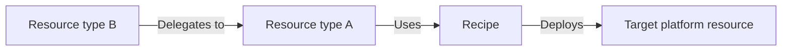

# Delegated provisioning with a single writer

## Decision and examples

Radius resource types do not always map cleanly to a target platform's units of deployment: one deployment unit may need context from several Radius resource instances of different types. This document proposes the concept of "Delegated Provisioning" as a Radius feature to address this mismatch. A recipe registration can delegate provisioning to another **Radius resource instance**, whose recipe receives the combined desired configuration of both types (or more) and is the single native-resource deployer. Radius automatically reruns that recipe when either resource type changes. A single recipe is desirable so that the lifecycle of PUT/PATCH/DELETE for the target platform resource can be managed by Radius.



**Figure 1: Two Radius resource instances share one provisioning recipe in which Resource Type B delegates provisioning to Resource Type A. Both instances contribute to the desired configuration on the target platform.**

Azure Container Apps (ACA) illustrates the need: workload and TCP ingress belong to one Azure `Microsoft.App/containerApps` resource type, but this configuration is represented in Radius as two separate resource types: a container and a route. When an ACA recipe is registered, it needs a single recipe to deploy both the route type and the container type. 

We can use the "delegated provisioning" feature proposed in this document to provide a single recipe to deploy a single Azure resource using configuration from both Radius resource types. If we attempt to do this with two recipes (one for each Radius resource type), Radius would not be able to manage PATCH and DELETE operations. For example, a PATCH to the  Radius.Compute/containers type would undo the configuration provided by the Radius.Compute/routes type.

### Register delegation

```bicep
extension radius

@description('Immutable OCI reference of the delegation-aware container recipe.')
param containerRecipeSource string

resource acaRecipes 'Radius.Core/recipePacks@2025-08-01-preview' = {
  name: 'azure-aca'
  properties: {
    recipes: {
      'Radius.Compute/containers': {
        kind: 'bicep'
        source: containerRecipeSource
        acceptsDelegationFrom: ['Radius.Compute/routes']
      }
      'Radius.Compute/routes': {
        kind: 'delegated'
        target: {
          resourceType: 'Radius.Compute/containers'
          idsFrom: '$.rules[*].destinationContainer.resourceId'
        }
      }
    }
  }
}
```

Figure 2: `delegated`, `target`, and `acceptsDelegationFrom` are proposed additions, not supported by today's API/schema despite the familiar envelope and API-version label.

### Select a container instance

In an existing application, `cache` is a portable container resource whose `redis` container declares port 6379. The route uses its symbolic Radius ID, not an Azure ID or cloud-specific flag:

```bicep
resource cacheRoute 'Radius.Compute/routes@2025-08-01-preview' = {
  name: 'cache-tcp'
  properties: {
    environment: environment
    application: application.id
    kind: 'TCP'
    rules: [{
      matches: []
      destinationContainer: {
        resourceId: cache.id
        containerName: 'redis'
        containerPort: 6379
      }
    }]
  }
}
```

Figure 3: The TCP route references `cache.id` to select its provisioning target and identifies the `redis` container and port 6379 within that target.

### Read routes in the container recipe

This excerpt generates ingress and listener outputs. The same recipe declares `containerApp` and its workload, identity, secrets, and volumes; those declarations and preflight checks are omitted here.

```bicep
@description('Radius-supplied deployment context.')
param context object

var routes = context.resource.incomingReferences
var ports = sort(
  map(routes, route => route.properties.rules[0].destinationContainer.containerPort),
  (a, b) => a < b
)

// Assign to containerApp.properties.configuration.ingress.
var ingress = empty(ports) ? null : {
  external: false
  transport: 'tcp'
  exposedPort: ports[0]
  targetPort: ports[0]
  additionalPortMappings: [for port in skip(ports, 1): {
    external: false
    exposedPort: port
    targetPort: port
  }]
}

output result object = {
  resources: [containerApp.id]
  values: {}
  delegatedOutputs: [for route in routes: {
    id: route.id
    revision: route.revision
    values: {
      listener: {
        hostname: containerApp.name
        port: route.properties.rules[0].destinationContainer.containerPort
        protocol: 'TCP'
      }
    }
  }]
}
```

This example pack supports internal TCP, one rule per route, and six distinct ports: the lowest is primary, with up to five additional ports. Before native writes, the recipe rejects unsupported protocols, nonempty matches/hostnames, duplicate/invalid ports, or undeclared destination containers/ports. No route is silently dropped. Removing the last route clears ingress. [ACA-specific restrictions](https://learn.microsoft.com/en-us/azure/container-apps/ingress-overview#additional-tcp-ports) stay in recipes.

**Terraform:** context-aware target modules read `var.context.resource.incomingReferences` and return `result.delegatedOutputs`; the delegated registration is unchanged. No route module/custom provider is required, but the target still needs suitable native-provider support and Radius credential integration.

## Contract

**Registration and selection.** Initially support Dynamic RP resources in `Radius.Core` recipe-pack environments. An entry is direct or delegated; delegated entries have no source, parameters, or output mappings. `idsFrom` traverses desired properties using field names and `[*]` only. Validate against registered/instance schemas; canonicalize and deduplicate selected IDs. Exactly one existing, non-deleting target must remain. Multiple delegates may share it; zero/multiple targets, self-reference, delegation chains, manual-provisioning targets, and dependency cycles fail before side effects. These restrictions do not change ordinary routes. Environment attachment validates both registrations; the target's normal environment recipe selection/parameter precedence applies, with explicit `acceptsDelegationFrom` consent. Context-free modules need wrappers; missing recipes are errors.

**Input snapshot.** New `incomingReferences` entries contain `{ id, type, apiVersion, revision, properties }`, sorted by canonical ID, once per live delegate; tombstones are excluded and an empty set is `[]`. Properties are validated/defaulted desired inputs, never computed outputs or status. Initially reject types with sensitive writable fields. Revisions identify desired state, not status writes. Read all delegates together with the target's desired revision; existing outgoing `connections` remain separate. The target must not depend on delegate completion, directly or indirectly.

**Outputs and ownership.** New `delegatedOutputs` requires one ID/revision-matched entry per snapshot delegate. Missing, duplicate, foreign, or invalid entries fail reconciliation; routes require a listener with hostname, port, and protocol. Values populate only schema-declared read-only computed properties, never desired fields, framework status, secrets, or inventory. Routes retain declarations, bindings, operation state, and listeners, but execute no provisioning/deletion driver. Only the target owns native inventory and Terraform state; existing `result.resources`/`values` remain its outputs.

## Lifecycle

| Action                                  | Behavior                                                                                                                                                                                                                                                                |
|-----------------------------------------|-------------------------------------------------------------------------------------------------------------------------------------------------------------------------------------------------------------------------------------------------------------------------|
| Initial deployment                      | Provision the container with no delegates, then accept the route and rerun its target. The route succeeds only after native apply and output projection, avoiding a circular completion dependency.                                                                     |
| Route create/update or container update | Automatically reconcile the latest container definition with **all** live delegates, including pending desired revisions. Preserve workload and other routes; refresh listeners. Incompatible changes fail, not disappear.                                              |
| Retarget or detach                      | Target, application, and environment are immutable while bound. Return a conflict; delete successfully, then recreate against the new target. Clearing the destination is invalid.                                                                                      |
| Route delete                            | Persist a tombstone; apply without that route before removing its record. Workload/other routes survive. Failed deletion retains the tombstone and cleanup obligation.                                                                                                  |
| Container delete                        | Reject while live delegates remain. Otherwise drain in-flight apply, delete native inventory, then finalize tombstones; do not wait circularly for route reconciliation.                                                                                                |
| Application delete                      | Server-side cascade marks the application/members deleting, blocks new writes, drains in-flight applies, deletes each target's inventory, then finalizes delegates/application. Skip route-triggered applies; retain failed cleanup. CLI and REST share this operation. |
| Missing target                          | Route create/update fails. Delete completes only with confirmed native cleanup; otherwise resume cleanup from the retained owner record or report incomplete cleanup. Recreated IDs cannot inherit old bindings.                                                        |

An externally deleted native object may be recreated on the next reconciliation while its Radius target lives; continuous drift detection is out of scope.

## Reliability and safety

Persist target-scoped desired inputs, bindings, revisions, pending operations, deletion state, and native execution identity, with a reverse lookup for delegates. Recording intent must also durably record work, surviving queue/worker failure. Existing single-object ETags do not provide cross-resource transactions.

Serialize target applies/deletion, including ordinary container updates; coalesce pending changes. Resume uncertain native operations before starting another writer. Preserve inventory from partial/stale attempts, but publish success only for the current applied snapshot. Reject overlapping operations on the same resource. Retry transient failures idempotently; deterministic errors require correction. Failed/timed-out operations stay failed; corrected PUTs/retried DELETEs automatically recover without manual container redeployment. Keep desired state, cleanup records, and last-successful outputs; promise no rollback. Proposed read-only `properties.status.reconciliation` exposes desired/applied revisions and errors on target/delegates, identifying stale listeners. Target revisions cover the whole snapshot; delegate revisions cover their inputs.

Require the same tenant, plane, resource group, application, and environment. Authorize writes to both delegate and target, and deletion of cascade members; recheck identity/boundaries during execution. Expose only permitted desired inputs to the accepting recipe; never log payloads.

Existing registrations remain direct. Pin registration, parameters, and immutable target artifact for execution/retry/cleanup. While instances exist, reject ownership-affecting changes to mode, selector, accepted types, effective recipe, or environment/provider scope. Recipe rollout/migration initially requires draining/deleting affected instances. Older APIs, force-delete, and scope-delete cannot bypass cleanup barriers.

## Required Radius changes

| Area                         | Change                                                                                                                                                                                                                                                         |
|------------------------------|----------------------------------------------------------------------------------------------------------------------------------------------------------------------------------------------------------------------------------------------------------------|
| Registration                 | Extend [recipe-pack TypeSpec](../../../typespec/Radius.Core/recipePacks.tsp), stored models/conversions, generated clients/Bicep types, pack/environment validation, and recipe resolution. Today only Bicep/Terraform kinds with `source` exist.              |
| Relationships and scheduling | Extend [Dynamic RP](../../../pkg/dynamicrp/backend/controller/dynamicresource.go) persistence, admission, async operations, graph edges, and status with bindings and target reconciliation. Manual provisioning merely skips execution; it cannot substitute. |
| Recipe inputs/outputs        | Extend [shared orchestration](../../../pkg/portableresources/backend/controller/createorupdateresource.go), context/result models, and both drivers for incoming snapshots, projection, and durable recovery. Existing connection lookup is outgoing only.     |
| Ownership                    | Keep execution/state/cleanup on the target. [Bicep already inventories discovered IDs](../../../pkg/recipes/driver/bicep/bicep.go); omitting explicit route outputs cannot make two writers safe. ACA rendering remains recipe code.                           |
| Deletes and CLI              | Version the synchronous [application-delete API](../../../typespec/Radius.Core/applications.tsp) for server-owned async cascade; replace CLI parallel member deletion. Update pack/status clients and all deletion entry points.                               |
| Tests and docs               | Cover registration/context, scheduler recovery, both drivers, inventory, and CLI. Update recipe-author/pack, status/deletion, and architecture guidance when implemented.                                                                                      |

Ordinary recipe behavior, outgoing connections, and application syntax stay unchanged. The deployment engine still orders normal symbolic dependencies; Radius must schedule reverse-reference reruns so independent CRUD works.

## Acceptance and consequences

- Both target drivers aggregate two routes deterministically, return valid listeners, and inventory the native app only on the container.
- Route-only/container-only updates preserve other desired configuration; last-route deletion clears ingress without deleting the workload. Invalid registration, targets, cycles, permissions, and outputs cannot report success.
- Concurrent updates, duplicate delivery, crashes, partial applies, and delete races converge without overlapping writers, stale success, recreation during cascade, or lost cleanup. Corrected requests recover automatically.

Two native writers retain ownership/update conflicts. A Terraform-only field-ownership provider is a separate alternative; merging routes into containers or requiring manual redeployment sacrifices portability or automatic lifecycle. Delegation keeps authors/recipes simple at the cost of generic Radius aggregation, scheduling, and coordinated deletion. One-hop/single-target bindings and migration restrictions bound that cost; these are proposed limitations, not previously accepted decisions.

**Evidence:** source checked at `03d784341203ab349693d7be737b76e6abdf52f6`; existing fields and example data flow checked against current schemas and [ACA's resource schema](https://learn.microsoft.com/en-us/azure/templates/microsoft.app/2025-01-01/containerapps). New fields require API/schema changes. These excerpts are not complete, compiled, or deployed modules. Neither this proposal nor its reliability guarantees were validated by the earlier Terraform experiment.
