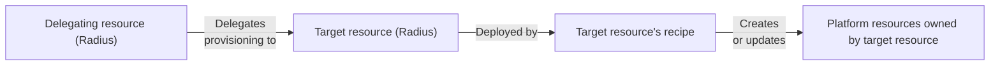

# Delegated provisioning

## Decision

Introduce **delegated provisioning** when several Radius resources contribute configuration to infrastructure managed by one recipe. For an application deployment, Radius provides the target resource and all its delegating resources as inputs to one execution of the target resource's recipe. A later deployment or independent Radius resource change executes that recipe again with the updated combined configuration.

Only the target resource owns the platform resources created by its recipe and any Terraform state. Delegating resources do not execute separate provisioning or deletion recipes. This applies to Bicep and Terraform; platform-specific configuration stays in recipes.



## Terms

| Term                       | Definition                                                                                                                                                                                                                                                                       |
|:---------------------------|:---------------------------------------------------------------------------------------------------------------------------------------------------------------------------------------------------------------------------------------------------------------------------------|
| **Radius Resource Type**   | A type defined by a Radius resource schema, such as `Radius.Compute/routes` or `Radius.Compute/containers`.                                                                                                                                                                      |
| **Platform Resource Type** | A type defined by the deployment platform, such as Azure's `Microsoft.App/containerApps` or Kubernetes' `apps/v1` Deployment.                                                                                                                                                    |
| **Radius resource**        | An instance of a Radius Resource Type, with its own Radius resource ID, desired properties, and status. For example, the route `cache-tcp` is distinct from the container resource `cache`.                                                                                      |
| **Platform resource**      | An instance of a Platform Resource Type created or managed by a recipe. Its platform resource ID is distinct from the Radius resource ID of its owning Radius resource.                                                                                                          |
| **Delegating resource**    | A Radius resource that uses a delegated recipe registration to supply its desired properties to a target resource's recipe. It retains its own Radius resource ID, status, and computed properties. In the ACA example, this is the Radius route `cache-tcp`.                    |
| **Target resource**        | The Radius resource whose recipe provisions platform resources using its own desired properties and those of its delegating resources. It owns the resulting platform resources. In the ACA example, this is the Radius container resource `cache`, not the Azure Container App. |

## ACA example

An Azure Container App is an instance of the Platform Resource Type `Microsoft.App/containerApps`; it stores workload and TCP ingress configuration together. Radius represents these inputs as instances of two Radius Resource Types: `Radius.Compute/containers` and `Radius.Compute/routes`.

The Radius route is the delegating resource; its destination Radius container resource is the target resource. Radius supplies both Radius resource declarations to the target resource's recipe, which configures workload and ingress on the Azure Container App.

### Register the ACA recipes

```bicep
extension radius

@description('Immutable OCI reference of the delegation-aware container recipe.')
param containerRecipeSource string

resource acaRecipes 'Radius.Core/recipePacks@2025-08-01-preview' = {
  name: 'azure-aca'
  properties: {
    recipes: {
      'Radius.Compute/containers': {
        kind: 'bicep'
        source: containerRecipeSource
        acceptsDelegationFrom: ['Radius.Compute/routes']
      }
      'Radius.Compute/routes': {
        kind: 'delegated'
        target: {
          resourceType: 'Radius.Compute/containers'
          idsFrom: '$.rules[*].destinationContainer.resourceId'
        }
      }
    }
  }
}
```

`target.resourceType` names the target resource's Radius Resource Type. `idsFrom` selects the target resource's Radius resource ID from the delegating resource's desired properties. `acceptsDelegationFrom` lists the Radius Resource Types whose instances may delegate to the target resource. These fields do not select Platform Resource Types or platform resource IDs.

The new registration fields are implemented experimentally, not released. This Bicep registration example requires regenerated/published Bicep definitions for Radius recipe-pack registration; prototype pack registration uses REST.

### Declare the delegating Radius route

In this application excerpt, `cache` is an instance of the Radius Resource Type `Radius.Compute/containers`; its workload container `redis` declares port 6379. The application author references `cache.id`, the target resource's Radius resource ID:

```bicep
resource cacheRoute 'Radius.Compute/routes@2025-08-01-preview' = {
  name: 'cache-tcp'
  properties: {
    environment: environment
    application: application.id
    kind: 'TCP'
    rules: [{
      matches: []
      destinationContainer: {
        resourceId: cache.id
        containerName: 'redis'
        containerPort: 6379
      }
    }]
  }
}
```

`cacheRoute.id` is the delegating resource's Radius resource ID, distinct from `cache.id`. ACA TCP ingress has no separate platform resource ID: it is configuration within the Azure Container App owned by the target resource `cache`.

### Read delegating resource inputs and return listeners

This shortened ACA Bicep recipe handles one delegating Radius route. `containerApp` is the Azure platform resource declared by the target resource's recipe; its workload declaration and input validation are omitted.

```bicep
@description('Radius-supplied deployment context.')
param context object

var routes = context.resource.incomingReferences
var routePort = empty(routes) ? 80 : routes[0].properties.rules[0].destinationContainer.containerPort

// Assign to containerApp.properties.configuration.ingress.
var ingress = empty(routes) ? null : {
  external: false
  transport: 'tcp'
  exposedPort: routePort
  targetPort: routePort
}

output result object = {
  values: {}
  delegatedOutputs: [for route in routes: {
    id: route.id
    revision: route.revision
    values: {
      listener: {
        hostname: containerApp.name
        port: route.properties.rules[0].destinationContainer.containerPort
        protocol: 'TCP'
      }
    }
  }]
}
```

In this ACA excerpt, an empty `incomingReferences` array clears TCP ingress on the Azure Container App. The full demo recipe validates the destination workload container and port. These recipe-specific choices do not limit the general delegation feature.

In each `delegatedOutputs` entry, `id` is the delegating resource's Radius resource ID, `revision` identifies the Radius route configuration used, and `listener.hostname` is the Azure Container App name used for internal TCP. Radius automatically records `containerApp.id`, the Azure platform resource ID, as owned by the target resource `cache`, not by the delegating resource `cacheRoute`.

Terraform recipes for target resources receive `var.context.resource.incomingReferences` and return `result.delegatedOutputs` using the same structure.

## General delegation behavior

**Registration.** Radius validates the selected target resource against the delegated recipe registration. The target resource's recipe registration must accept the delegating resource's Radius Resource Type through `acceptsDelegationFrom`. A delegated recipe registration has no provisioning source, parameters, or output mappings of its own.

**Recipe inputs.** Each execution receives the desired properties of the target resource and all its delegating resources, together. Each `incomingReferences` entry contains `{ id, type, apiVersion, revision, properties }`: `id` is the delegating resource's Radius resource ID, and `type` is its Radius Resource Type. The supplied properties contain application inputs, excluding computed outputs and deployment status.

**Recipe results.** The target resource's recipe returns one `delegatedOutputs` entry per delegating resource, matching its Radius resource ID and desired-state revision. Radius validates and copies the returned values into that delegating resource's computed properties. In the ACA example, each Radius route receives a listener containing hostname, port, and protocol.

**Ownership and bindings.** Radius saves a binding between the delegating resource's Radius resource ID and the target resource's Radius resource ID. Platform resource IDs discovered or returned by the target resource's recipe belong only to the target resource's cleanup inventory. Delegating resources retain their own Radius declarations, status, and computed outputs, but own no platform resources or Terraform state.

### Updates and deletes

Radius uses the saved binding to apply subsequent Radius resource changes automatically. In the ACA example, changing a Radius route updates the Azure Container App's TCP ingress; removing the Radius route removes that ingress while preserving the workload.

The following rules apply to delegating resources of any supported Radius Resource Type:

| Action                                                   | Required behavior                                                                                                                                                                                                                                        |
|----------------------------------------------------------|----------------------------------------------------------------------------------------------------------------------------------------------------------------------------------------------------------------------------------------------------------|
| Deploy target resource and delegating resources together | Execute the target resource's recipe once with their combined configuration; complete deployment after validating the returned computed properties.                                                                                                      |
| Add a delegating resource in a later deployment          | Execute the target resource's recipe with the new delegating resource's inputs.                                                                                                                                                                          |
| Update a delegating resource or target resource          | Execute the target resource's recipe with the updated combined configuration and refresh computed properties.                                                                                                                                            |
| Delete a delegating resource                             | Execute the target resource's recipe without the deleted delegating resource's inputs. Complete deletion after the platform configuration contributed by those inputs has been removed; preserve the target resource and remaining delegating resources. |
| Retarget a delegating resource                           | Delete it successfully, then recreate it against the new target resource.                                                                                                                                                                                |
| Delete the target resource                               | Reject while live delegating resources remain. Otherwise delete the target resource and its owned platform resources.                                                                                                                                    |
| Delete the Radius application                            | Delete its Radius resources and their owned platform resources without duplicate platform deletion or recreation during cleanup.                                                                                                                         |

### Delegation relationships

This proposal adds delegation to Radius resources served by Dynamic RP in `Radius.Core` recipe-pack environments. Each delegating resource selects exactly one target resource; multiple delegating resources may share it. The target resource must run a provisioning recipe, not delegate again or use manual provisioning. Reject self-reference and dependency cycles.

Both Radius resources must share the same tenant, plane, resource group, application, and environment.

Radius must preserve existing secret protection when assembling delegated recipe inputs, using each delegating resource's schema and Radius resource ID.

### Failure handling

Failed changes must report errors on the affected Radius resources and remain retryable without losing bindings or platform resource ownership information. Previously computed outputs must not imply that a failed update succeeded. All Radius deletion APIs must preserve these cleanup guarantees.

### Compatibility and recipe upgrades

Recipe upgrades must preserve bindings between delegating resources and target resources, platform resource ownership, and cleanup information without requiring deletion of the Radius resources. Changes to provisioning responsibility must reconcile old and new platform resource ownership rather than simply replace registration metadata.

## Required Radius changes

The following changes implement the general feature; ACA ingress configuration remains recipe code.

| Area                      | Required change                                                                                                                                                                                                                                                                          |
|---------------------------|------------------------------------------------------------------------------------------------------------------------------------------------------------------------------------------------------------------------------------------------------------------------------------------|
| Registration              | Add delegation fields to [recipe-pack APIs](../../../typespec/Radius.Core/recipePacks.tsp), stored definitions, and generated clients/Bicep definitions; validate target selection and accepted Radius Resource Types.                                                                   |
| Delegated execution       | Update deployment planning and [Dynamic RP controllers](../../../pkg/dynamicrp/backend/controller/dynamicresource.go) to save bindings, execute one target recipe with combined inputs, and trigger execution when bound Radius resources change.                                        |
| Recipe inputs/results     | Extend [shared recipe orchestration](../../../pkg/portableresources/backend/controller/createorupdateresource.go) and both drivers to supply `incomingReferences` and apply `delegatedOutputs` to each delegating resource's computed properties, preserving existing secret protection. |
| Ownership and deletion    | Associate platform resource inventory and Terraform state only with the target resource; update Radius deletion handling so removing a delegating resource removes its platform configuration without deleting shared platform resources.                                                |
| Verification and guidance | Add tests for registration, combined recipe inputs/results, updates, deletion, and failure recovery; document the new registration and recipe contracts.                                                                                                                                 |

## Tradeoffs

- **Registration complexity:** the platform engineer must configure compatible registrations: which Radius Resource Types delegate, how they select a target resource, and which delegating Radius Resource Types the target resource's recipe accepts.
- **Recipe-authoring complexity:** the target resource's recipe must interpret several Radius Resource Types, combine their configuration, and return computed properties for each delegating resource. It replaces several smaller recipes with one more capable recipe.
