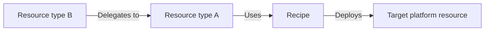

# Relationship-based delegated provisioning

## Summary

Radius executes a separate provisioning recipe for each Radius resource. Some platforms may require multiple Radius resources to provide configuration for a single platform resource recipe, but Radius does not currently support a many-to-one mapping of resource types to recipe.

In order to provide a \*..1 cardinality of multiple resource types mapped to a single recipe, this ADR proposes the concept of delegated provisioning in which a resource type may delegate provisioning to another resource type. For example, RT-A may delegate provisioning to RT-B. The recipe registration for RT-A will show delegation to RT-B as well as a recipe registration to RT-B. The recipe for RT-B will have access to both RTs and will deploy a single target platform resource.

## Decision

Some platforms deploy a single platform resource for what Radius models as separate resources. For example, Azure Container Apps stores workload and TCP ingress configuration in one deployment unit, while Radius models containers and routes separately.

Introduce **delegated provisioning** when several Radius resources contribute configuration to infrastructure managed by one recipe. For an application deployment, Radius provides the target resource and all its delegating resources as inputs to one execution of the target resource's recipe. A later deployment or independent Radius resource change executes that recipe again with the updated combined configuration.

Only the target resource owns the platform resources created by its recipe and any Terraform state. Delegating resources do not execute separate provisioning or deletion recipes. This applies to Bicep and Terraform; platform-specific configuration stays in recipes.

Recipe registration names the target type through `delegatesTo`. Radius finds the target instance from the delegating resource's typed relationships and gives its recipe only the related delegating resources.



Both Radius resources contribute configuration to one recipe. Only the target Radius resource owns the resulting platform resources.

## Terms

| Term                       | Definition                                                                                                                                                                                                                                                                       |
|:---------------------------|:---------------------------------------------------------------------------------------------------------------------------------------------------------------------------------------------------------------------------------------------------------------------------------|
| **Radius Resource Type**   | A type defined by a Radius resource schema, such as `Radius.Compute/routes` or `Radius.Compute/containers`.                                                                                                                                                                      |
| **Platform Resource Type** | A type defined by the deployment platform, such as Azure's `Microsoft.App/containerApps` or Kubernetes' `apps/v1` Deployment.                                                                                                                                                    |
| **Radius resource**        | An instance of a Radius Resource Type, with its own Radius resource ID, desired properties, and status. For example, the route `cache-tcp` is distinct from the container resource `cache`.                                                                                      |
| **Platform resource**      | An instance of a Platform Resource Type created or managed by a recipe. Its platform resource ID is distinct from the Radius resource ID of its owning Radius resource.                                                                                                          |
| **Delegating resource**    | A Radius resource that uses a delegated recipe registration to supply its desired properties to a target resource's recipe. It retains its own Radius resource ID, status, and computed properties. In the ACA example, this is the Radius route `cache-tcp`.                    |
| **Target resource**        | The Radius resource whose recipe provisions platform resources using its own desired properties and those of its delegating resources. It owns the resulting platform resources. In the ACA example, this is the Radius container resource `cache`, not the Azure Container App. |

## ACA example

An Azure Container App is an instance of the Platform Resource Type `Microsoft.App/containerApps`; it stores workload and TCP ingress configuration together. Radius represents these inputs as instances of two Radius Resource Types: `Radius.Compute/containers` and `Radius.Compute/routes`.

The Radius route is the delegating resource; its destination Radius container resource is the target resource. Radius supplies both Radius resource declarations to the target resource's recipe, which configures workload and ingress on the Azure Container App.

### Register the ACA recipes

```bicep
extension radius

@description('Immutable OCI reference of the delegation-aware container recipe.')
param containerRecipeSource string

resource acaRecipes 'Radius.Core/recipePacks@2025-08-01-preview' = {
  name: 'azure-aca'
  properties: {
    recipes: {
      'Radius.Compute/containers': {
        kind: 'bicep'
        source: containerRecipeSource
        acceptsDelegationFrom: ['Radius.Compute/routes']
      }
      'Radius.Compute/routes': {
        kind: 'delegated'
        delegatesTo: 'Radius.Compute/containers'
      }
    }
  }
}
```

`delegatesTo` names the target resource's Radius Resource Type. `acceptsDelegationFrom` lists the Radius Resource Types whose instances may delegate to the target recipe. These fields do not select platform resources or target instances. There is no `idsFrom` or other property-path mapping in registration.

These are proposed registration fields, not part of today's published API or Bicep definitions.

### Describe the relationship in the resource type

Routes already specify a destination through `rules[].destinationContainer.resourceId`. The proposed annotation tells Radius that this field refers to a `Radius.Compute/containers` resource:

```yaml
destinationContainer:
  type: object
  properties:
    resourceId:
      type: string
      x-radius-resource-reference: Radius.Compute/containers
    containerName:
      type: string
    containerPort:
      type: integer
```

The type author describes the relationship once, rather than each platform engineer repeating a path in recipe registration. Radius reads these annotations to find related resource instances, including references inside arrays or maps. It validates their IDs and types; arbitrary strings and computed outputs are not relationships.

The relationship does not itself assign provisioning ownership. The recipe registrations decide whether a route delegates and whether the target recipe accepts it. The same route schema still works with separate, nondelegated recipes. No container schema fields are added.

### Declare the delegating Radius route

In this application excerpt, `cache` is an instance of the Radius Resource Type `Radius.Compute/containers`; its workload container `redis` declares port 6379. The application author references `cache.id`, the target resource's Radius resource ID.

A Radius `containers` resource groups one or more workload containers. `resourceId` selects that group, `containerName` selects a workload container within it, and `containerPort` selects its port. An explicitly declared proxy sidecar may be the destination. All three fields remain required.

```bicep
resource cacheRoute 'Radius.Compute/routes@2025-08-01-preview' = {
  name: 'cache-tcp'
  properties: {
    environment: environment
    application: application.id
    kind: 'TCP'
    rules: [{
      matches: []
      destinationContainer: {
        resourceId: cache.id
        containerName: 'redis'
        containerPort: 6379
      }
    }]
  }
}
```

`cacheRoute.id` is the delegating resource's Radius resource ID, distinct from `cache.id`. ACA TCP ingress has no separate platform resource ID: it is configuration within the Azure Container App owned by the target resource `cache`.

If the application also contains `worker`, Radius supplies this route only to the `cache` recipe. The recipe does not search all application routes to find its own. Changing this route does not rerun the `worker` recipe.

### Read related delegating inputs and return listeners

The target recipe receives the container's configuration and all its related routes.

This Bicep excerpt shows the delegation inputs and outputs. `container-app.bicep` represents the platform-specific portion of the target recipe; the actual ACA implementation will be designed separately.

```bicep
@description('Radius-supplied target configuration and related routes.')
param context object

var routes = context.resource.incomingReferences

module containerApp 'container-app.bicep' = {
  name: 'container-deployment'
  params: {
    container: context.resource.properties
    routes: [for route in routes: {
      id: route.id
      rules: route.properties.rules
    }]
  }
}

output result object = {
  values: containerApp.outputs.values
  delegatedOutputs: [for route in routes: {
    id: route.id
    revision: route.revision
    values: {
      listener: containerApp.outputs.listeners[route.id]
    }
  }]
}
```

The `containerApp` module is part of the container recipe, not a separate route recipe. It deploys the workload and all routing rules together, and returns the container's computed values and a listener for each route. A listener describes where clients connect; a rule's destination port describes where traffic is forwarded. Unsupported rules must cause an error rather than be ignored.

On a route update, Radius reruns this recipe with the saved container configuration and the current related routes. On route deletion, it supplies the remaining routes, so the recipe removes the deleted route's configuration without deleting the workload. All platform resources remain owned by the target Radius resource.

Terraform recipes for target resources receive `var.context.resource.incomingReferences` and return `result.delegatedOutputs` using the same structure.

## General delegation behavior

**Registration.** Radius validates the related target resource against the delegated recipe registration. The target resource's recipe registration must accept the delegating resource's Radius Resource Type through `acceptsDelegationFrom`. A delegated recipe registration has no provisioning source, parameters, or output mappings of its own.

**Recipe inputs.** Each execution receives the desired properties of the target resource and all its related delegating resources, together. Each `incomingReferences` entry contains `{ id, type, apiVersion, revision, properties }`: `id` is the delegating resource's Radius resource ID, and `type` is its Radius Resource Type. The supplied properties contain application inputs, excluding computed outputs and deployment status. Each delegating resource appears once; an empty set is `[]`.

**Recipe results.** The target resource's recipe returns one `delegatedOutputs` entry per delegating resource, matching its Radius resource ID and desired-state revision. Radius validates and copies the returned values into that delegating resource's computed properties. In the ACA example, each Radius route receives a listener containing hostname, port, and protocol.

**Ownership and bindings.** Radius saves a binding between the delegating resource's Radius resource ID and the target resource's Radius resource ID. Platform resource IDs discovered or returned by the target resource's recipe belong only to the target resource's cleanup inventory. Delegating resources retain their own Radius declarations, status, and computed outputs, but own no platform resources or Terraform state.

### Updates and deletes

Radius uses the saved binding to apply subsequent Radius resource changes automatically. In the ACA example, changing a Radius route updates the Azure Container App's TCP ingress; removing the Radius route removes that ingress while preserving the workload.

A route-only deployment does not require the client to resubmit the container. Radius uses the container's saved desired configuration and all its related routes to rerun the container recipe. Previous workload changes are preserved; unrelated containers are unchanged.

The following rules apply to delegating resources of any supported Radius Resource Type:

| Action                                                   | Required behavior                                                                                                                                                                                                                        |
|:---------------------------------------------------------|:-----------------------------------------------------------------------------------------------------------------------------------------------------------------------------------------------------------------------------------------|
| Deploy target resource and delegating resources together | Execute the target resource's recipe once with their combined configuration; complete deployment after validating the returned computed properties. Planning must avoid circular waits between target execution and delegate completion. |
| Add a delegating resource in a later deployment          | Execute the related target resource's recipe with the new delegate, other live delegates, and saved target desired inputs.                                                                                                               |
| Update a delegating resource or target resource          | Execute the target resource's recipe with the updated combined configuration and refresh computed properties. Preserve target-only changes and other delegates; unrelated targets remain unchanged.                                      |
| Delete a delegating resource                             | Execute the target resource's recipe without the deleted delegate's inputs. Complete deletion after its contributed platform configuration has been removed; preserve the target and remaining delegates.                                |
| Change a delegating resource's target                    | Delete it successfully, then recreate it against the new target resource, retaining the original ADR's supported retargeting behavior.                                                                                                   |
| Delete the target resource                               | Reject while live delegates remain. Otherwise delete the target and its owned platform resources without overlapping a reconciliation writer.                                                                                            |
| Delete the Radius application                            | Delete its Radius resources and their owned platform resources without duplicate platform deletion or recreation during cleanup. Delegate cleanup must not recreate a target being deleted.                                              |

### Delegation relationships

This proposal adds delegation to Radius resources served by Dynamic RP in `Radius.Core` recipe-pack environments. Each delegating resource must resolve to exactly one target resource of the registered target type; multiple delegating resources may share it. The target resource must run a provisioning recipe, not delegate again or use manual provisioning. Reject self-reference and dependency cycles.

Both Radius resources must share the same tenant, plane, resource group, application, and environment.

Radius must preserve existing secret protection when saving target configuration and assembling delegated recipe inputs, using each resource's schema and Radius resource ID.

### Failure handling

Failed changes must report errors on the affected Radius resources and remain retryable without losing bindings or platform resource ownership information. Previously computed outputs must not imply that a failed update succeeded. All Radius deletion APIs must preserve these cleanup guarantees.

Radius must prevent simultaneous changes from creating competing recipe executions for the same target. Retrying a failed route change must not require the user to redeploy its container manually.

### Compatibility and recipe upgrades

Recipe upgrades must preserve bindings between delegating resources and target resources, platform resource ownership, and cleanup information without requiring deletion of the Radius resources. Changes to provisioning responsibility must reconcile old and new platform resource ownership rather than simply replace registration metadata.

Existing nondelegated registrations and application declarations retain their behavior.

## Required Radius changes

The following changes implement the general feature; ACA ingress configuration remains recipe code.

| Area                      | Required change                                                                                                                                                                                                                                                                        |
|:--------------------------|:---------------------------------------------------------------------------------------------------------------------------------------------------------------------------------------------------------------------------------------------------------------------------------------|
| Registration              | Add type-only delegation and target consent to [recipe-pack APIs](../../../typespec/Radius.Core/recipePacks.tsp), stored definitions, and generated clients/Bicep definitions. Validate effective recipe selection and accepted Radius Resource Types; do not add target-path mapping. |
| Typed relationships       | Add shared reference metadata to resource type definitions and generic schema-aware discovery. Validate IDs, destination types, and ambiguous ownership independently of recipe-specific route logic.                                                                                  |
| Delegated execution       | Update deployment planning and [Dynamic RP controllers](../../../pkg/dynamicrp/backend/controller/dynamicresource.go) to persist bindings/protected desired inputs, execute one target recipe with combined inputs, and schedule related reruns with durable recovery.                 |
| Recipe inputs/results     | Extend [shared recipe orchestration](../../../pkg/portableresources/backend/controller/createorupdateresource.go) and both drivers to supply filtered `incomingReferences` and validate/project `delegatedOutputs`, preserving secret protection and normal target parameters.         |
| Ownership and deletion    | Associate platform resource inventory and Terraform state only with the target; preserve cleanup obligations through partial failures, delegate removal, target deletion, and coordinated application/scope deletion.                                                                  |
| Verification and guidance | Cover related-input isolation, combined and resource-only deployments, both drivers, secret handling, lifecycle, concurrency, recovery, and unchanged nondelegated behavior. Document registration, resource metadata, recipe inputs/results, and operational errors when implemented. |

## Tradeoffs

- **Registration complexity:** the platform engineer must configure compatible registrations: which Radius Resource Types delegate and which delegating Radius Resource Types the target resource's recipe accepts. Resource type authors describe the target relationship in the schema instead of platform engineers repeating it in each registration.
- **Recipe-authoring complexity:** the target resource's recipe must interpret several Radius Resource Types, combine their configuration, and return computed properties for each delegating resource. It replaces several smaller recipes with one more capable recipe.

## Open questions

- **Routes with several targets.** Several rules may reference the same target, but a route referencing distinct container resources does not identify a single provisioning owner. How should ownership and route outputs work in that case? Such routes remain valid with nondelegated recipes.
- **Recipe selection.** Can the delegating and accepting registrations come from different recipe packs in the same environment?
- **Ownership changes.** How should Radius move an existing resource between separate and delegated recipes while preserving its platform resources? The migration procedure remains undecided.
