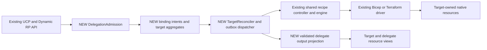
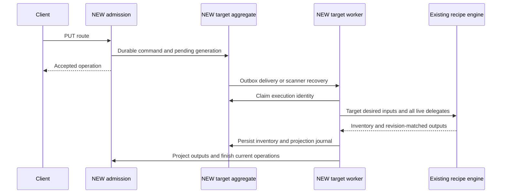

# Delegated provisioning implementation design

## Purpose and scope

Implement the [Delegated Provisioning ADR](2026-10-delegated-provisioning-adr.md) as an accepted decision for this design. Its imported text remains unchanged; this assumption does not change the document's approval status. Input SHA256: `70AFE5C2FCEF948A2F80DC7BE2D2E24B3AE2608B3EFDE5E5E32CA69E3EA52A85`. Source baseline: `ef7aab17f27fddd940c57ec63220dc88a42b840c`.

The feature combines desired inputs from independently managed Radius resources into one target recipe execution. The target alone owns native inventory and Terraform state. This is generic orchestration, not ACA-specific rendering or a second native field writer. The complete production design below is broader than the [experimental prototype](../../../test/experimental/delegated-provisioning/README.md).

## Existing integration points

Today [Dynamic RP routes](../../../pkg/dynamicrp/frontend/routes.go) use `DefaultAsyncPut`/`DefaultAsyncDelete`; [PrepareAsyncOperation](../../../pkg/armrpc/frontend/controller/operation.go) saves one resource and then queues its operation. These are separate writes, not a transactional outbox. [DynamicResourceController](../../../pkg/dynamicrp/backend/controller/dynamicresource.go) selects manual or recipe execution. `RecipePutController` invokes the shared [CreateOrUpdateResource](../../../pkg/portableresources/backend/controller/createorupdateresource.go), which reads the resource, resolves outgoing connections, calls `engine.Execute`, processes outputs, and saves with its ETag.

[EnvironmentLoader](../../../pkg/recipes/configloader/environment.go) resolves the effective recipe and parameters from Radius.Core environments and recipe packs. Both [Bicep](../../../pkg/recipes/driver/bicep/bicep.go) and [Terraform](../../../pkg/recipes/driver/terraform/terraform.go) use the common context/result models; they discover native inventory as well as reading explicit resource outputs. [DynamicProcessor](../../../pkg/dynamicrp/backend/processor/dynamicresource.go) projects normal computed properties and materializes secrets. Delegation needs a stricter projection path: normal output mapping currently does not itself enforce read-only-only writes.

## Key components



`DelegationAdmission`, `TargetReconciler`, binding intents, and the outbox dispatcher are proposed production components, not existing services. Keep them within Dynamic RP and shared recipe orchestration rather than creating a separate RP. Existing direct registrations continue through their existing path unless they explicitly accept delegation.

## API and registration

Extend `RecipeDefinition` in [recipePacks.tsp](../../../typespec/Radius.Core/recipePacks.tsp), versioned/stored conversions, Go SDKs, Swagger, and generated Bicep types with the ADR's `kind: 'delegated'`, `target: { resourceType, idsFrom }`, and `acceptsDelegationFrom: string[]`. Model source as optional structurally and validate it conditionally: a direct entry requires its normal source; a delegated entry forbids source, parameters, output mappings, transport options, and accepted delegate types. Do not treat delegation as a driver.

At pack PUT, validate selector grammar, type names, direct/delegated exclusivity, and contradictions visible within the pack. At environment attachment, resolve the complete effective registration set using existing precedence and duplicate checks; require the selected target registration to be direct and explicitly accept the source type. Cross-pack references are valid in the full design. Validate selectors against registered writable input schemas: field access and `[*]` only, ending at resource-ID strings. Initially reject schema compositions that cannot be resolved and types with sensitive writable fields. Resolve schemas before validating instances and use the schema's defaults.

Admission evaluates the selector against desired properties, canonicalizes IDs, deduplicates results, and requires exactly one existing non-deleting target. Require Dynamic RP, Radius.Core environment, same tenant/plane/group/application/environment, non-manual target, and explicit consent. Reject self-reference and chains. Build a dependency graph containing ordinary completion dependencies and proposed bindings; reject any path from target completion back to its delegate, including indirect outgoing connections. The delegate can depend on initial target creation, but the target must never wait for the delegate's operation to finish.

Authorize the caller for both delegate mutation and target reconciliation, not merely GET on the target. Existing internal RBAC configuration is reserved, so production needs actual authorization checks, not an assumption that enabling that configuration provides them. Capture an execution authorization descriptor without credentials; recheck resource identities, boundaries, and effective registration at execution. Errors must not include desired property payloads.

Store a fingerprint of mode, selector, accepted types, effective recipe artifact digest, parameter resolution, provider/environment scope, and schemas. Reject changes affecting bound instances at every registration/configuration API, including environment updates and pack PATCH. Initial rollout requires draining/deleting affected instances. Never reinterpret an existing native owner as a delegate because its registration changed.

## Persistent model and admission protocol

Use explicit immutable resource-incarnation UUIDs; resource IDs and creation timestamps are not sufficiently strong identities. Desired revisions are monotonic within each incarnation and change only on normalized desired input changes. Do not use database ETags as desired revisions: status writes change them.

| Record                                        | Authoritative content                                                                                                                                                                                                                                                                                |
|-----------------------------------------------|------------------------------------------------------------------------------------------------------------------------------------------------------------------------------------------------------------------------------------------------------------------------------------------------------|
| Binding intent, keyed by delegate incarnation | Source ID/incarnation/type/API/schema, target ID/incarnation, application/environment, desired properties/revision, pinned registration, caller authorization descriptor, operation ID, intent state and delivery obligation                                                                         |
| Target aggregate, keyed by target incarnation | Target desired revision, ordered live delegate inputs/revisions, tombstones, aggregate generation, pending operation IDs, pinned execution recipe/configuration, current execution identity/fencing token, accumulated native inventory, last applied generation, pending projection and outbox work |
| Resource view                                 | Current desired properties, last-successful computed properties, operation state and read-only reconciliation status; references authoritative binding/aggregate identity                                                                                                                            |
| Application deletion record                   | Application incarnation, membership/deleting barrier, targets/delegates, authorization decisions, pending cleanup and operation ID                                                                                                                                                                   |

Use the target aggregate's CAS as the snapshot serialization point; do not pretend several resource ETags provide a transaction. First reserve the delegate identity with a CAS binding intent containing its complete desired command and a durable delivery obligation. Next idempotently admit that command into the target aggregate, using `(delegate incarnation, desired revision, operation ID)` as the command identity. Record accepted work and outbox state in the same aggregate save. Only then return accepted operation status. A failed second write leaves a recoverable binding intent, not an untracked partial binding.

A startup and periodic scanner must recover both binding-intent delivery and aggregate outboxes, independent of successful queue publication. A worker ACK follows persisted execution/projection state. Reservation conflicts prevent retargeting; cancellation releases a reservation only after proving the target did not accept its command. Source views and operation records are materialized idempotently from authoritative intents/aggregates; GET overlays pending intent when necessary so a failed materialization does not hide accepted desired state. Target updates also enter this aggregate instead of bypassing it through `DefaultAsyncPut`.

This design deliberately uses recoverable intent/outbox records rather than adding an imaginary cross-object transaction to `database.Client`. Implement equivalent CAS and paginated scanning on both APIServer and PostgreSQL stores. Add reverse indexes for delegate-to-target and target-to-delegates; index rebuilding is supported from authoritative records.

## Snapshot and recipe contract

At execution, snapshot target desired inputs and every live admitted delegate at one aggregate generation. Sort references by canonical source ID. Strip framework fields and schema-declared read-only properties recursively; never send computed values, status, inventory, secret references or sensitive inputs as delegate properties. Preserve existing outgoing `context.resource.connections` separately.

```json
{
  "resource": {
    "id": "<target Radius ID>",
    "properties": { "<desired target property>": "<value>" },
    "incomingReferences": [
      {
        "id": "<delegate Radius ID>",
        "type": "Radius.Compute/routes",
        "apiVersion": "2025-08-01-preview",
        "revision": "<desired revision within source incarnation>",
        "properties": { "<desired delegate property>": "<value>" }
      }
    ]
  }
}
```

An accepting recipe always receives `incomingReferences`, including `[]`. Recipe inputs are immutable snapshots for that attempt. Drivers pass the same contract to context-aware Bicep and Terraform; context-free modules require wrappers. A missing recipe or unsupported wrapper is an error, never a successful no-op. ACA limits, ingress calculation, supported protocols and destination-port checks remain recipe preconditions.

```json
{
  "resources": ["<target-owned native ID>"],
  "values": {},
  "delegatedOutputs": [
    {
      "id": "<delegate Radius ID>",
      "revision": "<exact input revision>",
      "values": {
        "listener": { "hostname": "<host>", "port": 6379, "protocol": "TCP" }
      }
    }
  ]
}
```

Validate the entire output set before publishing any success: exactly one canonical ID/revision pair for every snapshot delegate, no extras or duplicates. Validate every value against the registered output schema and a read-only-property allowlist; exclude framework fields, desired inputs, secrets, and native inventory even if a malformed schema declares them read-only. Routes require complete valid listeners. Stage a projection journal in the aggregate, then idempotently project values and operation results. Delegates never receive native inventory or Terraform state and never call a deletion driver.

## Scheduling, errors and concurrency



Serialize all native execution and deletion for one target, including normal target updates. Coalesce queued desired changes, but never overlap writers or blindly rerun after an expired lease. Lease expiry is not evidence that a provider operation stopped: retain execution identity, native operation handles and Terraform backend/state lock identity; resume or establish terminal outcome before starting a successor. If a driver cannot prove an uncertain operation ended, expose a blocked reconciliation requiring explicit recovery rather than risking a second writer.

Persist discovered inventory from successful, partial, and stale attempts before deciding whether their outputs are current. Terraform state remains target-keyed; Bicep inventory is merged into the target cleanup journal. If the aggregate changed during apply, keep its inventory but do not publish stale success. Immediately schedule the latest generation. Incremental status projection must not overwrite newly admitted desired state.

Add read-only `properties.status.reconciliation` with desired/applied revisions, current operation/target identity, and structured sanitized error details. Delegate revisions describe their desired inputs; target revisions describe the complete aggregate snapshot. Retain last-successful outputs and show their applied revision so stale listeners are visible. A native apply is not a rollback guarantee.

Transient failures retry with bounded backoff against the pinned execution configuration. Deterministic validation failures require correction. Failed/timed-out operation IDs remain failed even if a later desired revision succeeds. A corrected PUT or repeated DELETE admits new recoverable work automatically; users never redeploy the target manually to repair delegation.

## Updates and deletion

| Operation          | Implementation                                                                                                                                                                                                                                          |
|--------------------|---------------------------------------------------------------------------------------------------------------------------------------------------------------------------------------------------------------------------------------------------------|
| Target PUT         | Admit target desired revision; execute with every live delegate, including admitted pending revisions. Validate incompatible workload/route changes before native writes.                                                                               |
| Delegate PUT       | Preserve immutable binding and application/environment identities; atomically update its admitted aggregate input and schedule target. Route succeeds after native apply and output projection.                                                         |
| Retarget/detach    | Conflict while bound; clearing selector is invalid. Delete successfully and recreate with a new binding incarnation.                                                                                                                                    |
| Delegate DELETE    | Persist intent/tombstone and durable work; exclude from next snapshot, apply target, then remove delegate view/binding. Retain tombstone on failure.                                                                                                    |
| Target DELETE      | Reject while any live delegates remain; otherwise establish deletion barrier, drain uncertain/in-flight work, delete accumulated inventory/state and finalize remaining tombstones.                                                                     |
| Application DELETE | New versioned async server-owned operation installs application/member write barriers, authorizes each member, drains applies, deletes each distinct target once, finalizes delegates and application. Suppress route-triggered applies during cascade. |
| Missing target     | Create/update fails. Delete requires confirmed native cleanup or recovery using retained owner/execution records; absence of the Radius target alone is not proof of cleanup.                                                                           |

All entry points must respect barriers: Dynamic RP CRUD, application REST/CLI, generic resource-group/scope deletion, force-delete, and older API versions. Update [applications.tsp](../../../typespec/Radius.Core/applications.tsp), async route/controller wiring, operation polling clients and the CLI's current parallel member-deletion path together. Existing synchronous versions must reject a delegated application delete or forward internally to the same coordinator; they cannot bypass it. Do not add a second client-only cascade.

## Compatibility, rollout and test plan

Ship production behind a disabled-by-default feature gate until both stores, drivers and every delete surface satisfy the contract. Existing registrations, outgoing connections and ordinary application syntax remain unchanged. Advertise the API/schema capability before accepting registrations; regenerate SDK/Swagger/Bicep assets together. Existing instances require no migration unless opting into delegation, which initially requires a drain/recreate. Pin recipe artifacts immutably before rollout and reject mutable execution changes while bound.

Test registration conversion and Bicep compilation, selectors/schema/defaults, one-hop/consent/boundary/authorization/cycle admission, exact context and output shapes, forbidden computed/secret writes, multiple routes and pending revisions, ordinary target updates and native inventory. Run the same aggregation/update/delete contract with Bicep and Terraform against real isolated targets. Include native-write failure with partial inventory, stale output projection, duplicate queue delivery, process death between every persistence/queue/native/projection boundary, lease expiry with a native operation still running, competing workers, repeated deletes, retarget rejection, application cascade, force/scope/legacy bypass attempts and missing/recreated IDs. Assert no overlapping native operations and no stale operation success, not merely eventual resource existence.

## Experimental implementation boundary

The prototype adds TypeSpec plus generated Go registration fields/conversions, recipe resolution, shared context/result support, pure contract checks in `pkg/recipes/delegation`, opt-in `DynamicResourceController` orchestration, persisted internal binding snapshots/tombstones, schema-checked delegate projection, and a Terraform Kubernetes recipe. It uses actual UCP/Dynamic RP async PUT/DELETE and the existing shared recipe engine/driver; there is no external watcher manually redeploying targets.

It supports sequential CRUD in one Dynamic RP process, same-pack registrations, one target per delegate, multiple delegates per target, explicit consent and same-scope checks, desired-input hashing, target creation-time binding checks, automatic owner/delegate updates, target delete rejection while bound, route removal and last-route native ingress cleanup. A process mutex serializes backend execution; this is not a distributed lock or admission transaction. Binding records and target reconciliation hashes persist, but there is no production outbox/scanner or automatic crash recovery. Creation timestamps are only a prototype identity check. Registration/configuration mutation, concurrent admission, repeated native failures, partial-apply inventory and every deletion bypass must be treated as unsupported, not implied by the happy-path demo.

The original demo exercises Terraform with real Kubernetes Deployment/Service resources and internal TCP listeners. It does not validate Bicep recipe-driver end-to-end execution, full schema-aware selector registration, dependency-cycle discovery, authorization, schema/version migration, distributed fencing, complete error status/retry recovery, or application/scope/force-delete cascade. Generated Go types and Swagger are included; Bicep type generation/publication remains deferred, so setup uses a clearly labeled API-level recipe-pack registration. Recipe-pack PUT rejects definition changes, but PATCH and environment/provider/schema mutation remain outside the supported subset. The demo runbook and persisted evidence define the exact verified behavior.

### Kubernetes and ACA portability follow-on

The [separate portability fixture](../../../test/experimental/delegated-provisioning-portability/README.md) deploys one unchanged Bicep application to Kubernetes and ACA through normal `rad deploy`, changing only the selected environment/workspace. The app includes a server, delegated TCP route and a portable peer workload. Its environment recipes map that definition to Kubernetes Deployment/Service resources, ACA through an actual Bicep target recipe, or a retained standard AzureRM Terraform alternative. The application contains no native Azure IDs or platform-specific ingress flags.

The ACA recipes support one unconditional internal TCP route, not the full multi-port ACA contract. They return the native app name for internal TCP clients. Source-hash snapshots, native ingress/inventory checks, independent owner/route updates and live peer traffic verify the Terraform and Bicep target-driver paths. Bicep declares the native app and Radius inventories it automatically; routes execute no driver. A fresh command-capture video demonstrates the Bicep ACA path and retains Terraform as an alternative. This supplements the original Kubernetes demo without replacing its source/evidence and does not extend the prototype's concurrency/recovery/cascade guarantees.
