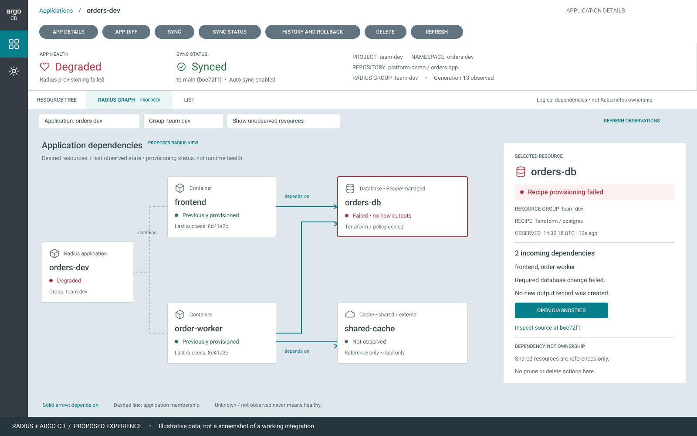
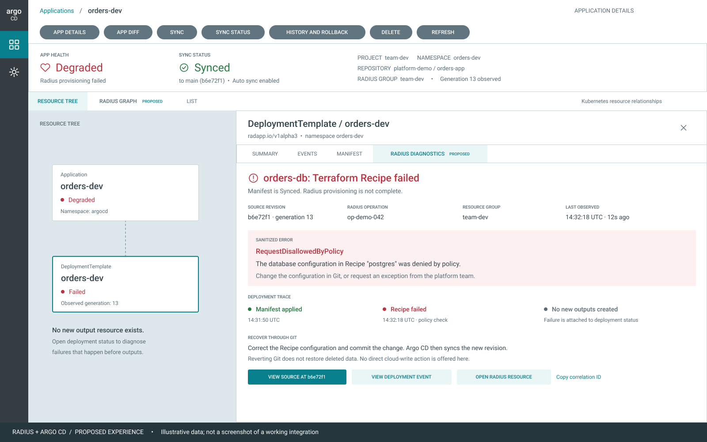

# Topic: Radius Integration with Argo CD

- **Author**: Will Tsai (@willtsai)

## Topic Summary

Platform teams and application teams can use Argo CD to deliver Radius changes from Git. Argo CD shows which revision it synced; Radius reports what it deployed or why provisioning failed. An optional view inside Argo CD lets users follow Radius dependencies and diagnose a failed Recipe. For the current health of a running workload, users rely on what Argo CD already observes.

The [original GitOps feature specification](2024-06-gitops-feature-spec.md) remains the foundation for installation, deployment, and parameter-editing scenarios. The [DeploymentTemplate controller design](2024-10-deploymenttemplate-controller.md) and [Flux integration design](2025-01-gitops-technical-design.md) describe the underlying deployment model. This document defines the incremental Argo CD source and UI experience; it does not replace those documents or redesign the Flux workflow. All Argo CD-specific behavior below is proposed, not a statement of released capability.

### Top level goals

- Let operators sync Environments and Recipe packs and let application teams sync definitions and parameter-only changes, using the same Radius deployment model as Flux.
- Let teams use approved Kubernetes Secrets without putting their values in Git or exposing them to people who can inspect a deployment. This protection applies without the optional GUI.
- Let Argo CD users inspect Radius-managed applications without seeing only an opaque top-level custom resource.
- Distinguish Git synchronization, Radius provisioning, and observed workload health so a successfully applied manifest cannot conceal a failed Recipe or an unobserved deployment.
- Make a failed Bicep or Terraform operation traceable from the Argo CD application to the affected Radius resource, attempted revision, and actionable diagnostic.
- Respect existing operator, developer, and SRE permissions. Opening a graph or diagnostic must not grant access beyond the selected application and its authorized Radius scope.
- Let operators adopt Argo CD without installing Flux or changing an existing Flux installation. After setup, a developer or SRE can follow a workload to a dependency outside its Kubernetes resource tree (such as a cloud-hosted database), diagnose a failed Recipe, and recover through Git without cluster-admin access.

### Non-goals (out of scope)

- Replacing Flux, Argo CD, their reconciliation policies, or Git as the source of desired configuration.
- Redefining the original specification's Radius installation and authoring workflows, migrating existing Flux applications, or introducing a Flux UI integration (Flux doesn't offer a native GUI like Argo CD does).
- Building a new GitOps dashboard in Radius. The proposed UI work augments Argo CD; an existing Radius view may be linked for additional context.
- Making Argo CD directly reconcile every cloud resource created by a Recipe, or representing a dependency relationship as Kubernetes ownership solely to draw a graph.
- Building or containerizing application code, publishing Recipe artifacts, or automatically updating image references. These remain CI responsibilities; GitOps consumes the resulting configuration changes.
- Providing a complete Terraform plan, cloud drift detector, database rollback, or disaster-recovery system through Argo CD's manifest diff and history.
- Adding arbitrary cloud mutations, terminal access, or a second deployment engine to a Radius UI extension.
- Monitoring running services or requiring Radius to detect a failure that Argo CD cannot see.
- Introducing enterprise identity mapping, a new role-based access control (RBAC) model, or organization-wide application and environment discovery in v1.
- Installing Radius or bootstrapping cloud credentials through application sync. An application does not own the platform team's shared Environment or Recipe packs.
- Adding a direct Radius Canvas integration. A developer or modeling skill can edit Bicep; once the change lands on the watched branch, it follows the same Argo CD workflow as any other commit.
- Requiring all future GitOps tools to offer Argo CD's UI features. Common Radius deployment semantics should remain reusable, but UI integration is tool-specific.

## User profile and challenges

### User persona(s)

**Infrastructure operators / administrators** maintain Radius installations, environments, Recipe registrations, and Argo CD repository access, projects, destinations, and policies. They decide which integrations users can install and which resources they may manage.

**Application developers** define applications and dependencies, publish code through CI, and submit application-definition changes through Git. They need to understand which component or dependency is preventing a deployment from becoming usable.

**Site Reliability Engineers (SREs)** adjust approved parameters and diagnose provisioning and runtime failures. They need application-scoped visibility without permission to rewrite application definitions, inspect unrelated environments, or administer the entire cluster.

### Challenge(s) faced by the user

Applying a top-level Radius resource is not enough to explain what happened beneath it. A developer can see that GitOps accepted a configuration while a Recipe is still provisioning, Terraform has failed, or a workload cannot reach a dependency. An opaque resource prevents the developer from using the graph and diagnostic workflows that make Argo CD valuable.

The Kubernetes ownership tree also differs from the Radius application graph. Shared services, external infrastructure, and application dependencies do not necessarily exist as child Kubernetes objects. Users need these relationships without a misleading claim that Argo CD owns or continuously monitors every graph node.

At enterprise scale, an unfiltered resource-group dropdown or global application inventory is not a usable entry point. Users need to find the applications and environments relevant to their responsibilities, with access restrictions that remain effective when they follow graph edges or diagnostic links.

### Positive user outcome

I can keep Argo CD as my GitOps interface and use Radius's existing application and deployment model. I can answer which revision was applied, what Radius is provisioning, which dependency is blocked, and where to investigate without maintaining a separate application catalog or acquiring broad administrative access.

## Key scenarios

### Scenario 1: Connect Radius definitions to Argo CD

As an operator, I point an Argo CD Application at the folder, Bicep definition, and parameters for one app in one environment. Other apps in the same repository sync independently. I can preview the change without deploying it, and if a file is invalid, Argo CD tells me what to fix before sync.

### Scenario 2: Navigate Radius resources and dependencies inside Argo CD

As a developer, I open an Argo CD Application's resource tree and inspect its Radius deployment and discoverable Kubernetes resources. Without leaving that Application, I open the Radius dependency graph and follow a workload's connection to a shared database, even if the database has no Kubernetes object. I can tell which resources Radius deployed and which the application only references.

### Scenario 3: Diagnose convergence and Recipe failures through Argo CD

As an SRE, I open an application that is synchronized but still provisioning or degraded. I locate the blocked dependency and see a safe error summary, attempted revision, operation context, and last-observed state. A Terraform failure is visible even if it occurs before any child resource is created. After an authorized correction and reconciliation, the view shows the new attempt and outcome without presenting the previous attempt's success as current.

### Scenario 4: Review changes and recover through Argo CD

As a developer or SRE, I inspect the desired-input diff and deployment history for an application or parameter change. I can connect a failed attempt to its input revision and correct or revert that input in Git. Requested logical resource removals and pending cleanup are visible; Argo CD's manifest diff and rollback history do not imply a complete cloud-resource plan or restoration of deleted data.

### Scenario 5: Distinguish a deployed workload from a healthy one

As an SRE, I see `Deployed` for revision A. Hours later, with no change in Git, a Pod starts restarting. If Argo CD tracks the Pod and reports `CrashLoopBackOff`, I see that condition on the Pod in its native resource tree. The Application can remain `Synced`, and the Radius deployment result does not change. If Argo CD cannot see the Pod, the Radius tab does not promise to detect the failure.

### Scenario 6: Sync shared platform changes before deploying an application

As a platform operator, I commit an updated Recipe pack for the development Environment. In Argo CD, I sync the platform configuration and check that Radius deployed the change before the orders team syncs its application. If registration fails, I can fix the platform revision in Git; the application team does not have to take ownership of the pack or the Environment.

## Key dependencies and risks

- **Shared Radius deployment foundation:** Argo CD must submit desired deployment inputs through the same `DeploymentTemplate` model and Radius controllers used by Flux. Reuse includes asynchronous operation handling and resource cleanup, not just manifest shape. Argo CD-specific source handling and presentation must not require a second provisioning path or change existing Flux users' behavior.
- **Argo CD compatibility:** The proposed integration depends on documented [config management plugins](https://argo-cd.readthedocs.io/en/stable/operator-manual/config-management-plugins/), [resource tracking](https://argo-cd.readthedocs.io/en/stable/user-guide/resource_tracking/), [custom health checks](https://argo-cd.readthedocs.io/en/stable/operator-manual/health/), and optional [UI extensions](https://argo-cd.readthedocs.io/en/stable/developer-guide/extensions/ui-extensions/). A supported Radius/Argo CD version range and the required administrator configuration are not yet established. Users must receive explicit prerequisites rather than a claim that installing a chart provides full integration.
- **Deployment status is not workload health:** Radius reports the outcome of a deployment, including a failed Recipe. Argo CD may observe the current health of resources it tracks. A successful deployment is not evidence that a workload or an external dependency is still running.
- **Resource identity and ownership:** A Radius deployment can produce multiple resources or reference shared infrastructure. Visibility must not give Flux and Argo CD concurrent reconciliation authority over the same desired resource, change Kubernetes garbage-collection relationships, or make shared resources prune targets. Cross-namespace and external relationships may require the Radius graph view rather than native tree placement.
- **Authorization across systems:** Access to an Argo CD Application or a Kubernetes namespace does not grant access to another team's Radius resources. Use the same boundaries as other GitOps deployments; see the [Radius controller authorization design](../security/2026-09-internal-component-authorization.md). A direct graph or diagnostic link must respect them too.
- **Sensitive output and trusted extensions:** Recipe diagnostics, rendered templates, parameters, and cloud identifiers may contain sensitive information. Status summaries and links must exclude credentials and secret values. Detailed diagnostics require appropriate authorization and redaction; installing a plugin or UI extension is an administrator-controlled trust decision.
- **Secret use:** Permission to submit an application does not grant permission to use every Secret in its namespace. Operators approve which Secrets it can use and remain responsible for protecting them in storage.
- **Deletion and recovery:** Removing a resource inside a deployment template can delete infrastructure even when Argo CD is not pruning the template object. Operators need a Radius-level deletion policy and visibility of requested removals, not reliance on Argo CD's prune toggle alone. Reapplying an earlier configuration cannot undo data loss or every provider-side change.
- **Freshness and scale:** A graph can become misleading when observations are stale, incomplete, or too large to navigate. Display observation scope and freshness, support scoped search and incremental expansion, and validate the experience against an agreed representative application inventory.
- **Flux compatibility:** Shared status or resource-identity improvements must not require Flux users to install Argo CD, replace `radius-gitops-config.yaml`, or migrate existing resources. Adoption of the shared Secret-reference contract and migration from existing inline secret parameters in Flux are tracked separately in [#13500](https://github.com/radius-project/radius/issues/13500); preserving compatibility does not mean the existing plaintext path is safe. Flux and Argo CD may serve different applications, but must not reconcile the same deployment inputs concurrently. Migration between tools is outside this proposal.

## Key assumptions to test and questions to answer

- **Graph coverage:** Starting in the native tree, can an operator use the embedded Radius dependency graph to find a shared database and diagnose a Recipe that failed before producing an output? Validate which nodes and edges the deployed graph API returns, what desired-source or operation context is needed for missing outputs, and which details the caller is allowed to see.
- **Minimum useful visibility:** The motivating need is dependency navigation and downstream convergence/error feedback. Manifest diffs, history, log links, and filtering are proposed supporting experiences, not a confirmed checklist of customer requests. Confirm their relative priority and whether authorized deep links are sufficient for detailed logs.
- **Plugin adoption:** Will target operators approve installing a config management plugin in their Argo CD repo-server? Confirm with them before claiming they can adopt v1. Where policy prohibits plugins, this proposal does not supply a plugin-free workflow. Verify that rendering the same inputs produces the same manifest without deploying or reading Secrets.
- **Separate configuration repositories:** When an `ApplicationSet` selects an app folder but its parameters live in another repository, can an SRE change only the parameters and trace the result to both revisions? Validate the integer `replicaCount` example below before claiming support for this layout.
- **Secret rotation and retry:** After a Secret changes or a reference is corrected, how does the operator know when Radius will try again and which attempt used the new version? Document the workflow without requiring access to the value.
- **Native resource visibility:** Which Kubernetes resources can an application-scoped user actually inspect in Argo CD after Radius deploys them? Use Scenario 5 to document what is visible on the Pod versus the Application. Missing native coverage is a limit to explain, not a requirement for new Radius monitoring.
- **Application boundaries:** With two Applications targeting different paths in one repository, verify that a change to one application's inputs does not deploy or prune the other. Managing several Radius applications or environments as one Argo CD Application is outside v1.
- **Access enforcement:** Can the backend verify access to both the selected Argo CD Application and its configured Radius scope using existing permissions? Test direct requests as well as navigation. Where the boundary cannot be enforced, do not enable backend graph or diagnostic access; do not require a new enterprise identity system to use core sync.
- **Application deletion:** Validate cascading and non-cascading deletion with the supported Argo CD settings, including when an `ApplicationSet` manages the Application. Document which resources remain and where operators can follow unfinished cleanup after the Application disappears. These are intended outcomes, not verified behavior.
- **Compatibility and support:** Which Radius and Argo CD versions, extension mechanisms, and Recipe types work together? Verify the plugin, health customization, and optional graph extension against the documented combinations before claiming support.

## Current state

The [original GitOps specification](2024-06-gitops-feature-spec.md) establishes tool-neutral user scenarios. The [Radius Flux Controller design](2025-01-gitops-technical-design.md) describes the implemented Flux-specific source integration and explicitly excludes Argo CD. The [Flux controller](../../../pkg/controller/reconciler/flux_controller.go) reads Flux `GitRepository` artifacts, uses `radius-gitops-config.yaml` to select Bicep files and parameters, and creates or updates Radius `DeploymentTemplate` resources.

Argo CD can reuse the [Radius deployment and cleanup workflow](../../../pkg/controller/reconciler/deploymenttemplate_reconciler.go) without asking users to install Flux or commit compiled manifests. There are limits to that reuse: the [current manifest generator](../../../pkg/cli/cmd/bicep/generatekubernetesmanifest/generatekubernetesmanifest.go) accepts string parameter values, and marking an inline value `@secure()` does not hide it from someone who can read the deployment object. Typed parameters and safe Secret references are not established by the existing generator.

The [`rad app graph` command](../../../pkg/cli/cmd/app/graph/graph.go) can show relationships modeled in Bicep or reported for a deployed application. These relationships can help a user find a database that a workload depends on; they do not tell the user whether the database is accepting connections.

Argo CD's documented UI extensions can add resource/application tabs and application views, and [external URL links](https://argo-cd.readthedocs.io/en/stable/user-guide/external-url/) can connect a resource to an existing diagnostic view. These are available integration surfaces, not evidence that a Radius extension is installed or supported today.

## Details of user problem

I already use Argo CD to manage application configuration. Radius has a deployment foundation used by Flux, but I need to use it through Argo CD without installing another GitOps tool or losing the UI workflows my team relies on. My SRE colleagues must still be able to change approved inputs without gaining permission to change the whole application definition.

When I inspect a Radius deployment in Argo CD, a single custom resource cannot tell me whether its dependencies exist, whether Terraform converged, or which component is blocking the application. I need to navigate the actual application relationships and observed resources, not maintain an independently authored diagram. When data is missing or I lack permission, I need to know what I can do next without being given misleading health information or access to another team's resources.

## Desired user experience outcome

I can connect Radius definitions or parameter updates to Argo CD while retaining Radius's shared deployment behavior. In Argo CD, I can distinguish the accepted Git revision from Radius provisioning progress, navigate from an application to an affected dependency, and inspect authorized diagnostics. I can recover through an approved Git change while preserving my team's ownership and access policies.

### Detailed user experience

**Prepare the platform.** I start with Radius installed, cloud credentials configured, and the required Radius source plugin installed in Argo CD. I can use a separate Argo CD Application for my team's Environments and Recipe packs and see whether they deployed before apps use them. Deleting the orders application must not remove a pack that billing still uses. The setup guide documents any required folder convention; an `env/` or `app/` directory name alone does not determine sync order.

**Configure the application source.** I grant the Argo CD project access to its repository and destination. In this example, `orders-dev` selects `apps/orders`; `billing-dev` can select `apps/billing` from the same repo. I can define these Applications individually or use an `ApplicationSet` to create one per selected folder. Each has its own inputs and target. The example uses manual sync; the plugin name is illustrative.

```yaml
apiVersion: argoproj.io/v1alpha1
kind: Application
metadata:
  name: orders-dev
  namespace: argocd
spec:
  project: team-dev
  source:
    repoURL: https://git.example.com/team/services.git
    targetRevision: main
    path: apps/orders
    plugin:
      name: radius-bicep # Illustrative name
  destination:
    server: https://kubernetes.default.svc
    namespace: orders-dev
```

I commit the Bicep definition and parameter references, not generated manifests. Argo CD calls the plugin to render the selected inputs and reports compilation errors before sync. Refreshing the source or viewing a diff never provisions infrastructure.

**Change a parameter without changing the app.** In the [original SRE scenario](2024-06-gitops-feature-spec.md), I change `replicaCount` from `1` to `10` in the configuration repository. Git lets me edit those parameters but not the developer's application definition. For Argo CD to support that layout, the deployment must use `10` as an integer, leave the definition untouched, and identify both revisions and the destination. If an input is unreadable or its type is unsupported, I see what to fix before deployment; Radius does not substitute a default or silently turn the number into a string.

Credentials remain in the approved credential-management system, not plaintext Git files or generated manifests. After CI publishes an application image or Recipe artifact, I update its immutable reference in the desired configuration; publishing the artifact alone does not trigger this workflow.

**Supply secret parameters without exposing values (v1).** As an operator, I populate a Kubernetes Secret through an approved secret-management integration or another authorized process outside plaintext Git. As an application author, I bind a secure parameter to that Secret's name and key rather than supplying its value inline. For example, a database password parameter can reference key `password` in Secret `orders-db-credentials` in the deployment's namespace. This is an illustrative binding, not an existing API or command syntax; ordinary non-secret parameters retain their supported value-based workflow.

I can review a diff, refresh the source, or inspect a generated manifest without reading the password. Radius uses the value only for the authorized deployment; it never appears in generated artifacts, deployment objects, status, events, logs, or diagnostics.

If `orders-dev` targets an unauthorized Radius group or references a Secret it cannot use, Radius denies the request before reading the Secret or starting the deployment, even with the GUI disabled. A missing key, a reference outside the deployment namespace, or a conflicting inline value gives me an error I can act on. Radius does not substitute plaintext or a default.

When I rotate the Secret without changing Git, I can follow the documented rotation or retry workflow and tell which version each attempt used, for example in an authorized log that shows the version but never the value. If an earlier attempt finishes late, its success cannot make the newer attempt look deployed. Removing the binding or deleting the application leaves the externally managed Secret in place. If a password was previously committed inline, I rotate it; changing to a reference does not erase old copies.

**Inspect the application and graph.** I select my application in Argo CD and see the Git revision, sync status, and health as distinct information. The native resource tree identifies the Radius deployment and Kubernetes descendants that can actually be discovered through valid relationships and permissions. Selecting a resource preserves the current application, environment, and revision context.

In the same Argo CD Application, I open the **Radius dependency graph**. I can find a component by name or type, follow a connection to a shared or external dependency, and distinguish desired relationships from observed deployed resources. Nodes identify the logical Radius resource, its type, its environment, and any authorized deployed-resource reference. An external node is not presented as a Kubernetes object or as directly managed by Argo CD.

The graph derives from Radius definitions and observed resources rather than a second manually maintained catalog. It labels ownership separately from dependency links and distinguishes resources in this deployment from references managed elsewhere. An unsupported resource, missing observation, loading failure, or restricted dependency cannot silently disappear or appear healthy. Authorized external links preserve resource context but do not grant access to their destinations. A link-only experience can supplement the graph; it does not satisfy the requirement to navigate dependencies within Argo CD.

**Read sync, deployment, and workload status separately.** `Synced` tells me Argo CD has applied the desired manifests. To find out what happened to that revision, I look at the Radius deployment:

| What happened                                                             | What I see in Argo CD                                                                                                  |
|---------------------------------------------------------------------------|------------------------------------------------------------------------------------------------------------------------|
| Radius has not yet applied the new revision, or provisioning is underway. | `Progressing`, with the attempted revision. The previous revision's success is not shown as the new result.            |
| A Recipe failed before creating any resources.                            | The Application can be `Synced` and `Degraded`. I can open the deployment to see the failed attempt and a safe reason. |
| Provisioning succeeded but cleanup is unfinished.                         | `Progressing`, with the remaining cleanup visible.                                                                     |
| Provisioning and cleanup finished.                                        | Radius shows `Deployed` for that revision. This describes the deployment, not what is running now.                     |

If a Recipe creates an Azure PostgreSQL database, **Deployed** does not tell me whether the database accepts connections. With no existing health signal, its runtime health is **Not monitored**. **Temporarily unavailable** means a signal normally exists but cannot be read now; if a previous result is shown, it is labeled with its observation time. Neither label means the database is down or healthy. Radius does not probe the database or fill gaps in Argo CD's native workload view.

**Diagnose and recover.** I select a failed node or deployment and see which definition/revision was attempted, which Radius resource and Recipe were involved, the failure category, and a sanitized message. A failure before resource creation remains reachable from the deployment. Kubernetes events and permitted workload logs can remain in their native Argo CD surfaces; Recipe and provider diagnostics use a scoped Radius view or an authorized deep link, not an assertion that Argo CD has those logs natively.

If a Recipe fails because of an invalid input, I follow the source context, fix the input in Git, and inspect the new deployment attempt. If a credential or external service needs operator intervention, the message identifies the required action without exposing the credential. A temporary diagnostic-service outage leaves the deployment view usable, marks unavailable details, and offers refresh; refreshing is not a deployment retry.

**Remove only what I intended.** Git is the source of desired configuration; the Radius graph is read-only. I need to distinguish three actions:

- **Remove one resource from Bicep.** When I commit and sync the change, Radius identifies the owned resource to remove under the configured deletion policy. A blank graph or incomplete list of deployment results is not a removal request. If Radius cannot confirm what was removed, it keeps the last known list and existing resources, pauses cleanup, and tells me why.
- **Remove the application definition from Git.** When my reviewed change intentionally removes `app.bicep`, syncing that removal should start cleanup of the app's owned resources under the configured sync and retention policies. If Argo CD instead cannot read or render the source, it reports an error and leaves the existing deployment intact.
- **Delete the Argo CD Application.** With non-cascading deletion, I remove the Argo CD Application but leave its managed resources in place. With cascading deletion, Argo CD also requests deletion of managed resources; if it removes the Radius deployment, Radius handles cleanup of its owned resources. Neither choice transfers ownership of a shared database, Environment, or Recipe pack. Operators need a way to follow pending or failed cleanup even after the Argo CD Application is gone.

For recovery, I normally revert the desired configuration, including the image or Recipe reference, in Git. Argo CD [does not permit rollback while automated sync is enabled](https://argo-cd.readthedocs.io/en/stable/user-guide/auto_sync/); its imperative history rollback is not a substitute for restoring the Git source of truth. Neither path promises to recover deleted data. Pending or failed cleanup remains visible until it completes or an operator resolves it.

**Stay within existing permissions.** I open an Application I can already access in Argo CD. Following a graph edge, opening diagnostics, or pasting a direct link does not grant access to another team's resources. If I lack permission, I see that the view is restricted without learning protected names or values.

I can search and expand a large graph incrementally instead of loading an unrestricted inventory. The extension provides keyboard navigation, visible focus, textual status labels that do not rely on color, and an accessible list equivalent for graph relationships. Empty, loading, partial, stale, and permission-denied states retain application context and give an appropriate next action. Disabling the optional graph extension leaves core synchronization and configured health reporting available.

#### Example Argo CD UI screenshots

These mockups use synthetic data to illustrate provisioning and failure diagnosis inside Argo CD. They are not a working integration or a requirement to reproduce this layout. They show automated sync rather than the manual sync used above; Scenario 5 describes the post-deployment experience not pictured here.

**Native resource tree and convergence.** The application is `Synced`, but its health remains `Progressing` while Radius finishes cleanup in `ReadyPendingCleanup`. The tree shows tracked Kubernetes resources and discoverable relationships, not fabricated child objects for external dependencies.


**Radius dependency graph.** The proposed graph view follows logical dependencies beyond Kubernetes ownership. It distinguishes previously provisioned workloads from the current failed database change and marks the shared external cache as unobserved rather than healthy. Dependency links do not confer ownership or prune authority.



**Recipe failure diagnostics.** The proposed resource tab exposes a sanitized Terraform policy error, attempted revision, operation context, and deployment trace even when the attempt creates no new output records. Source and diagnostic links support an authorized correction through Git rather than direct cloud mutations.



## Key investments

### Feature 1: Argo CD source integration using shared Radius deployments

The config management plugin is the only proposed v1 source workflow. As part of the core integration, the Radius project would package, publish, and maintain the plugin and its installation, upgrade, and compatibility instructions. Argo CD administrators choose whether to install it and configure repository and destination access. Application teams supply definitions and parameters; they do not have to author or publish a separate manifest-generation workflow.

The [core integration](https://github.com/radius-project/radius/issues/12999) includes safe Secret use without the [optional GUI extension](https://github.com/radius-project/radius/issues/13351). [Flux adoption and migration](https://github.com/radius-project/radius/issues/13500) are tracked separately.

### Feature 2: Native Argo CD resource visibility

Let users find the Radius deployment and inspect discoverable Kubernetes descendants through Argo CD's existing resource tree and detail panels. Preserve actual ownership and resource identity, avoid competing reconciliation and prune ownership, and identify relationships that require the Radius graph view. Showing only a successful top-level apply does not complete this feature's user outcome.

### Feature 3: Radius convergence and error reporting in Argo CD

Show which revision Radius is deploying, what failed, and whether cleanup is still in progress. A Recipe failure must be visible from the Application even if it produced no resource to select. Later workload conditions belong to Argo CD's native view where available; they do not change the recorded Radius deployment outcome.

### Feature 4: Optional Radius dependency graph within Argo CD

Let me follow an application component to its dependencies without leaving Argo CD, even when a dependency is outside Kubernetes. Prefer the existing Radius graph API where it supplies those relationships. The requirement is that I can tell what was requested, what deployed, and what is shared; it does not depend on a particular renderer or an exact match to the mockups. If the view cannot refresh, tell me rather than displaying an empty graph.

### Feature 5: Git-consistent change review and recovery

Make definition and parameter revisions, desired-input diffs, logical removals, and deployment attempts traceable. Preserve Git-based recovery, operator-configured deletion controls, and clear warnings about cloud-plan, prune, and data-recovery limits. Establish explicit retry semantics rather than adding an ungoverned deployment action to the UI.

### Feature 6: Accessible navigation within existing access boundaries

Keep the selected Application's scope, backend access checks, and redaction in force through graph navigation and diagnostics. Provide keyboard and list navigation within that scope. New enterprise role mapping and cross-application discovery are follow-up work, not conditions for delivering core sync or the optional GUI.
