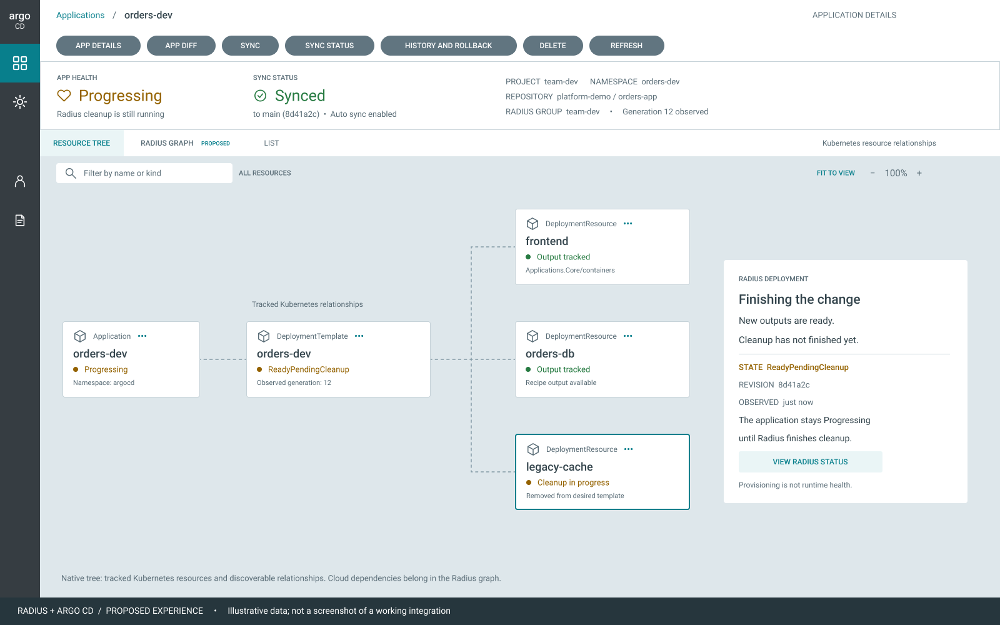

# Topic: Radius Integration with Argo CD

- **Author**: Will Tsai (@willtsai)

## Topic Summary

This specification proposes deploying Radius definitions through an Argo CD config management plugin and the same Radius controllers that Flux uses. The core integration reports sync and provisioning status without a GUI extension. An optional view embedded in Argo CD lets users follow Radius dependencies, diagnose a failed Recipe, and see supported workload health signals after deployment.

The [original GitOps feature specification](2024-06-gitops-feature-spec.md) remains the foundation for installation, deployment, and parameter-editing scenarios. The [DeploymentTemplate controller design](2024-10-deploymenttemplate-controller.md) and [Flux integration design](2025-01-gitops-technical-design.md) describe the underlying deployment model. This document defines the incremental Argo CD source and UI experience; it does not replace those documents or redesign the Flux workflow. All Argo CD-specific behavior below is proposed, not a statement of released capability.

### Top level goals

- Bring Radius definitions and parameter-only changes into Argo CD using the shared `DeploymentTemplate` deployment model already used by Flux, rather than creating a separate Radius deployment engine.
- Require safe secret-parameter handling in the first release of core Argo CD GitOps: deployment inputs reference Kubernetes Secrets, and the shared Radius controller resolves values at deployment time without exposing them in generated manifests, deployment objects, status, events, or logs. This must work without the optional GUI extension.
- Let Argo CD users inspect Radius-managed applications without seeing only an opaque top-level custom resource.
- Distinguish Git synchronization, Radius provisioning, and observed workload health so a successfully applied manifest cannot conceal a failed Recipe or an unobserved deployment.
- Make a failed Bicep or Terraform operation traceable from the Argo CD application to the affected Radius resource, attempted revision, and actionable diagnostic.
- Respect existing operator, developer, and SRE permissions. Opening a graph or diagnostic must not grant access beyond the selected application and its authorized Radius scope.
- Let operators adopt Argo CD without installing Flux or changing an existing Flux installation. After operator setup, a developer or SRE should be able to complete Scenarios 2-5 without cluster-admin access: follow a Kubernetes workload to a dependency outside its Kubernetes resource tree (such as a cloud-hosted database), diagnose a failed Recipe, recover through Git, and recognize a later workload failure.

### Non-goals (out of scope)

- Replacing Flux, Argo CD, their reconciliation policies, or Git as the source of desired configuration.
- Redefining the original specification's Radius installation and authoring workflows, migrating existing Flux applications, or introducing a Flux UI integration (Flux doesn't offer a native GUI like Argo CD does).
- Building a new GitOps dashboard in Radius. The proposed UI work augments Argo CD; an existing Radius view may be linked for additional context.
- Making Argo CD directly reconcile every cloud resource created by a Recipe, or representing a dependency relationship as Kubernetes ownership solely to draw a graph.
- Building or containerizing application code, publishing Recipe artifacts, or automatically updating image references. These remain CI responsibilities; GitOps consumes the resulting configuration changes.
- Providing a complete Terraform plan, cloud drift detector, database rollback, or disaster-recovery system through Argo CD's manifest diff and history.
- Adding arbitrary cloud mutations, terminal access, or a second deployment engine to a Radius UI extension.
- Building a monitoring system or adding probes to check whether external services are running. V1 displays existing health signals.
- Introducing enterprise identity mapping, a new role-based access control (RBAC) model, or organization-wide application and environment discovery in v1.
- Managing the lifecycle of the Radius installation, cloud credentials, Environments, or Recipe packs through the application's Argo CD sync.
- Requiring all future GitOps tools to offer Argo CD's UI features. Common Radius deployment semantics should remain reusable, but UI integration is tool-specific.

## User profile and challenges

### User persona(s)

**Infrastructure operators / administrators** maintain Radius installations, environments, Recipe registrations, and Argo CD repository access, projects, destinations, and policies. They decide which integrations users can install and which resources they may manage.

**Application developers** define applications and dependencies, publish code through CI, and submit application-definition changes through Git. They need to understand which component or dependency is preventing a deployment from becoming usable.

**Site Reliability Engineers (SREs)** adjust approved parameters and diagnose provisioning and runtime failures. They need application-scoped visibility without permission to rewrite application definitions, inspect unrelated environments, or administer the entire cluster.

### Challenge(s) faced by the user

Applying a top-level Radius resource is not enough to explain what happened beneath it. A developer can see that GitOps accepted a configuration while a Recipe is still provisioning, Terraform has failed, or a workload cannot reach a dependency. An opaque resource prevents the developer from using the graph and diagnostic workflows that make Argo CD valuable.

The Kubernetes ownership tree also differs from the Radius application graph. Shared services, external infrastructure, and application dependencies do not necessarily exist as child Kubernetes objects. Users need these relationships without a misleading claim that Argo CD owns or continuously monitors every graph node.

At enterprise scale, an unfiltered resource-group dropdown or global application inventory is not a usable entry point. Users need to find the applications and environments relevant to their responsibilities, with access restrictions that remain effective when they follow graph edges or diagnostic links.

### Positive user outcome

I can keep Argo CD as my GitOps interface and use Radius's existing application and deployment model. I can answer which revision was applied, what Radius is provisioning, which dependency is blocked, and where to investigate without maintaining a separate application catalog or acquiring broad administrative access.

## Key scenarios

### Scenario 1: Connect Radius definitions to Argo CD

As an operator, I configure an Argo CD Application to use the Radius config management plugin for one Radius application in one environment. I select its source directory, Bicep entry point, parameter inputs, and destination. Other applications can live in the same repository and sync independently. The plugin renders a `DeploymentTemplate`; only after sync do the shared Radius controllers deploy it. A compilation or input error identifies what I need to fix before deployment.

### Scenario 2: Navigate Radius resources and dependencies inside Argo CD

As a developer, I open an Argo CD Application's resource tree and inspect its Radius deployment and discoverable Kubernetes resources. Without leaving that Application, I open the Radius dependency graph and follow a workload's connection to a shared database, even if the database has no Kubernetes object. I can tell which resources Radius deployed and which the application only references.

### Scenario 3: Diagnose convergence and Recipe failures through Argo CD

As an SRE, I open an application that is synchronized but still provisioning or degraded. I locate the blocked dependency and see a safe error summary, attempted revision, operation context, and last-observed state. A Terraform failure is visible even if it occurs before any child resource is created. After an authorized correction and reconciliation, the view shows the new attempt and outcome without presenting the previous attempt's success as current.

### Scenario 4: Review changes and recover through Argo CD

As a developer or SRE, I inspect the desired-input diff and deployment history for an application or parameter change. I can connect a failed attempt to its input revision and correct or revert that input in Git. Requested logical resource removals and pending cleanup are visible; Argo CD's manifest diff and rollback history do not imply a complete cloud-resource plan or restoration of deleted data.

### Scenario 5: See a workload failure after a successful deployment

As an SRE, I open a synced Application after a workload fails. Nobody has changed Git, and the last Radius deployment succeeded. I can see which workload reported the failure. For its dependencies, I can tell whether the integration has no health signal or has temporarily lost access to one.

## Key dependencies and risks

- **Shared Radius deployment foundation:** Argo CD must submit desired deployment inputs through the same `DeploymentTemplate` model and Radius controllers used by Flux. Reuse includes asynchronous operation handling and resource cleanup, not just manifest shape. Argo CD-specific source handling and presentation must not require a second provisioning path or change existing Flux users' behavior.
- **Argo CD compatibility:** The proposed integration depends on documented [config management plugins](https://argo-cd.readthedocs.io/en/stable/operator-manual/config-management-plugins/), [resource tracking](https://argo-cd.readthedocs.io/en/stable/user-guide/resource_tracking/), [custom health checks](https://argo-cd.readthedocs.io/en/stable/operator-manual/health/), and optional [UI extensions](https://argo-cd.readthedocs.io/en/stable/developer-guide/extensions/ui-extensions/). A supported Radius/Argo CD version range and the required administrator configuration are not yet established. Users must receive explicit prerequisites rather than a claim that installing a chart provides full integration.
- **Deployment status is not workload health:** An Argo CD Lua health check reads the status of its own object; it does not query cloud services or automatically inherit the health of Kubernetes descendants. Provisioning failures can be reported from `DeploymentTemplate` status. For later workload failures, the integration must identify an existing health signal and make it visible from the Application without rewriting the outcome of the deployment.
- **Resource identity and ownership:** A Radius deployment can produce multiple resources or reference shared infrastructure. Visibility must not give Flux and Argo CD concurrent reconciliation authority over the same desired resource, change Kubernetes garbage-collection relationships, or make shared resources prune targets. Cross-namespace and external relationships may require the Radius graph view rather than native tree placement.
- **Authorization across systems:** Argo CD project permissions, Kubernetes namespace access, and Radius resource-group permissions are not interchangeable. A deployment target or graph URL must not bypass the user's permitted Radius scope. If an extension queries a backend, the [proxy extension contract](https://argo-cd.readthedocs.io/en/stable/developer-guide/extensions/proxy-extensions/) requires backend validation in addition to Argo CD authorization; a permitted application must not become a route to arbitrary Radius resources.
- **Sensitive output and trusted extensions:** Recipe diagnostics, rendered templates, parameters, and cloud identifiers may contain sensitive information. Status summaries and links must exclude credentials and secret values. Detailed diagnostics require appropriate authorization and redaction; installing a plugin or UI extension is an administrator-controlled trust decision.
- **Secret references and controller authority:** Bicep `@secure()` does not encrypt values serialized into a Kubernetes custom resource. V1 requires a shared Secret-reference contract, not GUI-only masking. Restrict initial references to the deployment's Kubernetes namespace, constrain controller reads, and enforce which Secrets a deployment may consume; permission to submit a deployment must not grant unrestricted use of the controller's Secret access. Operators remain responsible for secure Secret provisioning, Kubernetes RBAC, and encryption at rest.
- **Deletion and recovery:** Removing a resource inside a deployment template can delete infrastructure even when Argo CD is not pruning the template object. Operators need a Radius-level deletion policy and visibility of requested removals, not reliance on Argo CD's prune toggle alone. Reapplying an earlier configuration cannot undo data loss or every provider-side change.
- **Freshness and scale:** A graph can become misleading when observations are stale, incomplete, or too large to navigate. Display observation scope and freshness, support scoped search and incremental expansion, and validate the experience against an agreed representative application inventory.
- **Flux compatibility:** Shared status or resource-identity improvements must not require Flux users to install Argo CD, replace `radius-gitops-config.yaml`, or migrate existing resources. Adoption of the shared Secret-reference contract and migration from existing inline secret parameters in Flux are tracked separately in [#13500](https://github.com/radius-project/radius/issues/13500); preserving compatibility does not mean the existing plaintext path is safe. Flux and Argo CD may serve different applications, but must not reconcile the same deployment inputs concurrently. Migration between tools is outside this proposal.

## Key assumptions to test and questions to answer

- **Graph coverage:** Starting in the native tree, can an operator use the embedded Radius dependency graph to find a shared database and diagnose a Recipe that failed before producing an output? Validate which nodes and edges the deployed graph API returns, what desired-source or operation context is needed for missing outputs, and which details the caller is allowed to see.
- **Minimum useful visibility:** The motivating need is dependency navigation and downstream convergence/error feedback. Manifest diffs, history, log links, and filtering are proposed supporting experiences, not a confirmed checklist of customer requests. Confirm their relative priority and whether authorized deep links are sufficient for detailed logs.
- **Plugin adoption:** Will target operators approve installing a config management plugin in their Argo CD repo-server? Confirm with them before claiming they can adopt v1. Where policy prohibits plugins, this proposal does not supply a plugin-free workflow. Verify that rendering the same inputs produces the same manifest without deploying or reading Secrets.
- **Split repositories:** The original specification includes definition and parameter repositories with separate permissions. How will the Argo CD source integration select and authorize both revisions? Validate this separately; neither a local Bicep `using` path nor the existing Flux source configuration proves cross-repository support.
- **Secret-reference contract:** Secret references are in scope for v1; the exact API and authoring syntax, supported secure parameter types, treatment of secure defaults, binding validation, and enforceable Secret-use authorization need design agreement. Define rotation and retry triggers when a Secret changes without a Git revision change, including safe change-detection metadata. Validate missing keys, denied access, unsupported inputs, and migration from inline values before release; these are required design decisions, not reasons to silently fall back to plaintext.
- **Status coverage and freshness:** Prototype a successful sync, then cause a tracked Kubernetes workload to report a failure without changing Git. Verify where the failure appears on the workload and in the enclosing Application, whether it contributes to Argo CD's native Application health, and how the view behaves if the signal goes stale. A tree relationship or a Lua check on `DeploymentTemplate` alone is not evidence that the failure reaches the Application.
- **Application boundaries:** With two Applications targeting different paths in one repository, verify that a change to one application's inputs does not deploy or prune the other. Managing several Radius applications or environments as one Argo CD Application is outside v1.
- **Access enforcement:** Can the backend verify access to both the selected Argo CD Application and its configured Radius scope using existing permissions? Test direct requests as well as navigation. Where the boundary cannot be enforced, do not enable backend graph or diagnostic access; do not require a new enterprise identity system to use core sync.
- **Deletion and retry semantics:** What operator-configured approval or retention policy governs removals within a template, shared resources, and failed partial deployments? Which failures retry automatically, and how can users request an authorized retry without changing intent? Define these behaviors before enabling destructive or retry actions; a UI refresh must not imply a new deployment.
- **Compatibility and support:** Which Radius and Argo CD versions, extension mechanisms, and Recipe types work together? Verify the plugin, health customization, and optional graph extension against the documented combinations before claiming support.

## Current state

The [original GitOps specification](2024-06-gitops-feature-spec.md) establishes tool-neutral user scenarios. The [Radius Flux Controller design](2025-01-gitops-technical-design.md) describes the implemented Flux-specific source integration and explicitly excludes Argo CD. The [Flux controller](../../../pkg/controller/reconciler/flux_controller.go) reads Flux `GitRepository` artifacts, uses `radius-gitops-config.yaml` to select Bicep files and parameters, and creates or updates Radius `DeploymentTemplate` resources.

The reusable foundation is the deployment model beneath that Flux-specific source handling:

- **Deployment inputs:** The [DeploymentTemplate API](../../../pkg/controller/api/radapp.io/v1alpha3/deploymenttemplate_types.go) represents compiled template content, parameters, and provider scope. Argo CD can target this shared input model instead of requiring users to adopt a separate Radius definition format.
- **Execution and lifecycle:** The [DeploymentTemplate reconciler](../../../pkg/controller/reconciler/deploymenttemplate_reconciler.go) drives asynchronous Radius deployments, emits failure events, and creates owned `DeploymentResource` records for successful outputs. The proposed Argo CD integration reuses this execution and cleanup behavior; the source plugin and UI do not execute Recipes.
- **Status:** The existing API exposes an observed generation, deployment phrase, operation state, and output resource IDs. Phrases include `Updating`, `Ready`, `ReadyPendingCleanup`, `Failed`, `Deleting`, and `Deleted`. These are the starting points for Argo CD health reporting, not proof of complete dependency-health aggregation or continuous runtime monitoring.
- **Manifest generation:** The [`rad bicep generate-kubernetes-manifest` command](../../../pkg/cli/cmd/bicep/generatekubernetesmanifest/generatekubernetesmanifest.go) already generates a `DeploymentTemplate` manifest. The plugin can reuse this capability; v1 does not require users to run the command or commit its output.

The current manifest generator and Flux source controller copy supplied parameter values into `DeploymentTemplate.spec.parameters`, which is a map of strings. The shared deployment controller consumes those values directly; the API does not yet expose the proposed Secret-reference binding. Marking a Bicep parameter `@secure()` does not prevent this serialization. A user permitted to read the deployment object may therefore see supplied secret values. Reusing the deployment model requires extending its input and resolution contract, not claiming secret references already work.

The [`rad app graph` command](../../../pkg/cli/cmd/app/graph/graph.go) distinguishes a graph modeled from Bicep from one retrieved through the Radius deployed application graph API. The latter supplies resource identities and relationships for the proposed Argo CD view. It is not an Argo CD renderer or a source of continuous runtime health.

The proposed additions are Argo CD source configuration, shared secret-parameter references and resolution, native resource visibility, health customization, diagnostic correlation, and an optional Radius graph view. The Flux `GitRepository` adapter remains Flux-specific; Argo CD does not need it or `radius-gitops-config.yaml` merely to consume a generated manifest. Existing deployment status and output records do not by themselves expose every Recipe-created component or application dependency in Argo CD.

Argo CD's documented UI extensions can add resource/application tabs and application views, and [external URL links](https://argo-cd.readthedocs.io/en/stable/user-guide/external-url/) can connect a resource to an existing diagnostic view. These are available integration surfaces, not evidence that a Radius extension is installed or supported today.

## Details of user problem

I already use Argo CD to manage application configuration. Radius has a deployment foundation used by Flux, but I need to use it through Argo CD without installing another GitOps tool or losing the UI workflows my team relies on. My SRE colleagues must still be able to change approved inputs without gaining permission to change the whole application definition.

When I inspect a Radius deployment in Argo CD, a single custom resource cannot tell me whether its dependencies exist, whether Terraform converged, or which component is blocking the application. I need to navigate the actual application relationships and observed resources, not maintain an independently authored diagram. When data is missing or I lack permission, I need to know what I can do next without being given misleading health information or access to another team's resources.

## Desired user experience outcome

I can connect Radius definitions or parameter updates to Argo CD while retaining Radius's shared deployment behavior. In Argo CD, I can distinguish the accepted Git revision from Radius provisioning progress, navigate from an application to an affected dependency, and inspect authorized diagnostics. I can recover through an approved Git change while preserving my team's ownership and access policies.

### Detailed user experience

**Prepare the target before application sync.** As a platform operator, I install Radius and its CRDs, configure cloud credentials, and make the target Radius Environment and required Recipe packs ready before the application syncs. The application does not create, update, or prune these shared resources. If my team manages them through a separate GitOps process, we establish readiness there before enabling the application sync. Directory names such as `env/` and `app/` are conventions, not prerequisites or sync-order controls.

**Configure the application source.** I install the Radius plugin in Argo CD and grant the project access to its repository and destination. In this example, `orders-dev` selects `apps/orders` from a shared repository; `billing-dev` could select `apps/billing` in the same repository without taking ownership of `orders`. Each Application explicitly selects its Bicep entry point, parameter inputs, and Radius target. The YAML illustrates the Argo CD source and manual-sync configuration, not a final plugin name or input syntax.

```yaml
apiVersion: argoproj.io/v1alpha1
kind: Application
metadata:
  name: orders-dev
  namespace: argocd
spec:
  project: team-dev
  source:
    repoURL: https://git.example.com/team/services.git
    targetRevision: main
    path: apps/orders
    plugin:
      name: radius-bicep # Illustrative name
  destination:
    server: https://kubernetes.default.svc
    namespace: orders-dev
```

I commit the Bicep definition and parameter references, not generated manifests. Argo CD calls the plugin to render the selected inputs and reports compilation errors before sync. Refreshing the source or viewing a diff never provisions infrastructure.

**Submit existing Radius definitions and parameter changes.** I use the application-definition and approved-parameter workflows from the original specification against the prepared Environment. In Argo CD, a definition or parameter-only commit identifies the input revisions and destination for the resulting Radius deployment. Missing or inaccessible inputs cause a visible error rather than a deployment with implicit defaults. Changes to supported Bicep compiler configuration also participate in source generation. Split-repository resolution remains an explicit question rather than an assumed capability inherited from Flux.

Credentials remain in the approved credential-management system, not plaintext Git files or generated manifests. After CI publishes an application image or Recipe artifact, I update its immutable reference in the desired configuration; publishing the artifact alone does not trigger this workflow.

**Supply secret parameters without exposing values (v1).** As an operator, I populate a Kubernetes Secret through an approved secret-management integration or another authorized process outside plaintext Git. As an application author, I bind a secure parameter to that Secret's name and key rather than supplying its value inline. For example, a database password parameter can reference key `password` in Secret `orders-db-credentials` in the deployment's namespace. This is an illustrative binding, not an existing API or command syntax; ordinary non-secret parameters retain their supported value-based workflow.

The plugin preserves references without reading the Secret during compilation, generation, refresh, or diff. Only the shared Radius deployment controller resolves an authorized reference when preparing a deployment and passes the value to the deployment engine. It must not copy resolved values into compiled/generated artifacts, the `DeploymentTemplate`, status, events, logs, or diagnostic views. Hiding a value in the GUI is insufficient because readers can also inspect the underlying object.

The controller uses least-privilege access and an enforceable policy limiting which Secrets this deployment may consume. Cross-namespace references are rejected for the initial contract. Missing Secrets or keys, denied access, invalid or unsupported secure inputs, and conflicting inline/reference bindings prevent a new deployment with a safe, actionable error. Inputs that would embed a secure parameter value in generated template content or parameter fields must be rejected rather than silently using plaintext or a default.

Secret rotation must have a documented, tested reconciliation trigger even when Git inputs are unchanged, with explicit retry behavior and non-sensitive change-detection metadata. Removing a binding or deleting the application must not delete an externally managed Secret. Kubernetes Secret encoding is not encryption; operators still configure storage protection and access controls. Moving a value to a Secret cannot remove previously exposed values from Git history, logs, or other stored copies; migration guidance must require rotating affected credentials.

V1 completion requires end-to-end evidence for successful Secret-backed deployment, missing or denied references, conflicting bindings, rotation, retry, and deletion, plus checks that synthetic secret values never appear in generated manifests, deployment objects, status, events, or logs. Shared controller changes must preserve ordinary Flux parameter and lifecycle behavior. Flux-specific authoring and migration are separate follow-up work, not a dependency on the Argo CD GUI.

**Inspect the application and graph.** I select my application in Argo CD and see the Git revision, sync status, and health as distinct information. The native resource tree identifies the Radius deployment and Kubernetes descendants that can actually be discovered through valid relationships and permissions. Selecting a resource preserves the current application, environment, and revision context.

In the same Argo CD Application, I open the **Radius dependency graph**. I can find a component by name or type, follow a connection to a shared or external dependency, and distinguish desired relationships from observed deployed resources. Nodes identify the logical Radius resource, its type, its environment, and any authorized deployed-resource reference. An external node is not presented as a Kubernetes object or as directly managed by Argo CD.

The graph derives from Radius definitions and observed resources rather than a second manually maintained catalog. It labels ownership separately from dependency links and distinguishes resources in this deployment from references managed elsewhere. An unsupported resource, missing observation, loading failure, or restricted dependency cannot silently disappear or appear healthy. Authorized external links preserve resource context but do not grant access to their destinations. A link-only experience can supplement the graph; it does not satisfy the requirement to navigate dependencies within Argo CD.

**Read convergence and health correctly.** Argo CD's native sync status continues to describe its comparison of desired and live Kubernetes manifests. A deployment may therefore be `Synced` while its Radius health is `Progressing` or `Degraded`. The proposed health customization and Radius view must communicate the following:

| Observed situation                                                             | Required user-visible behavior                                                                                                                                 |
|--------------------------------------------------------------------------------|----------------------------------------------------------------------------------------------------------------------------------------------------------------|
| New desired generation is not yet observed, or provisioning is active          | Show `Progressing` with the attempted revision and pending work; never reuse an earlier generation's healthy result.                                           |
| Bicep or Terraform provisioning fails, including before output resources exist | Show `Degraded` for the affected Radius deployment and enclosing Argo CD application, with a safe reason and operation context.                                |
| Latest deployment succeeds but removed resources are still being cleaned up    | Keep convergence `Progressing`; explain cleanup rather than reporting completion from `ReadyPendingCleanup`.                                                   |
| Latest generation is successfully provisioned and required cleanup is complete | Report successful provisioning. Label the scope of any `Healthy` assessment; do not imply continuous runtime or external-service health that was not observed. |
| A supported dependency observation reports a failure after provisioning        | Show the affected node and an application-visible health problem; do not hide it behind the successful deployment result.                                      |
| No supported runtime health signal exists for this resource                    | Show `Not monitored`. Provisioning status is still available; it does not establish runtime health.                                                            |
| A supported runtime signal cannot be read or is stale                          | Show `Temporarily unavailable`. If a last known result exists, label it with its observation time, not as current health.                                      |
| Application or resource access is denied                                       | Explain that the view is restricted without exposing protected names, configuration, diagnostics, or status.                                                   |

For example, if Argo CD reports a Kubernetes workload as degraded hours after a successful sync, I see the failure and the affected workload from the Application without a new Git commit. The Application can remain `Synced`, and the last Radius deployment still shows successful provisioning. If native Application health does not reflect that workload's condition, the embedded view identifies the workload and its reported failure.

If a Radius Recipe creates an Azure PostgreSQL database and the integration has no signal that tells me whether it is accepting connections, I see **Provisioning: Succeeded** and **Runtime health: Not monitored**. If a supported signal normally provides that information but cannot currently be read, I see **Runtime health: Temporarily unavailable** instead. Neither label means the database is down or healthy. These labels describe the observation in the Radius view; they are not new native Argo CD health states and do not require a database probe.

**Diagnose and recover.** I select a failed node or deployment and see which definition/revision was attempted, which Radius resource and Recipe were involved, the failure category, and a sanitized message. A failure before resource creation remains reachable from the deployment. Kubernetes events and permitted workload logs can remain in their native Argo CD surfaces; Recipe and provider diagnostics use a scoped Radius view or an authorized deep link, not an assertion that Argo CD has those logs natively.

If a Recipe fails because of an invalid input, I follow the source context, fix the input in Git, and inspect the new deployment attempt. If a credential or external service needs operator intervention, the message identifies the required action without exposing the credential. A temporary diagnostic-service outage leaves the deployment view usable, marks unavailable details, and offers refresh; refreshing is not a deployment retry.

I use Argo CD's manifest diff to inspect the desired Kubernetes input changes and history to locate the attempted revision. This is not a full cloud-resource plan: removing a logical resource inside `DeploymentTemplate.spec.template` is an update to that object, not necessarily an Argo CD prune operation. The Radius experience identifies requested logical removals and applies the configured deletion policy; it must not imply a complete provider-level impact analysis.

For recovery, I normally revert the desired configuration, including the image or Recipe reference, in Git. Argo CD [does not permit rollback while automated sync is enabled](https://argo-cd.readthedocs.io/en/stable/user-guide/auto_sync/); its imperative history rollback is not a substitute for restoring the Git source of truth. Neither path promises to recover deleted data. Pending or failed cleanup remains visible until it completes or an operator resolves it.

**Stay within existing permissions.** I open an Application I can already access in Argo CD. Its configured Radius target bounds the view; I do not need to browse an organization-wide inventory or map enterprise roles. The backend checks graph queries, diagnostics, and direct URLs against that Application and the caller's permitted Radius scope. The extension is read-only. Sync and deletion remain subject to existing controls, and a denied request reveals no protected resource details.

I can search and expand a large graph incrementally instead of loading an unrestricted inventory. The extension provides keyboard navigation, visible focus, textual status labels that do not rely on color, and an accessible list equivalent for graph relationships. Empty, loading, partial, stale, and permission-denied states retain application context and give an appropriate next action. Disabling the optional graph extension leaves core synchronization and configured health reporting available.

#### Example Argo CD UI screenshots

These mockups use synthetic data to illustrate provisioning and failure diagnosis inside Argo CD. They are not a working integration or a requirement to reproduce this layout. They show automated sync rather than the manual sync used above; Scenario 5 describes the post-deployment experience not pictured here.

**Native resource tree and convergence.** The application is `Synced`, but its health remains `Progressing` while Radius finishes cleanup in `ReadyPendingCleanup`. The tree shows tracked Kubernetes resources and discoverable relationships, not fabricated child objects for external dependencies.



**Radius dependency graph.** The proposed graph view follows logical dependencies beyond Kubernetes ownership. It distinguishes previously provisioned workloads from the current failed database change and marks the shared external cache as unobserved rather than healthy. Dependency links do not confer ownership or prune authority.


**Recipe failure diagnostics.** The proposed resource tab exposes a sanitized Terraform policy error, attempted revision, operation context, and deployment trace even when the attempt creates no new output records. Source and diagnostic links support an authorized correction through Git rather than direct cloud mutations.


## Key investments

### Feature 1: Argo CD source integration using shared Radius deployments

The config management plugin is the only proposed v1 source workflow. As part of the core integration, the Radius project would package, publish, and maintain the plugin and its installation, upgrade, and compatibility instructions. Argo CD administrators choose whether to install it and configure repository and destination access. Application teams supply definitions and parameters; they do not have to author or publish a separate manifest-generation workflow.

Core implementation [#12999](https://github.com/radius-project/radius/issues/12999) also owns the v1 Secret-reference API, deploy-time resolution, authorization, validation, redaction, and rotation/retry contract. This is not GUI-extension work in [#13351](https://github.com/radius-project/radius/issues/13351). The existing Flux implementation adopts the same shared support through [#13500](https://github.com/radius-project/radius/issues/13500), with its own source-adapter changes, migration guidance, and regression coverage rather than a second resolver.

### Feature 2: Native Argo CD resource visibility

Let users find the Radius deployment and inspect discoverable Kubernetes descendants through Argo CD's existing resource tree and detail panels. Preserve actual ownership and resource identity, avoid competing reconciliation and prune ownership, and identify relationships that require the Radius graph view. Showing only a successful top-level apply does not complete this feature's user outcome.

### Feature 3: Radius convergence and error reporting in Argo CD

Use existing deployment phrases, observed generations, output records, and failure events for native Argo CD provisioning health, including failures before output creation and pending cleanup. Report later workload failures from supported observations as described in Scenario 5. Document which conditions reach native Application health and which appear in the embedded view. Neither path requires Radius to monitor external services.

### Feature 4: Optional Radius dependency graph within Argo CD

Render a read-only dependency graph inside the selected Argo CD Application. Reuse the Radius deployed graph API for resource identities and relationships rather than building a second catalog. The extension renders those relationships, distinguishes desired-only resources from deployed outputs, and adds authorized health and diagnostic information where available. A failed operation with no output remains reachable from the deployment. If the graph API is unavailable, show that the view could not refresh; do not present an empty graph as the deployed topology.

### Feature 5: Git-consistent change review and recovery

Make definition and parameter revisions, desired-input diffs, logical removals, and deployment attempts traceable. Preserve Git-based recovery, operator-configured deletion controls, and clear warnings about cloud-plan, prune, and data-recovery limits. Establish explicit retry semantics rather than adding an ungoverned deployment action to the UI.

### Feature 6: Accessible navigation within existing access boundaries

Keep the selected Application's scope, backend access checks, and redaction in force through graph navigation and diagnostics. Provide keyboard and list navigation within that scope. New enterprise role mapping and cross-application discovery are follow-up work, not conditions for delivering core sync or the optional GUI.
