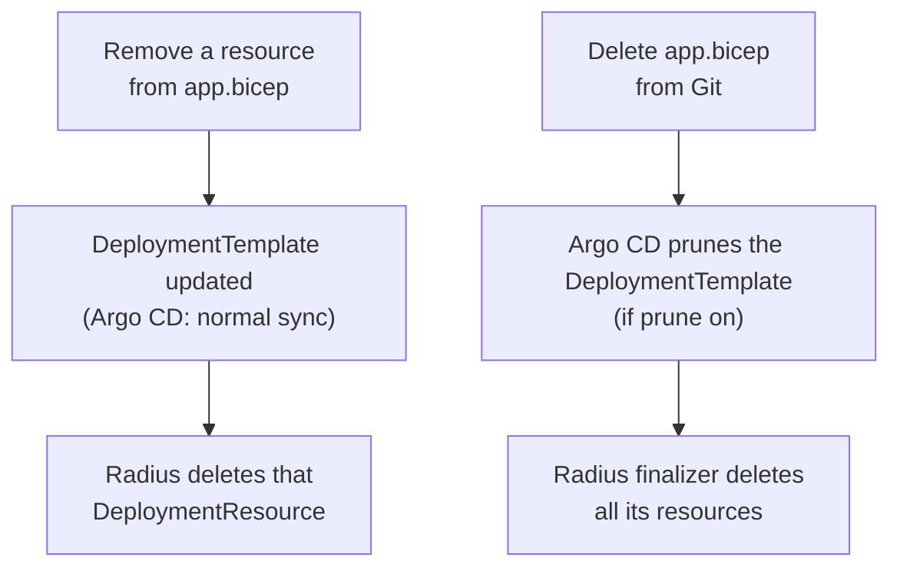
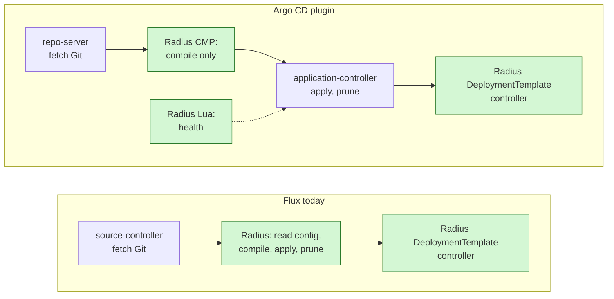
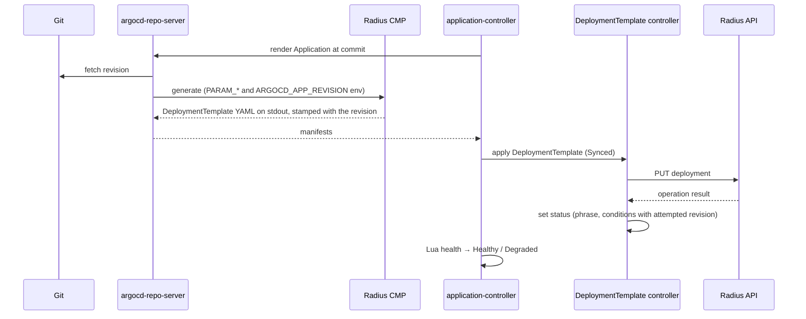
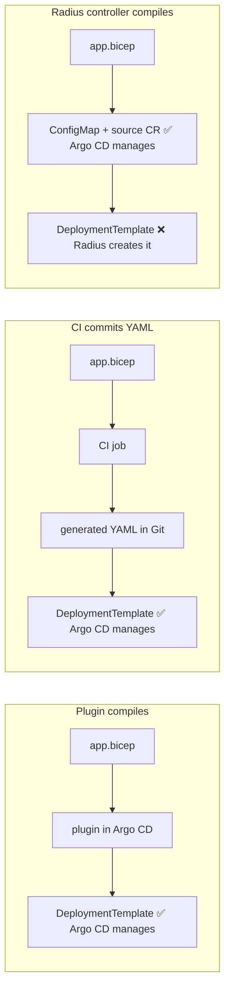
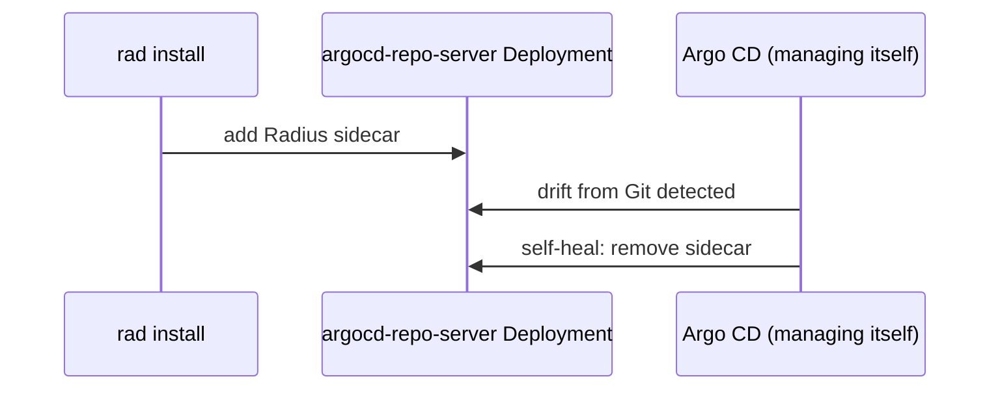

# Radius support for Argo CD

- **Author**: Nithya Subramanian (@nithyatsu)

## Review guide

This is a high-level design for the [Argo CD feature spec](https://github.com/radius-project/radius/pull/13284). Following that spec, it proposes a Radius Argo CD plugin that compiles Bicep, with generated manifests committed by CI as the fallback where plugins are not allowed. A Radius controller approach was also designed and is kept under [Alternatives considered](#alternatives-considered). Richer failure status and typed parameters change the `DeploymentTemplate` CRD and controller, which Flux also uses, so Flux users will see the new fields too; they need sign-off from the controller owners. The plugin runs repository content inside Argo CD, so it needs security sign-off. Open Questions are not up for decision yet; several come from the feature spec and need answers before the matching features ship. The work ships in four [delivery phases](#delivery-phases); each goal, scenario and work item says which phase delivers it. Phase 1 needs no CRD changes.

## Decisions for review

| Decision                                                                                                         | Options considered                                                                                                                        | Recommendation                                                                                                                                   | Risk if wrong                                                                                | Status |
|------------------------------------------------------------------------------------------------------------------|-------------------------------------------------------------------------------------------------------------------------------------------|--------------------------------------------------------------------------------------------------------------------------------------------------|----------------------------------------------------------------------------------------------|--------|
| [Who compiles Bicep for Argo CD?](#who-compiles-bicep-for-argo-cd)                                               | Argo CD plugin / CI / Radius controller                                                                                                   | Argo CD plugin, as the feature spec proposes; generated manifests from CI as the fallback where plugins are not allowed                          | Radius maintains a sidecar inside Argo CD, and admins who cannot install it fall back to CI  | Open   |
| [How is the plugin sidecar installed?](#how-the-plugin-sidecar-is-installed)                                     | Admin adds it / `rad install` switch / `rad argocd configure` helper                                                                      | Admin adds it from published snippets                                                                                                            | A manual step that admins skip or let drift                                                  | Open   |
| [How are health checks delivered?](#how-the-health-checks-are-delivered)                                         | Upstream to Argo CD / `argocd-cm` snippet / Radius patches `argocd-cm`                                                                    | Upstream, plus a snippet for older Argo CD versions                                                                                              | Older Argo CD shows Radius objects with no health                                            | Open   |
| [How do Radius CRDs report why a deployment failed?](#how-radius-crds-report-failure-reasons)                    | `status.message` / `status.conditions` / both                                                                                             | `status.conditions`, keeping `phrase`                                                                                                            | Argo CD shows Degraded with no reason                                                        | Open   |
| [How is the sidecar versioned?](#how-the-sidecar-is-versioned)                                                   | Released with each Radius release / versioned independently                                                                               | Released with each Radius release, with a mismatch check                                                                                         | Compiled output silently differs from what the Radius control plane expects                  | Open   |
| [How are non-string parameters carried?](#how-non-string-parameters-are-carried)                                 | Strings only, documented / new typed field / JSON-encode in strings                                                                       | New typed field, added alongside the existing one                                                                                                | Parameter-only changes (scenario 1) fail for integers, booleans, arrays and objects          | Open   |
| [How does the plugin name the `DeploymentTemplate`?](#how-the-plugin-names-the-deploymenttemplate)               | Bicep file name / Argo CD Application name / user-set parameter                                                                           | Keep the file name; v1 supports one Radius application per namespace                                                                             | Two Applications in one namespace overwrite each other's template                            | Open   |
| [How are environments kept out of the application view?](#how-environments-are-kept-out-of-the-application-view) | One Application for both / separate environment Application / environments set up with `rad` / UI extension / per-user collapse or filter | The application's Argo CD Application deploys only `app/`; environments are set up outside it, by a separate environment Application or by `rad` | Developers see platform objects in their app, or the app syncs before its Environment exists | Open   |

## Overview

Radius supports GitOps with Flux today: a Radius controller compiles Bicep from a Flux `GitRepository` into `DeploymentTemplate` resources, and a second controller deploys them through the Radius API. Argo CD users have no equivalent. This design proposes supporting Argo CD.

In a nutshell, users keep `.bicep` and `.bicepparam` files in Git and point an Argo CD Application at them. Argo CD cannot render Bicep, so something must compile it into a `DeploymentTemplate`:

- **Argo CD plugin (proposed):** a Radius Config Management Plugin (CMP) sidecar compiles during sync, and Argo CD applies the `DeploymentTemplate`.
- **Generated manifests (fallback):** where Argo CD admins do not allow plugins, a CI pipeline compiles the Bicep and commits the generated YAML, and Argo CD applies it as plain manifests.
- **Radius controller (alternative considered):** Argo CD applies the Bicep source, and the Radius controller compiles it, as with Flux.

Either way, Argo CD compares the `DeploymentTemplate` with the one in the cluster and applies the changes. The existing Radius `DeploymentTemplate` controller then deploys it, and Argo CD health checks report the Radius result.

## Terms and definitions

| Term                            | Definition                                                                                                                                                                                   |
|---------------------------------|----------------------------------------------------------------------------------------------------------------------------------------------------------------------------------------------|
| Argo CD Application             | Argo CD custom resource that maps a Git source (repository, revision, path, renderer) to a destination cluster and namespace.                                                                |
| AppProject                      | Argo CD custom resource that limits which repositories, clusters, namespaces and resource kinds an Application may use.                                                                      |
| ApplicationSet                  | Argo CD custom resource that generates many Applications from a template, for example one per environment or cluster.                                                                        |
| `argocd-repo-server`            | Argo CD component that clones Git and renders manifests (plain YAML, Kustomize, Helm, or a plugin). It never talks to the destination cluster.                                               |
| `argocd-application-controller` | Argo CD component that diffs rendered manifests with the live cluster, syncs, prunes, and computes health.                                                                                   |
| Config Management Plugin (CMP)  | An Argo CD extension point for custom renderers. It runs as a sidecar container in the `argocd-repo-server` pod and prints manifests to stdout.                                              |
| Sync status                     | Whether live objects match the rendered manifests: Synced or OutOfSync.                                                                                                                      |
| Health status                   | Argo CD's per-object and per-Application health: Healthy, Progressing, Degraded, Suspended, Missing or Unknown. Custom kinds get health from Lua scripts.                                    |
| Prune                           | Argo CD deleting live objects that are no longer in the rendered manifests.                                                                                                                  |
| Self-heal                       | Argo CD reverting live changes that were not made through Git.                                                                                                                               |
| `DeploymentTemplate`            | Radius CRD (`radapp.io/v1alpha3`) holding compiled ARM JSON, parameters and provider config. Its controller deploys it through the Radius API.                                               |
| `DeploymentResource`            | Radius CRD that the `DeploymentTemplate` controller creates and owns for each output resource. Deleting it deletes the Radius resource.                                                      |
| Phrase                          | The `status.phrase` field on the Radius CRDs. `DeploymentTemplate`: Updating, Ready, ReadyPendingCleanup, Failed, Deleting, Deleted. `DeploymentResource`: Ready, Failed, Deleting, Deleted. |
| Ops repo                        | The Git repository that holds deployable definitions (`.bicep`, `.bicepparam`) and that Argo CD watches.                                                                                     |

## Objectives

> **Issue Reference:** N/A. The tool-neutral scenarios are in the [GitOps feature spec](2024-06-gitops-feature-spec.md); the Argo CD requirements are in the [Argo CD feature spec](https://github.com/radius-project/radius/pull/13284), called "the feature spec" below.

This design shares its deployment engine and first three goals with the [Flux controller design](2025-01-gitops-technical-design.md#goals). It diverges from that design in one way: Radius does not read Git or select files itself, because Argo CD already does both.

### Goals

1. **(Phase 1) Integrate GitOps workflows with Radius and Bicep.** Users put Bicep files and parameters in Git, and Argo CD deploys them through Radius without Flux. This covers Radius Environments, Recipe registrations, Applications and resources. Changing only a parameter file or `bicepconfig.json` triggers a deployment, just as changing a definition does. Non-string and secure parameters follow in Phase 2.
2. **(Phase 1) Make the deployed state match Git.** Radius creates, updates and deletes resources as Git changes, including resources removed from a Bicep file and whole Bicep files removed from the repository. Reverting a commit restores the previous configuration. Documented limits: reverting does not restore deleted data, and Radius does not detect drift in cloud resources.
3. **(Phase 1) Fit existing Argo CD workflows.** Users keep Applications, ApplicationSets, projects, sync policies, prune, and the Argo CD UI and CLI. Radius adds only a plugin and health checks. It adds no Radius-specific configuration file such as `radius-gitops-config.yaml` and no Radius code that reads Git. Radius does not change Kubernetes garbage-collection relationships or make shared resources prune targets.
4. **Report the Radius outcome as Argo CD health**, including Recipe failures, kept separate from sync status. Phase 1 reports provisioning health and labels Healthy as provisioning health. Phase 4 makes supported failures after provisioning turn the Application Degraded, as the feature spec requires (see [Health mapping](#health-mapping)).
5. **(Phase 2) Make failures traceable** from the Argo CD Application and the attempted Git revision to the Radius resource that failed, with a redacted error message. Phase 1 already shows the revision and the raw Radius message. Pinning a failure to one Radius resource needs data Radius does not record today; see [open question 13](#open-questions).
6. **(All phases) No breaking changes for Flux.** Existing Flux setups keep working without changes. Flux and Argo CD share the `DeploymentTemplate` CRD and controller, so the additive status conditions and typed parameters also appear for Flux users, and typed parameters fix non-string parameters being silently dropped on the Flux path.

### Non goals

- Replacing Argo CD sync, prune or RBAC, or building a separate GitOps dashboard in Radius. Argo CD already owns these.
- Having Argo CD reconcile cloud resources directly. Radius and Recipes own that.
- CI work: building images, publishing Recipes, or updating image tags. Existing CI tools own that.
- Terraform-plan-style previews or recovery of deleted data. Out of scope for a first release.
- Migrating applications between Flux and Argo CD. Possible follow-up.
- Showing the Git revision on Radius resources outside Argo CD, for example in `rad` or the Radius dashboard. Argo CD and the Radius CRD status already answer which revision was applied.

### Delivery phases

Each phase is usable on its own, and a later phase never changes how an earlier one behaves. The [Development plan](#development-plan) lists the work items per phase.

| Phase                             | Scenarios     | Users get                                                                                                                                                        | Main changes                                                                         | Waiting on                                                                 |
|-----------------------------------|---------------|------------------------------------------------------------------------------------------------------------------------------------------------------------------|--------------------------------------------------------------------------------------|----------------------------------------------------------------------------|
| 1. Deploy and provisioning health | 1, 2, 3, 4, 5 | Bicep in Git deployed through Argo CD with the plugin or the CI fallback; Healthy, Progressing or Degraded from Radius provisioning, with the Git revision shown | Plugin sidecar, CLI fixes, Lua health checks, docs. No CRD changes                   | [Open question 12](#open-questions) (order of `env.bicep` and `app.bicep`) |
| 2. Why it failed                  | 1, 3, 4       | A redacted failure reason and category, the attempted revision, the resources being cleaned up, and non-string and secure parameters                             | Status conditions and typed parameters on the shared CRDs; affects Flux too          | [Open question 11](#open-questions) (secure parameters)                    |
| 3. Radius view inside Argo CD     | 2, 3, 5       | A "Radius" tab with the application graph, including resources outside the Kubernetes tree, and diagnostics                                                      | Argo CD UI extension and a proxy backend that reads the Radius application graph API | [Open question 13](#open-questions) (UI data and access)                   |
| 4. Health after provisioning      | 2, 3          | Supported runtime and dependency failures turn the Application Degraded; stale results are not shown as fresh Healthy                                            | Radius observes what it created and writes the result to `DeploymentTemplate` status | Open questions [6 and 7](#open-questions)                                  |

### User scenarios (optional)

The scenarios are the [feature spec's key scenarios](https://github.com/radius-project/radius/pull/13284), quoted as written. Under each, **This design** says how it is delivered and in which phase.

#### Scenario 1: Connect Radius definitions to Argo CD

> As an operator with Radius installed, I configure an Argo CD Application to consume generated `DeploymentTemplate` manifests or the proposed Radius Bicep source integration. Definition and parameter changes use the same Radius deployment semantics as the Flux path. I can identify the input revision and destination, and compilation or input errors prevent deployment with an actionable message. I do not need to install Flux.

**This design:**

- **(Phase 1)** An operator commits `env.bicep` (the Radius Environment and its Recipe pack); a developer commits `app.bicep` and `app.bicepparam`. An Argo CD Application points at that path with the Radius plugin, Argo CD syncs it, and Radius deploys it. Where plugins are not allowed, a CI job commits the generated manifests and the Application points at those instead (see [Who compiles Bicep for Argo CD](#who-compiles-bicep-for-argo-cd)).
- **(Phase 1)** The application deploys only after the Environment exists. The developer's Argo CD Application deploys only the `app/` folder, so its tree shows the application's resources and not the Environment or Recipe pack. The operator sets up the Environment outside that Application, either with a separate Argo CD Application for `env/` or with `rad` commands (see [How environments are kept out of the application view](#how-environments-are-kept-out-of-the-application-view)). Within one Application, the plugin parameter `bicepFiles` lists the files in deploy order; the plugin compiles each file into its own `DeploymentTemplate` and sets the `argocd.argoproj.io/sync-wave` annotation to the file's position. Argo CD applies a wave only after the previous wave is Healthy, and the health check reports Healthy only when Radius reports Ready. See [open question 12](#open-questions).
- **(Phase 1)** Argo CD shows the synced revision and destination, and the plugin stamps the revision on the `DeploymentTemplate`. A compile error fails rendering, so Argo CD shows a ComparisonError and does not sync.
- **(Phase 1, non-string parameters in Phase 2)** Changing only `app.bicepparam`, for example `replicaCount`, changes the `DeploymentTemplate` parameters, so Argo CD syncs and Radius redeploys. Phase 1 supports string parameters only. Whether it works when the `.bicepparam` file lives in a different repository is [open question 1](#open-questions).
- **(Phase 1)** Installing Radius itself as an Argo CD Application from the Helm chart is not in the feature spec's scenarios. Phase 1 validates and documents it, because operators who use Argo CD will try it.

#### Scenario 2: Navigate Radius resources and dependencies inside Argo CD

> As a developer, I open an Argo CD application's resource tree and inspect its Radius deployment and discoverable Kubernetes resources. From that context, I open the proposed Radius graph view to follow application dependencies, including external or shared resources and custom resource types. The view identifies each relationship and its source; resources with no live observation are explicitly shown as unobserved rather than healthy.

**This design:**

- **(Phase 1)** The tree shows the `DeploymentTemplate` and its `DeploymentResource` children, with Radius-derived health. Kubernetes objects and cloud resources that Radius creates are not in the tree; which ones could be is [open question 2](#open-questions).
- **(Phase 3)** An optional Argo CD UI extension adds a "Radius" view with the application graph, including Radius-created Kubernetes objects, external and shared dependencies, and custom resource types. The graph comes from the existing Radius application graph API, the same data as `rad app graph`, which works for applications the controller deploys.
- **(Phases 3 and 4)** The graph has each relationship today. The "unobserved" state needs Radius to observe resources after provisioning, which is Phase 4; until then every resource is shown with provisioning status only, labelled as such. See [open question 13](#open-questions).

#### Scenario 3: Diagnose convergence and Recipe failures through Argo CD

> As an SRE, I open an application that is synchronized but still provisioning or degraded. I locate the blocked dependency and see a safe error summary, attempted revision, operation context, and last-observed state. A Terraform failure is visible even if it occurs before any child resource is created. After an authorized correction and reconciliation, the view shows the new attempt and outcome without presenting the previous attempt's success as current.

**This design:**

- **(Phase 1)** Argo CD computes Application health only from the `DeploymentTemplate`, because it is the object Argo CD applied from Git; the `DeploymentResource` children are shown for navigation and do not count. So the `DeploymentTemplate` status carries every failure below it, including a Recipe that fails before any child resource exists. Health shows Progressing, Healthy (provisioning only) or Degraded with the attempted revision (mapping in [Health mapping](#health-mapping)).
- **(Phase 2)** Status conditions add a redacted error summary, failure category, operation ID and last-observed time. The health check reports Progressing while the observed generation is behind, so a new attempt never shows the previous success as current.
- **(Phase 3)** Pinning the failure to one blocked dependency needs data Radius does not record today; see [open question 13](#open-questions).
- **(Phase 4)** Failures after provisioning, and stale results when the Radius controller stops.

#### Scenario 4: Review changes and recover through Argo CD

> As a developer or SRE, I inspect the desired-input diff and deployment history for an application or parameter change. I can connect a failed attempt to its input revision and correct or revert that input in Git. Requested logical resource removals and pending cleanup are visible; Argo CD's manifest diff and rollback history do not imply a complete cloud-resource plan or restoration of deleted data.

**This design:**

- **(Phase 1)** Argo CD's diff and history show the `DeploymentTemplate` change. The plugin pretty-prints `spec.template` so the diff shows only the changed lines.
- **(Phase 1) Revert:** `git revert` makes Argo CD apply the previous template, and Radius redeploys it. Argo CD history rollback works only when automated sync is off, so documentation recommends Git-based recovery.
- **(Phase 1, cleanup list in Phase 2) Remove one resource from a Bicep file:** the `DeploymentTemplate` is updated, not pruned. Radius deletes the removed resource through `DeploymentResource` cleanup, even when Argo CD prune is off, and documentation must say so. While cleanup runs, Argo CD shows Progressing; from Phase 2 the status also lists the resources being removed.
- **(Phase 1) Remove a whole Bicep file:** with prune on, Argo CD prunes the `DeploymentTemplate`, and Radius finalizers delete all of its resources.
- **(Phase 1) Retry:** fixing the input in Git and committing creates a new attempt. Refreshing the Application in Argo CD only re-renders; it is not a retry and never redeploys an unchanged template. Which failures Radius retries on its own, and how a user asks for a retry without changing Git, are [open questions](#open-questions).

**Two levels of deletion.** Argo CD prune only decides whether the `DeploymentTemplate` object itself goes away. What happens to the real resources is always Radius's job. Removing a line from `app.bicep` is a Radius-level delete that Argo CD never sees as a prune.



#### Scenario 5: Find and inspect only the applications within my scope

> As a developer or SRE, I enter through my existing Argo CD project and select an application and environment without browsing the organization's entire resource inventory. Searches, graph expansion, diagnostics, and direct links enforce the same effective access boundaries. Missing permission, unavailable data, and an empty authorized result have distinct, actionable states without revealing protected resource details.

**This design:**

- **(Phase 1)** Argo CD projects and RBAC already scope which Applications, and so which `DeploymentTemplate` objects, a user sees. Radius adds nothing here.
- **(Phase 3)** Radius has no per-user authorization, so the UI extension's proxy backend enforces the viewer's Argo CD project and Application scope on every search, graph expansion, diagnostic and direct link, and returns only the Radius application that the Application deployed. It shows distinct states for missing permission, unavailable data and an empty result, without protected names or details. It supports keyboard navigation and text status labels. See [open question 13](#open-questions).

## User Experience

**What changes for a Radius user who adopts Argo CD:**

| Today, without Argo CD support                                 | With Argo CD support                                                                            |
|----------------------------------------------------------------|-------------------------------------------------------------------------------------------------|
| Deploy with `rad deploy app.bicep`, or install Flux for GitOps | Commit `app.bicep` and `app.bicepparam`; Argo CD deploys them                                   |
| Status from `rad app status` or the Radius dashboard           | Status in the Argo CD UI: Synced/OutOfSync, plus Radius health (Progressing, Healthy, Degraded) |
| Recover by redeploying an earlier file by hand                 | Recover with `git revert`                                                                       |
| SREs need `rad` access to change values                        | SREs change `.bicepparam` through a PR                                                          |

Users still write Bicep, use Recipes and Environments, and get the Radius application graph.

**What changes for an Argo CD user who adopts Radius:** without Radius, Argo CD manages only Kubernetes objects, and cloud databases, queues and buckets need a separate tool such as Terraform pipelines or Crossplane. With Radius, one Argo CD Application delivers an app and its infrastructure, provisioned by Recipes. Argo CD stays the GitOps engine and UI; Radius compiles the application model and runs Recipes.

**Sample Input, Argo CD plugin:** an Argo CD Application using the proposed plugin. The plugin name and parameter names are new in this design.

```yaml
apiVersion: argoproj.io/v1alpha1
kind: Application
metadata: { name: orders-dev, namespace: argocd }
spec:
  project: default
  source:
    repoURL: https://github.com/contoso/orders
    targetRevision: main
    path: app # the Environment is set up separately
    plugin:
      name: radius-bicep
      parameters:
        - { name: bicepFiles, string: app.bicep } # deploy order
        - { name: resourceGroup, string: orders-dev }
  destination: { server: https://kubernetes.default.svc, namespace: orders }
  syncPolicy: { automated: { prune: true, selfHeal: true } }
  info: # optional rows in the Argo CD app header
    - { name: Radius group, value: orders-dev }
    - { name: Radius environment, value: dev }
```

**Sample Input, generated-manifest fallback:** CI runs `rad bicep generate-kubernetes-manifest` and commits the result to `generated/`. The Application points at that directory with no plugin, as in the feature spec.

```bash
rad bicep generate-kubernetes-manifest app.bicep --parameters @app.bicepparam --group orders-dev --destination-file generated/app.yaml
```

```yaml
spec:
  source:
    repoURL: https://github.com/contoso/orders
    targetRevision: main
    path: generated
```

**Sample Output:** the Argo CD Application tree after a Recipe failure.

```text
Argo CD Application "orders-dev"     Sync: Synced   Health: Degraded
└── DeploymentTemplate app.bicep     Health: Degraded  "Recipe 'db' failed: ... (revision 3f2a1c9)"
    ├── DeploymentResource .../containers/frontend   Healthy
    └── DeploymentResource .../redisCaches/db        Degraded
```

**Sample Recipe Contract:** No Recipe contract changes.

## Design

### High Level Design

Argo CD only applies Kubernetes YAML, so something must compile the user's Bicep and parameters into a `DeploymentTemplate`. The existing `DeploymentTemplate` controller then deploys it, as it does for Flux. There are three places the compiling can happen:

- **In Argo CD, through a plugin (proposed).** Argo CD's rendering hook (CMP) runs a Radius sidecar that compiles the Bicep. Argo CD applies and prunes the `DeploymentTemplate`, and Radius health checks (Lua) report its status. This is the source integration the feature spec proposes.
- **In CI (fallback).** A CI pipeline in each app repository runs `rad bicep generate-kubernetes-manifest` on every change and commits the generated `DeploymentTemplate` YAML back to the repository. Argo CD applies that YAML with no plugin. This works today with no Radius changes beyond the [CLI fixes](#cli-design), and the feature spec keeps it for organizations that do not allow plugins. It costs both personas, so it is not the default. Developers get generated YAML they never edit committed next to their Bicep, and must wait for the bot's commit before Argo CD can sync. The platform team must add a workflow file, permissions and a bot with push rights to every app repository, and update the pinned `rad` version in each one on every Radius release. Radius documents this path but does not supply the per-repository workflows; see [Who compiles Bicep for Argo CD](#who-compiles-bicep-for-argo-cd).
- **In the Radius controller (alternative considered).** Argo CD applies the Bicep source (a ConfigMap) and a Radius source resource, and Radius compiles them, as it does with Flux. It needs no Radius code inside Argo CD, but Argo CD health and compile-error feedback are indirect. See [Alternatives considered](#alternatives-considered).

The rest of this design details the plugin. The health checks, status conditions and typed parameters serve both the plugin and the CI fallback, because both end with Argo CD applying the same `DeploymentTemplate`.

#### Integration points compared with Flux

| Integration point                                  | Flux: how Radius plugs in today                                                                                                 | Argo CD plugin                                                                   |
|----------------------------------------------------|---------------------------------------------------------------------------------------------------------------------------------|----------------------------------------------------------------------------------|
| Activation                                         | The Radius controller registers itself when the `GitRepository` CRD is established (`registerFluxController`)                   | Admin adds the sidecar to `argocd-repo-server`; Argo CD loads the health checks  |
| Change trigger                                     | Watches `GitRepository` and reconciles when `status.artifact.revision` changes (`GitRepositoryRevisionChangePredicate`)         | Argo CD polls Git or receives a webhook, then re-renders through the plugin      |
| Reading Git                                        | Downloads the source-controller archive from `status.artifact.url` and verifies its digest                                      | `argocd-repo-server` checks out the commit into a volume shared with the sidecar |
| Choosing files and parameters                      | `radius-gitops-config.yaml` at the repository root: Bicep file, parameter file, namespace, resource group                       | Application `spec.source.path` and plugin parameters                             |
| Compiling Bicep                                    | The Radius controller runs `bicep build` and `bicep build-params` in the cluster                                                | The Radius CMP runs `rad bicep generate-kubernetes-manifest` in the sidecar      |
| Applying the `DeploymentTemplate`                  | The Radius controller creates the namespace, then creates or updates the `DeploymentTemplate`                                   | Argo CD sync                                                                     |
| Removing a `DeploymentTemplate` when its file goes | The Radius controller lists templates by the indexed `spec.repository` field and deletes those no longer in the config          | Argo CD prune, using its tracking label or annotation                            |
| Deploying and deleting Radius resources            | `DeploymentTemplate` and `DeploymentResource` controllers                                                                       | Same controllers, unchanged                                                      |
| Status and health                                  | None; users run `kubectl get deploymenttemplates`                                                                               | Lua health checks on the `DeploymentTemplate` and richer conditions              |
| Cloud scopes                                       | Resource group only; the provider config is built with empty Azure and AWS scopes                                               | Plugin parameters map to `--azure-scope` and `--aws-scope`                       |
| Radius code delivered                              | A Go controller in the Radius controller binary ([`flux_controller.go`](../../../pkg/controller/reconciler/flux_controller.go)) | A sidecar image, `plugin.yaml`, Lua scripts and docs; no new Go controller       |

**Where Radius hooks in, side by side.** Green boxes are Radius code.



### Architecture Diagram

In a nutshell, the Radius plugin compiles the Bicep in Git into a `DeploymentTemplate`, which describes the desired state. Argo CD compares that compiled `DeploymentTemplate` with the one in the cluster and applies it when they differ. The Radius controller watches the `DeploymentTemplate` in the cluster and, when it changes, calls the Radius API to deploy the containers, Recipes and cloud resources. It then writes the result back into the template's status, which Argo CD shows as health. Argo CD keeps the `DeploymentTemplate` in sync with Git, and Radius keeps the real resources in sync with the `DeploymentTemplate`.


> Source files: [plugin-approach-architecture.svg](2026-10-argocd-functional-spec/plugin-approach-architecture.svg) (rendered above) and [plugin-approach-architecture.excalidraw](2026-10-argocd-functional-spec/plugin-approach-architecture.excalidraw) (editable in Excalidraw).

### Data flow and sequence



1. The CMP only compiles. It never calls the cluster or the Radius API, so it needs no cluster credentials. Viewing a diff or refreshing an Application therefore never provisions anything.
2. The CMP stamps the Git revision and source file paths onto the `DeploymentTemplate` as an annotation. The controller copies them into its status conditions, so Argo CD shows which revision Radius attempted. In the CI fallback, the CI job stamps the same annotation.
3. If compilation fails, the CMP exits non-zero. Argo CD shows a ComparisonError and does not sync, so the previous `DeploymentTemplate` stays in place.
4. Argo CD marks the Application Synced as soon as the apply succeeds. Health stays Progressing until the controller's observed generation catches up and the phrase is terminal.
5. `DeploymentResource` objects are owned by the `DeploymentTemplate`, so Argo CD shows them in the tree. Argo CD does not include them in Application health, because they do not come from Git; the `DeploymentTemplate` status must carry their failures.

**Synced and Healthy run on two clocks.** Sync finishes in seconds, when the `DeploymentTemplate` object is written. Health can take minutes, while Radius runs Recipes. Without the Lua checks, Argo CD would say "Synced, Healthy" the moment the object is written, even if the Recipe later fails. That is the core problem the feature spec calls out.

```text
time ─────────────────────────────────────────────────────────►
Argo CD sync:   OutOfSync ─► Synced
Radius phrase:               Updating ─────────────► Ready / Failed
Argo CD health:              Progressing ──────────► Healthy / Degraded
```

### Detailed Design

#### Decision details

##### Who compiles Bicep for Argo CD

**Context:** Argo CD cannot read Bicep. Something must compile it into the `DeploymentTemplate` YAML that Radius deploys. All options end with the same `DeploymentTemplate` controller. The Flux integration compiles in the cluster, but Flux never faced this choice: Flux has no plugin mechanism for rendering (its renderers, Kustomize and Helm, are fixed, and its documented extension path is a separate controller that consumes source artifacts), and Flux has no built-in UI whose diff, tree or health depended on where compilation happened. The Radius Flux path also bypasses Flux's `Kustomization`, so `flux get kustomizations` does not report Radius deployments; users check `kubectl get deploymenttemplates`. The Flux design does not record this rationale; this is the author's analysis. Argo CD changes both conditions: it has a supported plugin point, and its UI makes the location of compilation visible.

**Options:**

- **Radius controller compiles.** Radius compiles in the cluster. Argo CD applies the Bicep source in a ConfigMap (built by Kustomize's `configMapGenerator`) plus a small new Radius "source" custom resource. The Radius controller compiles with the compiler it already uses for Flux and creates the `DeploymentTemplate`. Needs a new CRD or new `DeploymentTemplate` fields.
- **Argo CD plugin compiles.** A Radius CMP sidecar in `argocd-repo-server` returns the `DeploymentTemplate`; Argo CD diffs and applies it.
- **CI compiles and commits YAML.** A pipeline runs `rad bicep generate-kubernetes-manifest` and commits the generated YAML. Argo CD deploys that directory as plain manifests. Works today with no new code.

**Steps per role.** All options assume Radius is installed on the destination cluster and the Radius health checks are configured in Argo CD. In a hub-and-spoke setup, Argo CD and its repo-server run on a management cluster that `rad install` on the workload cluster never touches.

*Enhance Radius controller:*

1. **Argo CD admin and platform team:** nothing.
2. **Developer, once per app:** commit `app.bicep`, `app.bicepparam`, a `kustomization.yaml` that packs them into a ConfigMap, and a Radius source resource, then create an Application.
3. **Developer, each change:** edit the Bicep or parameters and merge.
4. **Argo CD, automatically:** applies the ConfigMap and source resource.
5. **Radius controller, automatically:** compiles the Bicep, creates the `DeploymentTemplate`, deploys it, and reports the result on the source resource.
6. **If compilation fails:** the sync succeeds, then the source resource turns Degraded with the error.

*Create Argo CD plugin:*

1. **Argo CD admin, once:** add the Radius sidecar and `plugin.yaml` to the Argo CD install (Helm values or Kustomize patch) and, on hardened clusters, allow outbound access to the Bicep extension registry.
2. **Developer, once per app:** commit `app.bicep` and `app.bicepparam` under `app/`, then create one Application for that folder with the plugin parameters `bicepFiles` (in deploy order) and `resourceGroup`. The operator has already set up the Environment (see [How environments are kept out of the application view](#how-environments-are-kept-out-of-the-application-view)). Each file's parameters come from a parameters file with the same base name next to it.
3. **Developer, each change:** edit the Bicep or parameters and merge.
4. **Argo CD, automatically:** the sidecar compiles the Bicep into a `DeploymentTemplate`; Argo CD diffs and applies it, and Radius deploys it.
5. **If compilation fails:** the sync is blocked and the error shows in Argo CD.
6. **Argo CD admin, each Radius release:** upgrade the sidecar to match.

*Introduce CI workflow:*

1. **Argo CD admin:** nothing.
2. **Platform team, once per repo:** write and own a CI workflow that installs a `rad` version matching the cluster, runs `rad bicep generate-kubernetes-manifest`, and commits the output; grant a bot push rights past branch protection.
3. **Developer, once per app:** commit `app.bicep` and parameters, then create an Application pointing at the generated directory.
4. **Developer, each change:** edit and merge, wait for the bot commit, then review it or resolve conflicts in the generated file.
5. **Argo CD, automatically:** applies the generated `DeploymentTemplate`, and Radius deploys it.
6. **If compilation fails:** the error shows in CI, and Argo CD keeps the last good render.
7. **Platform team, each Radius release:** update the `rad` version in the workflow.

How the options compare, most important first. Rows marked (feature spec) are requirements from the feature spec. Its main ask is health and convergence: Argo CD should show whether the Radius deployment actually succeeded, not just that the YAML was applied.

| Criterion                                         | Enhance Radius controller                                                                                                                                                                           | Create Argo CD plugin                                                                                                                                                                           | Introduce CI workflow                                                                                                                                                                                                                                                                                                          |
|---------------------------------------------------|-----------------------------------------------------------------------------------------------------------------------------------------------------------------------------------------------------|-------------------------------------------------------------------------------------------------------------------------------------------------------------------------------------------------|--------------------------------------------------------------------------------------------------------------------------------------------------------------------------------------------------------------------------------------------------------------------------------------------------------------------------------|
| Health and convergence (feature spec)             | **Indirect.** Radius must copy the result onto the source resource (needs richer status conditions).                                                                                                | **Direct.** Argo CD applied the `DeploymentTemplate`, so its health feeds the Application.                                                                                                      | **Direct.** Same as the plugin.                                                                                                                                                                                                                                                                                                |
| User effort                                       | **Medium.** Developers commit Bicep and parameters, plus a `kustomization.yaml` and a source resource, and handle the ConfigMap name hash. The platform team does nothing beyond installing Radius. | **Medium.** Developers commit only Bicep and parameters. The Argo CD admin installs, upgrades and patches the Radius plugin inside Argo CD (see below the table).                               | **High.** The platform team adds a CI workflow to every app repository, keeps its `rad` version in step with the cluster, and gives a bot push rights past branch protection. Developers commit Bicep, wait for the bot to commit the compiled template before Argo CD can sync, and resolve conflicts in the generated files. |
| Compile-error feedback (feature spec)             | **Late.** Degraded after the sync.                                                                                                                                                                  | **Best.** Blocks the sync inside Argo CD (ComparisonError).                                                                                                                                     | **Outside Argo CD.** Fails in CI; Argo CD keeps the last good render.                                                                                                                                                                                                                                                          |
| Diff of definitions and parameters (feature spec) | **Best.** Shows the readable Bicep and parameter change. Changes caused only by a new Radius or extension version do not show.                                                                      | **Good.** Parameters diff per key. The compiled ARM JSON, which Radius already uses for the static app graph, is pretty-printed so only changed lines show. Compiler-version changes also show. | **Good.** Same as the plugin.                                                                                                                                                                                                                                                                                                  |

**Argo CD admin effort for the plugin.** To compile Bicep, the compiler must download the type definitions for every extension listed in `bicepconfig.json`, such as `br:biceptypes.azurecr.io/radius:<version>`. These definitions are published in an OCI container registry, so whichever component compiles the Bicep needs outbound HTTPS access to that registry. With the controller approach, the Radius controller compiles, and clusters that already use Radius with Flux allow this access. With the plugin approach, a Radius sidecar container inside Argo CD's `argocd-repo-server` pod compiles. On a hardened cluster, the Argo CD admin must open outbound access to that registry from the Argo CD namespace, or mirror the extensions into a registry the cluster already reaches. The admin must also add the sidecar to their Argo CD install and upgrade it with each Radius release. Radius, in turn, must scan and patch the sidecar image for CVEs and keep its compiler matched to each Radius release. Because `argocd-repo-server` reads every repository Argo CD renders, a flaw in the sidecar exposes more than Radius apps.

Smaller differences: the plugin rolls back exactly by reapplying the compiled template, while the controller recompiles old Bicep with the current Radius. The controller approach packs all Bicep files, including local modules, into one ConfigMap, which Kubernetes caps at 1 MiB. Both approaches need a medium amount of new Radius code, and neither works today.

The health difference comes from who applies the `DeploymentTemplate`, not from the plugin itself: Argo CD computes Application health only from objects it applied from Git. When the plugin or CI compiles, Argo CD applies it; when the Radius controller compiles, as in the Flux integration today, the Radius controller creates it.

All three options are equal for the other requirements in the feature spec: Radius must report removals that the user can see in the app, and the graph, scoping and authorization features use the Radius API.

**Proposed Option:** the Argo CD plugin, as the feature spec proposes, with generated manifests from CI as the supported fallback.

- **Argo CD plugin (proposed).** It gives the Argo CD-native experience the feature spec asks for: health is direct, compile errors block the sync, rollback is exact, and developers commit only Bicep. The price is a permanent maintenance and security commitment for a sidecar that runs inside Argo CD's pod (see [Radius CMP sidecar](#radius-cmp-sidecar-new-phase-1)), and every Argo CD admin must install it and upgrade it with Radius. The admin may also have to open outbound access to the Bicep extension registry (see the explanation above).
- **Generated manifests from CI (fallback).** For organizations whose Argo CD admins do not allow plugins. It works with any Argo CD version and needs only the [CLI fixes](#cli-design). Radius documents it, including how to stamp the revision annotation, but does not supply or maintain per-repository workflows. Its user effort is high, as the table shows.
- **Radius controller (not pursued).** It avoids Radius code inside Argo CD, but health reaches Argo CD only through a roll-up onto a source resource, compile errors appear after the sync, rollback recompiles with the current Radius, and developers also commit a `kustomization.yaml` and a source resource. See [Alternatives considered](#alternatives-considered).

**How we'll know it's right:** a plugin prototype completes the feature spec's success scenarios (connect, navigate, diagnose, recover, scoped access) on its representative application: a Kubernetes workload, an external dependency and a failed Recipe, without cluster-admin. The prototype also covers the cases the feature spec asks to test: a failure before any resource is created, partial provisioning, delayed cleanup, the Radius controller being unavailable, and a workload that fails after provisioning. Separately, at least one Argo CD admin confirms they would install the sidecar.

**What Argo CD actually sees in each option.** The difference that matters for the UI is which object Argo CD manages directly, because Argo CD only computes Application health from objects that came from Git.



When the plugin or CI compiles, the `DeploymentTemplate` is a Git object, so its health flows straight into the Application. When the Radius controller compiles, Argo CD only sees the ConfigMap and source resource, so Radius must copy the deploy result back onto the source resource for Argo CD to notice.

##### How the plugin sidecar is installed

**Context:** nothing on the Radius side needs enabling, because the `DeploymentTemplate` controller always runs. Argo CD 2.8 and later support plugins only as sidecars in the repo-server pod, so a plugin cannot be installed as a standalone component. The Flux precedent: Radius detects the Flux `GitRepository` CRD and starts watching automatically (`registerFluxController` in [`flux_controller.go`](../../../pkg/controller/reconciler/flux_controller.go)), and never modifies Flux's installation. A Radius install switch would exist only to modify Argo CD.

**Options:**

| Option                                                                          | Advantages                                                                                                                    | Disadvantages                                                                                                                                                                                          |
|---------------------------------------------------------------------------------|-------------------------------------------------------------------------------------------------------------------------------|--------------------------------------------------------------------------------------------------------------------------------------------------------------------------------------------------------|
| Admin adds it to the Argo CD installation                                       | Matches the Flux precedent. Works when Argo CD manages itself through GitOps and when Argo CD runs in a separate hub cluster. | Manual step. Admin keeps the sidecar version in line with Radius.                                                                                                                                      |
| `rad install kubernetes --set argocd.enabled=true` patches `argocd-repo-server` | One command.                                                                                                                  | Radius needs write access to the `argocd` namespace. Argo CD self-heal or a later Argo CD Helm upgrade reverts the patch. Fails when Argo CD runs in another cluster. Two tools write the same object. |
| A `rad argocd configure` helper prints or applies the snippet                   | Easier than A and explicitly opt-in.                                                                                          | Same drift problems as B if it applies rather than prints.                                                                                                                                             |

**Proposed Option:** admin adds it. Radius publishes the sidecar image, `plugin.yaml`, Argo CD Helm chart values (`repoServer.extraContainers`) and a Kustomize patch. The `rad argocd configure` helper in print-only mode is a possible follow-up.

**How we'll know it's right:** the snippets apply cleanly to the Argo CD Helm chart and the upstream install manifests in CI, and survive an Argo CD upgrade.

**Why Radius should not patch Argo CD.** Many teams manage Argo CD with Argo CD. If `rad install` edits the repo-server Deployment, Argo CD sees drift from its own Git and reverts it, so the sidecar disappears.



##### How the health checks are delivered

**Context:** Argo CD has no built-in health for Radius CRDs and treats them as Healthy once applied. Health checks are Lua scripts loaded from Argo CD's built-in `resource_customizations` directory or from the `argocd-cm` ConfigMap. The same checks serve the plugin and the CI fallback.

**Options:**

| Option                                           | Advantages                                                           | Disadvantages                                                                                            |
|--------------------------------------------------|----------------------------------------------------------------------|----------------------------------------------------------------------------------------------------------|
| Contribute upstream to `resource_customizations` | No configuration; works in every Argo CD release that includes them. | Depends on Argo CD review and release timing. Older Argo CD versions still need the `argocd-cm` snippet. |
| Admin applies an `argocd-cm` snippet             | Works on any Argo CD version.                                        | Manual step.                                                                                             |
| Radius patches `argocd-cm` during install        | Automatic.                                                           | Same drift and ownership problems as having `rad install` patch the Argo CD install.                     |

**Proposed Option:** contribute upstream, and publish the `argocd-cm` snippet for older versions.

**How we'll know it's right:** upstream accepts the scripts, and their test fixtures cover every phrase in [Health mapping](#health-mapping).

##### How Radius CRDs report failure reasons

**Context:** `DeploymentTemplateStatus` has only `observedGeneration`, `statusHash`, `outputResources`, `operation` and `phrase`. The [2024-10 design](2024-10-deploymenttemplate-controller.md) included a message field that was not implemented. Without a reason, Argo CD can show Degraded but not why. This also benefits Flux users.

**Options:**

| Option              | Advantages                                                                                                                             | Disadvantages                                                     |
|---------------------|----------------------------------------------------------------------------------------------------------------------------------------|-------------------------------------------------------------------|
| `status.message`    | Smallest change; trivial for Lua to read.                                                                                              | One string; cannot separate compile, deploy and cleanup failures. |
| `status.conditions` | Standard Kubernetes shape (`metav1.Condition`); type, reason, message, and observed generation per condition; read by generic tooling. | More code; Lua must pick the right condition.                     |
| Both                | Simple Lua plus standard conditions.                                                                                                   | Two sources of truth that can disagree.                           |

**Proposed Option:** `status.conditions`, keeping `phrase` for compatibility. Conditions carry the failure reason, attempted generation and operation ID, with messages redacted.

**How we'll know it's right:** a failed Recipe shows its redacted reason in the Argo CD UI and in `kubectl describe`.

##### How the sidecar is versioned

**Context:** the sidecar compiles Bicep with Radius extension types, so it must match the Radius control plane it deploys to, not the Argo CD version.

**Options:**

| Option                                       | Advantages                                                     | Disadvantages                               |
|----------------------------------------------|----------------------------------------------------------------|---------------------------------------------|
| Released and tagged with each Radius release | One version to reason about; release notes prompt the upgrade. | Admin must upgrade the sidecar with Radius. |
| Versioned independently                      | Fewer sidecar releases.                                        | Users must look up a compatibility matrix.  |

**Proposed Option:** released with each Radius release. Define what the plugin does when its version and the destination's Radius version differ. Because the plugin has no cluster access, the check likely belongs in the `DeploymentTemplate` controller, for example a version annotation that the controller validates.

**How we'll know it's right:** a deliberate version mismatch in a functional test fails with a clear message instead of a silent difference.

##### How non-string parameters are carried

**Context:** `DeploymentTemplateSpec.Parameters` is `map[string]string`. `convertFromARMJSONParameters` in [`util.go`](../../../pkg/controller/reconciler/util.go) silently drops non-string values on the Flux path, and `generateDeploymentTemplate` in [`generatekubernetesmanifest.go`](../../../pkg/cli/cmd/bicep/generatekubernetesmanifest/generatekubernetesmanifest.go) asserts every value is a string, which would panic on others. A parameter-only change (scenario 1, `replicaCount`) therefore fails for integers, booleans, arrays and objects on every path. This was found by reading code, not by running it.

**Options:**

| Option                                                                               | Advantages                          | Disadvantages                                                                         |
|--------------------------------------------------------------------------------------|-------------------------------------|---------------------------------------------------------------------------------------|
| Strings only; document and fail clearly on others                                    | No API change.                      | Users rewrite Bicep to take strings and convert them; poor fit for GitOps parameters. |
| Add a typed field (for example `apiextensionsv1.JSON` values) alongside `parameters` | Full ARM parameter types; additive. | CRD and controller change; two fields to reconcile.                                   |
| JSON-encode non-strings into the existing strings                                    | No schema change.                   | Ambiguous (is `"3"` a string or a number?); hard to read in diffs.                    |

**Proposed Option:** add a typed field. Fix both the CLI and the Flux path to use the shared conversion.

**How we'll know it's right:** functional tests for Flux and Argo CD deploy an integer, a boolean and an object parameter, and changing only that value redeploys.

**What breaks today.** Given `param replicaCount int = 2` in Bicep and `param replicaCount = 3` in `.bicepparam`, `bicep build-params` emits `{"replicaCount": {"value": 3}}`. The number 3 is not a Go `string`, so the Flux path drops it and Radius deploys the default of 2; the CLI path panics on the type assertion. Only `param tag string` style parameters survive today.

##### How the plugin names the `DeploymentTemplate`

**Context:** `rad bicep generate-kubernetes-manifest` sets `metadata.name` to the Bicep file name. Most applications use `app.bicep`, so every generated `DeploymentTemplate` is named `app.bicep`. Two Argo CD Applications that deploy into the same namespace would then write the same object, and each sync would overwrite the other's template. This was seen while prototyping.

**Options:**

| Option                                               | Advantages                                                            | Disadvantages                                                                                       |
|------------------------------------------------------|-----------------------------------------------------------------------|-----------------------------------------------------------------------------------------------------|
| Keep the Bicep file name                             | No change; matches `rad bicep generate-kubernetes-manifest` and Flux. | Collides when two Applications share a namespace.                                                   |
| Use the Argo CD Application name (`ARGOCD_APP_NAME`) | Unique per Application in a namespace.                                | Renaming the Application renames the object, so Argo CD prunes it and Radius deletes and redeploys. |
| Let the user set the name as a plugin parameter      | Explicit and stable.                                                  | One more setting to get right.                                                                      |

**Proposed Option:** keep the Bicep file name. v1 supports one Radius application per namespace, which avoids the collision, and the docs state this limit. Revisit if users need several applications in one namespace.

##### How environments are kept out of the application view

**Context:** a developer opening their app in Argo CD should see the app's resources, not the Environment and Recipe pack the platform team owns. The prototype deployed `env/env.bicep` and `app/app.bicep` from one Application, with sync waves for order, and the tree showed the Environment and Recipe pack next to the containers and database. Argo CD shows everything an Application owns and cannot hide one folder's resources while still syncing them: `resource.exclusions` matches only API group and kind, and each `DeploymentResource` must keep its owner reference to its `DeploymentTemplate`, because Radius uses it to decide what it may delete. So the Environment has to be deployed by something other than the app's Application. This was checked in the prototype.

**Options:**

| Option                                                                                                                                      | Advantages                                                                                                                                  | Disadvantages                                                                                                                                                                           |
|---------------------------------------------------------------------------------------------------------------------------------------------|---------------------------------------------------------------------------------------------------------------------------------------------|-----------------------------------------------------------------------------------------------------------------------------------------------------------------------------------------|
| One Application for `env/` and `app/`, ordered by sync waves (prototype)                                                                    | One object to create; order is built in                                                                                                     | Environment and Recipe pack show in every app's tree; the developer's Application owns platform objects                                                                                 |
| Two Argo CD Applications: one for `env/`, one for `app/`                                                                                    | Both are GitOps; the app's tree shows only the app; the environment Application can sit in a platform AppProject that developers cannot see | Order across Applications is not built in: needs a parent Application with sync waves and a health check for `argoproj.io/Application`, or the app retries until the Environment exists |
| Argo CD deploys only `app/`; the platform team sets up Environments with `rad` (for example `rad deploy env/env.bicep` or `rad env create`) | Matches how Radius Environments are set up today; Environments are long-lived and change rarely; no Argo CD ordering needed                 | Environment changes are not GitOps unless the team runs them from CI; drift is not shown in Argo CD                                                                                     |
| Argo CD UI extension hides Environment and Recipe pack nodes                                                                                | One Application                                                                                                                             | Only in Phase 3; the objects are still owned by the app's Application, so pruning and sync still act on them                                                                            |
| Each user collapses the `env.bicep` node or filters the tree                                                                                | No change                                                                                                                                   | Per user and per browser; not saved for others                                                                                                                                          |

**Proposed Option:** the application's Argo CD Application deploys only `app/`. The platform team sets up the Environment outside it, with a separate environment Application in a platform AppProject when they want GitOps, or with `rad` commands. Docs show both. `bicepFiles` stays for ordering several files within one Application.

**How we'll know it's right:** in the prototype, the app's tree shows only the application, containers and database, and an app synced before its Environment exists turns Degraded with a clear message and recovers once the Environment is Ready.

#### Health mapping

| Radius state                                                   | Argo CD health and message (prototype wording)                                                            |
|----------------------------------------------------------------|-----------------------------------------------------------------------------------------------------------|
| `status.observedGeneration` behind `metadata.generation`       | Progressing, "Waiting for Radius to pick up this revision"                                                |
| `Updating`                                                     | Progressing, "Deploying: Radius is applying this revision"                                                |
| `ReadyPendingCleanup`                                          | Progressing, "Finishing the change: new outputs are ready, cleanup of removed resources has not finished" |
| `Ready` and observed generation current                        | Healthy, "Ready: N outputs tracked (generation G)" (provisioning scope only)                              |
| `Failed`, including failures before any output resource exists | Degraded, with the redacted reason                                                                        |
| `Deleting`                                                     | Progressing                                                                                               |
| `DeploymentResource` Ready, owning template deploying          | Progressing, "Deploying: Radius is applying template generation G"                                        |
| `DeploymentResource` Ready                                     | Healthy, "Output tracked (provisioned; not runtime health)"                                               |
| `DeploymentResource` Deleting or Deleted                       | Progressing, "Cleanup in progress: removed from the desired template"                                     |

`DeploymentResource` uses the same mapping for its Ready, Failed and Deleting phrases, without the generation check: its controller sets `observedGeneration` only while deleting, and Ready means only that the Radius resource exists. The prototype confirmed that without its own health check every `DeploymentResource` shows no health in the Argo CD tree, and with it each shows Healthy. Every message includes the Git revision: in Phase 1 the health check reads it from the revision annotation, and from Phase 2 from the conditions. The redacted reason comes from conditions in Phase 2; in Phase 1 the message is the raw Radius error. **Healthy means Radius finished provisioning, not that the workload or cloud service is healthy now.** Health messages must state that scope. Argo CD reports any object with a `deletionTimestamp` as Progressing "Pending deletion" before it runs a custom health check, so a `DeploymentResource` that Radius is removing shows that message, not the Deleting text above.

**What plain Argo CD can show, without a UI extension (checked in the prototype):**

- App health Progressing while cleanup runs: comes from the `DeploymentTemplate` health check above.
- Sync status with branch and commit, and the tree of `Application` → `DeploymentTemplate` → `DeploymentResource`: built in.
- Health and the message above on each tree node: shown on the health icon and in the node's summary panel, not as text on the tile.
- Header rows such as Radius group, environment and application: `spec.info` on the Application, set by the user or an ApplicationSet template. They are static; the observed generation cannot be shown there.
- Radius type and status on each `DeploymentResource` tile: the Radius controller sets labels `radapp.io/resource-type` (for example `Radius.Compute.containers`) and `radapp.io/phrase` (mirrors `status.phrase`), and `resource.customLabels` in `argocd-cm` lists both. Argo CD shows at most two such chips per tile. This is a small controller change, prototyped on Phase 1.
- Per-resource progress during a deploy: Radius deploys the whole template in one call and does not touch `DeploymentResource` objects unless the set of outputs changes, so without help every resource tile stays Healthy while the template tile shows Deploying. The prototype adds a small controller change: while a `DeploymentTemplate` deploys, the controller sets the annotation `radapp.io/deploying-generation` on every `DeploymentResource` it owns and removes it when the deploy succeeds or fails; the phrase label reads `Updating` and the health check returns Progressing. Marking every resource is accurate because a Radius deploy re-applies every resource in the template. Two limits remain: resources new in this revision appear only after the deploy finishes, and the Kubernetes objects Radius creates (Deployments, pods) are not in the tree, so Argo CD cannot show a pod rollout.
- Not possible: a Radius status side panel, a Radius graph tab, and hiding nodes such as environments and recipe packs from the tree. These need an Argo CD UI extension. Hiding cannot be done by dropping the nodes either: `resource.exclusions` matches only API group and kind, and each `DeploymentResource` must keep its owner reference to the `DeploymentTemplate`, because Radius uses that reference to decide which resources it may delete when they leave Git.

The feature spec also asks for three situations that provisioning status alone does not cover:

- **Stale or unavailable observation (Phase 4):** if the Radius controller stops, the last result stays in status. Conditions carry the time Radius last observed the result, but a Lua health check cannot reliably compare it with the current time, so the check cannot turn it into Unknown on its own. How to show staleness is an [open question](#open-questions); it must never show as a fresh Healthy.
- **Failure after provisioning,** for example a workload that later crashes or a cloud dependency that fails: Radius does not watch these today. The feature spec requires supported failures to turn the Application Degraded, so this is in scope and ships in phases. In Phases 1 to 3, health messages say provisioning health only, and from Phase 3 the UI extension links to native diagnostics. Phase 4 adds observation; how is an [open question](#open-questions).
- **Access denied (Phase 3):** handled by the UI extension, which shows that the view is restricted without protected details. Lua health checks show only the status of objects the user can already see in Argo CD. A Lua sketch is in [Appendix: health check sketch](#health-check-sketch).

### API design

No REST or TypeSpec changes. Kubernetes API changes on `radapp.io/v1alpha3`:

- **Additive changes to existing CRDs:**
  - (Phase 2) `DeploymentTemplateStatus` and `DeploymentResourceStatus` gain `conditions []metav1.Condition`.
  - (Phase 2) `DeploymentTemplateSpec` gains a typed parameters field. Name to be chosen in the detailed design.
- **(Phase 1) Annotation, set by the plugin or CI:** the Git revision and source file paths the template was compiled from. Name to be chosen in the detailed design.
- **(Phase 2) Status conditions content:** the attempted generation and Git revision, the operation ID, a failure category, a redacted message, and the time Radius last observed the result.
- **(Phase 2) Pending cleanup:** while the phrase is `ReadyPendingCleanup`, status lists the resources still being removed.

### CLI Design

No new commands. `rad bicep generate-kubernetes-manifest` is reused by the plugin and by the CI fallback, and needs four fixes, all in Phase 1 except non-string parameters (Phase 2):

- accept a `.bicepparam` file by running `bicep build-params`, as the Flux controller does; today `@file` is parsed as JSON even though the command's help shows `--parameters @app.bicepparam`
- carry non-string parameters
- write to stdout (for example `--destination-file -`), because a CMP must print manifests to stdout
- stamp the source revision and file paths as an annotation (for example a `--source-revision` flag; the plugin passes `ARGOCD_APP_REVISION`)

### Implementation Details

#### Radius CMP sidecar (new, Phase 1)

One container image plus a `plugin.yaml`; it compiles and never deploys.

- **Image:** `rad` and a pinned Bicep binary preinstalled, plus pre-fetched Radius Bicep extensions so the common case needs no network. Released with Radius.
- **Maintenance and security ownership:** Radius owns this image for its lifetime. Build from a minimal base and run as non-root with a read-only root file system. Include it in Radius image scanning and SBOM publishing, and cover it in the Radius security policy so CVE fixes in the base image, Bicep or `rad` ship as patch releases. Test it against each supported Argo CD version, because Argo CD can change the sidecar contract (mounts, environment, socket) between releases. The container must not mount the repo-server's service account token.
- **Supply chain and hardening:** publish the image signed (for example with cosign) and document its digest, so admins reference it by digest rather than by a mutable tag and can verify it before adding it to `argocd-repo-server`. The documented container settings drop all Linux capabilities and set CPU and memory requests and limits, so a large or hostile Bicep file cannot starve the repo-server pod.
- **Version skew with the control plane:** the sidecar is upgraded by the Argo CD admin, separately from Radius, so its `rad` can be older or newer than the cluster's Radius. The sidecar's output must use a `DeploymentTemplate` API version and fields the cluster's controller accepts. For example, typed parameters written by a newer sidecar must not be dropped silently by an older controller. The supported skew (for example, the same minor release, or one minor release apart) and the error a user sees outside it are not yet decided.
- **Plugin definition:** discovers `*.bicep`; parameters `bicepFiles` (in deploy order; each file's position becomes its sync wave), `resourceGroup`, and optional cloud scopes mapped to `--azure-scope` and `--aws-scope`. Sketch in [Appendix: plugin definition sketch](#plugin-definition-sketch).
- **Determinism:** output must be byte-identical for identical inputs, or Argo CD shows OutOfSync forever and redeploys repeatedly. The manifest's `metadata.name` comes from the template file name. `json.MarshalIndent` sorts map keys; Bicep output stability needs a test. Pretty-print `spec.template` with stable key order so Argo CD's diff shows only the changed lines.
- **Compiler configuration:** `bicepconfig.json` in the source directory is an input. Argo CD re-renders on every new commit, so a change to it produces a new template; the sidecar must not cache extension resolution across renders in a way that ignores it.
- **No side effects:** Argo CD may call `generate` many times and caches by commit. The plugin must not write outside its working directory or call any cluster.
- **Network:** fetching Bicep extensions from registries named in `bicepconfig.json` needs egress or a mirror.

#### Radius health checks (new, Phase 1)

Lua scripts for `DeploymentTemplate` and `DeploymentResource` implementing [Health mapping](#health-mapping).

#### `DeploymentTemplate` and `DeploymentResource` controllers (changed, Phases 2 and 4)

The deploying annotation and display labels in Phase 1, richer status and typed parameters in Phase 2, and observation after provisioning in Phase 4; deploy logic unchanged.

- Packages: [`pkg/controller/api/radapp.io/v1alpha3`](../../../pkg/controller/api/radapp.io/v1alpha3/), [`pkg/controller/reconciler`](../../../pkg/controller/reconciler/).
- (Phase 1) Set `radapp.io/resource-type` and `radapp.io/phrase` labels on each `DeploymentResource`, and the `radapp.io/deploying-generation` annotation while its template deploys. See [What plain Argo CD can show](#health-mapping).
- Set conditions on every phrase transition, with redacted messages.
- Read the typed parameters field and convert it with a helper shared by the Flux path.
- Copy the source revision annotation into conditions, and refresh the last-observed time on each reconcile.
- **Kubernetes objects and cloud resources Radius creates:** Deployments, Services and cloud resources that Radius renders are not owned by the `DeploymentTemplate`, so they do not appear in the Argo CD tree. The feature spec forbids changing Kubernetes garbage-collection relationships, so Radius does not add owner references to make them appear. The UI extension shows them instead; whether some can be placed in the native tree is an [open question](#open-questions).

#### Argo CD UI extension (new, Phase 3)

A read-only "Radius" tab behind an Argo CD proxy extension that shows the application graph and diagnostics.

- **Data:** the backend reads the existing Radius application graph API, the same data as `rad app graph`. Applications that the controller deploys go through the Radius API, so they are in the graph.
- **Access:** Radius has no per-user authorization, and Argo CD project permissions are not Radius resource-group permissions. The proxy backend therefore enforces the viewer's Argo CD project and Application scope itself, and returns only the Radius application that the Application deployed.
- **Fits Argo CD's extension points:** a resource tab on the `DeploymentTemplate`, an app view for the graph, and a status panel. Argo CD extensions cannot change node subtitles in the native tree or add a permanent side card, so the feature spec's mockups need those parts moved into a tab or a flyout.
- **Data Radius does not have today:** the last successful revision per resource, a failure pinned to one resource, a "not observed" state, a failure category, and timestamps for each step. The first two depend on [open question 13](#open-questions); the rest come from Phases 2 and 4.

#### Documentation and validation (Phase 1)

Validate installing Radius with Argo CD (see scenario 1) and the plugin end to end. Document the CI fallback as a supported path for organizations that do not allow plugins, including the revision annotation; Radius does not supply per-repository workflows. Document the order of the environment and application Applications, and the v1 limit of one Radius application per namespace.

#### UCP

No UCP changes.

#### Bicep

No Bicep language or extension changes. The sidecar pins and ships the Bicep binary and Radius extensions.

#### Deployment Engine

No Deployment Engine changes.

#### Core RP

No Core RP changes.

#### Portable Resources / Recipes RP

No Recipes changes. Recipe failures are surfaced through the new status conditions.

### Error Handling

| Scenario                                              | Detection                                | User sees                                                                 | Recovery                                                                                           |
|-------------------------------------------------------|------------------------------------------|---------------------------------------------------------------------------|----------------------------------------------------------------------------------------------------|
| Bicep compile error                                   | Plugin exits non-zero                    | ComparisonError on the Application; no sync                               | Fix the Bicep and commit                                                                           |
| Plugin cannot fetch a Bicep extension                 | Plugin exits non-zero                    | ComparisonError naming the registry                                       | Allow egress or mirror the registry                                                                |
| Radius CRDs missing on the destination cluster        | Argo CD sync fails                       | "no matches for kind DeploymentTemplate"                                  | Install Radius on the destination                                                                  |
| Radius deployment or Recipe fails                     | Phrase `Failed`                          | Degraded with redacted reason                                             | Fix and commit, or `git revert`                                                                    |
| Recipe fails before any resource is created           | Phrase `Failed` with no output resources | Degraded on the `DeploymentTemplate` and the Application, with the reason | Fix and commit                                                                                     |
| Radius controller unavailable                         | Conditions stop updating                 | Last result, with the time Radius last observed it                        | Restore the controller; stale health is Phase 4                                                    |
| User refreshes the Application after a failure        | Not a Radius event                       | Same result; nothing is redeployed                                        | Commit a fix to start a new attempt                                                                |
| Non-deterministic plugin output                       | Perpetual OutOfSync                      | Repeated syncs and redeploys                                              | Bug in the plugin; normalize output                                                                |
| Noisy or unstable diffs in `spec.template` (plugin)   | Large diffs on small changes             | Hard-to-read diffs                                                        | Normalize `spec.template`; document `ignoreDifferences`                                            |
| Sidecar and Radius versions differ                    | Version check                            | Clear mismatch error                                                      | Upgrade the sidecar with Radius                                                                    |
| Flux and Argo CD both manage one `DeploymentTemplate` | Not detected today                       | Flapping updates                                                          | Documented as unsupported; detection via Argo CD tracking labels plus `spec.repository` considered |
| Non-string parameter                                  | Today: dropped (Flux) or panic (CLI)     | Wrong value deployed, or plugin crash                                     | Typed parameters field (Phase 2)                                                                   |

## Test plan

- **Unit (Phase 1):** CLI fixes (`.bicepparam`, stdout, revision annotation); plugin output determinism, including a `bicepconfig.json` change.
- **Unit (Phase 2):** controller condition transitions, revision annotation and pending-cleanup list; shared parameter conversion; typed parameters in the CLI.
- **Lua (Phase 1):** Argo CD's health-check test fixtures, one per phrase and for a stale observed generation.
- **Functional:** a new test installs Argo CD and the sidecar in a kind cluster and syncs the feature spec's representative application: a Kubernetes workload, an external dependency and a failed Recipe. Each phase adds assertions:
  - Phase 1 (scenarios 1, 3, 4): Synced plus Progressing, then Healthy, with the revision in the message; Degraded for a failed Recipe, including one that fails before any resource is created; the environment and application Applications synced in order; a refresh does not redeploy; a file removal prunes the template and Radius cleans up; the same application deploys through the CI fallback.
  - Phase 2 (scenarios 1, 3, 4): Degraded with a redacted reason, including partial provisioning; Progressing while removed resources are cleaned up, with the resources listed; a non-string parameter-only change redeploys on the plugin and Flux paths.
  - Phase 3 (scenarios 2, 5): the UI extension returns the graph for an Application in the viewer's scope, and distinct states for missing permission, unavailable data and an empty result.
  - Phase 4 (scenarios 2, 3): a workload failure after provisioning turns the Application Degraded; a stopped Radius controller does not show as fresh Healthy.
- **New challenges:** functional tests depend on an Argo CD release and its images; compiling needs Bicep extension registries or a local mirror.

## Security

| Threat                                                                                                            | Mitigation                                                                                                                                                                                                                                                                                |
|-------------------------------------------------------------------------------------------------------------------|-------------------------------------------------------------------------------------------------------------------------------------------------------------------------------------------------------------------------------------------------------------------------------------------|
| Plugin runs repository content inside `argocd-repo-server`                                                        | Compile only; no cluster or Radius credentials; Argo CD sidecar isolation.                                                                                                                                                                                                                |
| A vulnerable or compromised sidecar weakens `argocd-repo-server`, which can read every repository Argo CD renders | Minimal non-root image with no service account token, all capabilities dropped and resource limits; signed and referenced by digest; Radius image scanning, SBOM and patch releases for CVEs in the base image, Bicep and `rad`.                                                          |
| Plugin downloads Bicep extensions from registries                                                                 | Pre-fetch extensions in the image; pin versions; support registry mirrors.                                                                                                                                                                                                                |
| Anyone who can create a `DeploymentTemplate` can deploy anything Radius allows in that resource group             | Restrict `DeploymentTemplate` with Argo CD AppProject resource allow-lists and Kubernetes RBAC on namespaces. This applies equally to CI-generated manifests.                                                                                                                             |
| Secrets in status messages or in rendered templates and parameters                                                | Redact status messages. `spec.parameters` is plain text in the cluster and in Argo CD diffs, so in Phase 1 secrets belong in Radius secret stores, not `.bicepparam`. Phase 2 adds secure parameters; see [open question 11](#open-questions).                                            |
| UI extension exposes Radius data to users without Radius rights                                                   | Phase 3. Radius has no per-user authorization, so the proxy backend enforces the viewer's Argo CD project and Application scope on every graph query, error detail and direct URL; filtering is not an authorization boundary. Read-only viewers cannot sync, retry or delete through it. |

## Compatibility (optional)

- No breaking changes for Flux users. Because the CRDs are shared, Flux users will also see the new status and parameter fields. Both are additive, and the shared parameter conversion fixes a silent drop on the Flux path.
- The plugin requires Argo CD 2.8 or later (sidecar plugins). The CI fallback works with any Argo CD version that can apply a custom resource, and works today apart from the CLI fixes.
- Flux and Argo CD must not reconcile the same inputs. Using both on one `DeploymentTemplate` is documented as unsupported.
- Older Argo CD versions without the upstream health checks need the `argocd-cm` snippet.

## Monitoring and Logging

- **Argo CD:** Application sync and health in the UI and in `argocd_app_info` metrics.
- **Plugin:** logs in the sidecar container, for example `kubectl logs deploy/argocd-repo-server -c radius-bicep`; errors also appear as the Application's ComparisonError.
- **Radius:** `DeploymentTemplate` conditions in `kubectl describe`, and existing controller logs keyed by namespace and name.

## Development plan

| Work item                                                                                                                                                            | Size | Phase |
|----------------------------------------------------------------------------------------------------------------------------------------------------------------------|------|-------|
| Documentation and validation: install Radius with Argo CD; order of environment and application Applications; one Radius application per namespace                   | S    | 1     |
| CLI fixes (`.bicepparam`, stdout, revision annotation) and CI fallback documentation                                                                                 | S    | 1     |
| Radius CMP sidecar image and `plugin.yaml`, added to Radius image scanning and release                                                                               | M    | 1     |
| Health checks for `DeploymentTemplate` and `DeploymentResource` on `phrase` and the revision annotation, upstream plus snippet                                       | S    | 1     |
| Diff hygiene: normalize `spec.template`; fix empty `parameters` ([#13436](https://github.com/radius-project/radius/issues/13436)); document `ignoreDifferences`      | S    | 1     |
| Richer status on both CRDs: conditions with attempted revision, redacted reason and last-observed time, pending-cleanup list; health checks read them; benefits Flux | M    | 2     |
| Typed parameters on `DeploymentTemplate`, shared by CLI and Flux paths                                                                                               | M    | 2     |
| Secure parameters (design in Open Question 11)                                                                                                                       | M    | 2     |
| Argo CD UI extension: read-only Radius graph from the application graph API, and diagnostics, behind a proxy that enforces Argo CD scope                             | L    | 3     |
| Runtime and dependency health after provisioning, and stale health (required by the feature spec; design in Open Questions 6 and 7)                                  | L    | 4     |

Estimates include unit and functional tests.

## Open Questions

1. **Split repositories (scenario 1).** Argo CD multi-source Applications support `ref` sources mainly for Helm values files. Can a CMP read a `.bicepparam` file from a second repository, or is another design needed?
2. **Native tree placement.** The feature spec asks users to find Radius-created Kubernetes objects in Argo CD's native tree, without changing garbage-collection relationships or competing for prune ownership. Which objects, if any, can appear there, and how, or does the UI extension cover them all?
3. **Application scope.** Should one Argo CD Application map to exactly one Radius application and resource group? How should several environments be handled? ApplicationSets are a candidate.
4. **Deletion and retention policy.** What Radius-level policy governs removals within a template, shared resources and failed partial deployments? For example, "retain on delete", so pruning a `DeploymentTemplate` does not destroy shared or production infrastructure, and approval before destructive removals.
5. **Retry semantics.** Today the controller does not retry a failed template until its spec changes. Which failures should Radius retry on its own, and how does an authorized user ask for a retry without changing Git? A refresh must not count as a retry.
6. **(Phase 4) Stale health.** How does Argo CD show that a Radius result is stale when the controller stops? Options include a controller heartbeat that a separate component checks, or showing staleness only in the UI extension.
7. **(Phase 4) Health after provisioning.** Radius must report supported failures after provisioning as Degraded, as the feature spec requires. How does Radius watch workload and dependency health, and what is the observation interval and stale threshold?
    The health check reads only `status.phrase`, and `Ready` means Radius finished deploying: the deployment engine created every resource in the template without errors. It does not say that the application is running. If a pod crashes ten minutes later, `phrase` stays `Ready`, because Radius does not watch the application after deployment. Whether "finished" includes pods being ready depends on the resource type and its Recipe; the prototype will check this. A cloud database that later becomes unreachable does not change `phrase` either. The feature spec accepts this only as a fallback: where Radius supports an observation, a later failure must make the application's health visibly bad, and where it does not, Argo CD must say so and point to diagnostics. Candidate designs:
    - Radius watches what it created, for example Deployment availability, and writes the result into the `DeploymentTemplate` status, which the health check reads. This fits Argo CD best, because Application health comes only from the `DeploymentTemplate`.
    - Argo CD watches the Kubernetes objects Radius creates. This needs them in Argo CD's tree; see question 2.
    - The UI extension shows live health from Radius. This informs users but does not change Argo CD's Application health.
8. **Argo CD version support.** Which Argo CD versions are supported? The plugin needs 2.8 or later.
9. **Hub-and-spoke.** One Argo CD often deploys to many clusters, each with its own Radius. Can one sidecar serve clusters on different Radius versions? How does Argo CD report a destination with no Radius CRDs?
10. **TODO: robustness of the reused `DeploymentTemplate` CRD and controller.** Review the CRD and reconciler end to end for gaps that matter when Argo CD applies the `DeploymentTemplate`, beyond the status changes above. Candidates found while prototyping:
    - **Secrets in plain text.** A developer marks `postgresPassword` as `@secure()` and passes it as a plugin parameter. The plugin writes it into `spec.parameters` as plain text. Anyone who can view the Application in Argo CD sees the password in the manifest and diff views, and it also sits in the repo-server cache.
    - **One large string.** A team's application grows, so its compiled ARM JSON grows too. Argo CD's default client-side apply copies the whole object into an annotation, and annotations are limited to 256 KB, so the sync fails once the template is too big. `ServerSideApply=true` avoids this. Separately, when a developer changes one line of Bicep, the Argo CD diff shows the whole `spec.template` string as changed, unless the plugin pretty-prints the JSON across lines.
    - **Unstable compiled output.** An operator upgrades the sidecar to a newer Bicep version. Nobody changed any Bicep file, but the compiler metadata in every ARM template changes. Every Application goes OutOfSync, and with auto-sync every application redeploys.
    - **Drift in what Radius created is not fixed.** Someone runs `kubectl scale` on the `vote` Deployment that Radius created. Argo CD does not own that Deployment, and the Radius controller acts only when the `DeploymentTemplate` changes, so the change stays in place and nothing reports it.
    - **An application without parameters is always OutOfSync.** A developer's Bicep file takes no parameters, so the generated `DeploymentTemplate` has `parameters: {}`. The Radius controller updates the object to add its finalizer, and because `Parameters` is tagged `omitempty`, the update removes the empty map. Argo CD compares Git (`parameters: {}`) with the live object (no `parameters`) and shows OutOfSync, even though Radius reports Ready. Re-syncing does not help. Fixes include leaving out empty `parameters` in the generator or plugin, or an `ignoreDifferences` rule. This was seen while prototyping and is tracked in [#13436](https://github.com/radius-project/radius/issues/13436).

11. **(Phase 2) Secure parameters.** A `@secure()` parameter passed through the plugin is written to `spec.parameters` in plain text (see question 10). Should the plugin or CI reference a Kubernetes Secret instead of a value, and must the first release support secure parameters at all, or is "use Radius secret stores" enough until Phase 2?
12. **(Phase 1) Order of environment and application.** `app.bicep` needs the Environment from `env.bicep`. Proposed: the Environment is set up outside the application's Argo CD Application, by a separate environment Application or by `rad` (see [How environments are kept out of the application view](#how-environments-are-kept-out-of-the-application-view)). Still open: what the application shows while the Environment does not exist or is not Ready.
13. **(Phase 3) UI data and access.** Is enforcing Argo CD project and Application scope in the proxy backend the right access model, given that Radius has no per-user authorization? Which parts of the feature spec's mockups are needed first: the last successful revision per resource, a failure pinned to one resource, the "not observed" state, failure categories and step timestamps?

## Alternatives considered

### Radius controller compiles

Kustomize packs the Bicep files from Git into a ConfigMap, and Argo CD applies that ConfigMap and a new Radius source resource (working name `BicepSource`) like any other objects. A new source reconciler in the Radius controller compiles the Bicep with the code the Flux integration uses, and creates a `DeploymentTemplate` that it owns. The existing `DeploymentTemplate` controller deploys it. Argo CD never applies the `DeploymentTemplate`, so the source reconciler copies its result onto the source resource's status, where a Lua health check reads it.


> Source files: [controller-approach-architecture.svg](2026-10-argocd-functional-spec/controller-approach-architecture.svg) and [controller-approach-architecture.excalidraw](2026-10-argocd-functional-spec/controller-approach-architecture.excalidraw).

Its strengths: no Radius code inside Argo CD, no new image, the compiler always matches the cluster's Radius, the compile code is shared with Flux, and diffs show readable Bicep. We do not pursue it because the feature spec asks for an Argo CD-native experience that it delivers only indirectly:

- Health reaches Argo CD only through a roll-up onto the source resource.
- Compile errors appear after the sync instead of blocking it.
- Rollback recompiles old Bicep with the current Radius.
- Developers also commit a `kustomization.yaml` and a source resource, and handle the ConfigMap name hash.
- A ConfigMap holds at most 1 MiB, its keys cannot contain `/` (so local module paths break), and Argo CD's client-side apply stores it in an annotation capped at 256 KiB.

### Other alternatives

- **A Radius controller that reads Git itself for Argo CD users:** duplicates Argo CD's source handling and breaks goal 3.
- **Reusing `radius-gitops-config.yaml` with Argo CD:** a second configuration surface; the Application spec already selects files and parameters.
- **Argo CD reconciling cloud resources directly (for example rendering to Crossplane objects):** loses Recipes and the Radius application model; a non-goal.
- **Owner references from Radius-created objects to `DeploymentResource`,** so they show in the Argo CD tree: changes Kubernetes garbage-collection relationships, which the feature spec rules out.
- **Per-decision alternatives** (install switches, health check delivery) are in [Decision details](#decision-details).

## Appendix (optional)

### Plugin definition sketch

Not final. Argo CD exposes Application plugin parameters to the plugin as `PARAM_<NAME>` environment variables. This sketch assumes the CLI fixes in [CLI Design](#cli-design).

```yaml
apiVersion: argoproj.io/v1alpha1
kind: ConfigManagementPlugin
metadata:
  name: radius-bicep
spec:
  discover:
    fileName: "*.bicep"
  parameters:
    static:
      - name: bicepFiles # space-separated, deploy order
      - name: resourceGroup
  generate:
    # For each file in $PARAM_BICEPFILES, in order: run
    #   rad bicep generate-kubernetes-manifest <file> --group "$PARAM_RESOURCEGROUP"
    #     [--parameters @<matching parameters file>] --destination-file -
    # and add the annotations argocd.argoproj.io/sync-wave: "<position>" and
    # radapp.io/source-revision: "$ARGOCD_APP_REVISION".
    command: [/usr/local/bin/radius-generate.sh]
```

**How Argo CD runs this.** `discover` tells Argo CD the plugin applies to a directory containing `*.bicep`. On every render, the repo-server checks out the commit into a shared volume, then runs `generate` inside the sidecar with the Application's parameters as environment variables. Whatever the command prints on stdout is the manifest set; anything non-zero is a ComparisonError. The plugin never applies anything; the application-controller does that later.

### Health check sketch

Not final; status conditions would replace the generic Degraded message with the condition's reason.

```lua
hs = {}
if obj.status == nil or obj.status.observedGeneration ~= obj.metadata.generation then
  hs.status = "Progressing"; hs.message = "Waiting for Radius"; return hs
end
local p = obj.status.phrase
if p == "Ready" then
  hs.status = "Healthy"; hs.message = "Radius provisioning complete"
elseif p == "Failed" then
  hs.status = "Degraded"; hs.message = "Radius deployment failed"
else
  hs.status = "Progressing"; hs.message = p
end
return hs
```

## Design Review Notes

Not yet reviewed.
