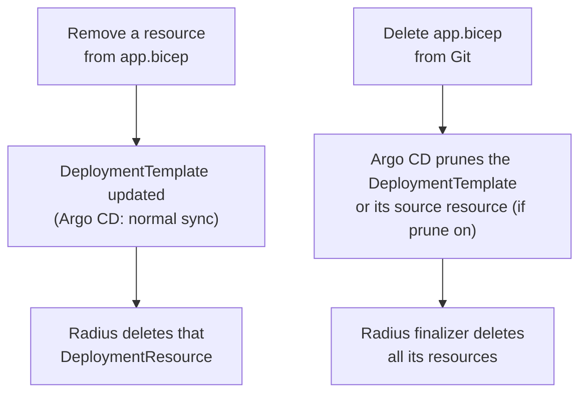
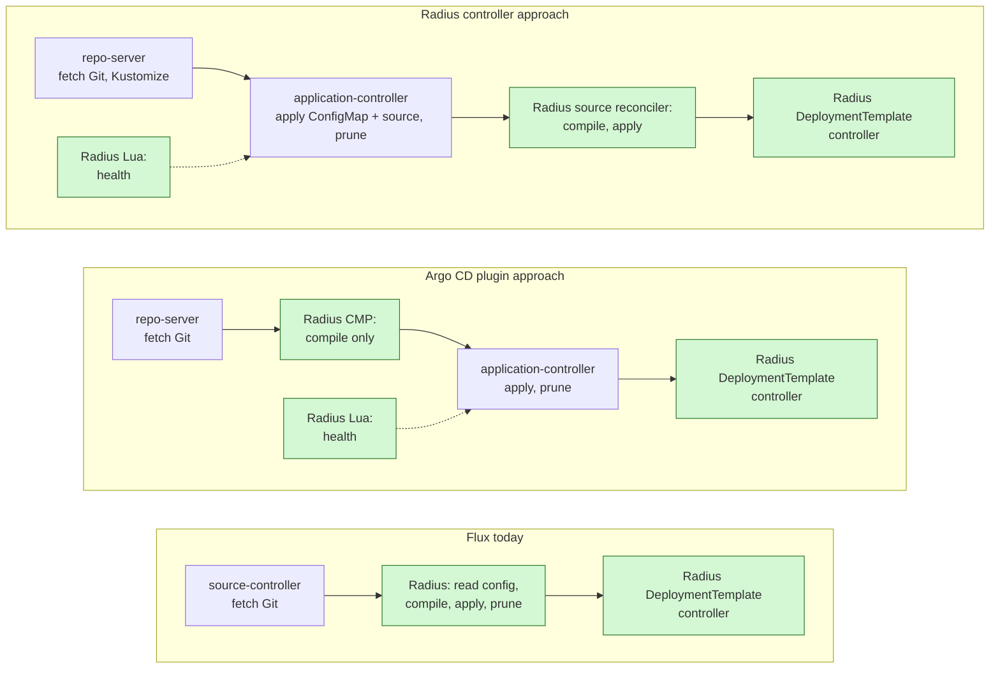
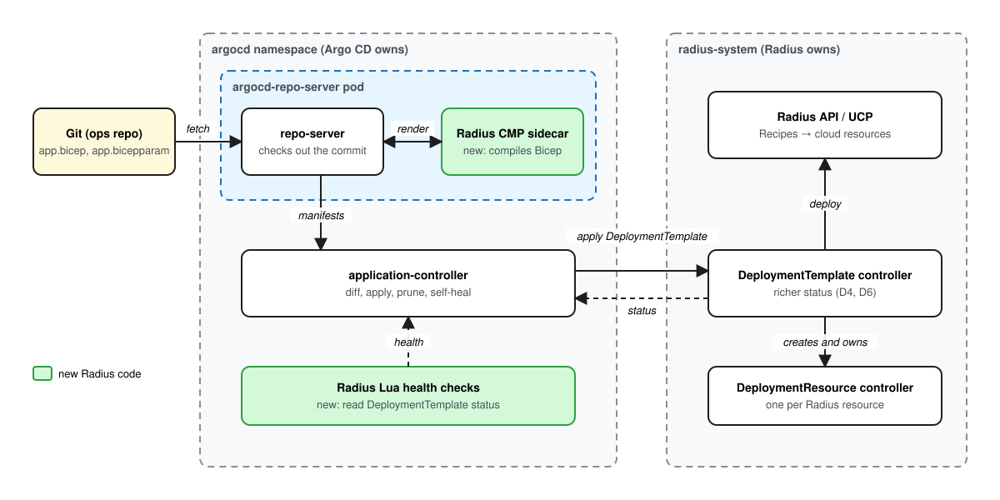
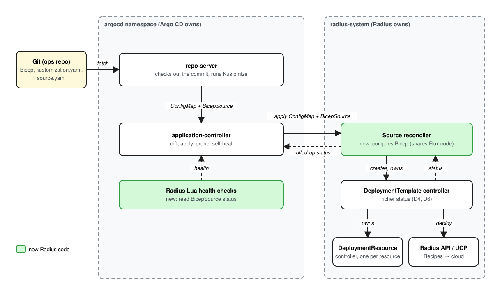
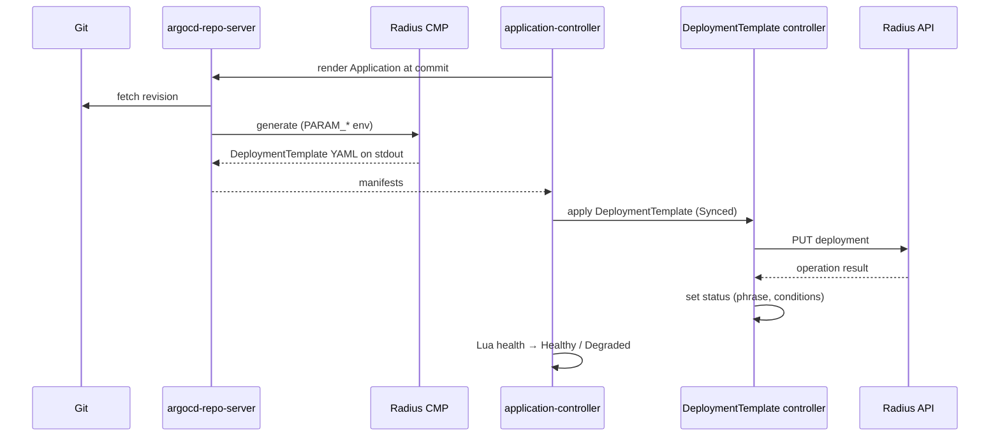
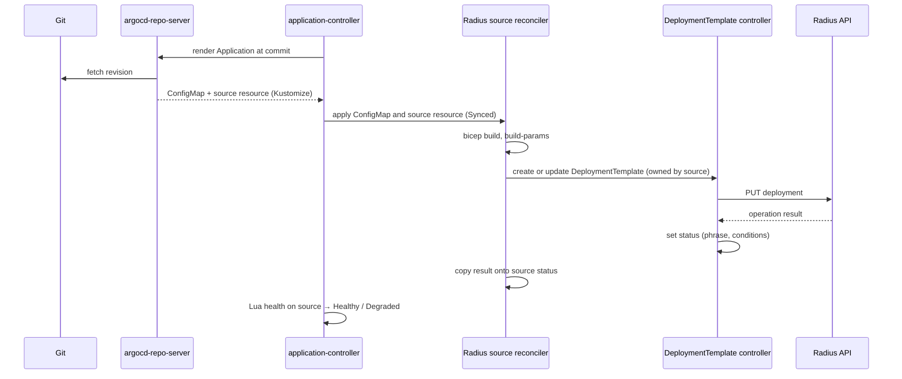
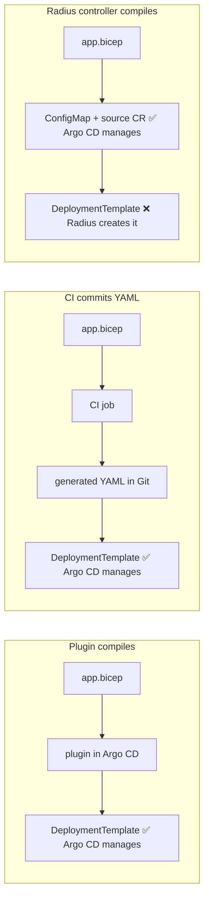
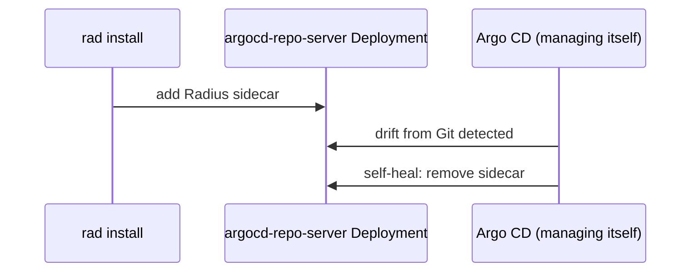

# Radius support for Argo CD

- **Author**: Nithya Subramanian (@nithyatsu)

## Review guide

This is a high-level design. Who compiles Bicep is left open: the note details two approaches, an Argo CD plugin and a Radius controller, and the team chooses after prototyping both. Installing and versioning the sidecar apply only to the plugin approach. Richer failure status and typed parameters change the `DeploymentTemplate` CRD and controller, which Flux also uses, so Flux users will see the new fields too; they need sign-off from the controller owners. Security needs sign-off for whichever approach is chosen: the plugin runs repository content inside Argo CD, and the Radius controller runs it inside the Radius controller. Open Questions are not up for decision yet.

## Decisions for review

| Decision                                                                                      | Options considered                                                     | Recommendation                                                                                                           | Risk if wrong                                                                                                         | Status |
|-----------------------------------------------------------------------------------------------|------------------------------------------------------------------------|--------------------------------------------------------------------------------------------------------------------------|-----------------------------------------------------------------------------------------------------------------------|--------|
| [Who compiles Bicep for Argo CD?](#who-compiles-bicep-for-argo-cd)                            | Argo CD plugin / CI / Radius in the cluster                            | None yet: choose between the Argo CD plugin and the Radius controller after prototypes; CI only as an interim workaround | Plugin: Radius maintains a sidecar inside Argo CD. Controller: weaker Argo CD health and later compile-error feedback | Open   |
| [How is the plugin sidecar installed?](#how-the-plugin-sidecar-is-installed)                  | Admin adds it / `rad install` switch / `rad argocd configure` helper   | Admin adds it from published snippets                                                                                    | A manual step that admins skip or let drift                                                                           | Open   |
| [How are health checks delivered?](#how-the-health-checks-are-delivered)                      | Upstream to Argo CD / `argocd-cm` snippet / Radius patches `argocd-cm` | Upstream, plus a snippet for older Argo CD versions                                                                      | Older Argo CD shows Radius objects with no health                                                                     | Open   |
| [How do Radius CRDs report why a deployment failed?](#how-radius-crds-report-failure-reasons) | `status.message` / `status.conditions` / both                          | `status.conditions`, keeping `phrase`                                                                                    | Argo CD shows Degraded with no reason                                                                                 | Open   |
| [How is the sidecar versioned?](#how-the-sidecar-is-versioned)                                | Released with each Radius release / versioned independently            | Released with each Radius release, with a mismatch check                                                                 | Compiled output silently differs from what the Radius control plane expects                                           | Open   |
| [How are non-string parameters carried?](#how-non-string-parameters-are-carried)              | Strings only, documented / new typed field / JSON-encode in strings    | New typed field, added alongside the existing one                                                                        | Parameter-only changes (S3) fail for integers, booleans, arrays and objects                                           | Open   |

## Overview

Radius supports GitOps with Flux today: a Radius controller compiles Bicep from a Flux `GitRepository` into `DeploymentTemplate` resources, and a second controller deploys them through the Radius API. Argo CD users have no equivalent. This design proposes supporting Argo CD.

In a nutshell, Users keep `.bicep` and `.bicepparam` files in Git and point an Argo CD Application at them. Argo CD cannot render Bicep, so something must compile it into a `DeploymentTemplate`. Options are:

- **Argo CD plugin:** a Radius Config Management Plugin (CMP) sidecar compiles during sync, and Argo CD applies the `DeploymentTemplate`.
- **Radius controller:** Argo CD applies the Bicep source, and the Radius controller compiles it, as with Flux.
- **CI compiles (interim workaround only):** a pipeline compiles and commits the generated YAML.

ArgoCD compares with the DeploymentTemplate in cluster and applies the changes. Then, the existing Radius `DeploymentTemplate` controller deploys it,
and Argo CD health checks report the Radius result.

## Terms and definitions

| Term                            | Definition                                                                                                                                                                                   |
|---------------------------------|----------------------------------------------------------------------------------------------------------------------------------------------------------------------------------------------|
| Argo CD Application             | Argo CD custom resource that maps a Git source (repository, revision, path, renderer) to a destination cluster and namespace.                                                                |
| AppProject                      | Argo CD custom resource that limits which repositories, clusters, namespaces and resource kinds an Application may use.                                                                      |
| ApplicationSet                  | Argo CD custom resource that generates many Applications from a template, for example one per environment or cluster.                                                                        |
| `argocd-repo-server`            | Argo CD component that clones Git and renders manifests (plain YAML, Kustomize, Helm, or a plugin). It never talks to the destination cluster.                                               |
| `argocd-application-controller` | Argo CD component that diffs rendered manifests with the live cluster, syncs, prunes, and computes health.                                                                                   |
| Config Management Plugin (CMP)  | An Argo CD extension point for custom renderers. It runs as a sidecar container in the `argocd-repo-server` pod and prints manifests to stdout.                                              |
| Sync status                     | Whether live objects match the rendered manifests: Synced or OutOfSync.                                                                                                                      |
| Health status                   | Argo CD's per-object and per-Application health: Healthy, Progressing, Degraded, Suspended, Missing or Unknown. Custom kinds get health from Lua scripts.                                    |
| Prune                           | Argo CD deleting live objects that are no longer in the rendered manifests.                                                                                                                  |
| Self-heal                       | Argo CD reverting live changes that were not made through Git.                                                                                                                               |
| `DeploymentTemplate`            | Radius CRD (`radapp.io/v1alpha3`) holding compiled ARM JSON, parameters and provider config. Its controller deploys it through the Radius API.                                               |
| `DeploymentResource`            | Radius CRD that the `DeploymentTemplate` controller creates and owns for each output resource. Deleting it deletes the Radius resource.                                                      |
| Phrase                          | The `status.phrase` field on the Radius CRDs. `DeploymentTemplate`: Updating, Ready, ReadyPendingCleanup, Failed, Deleting, Deleted. `DeploymentResource`: Ready, Failed, Deleting, Deleted. |
| Ops repo                        | The Git repository that holds deployable definitions (`.bicep`, `.bicepparam`) and that Argo CD watches.                                                                                     |

## Objectives

> **Issue Reference:** N/A. The tool-neutral scenarios are in the [GitOps feature spec](2024-06-gitops-feature-spec.md); the UI and diagnostics asks are in [#13284](https://github.com/radius-project/radius/pull/13284).

This design shares its deployment engine and first three goals with the [Flux controller design](2025-01-gitops-technical-design.md#goals). It diverges from that design in one way: Radius does not read Git or select files itself, because Argo CD already does both.

### Goals

1. **Integrate GitOps workflows with Radius and Bicep.** Users put Bicep files and parameters in Git, and Argo CD deploys them through Radius without Flux. This covers Radius Environments, Recipe registrations, Applications and resources. Changing only a parameter file triggers a deployment, just as changing a definition does.
2. **Make the deployed state match Git.** Radius creates, updates and deletes resources as Git changes, including resources removed from a Bicep file and whole Bicep files removed from the repository. Reverting a commit restores the previous configuration. Documented limits: reverting does not restore deleted data, and Radius does not detect drift in cloud resources.
3. **Fit existing Argo CD workflows.** Users keep Applications, ApplicationSets, projects, sync policies, prune, and the Argo CD UI and CLI. Radius adds only health checks and either a plugin or a source resource. It adds no Radius-specific configuration file such as `radius-gitops-config.yaml` and no Radius code that reads Git.
4. **Report the Radius outcome as Argo CD health**, including Recipe failures, kept separate from sync status.
5. **Make failures traceable** from the Argo CD Application to the Radius resource that failed, with a redacted error message.
6. **No breaking changes for Flux.** Existing Flux setups keep working without changes. Flux and Argo CD share the `DeploymentTemplate` CRD and controller, so the additive status conditions and typed parameters also appear for Flux users, and typed parameters fix non-string parameters being silently dropped on the Flux path.

### Non goals

- Replacing Argo CD sync, prune or RBAC, or building a separate GitOps dashboard in Radius. Argo CD already owns these.
- Having Argo CD reconcile cloud resources directly. Radius and Recipes own that.
- CI work: building images, publishing Recipes, or updating image tags. Existing CI tools own that.
- Terraform-plan-style previews or recovery of deleted data. Out of scope for a first release.
- Migrating applications between Flux and Argo CD. Possible follow-up.

### User scenarios (optional)

#### User story 1: Install Radius with Argo CD (operator)

The operator installs Radius as an Argo CD Application that points at the Radius Helm chart. Changing the chart version upgrades Radius. This needs validation and documentation only: confirm the chart syncs without perpetual OutOfSync diffs, for example from generated certificates or webhook CA bundles.

#### User story 2: Deploy Radius definitions from Git (operator and developer)

An operator commits `env.bicep`. A developer commits `app.bicep` and `app.bicepparam`. An Argo CD Application points at that path, Argo CD syncs it, and Radius deploys it. Where the Bicep is compiled is still open (see [Who compiles Bicep for Argo CD](#who-compiles-bicep-for-argo-cd)).

#### User story 3: Change parameters only (SRE)

An SRE changes `replicaCount` in `app.bicepparam` and merges the PR. Argo CD sees the change (in the `DeploymentTemplate` parameters with the plugin, or in the ConfigMap with the Radius controller) and syncs. Radius redeploys with the new value. Today this works only for string parameters. Whether it works when the `.bicepparam` file lives in a different repository is an [open question](#open-questions).

#### User story 4: See the real outcome in Argo CD (developer and SRE)

The Application tree shows the Radius objects with Radius-derived health: with the plugin, the `DeploymentTemplate` and its `DeploymentResource` children; with the Radius controller, the source resource, then the `DeploymentTemplate` and `DeploymentResource` objects it owns (mapping in [Health mapping](#health-mapping)).

#### User story 5: Recover and delete (developer and SRE)

- **Revert:** `git revert` makes Argo CD apply the previous template (plugin) or the previous source, which Radius recompiles with its current version (Radius controller). Radius redeploys it. Argo CD history rollback works only when automated sync is off, so documentation recommends Git-based recovery.
- **Remove one resource from a Bicep file:** the `DeploymentTemplate` is updated, not pruned. Radius deletes the removed resource through `DeploymentResource` cleanup. This happens even when Argo CD prune is off, and documentation must say so.
- **Remove a whole Bicep file:** with prune on, Argo CD prunes the `DeploymentTemplate` (plugin), or prunes the source resource and Kubernetes garbage-collects the `DeploymentTemplate` it owns (Radius controller). Radius finalizers then delete all of its resources.

**Two levels of deletion.** Argo CD prune only decides whether the `DeploymentTemplate` object itself goes away. What happens to the real resources is always Radius's job. Removing a line from `app.bicep` is a Radius-level delete that Argo CD never sees as a prune.



#### User story 6 (later phase): Navigate the Radius graph inside Argo CD

An optional Argo CD UI extension adds a "Radius" tab with the application graph, including external and shared dependencies that the Kubernetes tree cannot show, and scoped diagnostic links. This matches the visualization goals in #13284.

## User Experience

**What changes for a Radius user who adopts Argo CD:**

| Today, without Argo CD support                                 | With Argo CD support                                                                            |
|----------------------------------------------------------------|-------------------------------------------------------------------------------------------------|
| Deploy with `rad deploy app.bicep`, or install Flux for GitOps | Commit `app.bicep` and `app.bicepparam`; Argo CD deploys them                                   |
| Status from `rad app status` or the Radius dashboard           | Status in the Argo CD UI: Synced/OutOfSync, plus Radius health (Progressing, Healthy, Degraded) |
| Recover by redeploying an earlier file by hand                 | Recover with `git revert`                                                                       |
| SREs need `rad` access to change values                        | SREs change `.bicepparam` through a PR                                                          |

Users still write Bicep, use Recipes and Environments, and get the Radius application graph.

**What changes for an Argo CD user who adopts Radius:** without Radius, Argo CD manages only Kubernetes objects, and cloud databases, queues and buckets need a separate tool such as Terraform pipelines or Crossplane. With Radius, one Argo CD Application delivers an app and its infrastructure, provisioned by Recipes. Argo CD stays the GitOps engine and UI; Radius compiles the application model and runs Recipes.

**Sample Input, Argo CD plugin approach:** an Argo CD Application using the proposed plugin. The plugin name and parameter names are new in this design.

```yaml
apiVersion: argoproj.io/v1alpha1
kind: Application
metadata: { name: orders-dev, namespace: argocd }
spec:
  project: default
  source:
    repoURL: https://github.com/contoso/orders-ops
    targetRevision: main
    path: apps/orders
    plugin:
      name: radius-bicep
      parameters:
        - { name: bicepFile, string: app.bicep }
        - { name: paramsFile, string: app.bicepparam }
        - { name: resourceGroup, string: orders-dev }
  destination: { server: https://kubernetes.default.svc, namespace: orders }
  syncPolicy: { automated: { prune: true, selfHeal: true } }
```

**Sample Input, Radius controller approach:** the developer adds a `kustomization.yaml` and a source resource next to the Bicep files. The Application points at the directory with no plugin; Argo CD runs Kustomize because it finds `kustomization.yaml`. `BicepSource` is a working name ([open question 2](#open-questions)).

```yaml
# apps/orders/kustomization.yaml
configMapGenerator:
  - name: orders-bicep
    files: [app.bicep, app.bicepparam]
generatorOptions:
  disableNameSuffixHash: true   # or keep the hash and add a Kustomize nameReference for configMapRef
resources: [source.yaml]
---
# apps/orders/source.yaml
apiVersion: radapp.io/v1alpha3
kind: BicepSource
metadata: { name: orders }
spec:
  configMapRef: { name: orders-bicep }
  bicepFile: app.bicep
  paramsFile: app.bicepparam
  resourceGroup: orders-dev
```

**Sample Output:** the Argo CD Application tree after a Recipe failure.

With the plugin:

```text
Argo CD Application "orders-dev"     Sync: Synced   Health: Degraded
└── DeploymentTemplate app.bicep     Health: Degraded  "Recipe 'db' failed: ..."
    ├── DeploymentResource .../containers/frontend   Healthy
    └── DeploymentResource .../redisCaches/db        Degraded
```

With the Radius controller:

```text
Argo CD Application "orders-dev"     Sync: Synced   Health: Degraded
├── ConfigMap orders-bicep           Healthy
└── BicepSource orders               Health: Degraded  "Recipe 'db' failed: ..."
    └── DeploymentTemplate orders    (shown, not counted in Application health)
        ├── DeploymentResource .../containers/frontend   Healthy
        └── DeploymentResource .../redisCaches/db        Degraded
```

**Sample Recipe Contract:** No Recipe contract changes.

## Design

### High Level Design

Argo CD only applies Kubernetes YAML, so something must compile the user's Bicep and parameters into a `DeploymentTemplate`. The existing `DeploymentTemplate` controller then deploys it, as it does for Flux. There are three places the compiling can happen:

- **In Argo CD, through a plugin.** Argo CD's rendering hook (CMP) runs a Radius sidecar that compiles the Bicep. Argo CD applies and prunes the `DeploymentTemplate`, and Radius health checks (Lua) report its status.
- **In the Radius controller.** Argo CD applies the Bicep source (a ConfigMap) and a Radius source resource. Radius compiles them and applies the `DeploymentTemplate`, as it does with Flux, which has no rendering hook. Argo CD uses only the health hook.
- **In CI.** A CI pipeline in each app repository runs `rad bicep generate-kubernetes-manifest` on every change and commits the generated `DeploymentTemplate` YAML back to the repository. Argo CD applies that YAML with no plugin. This works today with no Radius changes, but it costs both personas. Developers get generated YAML they never edit committed next to their Bicep, and must wait for the bot's commit before Argo CD can sync. The platform team must add a workflow file, permissions and a bot with push rights to every app repository, and update the pinned `rad` version in each one on every Radius release. We don't pursue it because of these user experience overheads; see [Who compiles Bicep for Argo CD](#who-compiles-bicep-for-argo-cd).

The rest of this design details the first two, called the **Argo CD plugin approach** and the **Radius controller approach**.

#### Integration points compared with Flux

| Integration point                                  | Flux: how Radius plugs in today                                                                                                 | Argo CD plugin approach                                                          | Radius controller approach                                                                                                              |
|----------------------------------------------------|---------------------------------------------------------------------------------------------------------------------------------|----------------------------------------------------------------------------------|-----------------------------------------------------------------------------------------------------------------------------------------|
| Activation                                         | The Radius controller registers itself when the `GitRepository` CRD is established (`registerFluxController`)                   | Admin adds the sidecar to `argocd-repo-server`; Argo CD loads the health checks  | Installed with Radius; the controller watches the new source CRD. Argo CD loads the health checks                                       |
| Change trigger                                     | Watches `GitRepository` and reconciles when `status.artifact.revision` changes (`GitRepositoryRevisionChangePredicate`)         | Argo CD polls Git or receives a webhook, then re-renders through the plugin      | Argo CD polls Git or receives a webhook and applies the changed ConfigMap; the controller watches the source resource and its ConfigMap |
| Reading Git                                        | Downloads the source-controller archive from `status.artifact.url` and verifies its digest                                      | `argocd-repo-server` checks out the commit into a volume shared with the sidecar | `argocd-repo-server` checks out the commit; Kustomize's `configMapGenerator` packs the Bicep files into a ConfigMap                     |
| Choosing files and parameters                      | `radius-gitops-config.yaml` at the repository root: Bicep file, parameter file, namespace, resource group                       | Application `spec.source.path` and plugin parameters                             | `kustomization.yaml` selects the files; the source resource names the Bicep file, parameter file and resource group                     |
| Compiling Bicep                                    | The Radius controller runs `bicep build` and `bicep build-params` in the cluster                                                | The Radius CMP runs `rad bicep generate-kubernetes-manifest` in the sidecar      | The Radius controller runs `bicep build` and `bicep build-params`, sharing the Flux code                                                |
| Applying the `DeploymentTemplate`                  | The Radius controller creates the namespace, then creates or updates the `DeploymentTemplate`                                   | Argo CD sync                                                                     | The Radius controller creates or updates it, owned by the source resource                                                               |
| Removing a `DeploymentTemplate` when its file goes | The Radius controller lists templates by the indexed `spec.repository` field and deletes those no longer in the config          | Argo CD prune, using its tracking label or annotation                            | Argo CD prunes the source resource; Kubernetes garbage collection removes the `DeploymentTemplate` it owns                              |
| Deploying and deleting Radius resources            | `DeploymentTemplate` and `DeploymentResource` controllers                                                                       | Same controllers, unchanged                                                      | Same controllers, unchanged                                                                                                             |
| Status and health                                  | None; users run `kubectl get deploymenttemplates`                                                                               | Lua health checks on the `DeploymentTemplate` and richer conditions              | Lua health check on the source resource, which copies the `DeploymentTemplate` result                                                   |
| Cloud scopes                                       | Resource group only; the provider config is built with empty Azure and AWS scopes                                               | Plugin parameters map to `--azure-scope` and `--aws-scope`                       | Fields on the source resource                                                                                                           |
| Radius code delivered                              | A Go controller in the Radius controller binary ([`flux_controller.go`](../../../pkg/controller/reconciler/flux_controller.go)) | A sidecar image, `plugin.yaml`, Lua scripts and docs; no new Go controller       | A new CRD and reconciler in the existing controller binary, Lua scripts and docs; no new image                                          |

**Where Radius hooks in, side by side.** Green boxes are Radius code.



### Architecture Diagram

#### Argo CD plugin approach

In a nutshell, the Radius plugin compiles the Bicep in Git into a `DeploymentTemplate`, which describes the desired state. Argo CD compares that compiled `DeploymentTemplate` with the one in the cluster and applies it when they differ. The Radius controller watches the `DeploymentTemplate` in the cluster and, when it changes, calls the Radius API to deploy the containers, Recipes and cloud resources. It then writes the result back into the template's status, which Argo CD shows as health. Argo CD keeps the `DeploymentTemplate` in sync with Git, and Radius keeps the real resources in sync with the `DeploymentTemplate`.



> Source files: [plugin-approach-architecture.svg](2026-10-argocd-functional-spec/plugin-approach-architecture.svg) (rendered above) and [plugin-approach-architecture.excalidraw](2026-10-argocd-functional-spec/plugin-approach-architecture.excalidraw) (editable in Excalidraw).

#### Radius controller approach

In a nutshell, Kustomize packs the Bicep files from Git into a ConfigMap, and Argo CD applies that ConfigMap and a `BicepSource` resource like any other objects. The Radius source reconciler watches the `BicepSource`, compiles the Bicep with the same code the Flux integration uses, and creates a `DeploymentTemplate` that it owns. From there the existing `DeploymentTemplate` controller deploys through the Radius API, as in the plugin approach. Argo CD never sees the `DeploymentTemplate`, so the source reconciler copies its result onto the `BicepSource` status, which Argo CD shows as health. Argo CD keeps the Bicep source in sync with Git, and Radius keeps both the `DeploymentTemplate` and the real resources in sync with that source.

**Which pieces belong to whom.** Argo CD ships the repo-server and application-controller and needs no changes. Radius adds the green pieces: a source reconciler and CRD in the existing Radius controller binary, and Lua health scripts that Argo CD loads. The `DeploymentTemplate` and `DeploymentResource` controllers are unchanged, except for richer status.



> Source files: [controller-approach-architecture.svg](2026-10-argocd-functional-spec/controller-approach-architecture.svg) (rendered above) and [controller-approach-architecture.excalidraw](2026-10-argocd-functional-spec/controller-approach-architecture.excalidraw) (editable in Excalidraw).

### Data flow and sequence

#### Argo CD plugin approach



1. The CMP only compiles. It never calls the cluster or the Radius API, so it needs no cluster credentials.
2. If compilation fails, the CMP exits non-zero. Argo CD shows a ComparisonError and does not sync, so the previous `DeploymentTemplate` stays in place.
3. Argo CD marks the Application Synced as soon as the apply succeeds. Health stays Progressing until the controller's observed generation catches up and the phrase is terminal.
4. `DeploymentResource` objects are owned by the `DeploymentTemplate`, so Argo CD shows them in the tree. Argo CD does not include them in Application health, because they do not come from Git; the `DeploymentTemplate` status must carry their failures.

#### Radius controller approach



1. Compilation runs in the Radius controller pod, which already runs Bicep for Flux. Argo CD runs no Radius code.
2. If compilation fails, the sync has already succeeded. The source resource turns Degraded with the compile error, and the previous `DeploymentTemplate` stays in place.
3. Argo CD computes Application health only from the ConfigMap and the source resource. The `DeploymentTemplate` and `DeploymentResource` objects appear in the tree through owner references but do not count, so the source resource must carry their result.
4. Kustomize adds a content hash to the ConfigMap name by default. Either the source resource's reference is rewritten with a Kustomize `nameReference`, or the hash is disabled and the controller watches the ConfigMap's content.

**Synced and Healthy run on two clocks.** Sync finishes in seconds, when the `DeploymentTemplate` object is written. Health can take minutes, while Radius runs Recipes. Without the Lua checks, Argo CD would say "Synced, Healthy" the moment the object is written, even if the Recipe later fails. That is the core problem #13284 calls out.

```text
time ─────────────────────────────────────────────────────────►
Argo CD sync:   OutOfSync ─► Synced
Radius phrase:               Updating ─────────────► Ready / Failed
Argo CD health:              Progressing ──────────► Healthy / Degraded
```

### Detailed Design

#### Decision details

##### Who compiles Bicep for Argo CD

**Context:** Argo CD cannot read Bicep. Something must compile it into the `DeploymentTemplate` YAML that Radius deploys. All options end with the same `DeploymentTemplate` controller. The Flux integration compiles in the cluster, but Flux never faced this choice: Flux has no plugin mechanism for rendering (its renderers, Kustomize and Helm, are fixed, and its documented extension path is a separate controller that consumes source artifacts), and Flux has no built-in UI whose diff, tree or health depended on where compilation happened. The Radius Flux path also bypasses Flux's `Kustomization`, so `flux get kustomizations` does not report Radius deployments; users check `kubectl get deploymenttemplates`. The Flux design does not record this rationale; this is the author's analysis. Argo CD changes both conditions: it has a supported plugin point, and its UI makes the location of compilation visible.

**Options:**

- **Radius controller compiles.** Radius compiles in the cluster. Argo CD applies the Bicep source in a ConfigMap (built by Kustomize's `configMapGenerator`) plus a small new Radius "source" custom resource. The Radius controller compiles with the compiler it already uses for Flux and creates the `DeploymentTemplate`. Needs a new CRD or new `DeploymentTemplate` fields.
- **Argo CD plugin compiles.** A Radius CMP sidecar in `argocd-repo-server` returns the `DeploymentTemplate`; Argo CD diffs and applies it.
- **CI compiles and commits YAML.** A pipeline runs `rad bicep generate-kubernetes-manifest` and commits the generated YAML. Argo CD deploys that directory as plain manifests. Works today with no new code.

**Steps per role.** All options assume Radius is installed on the destination cluster and the Radius health checks are configured in Argo CD. In a hub-and-spoke setup, Argo CD and its repo-server run on a management cluster that `rad install` on the workload cluster never touches.

*Enhance Radius controller:*

1. **Argo CD admin and platform team:** nothing.
2. **Developer, once per app:** commit `app.bicep`, `app.bicepparam`, a `kustomization.yaml` that packs them into a ConfigMap, and a Radius source resource, then create an Application.
3. **Developer, each change:** edit the Bicep or parameters and merge.
4. **Argo CD, automatically:** applies the ConfigMap and source resource.
5. **Radius controller, automatically:** compiles the Bicep, creates the `DeploymentTemplate`, deploys it, and reports the result on the source resource.
6. **If compilation fails:** the sync succeeds, then the source resource turns Degraded with the error.

*Create Argo CD plugin:*

1. **Argo CD admin, once:** add the Radius sidecar and `plugin.yaml` to the Argo CD install (Helm values or Kustomize patch) and, on hardened clusters, allow outbound access to the Bicep extension registry.
2. **Developer, once per app:** commit `app.bicep` and `app.bicepparam`, then create an Application with the plugin parameters `bicepFile`, `paramsFile` and `resourceGroup`.
3. **Developer, each change:** edit the Bicep or parameters and merge.
4. **Argo CD, automatically:** the sidecar compiles the Bicep into a `DeploymentTemplate`; Argo CD diffs and applies it, and Radius deploys it.
5. **If compilation fails:** the sync is blocked and the error shows in Argo CD.
6. **Argo CD admin, each Radius release:** upgrade the sidecar to match.

*Introduce CI workflow:*

1. **Argo CD admin:** nothing.
2. **Platform team, once per repo:** write and own a CI workflow that installs a `rad` version matching the cluster, runs `rad bicep generate-kubernetes-manifest`, and commits the output; grant a bot push rights past branch protection.
3. **Developer, once per app:** commit `app.bicep` and parameters, then create an Application pointing at the generated directory.
4. **Developer, each change:** edit and merge, wait for the bot commit, then review it or resolve conflicts in the generated file.
5. **Argo CD, automatically:** applies the generated `DeploymentTemplate`, and Radius deploys it.
6. **If compilation fails:** the error shows in CI, and Argo CD keeps the last good render.
7. **Platform team, each Radius release:** update the `rad` version in the workflow.

How the options compare, most important first. Rows marked (#13284) are things the Argo CD UI and diagnostics proposal in #13284 asks for. Its main ask is health and convergence: Argo CD should show whether the Radius deployment actually succeeded, not just that the YAML was applied.

| Criterion                                   | Enhance Radius controller                                                                                                                                                                           | Create Argo CD plugin                                                                                                                                                                           | Introduce CI workflow                                                                                                                                                                                                                                                                                                          |
|---------------------------------------------|-----------------------------------------------------------------------------------------------------------------------------------------------------------------------------------------------------|-------------------------------------------------------------------------------------------------------------------------------------------------------------------------------------------------|--------------------------------------------------------------------------------------------------------------------------------------------------------------------------------------------------------------------------------------------------------------------------------------------------------------------------------|
| Health and convergence (#13284)             | **Indirect.** Radius must copy the result onto the source resource (needs richer status conditions).                                                                                                | **Direct.** Argo CD applied the `DeploymentTemplate`, so its health feeds the Application.                                                                                                      | **Direct.** Same as the plugin.                                                                                                                                                                                                                                                                                                |
| User effort                                 | **Medium.** Developers commit Bicep and parameters, plus a `kustomization.yaml` and a source resource, and handle the ConfigMap name hash. The platform team does nothing beyond installing Radius. | **Medium.** Developers commit only Bicep and parameters. The Argo CD admin installs, upgrades and patches the Radius plugin inside Argo CD (see below the table).                               | **High.** The platform team adds a CI workflow to every app repository, keeps its `rad` version in step with the cluster, and gives a bot push rights past branch protection. Developers commit Bicep, wait for the bot to commit the compiled template before Argo CD can sync, and resolve conflicts in the generated files. |
| Compile-error feedback (#13284)             | **Late.** Degraded after the sync.                                                                                                                                                                  | **Best.** Blocks the sync inside Argo CD (ComparisonError).                                                                                                                                     | **Outside Argo CD.** Fails in CI; Argo CD keeps the last good render.                                                                                                                                                                                                                                                          |
| Diff of definitions and parameters (#13284) | **Best.** Shows the readable Bicep and parameter change. Changes caused only by a new Radius or extension version do not show.                                                                      | **Good.** Parameters diff per key. The compiled ARM JSON, which Radius already uses for the static app graph, is pretty-printed so only changed lines show. Compiler-version changes also show. | **Good.** Same as the plugin.                                                                                                                                                                                                                                                                                                  |

**Argo CD admin effort for the plugin approach.** To compile Bicep, the compiler must download the type definitions for every extension listed in `bicepconfig.json`, such as `br:biceptypes.azurecr.io/radius:<version>`. These definitions are published in an OCI container registry, so whichever component compiles the Bicep needs outbound HTTPS access to that registry. With the controller approach, the Radius controller compiles, and clusters that already use Radius with Flux allow this access. With the plugin approach, a Radius sidecar container inside Argo CD's `argocd-repo-server` pod compiles. On a hardened cluster, the Argo CD admin must open outbound access to that registry from the Argo CD namespace, or mirror the extensions into a registry the cluster already reaches. The admin must also add the sidecar to their Argo CD install and upgrade it with each Radius release. Radius, in turn, must scan and patch the sidecar image for CVEs and keep its compiler matched to each Radius release. Because `argocd-repo-server` reads every repository Argo CD renders, a flaw in the sidecar exposes more than Radius apps.

Smaller differences: the plugin rolls back exactly by reapplying the compiled template, while the controller recompiles old Bicep with the current Radius. The controller approach packs all Bicep files, including local modules, into one ConfigMap, which Kubernetes caps at 1 MiB. Both approaches need a medium amount of new Radius code, and neither works today.

The health difference comes from who applies the `DeploymentTemplate`, not from the plugin itself: Argo CD computes Application health only from objects it applied from Git. When the plugin or CI compiles, Argo CD applies it; when the Radius controller compiles, as in the Flux integration today, the Radius controller creates it.

All three options are equal for the other asks in #13284: Radius must report removals that the user can see in the app, and the graph, scoping and authorization features use the Radius API.

**Proposed Option:** no single recommendation. This note details both the Argo CD plugin and the Radius controller approaches; the team chooses after prototyping both. CI compiling is not a supported target.

- **Choose the Argo CD plugin if** the Argo CD-native experience matters most: health is direct, compile errors block the sync, rollback is exact, and developers commit only Bicep. The price is a permanent maintenance and security commitment for a sidecar that runs inside Argo CD's pod (see [Radius CMP sidecar](#radius-cmp-sidecar-new-plugin-approach)), and every Argo CD admin must install it and upgrade it with Radius. The admin may also have to open outbound access to the Bicep extension registry (see the explanation above).
- **Choose the Radius controller if** low maintenance and no Radius code inside Argo CD matter most: no sidecar, no new image, the compiler always matches Radius, the compile code is shared with Flux, and diffs show readable Bicep. The price is user experience: health reaches Argo CD only through a roll-up onto the source resource (needs richer status conditions), compile errors appear after the sync, rollback recompiles with the current Radius, and developers also commit a `kustomization.yaml` and a source resource (see [Source resource reconciler](#source-resource-reconciler-new-radius-controller-approach)).
- **CI compiles and commits YAML: interim workaround only.** Works today with no Radius changes. It is not a supported target: it commits generated files that users never edit into their repository, makes users own a render pipeline and its credentials, and breaks the GitOps feature spec's requirement that users do not have to author pipelines.

**How we'll know it's right:** prototypes of both approaches show whether Argo CD admins accept the sidecar, whether the source-resource roll-up gives a usable health and error view in Argo CD, and how Bicep modules and ConfigMap limits behave.

**What Argo CD actually sees in each option.** The difference that matters for the UI is which object Argo CD manages directly, because Argo CD only computes Application health from objects that came from Git.



When the plugin or CI compiles, the `DeploymentTemplate` is a Git object, so its health flows straight into the Application. When the Radius controller compiles, Argo CD only sees the ConfigMap and source resource, so Radius must copy the deploy result back onto the source resource for Argo CD to notice.

##### How the plugin sidecar is installed

**Context:** applies only to the plugin approach. nothing on the Radius side needs enabling, because the `DeploymentTemplate` controller always runs. Argo CD 2.8 and later support plugins only as sidecars in the repo-server pod, so a plugin cannot be installed as a standalone component. The Flux precedent: Radius detects the Flux `GitRepository` CRD and starts watching automatically (`registerFluxController` in [`flux_controller.go`](../../../pkg/controller/reconciler/flux_controller.go)), and never modifies Flux's installation. A Radius install switch would exist only to modify Argo CD.

**Options:**

| Option                                                                          | Advantages                                                                                                                    | Disadvantages                                                                                                                                                                                          |
|---------------------------------------------------------------------------------|-------------------------------------------------------------------------------------------------------------------------------|--------------------------------------------------------------------------------------------------------------------------------------------------------------------------------------------------------|
| Admin adds it to the Argo CD installation                                       | Matches the Flux precedent. Works when Argo CD manages itself through GitOps and when Argo CD runs in a separate hub cluster. | Manual step. Admin keeps the sidecar version in line with Radius.                                                                                                                                      |
| `rad install kubernetes --set argocd.enabled=true` patches `argocd-repo-server` | One command.                                                                                                                  | Radius needs write access to the `argocd` namespace. Argo CD self-heal or a later Argo CD Helm upgrade reverts the patch. Fails when Argo CD runs in another cluster. Two tools write the same object. |
| A `rad argocd configure` helper prints or applies the snippet                   | Easier than A and explicitly opt-in.                                                                                          | Same drift problems as B if it applies rather than prints.                                                                                                                                             |

**Proposed Option:** admin adds it. Radius publishes the sidecar image, `plugin.yaml`, Argo CD Helm chart values (`repoServer.extraContainers`) and a Kustomize patch. The `rad argocd configure` helper in print-only mode is a possible follow-up.

**How we'll know it's right:** the snippets apply cleanly to the Argo CD Helm chart and the upstream install manifests in CI, and survive an Argo CD upgrade.

**Why Radius should not patch Argo CD.** Many teams manage Argo CD with Argo CD. If `rad install` edits the repo-server Deployment, Argo CD sees drift from its own Git and reverts it, so the sidecar disappears.



##### How the health checks are delivered

**Context:** Argo CD has no built-in health for Radius CRDs and treats them as Healthy once applied. Health checks are Lua scripts loaded from Argo CD's built-in `resource_customizations` directory or from the `argocd-cm` ConfigMap. This decision applies to both approaches; the Radius controller approach also needs a check for the source resource.

**Options:**

| Option                                           | Advantages                                                           | Disadvantages                                                                                            |
|--------------------------------------------------|----------------------------------------------------------------------|----------------------------------------------------------------------------------------------------------|
| Contribute upstream to `resource_customizations` | No configuration; works in every Argo CD release that includes them. | Depends on Argo CD review and release timing. Older Argo CD versions still need the `argocd-cm` snippet. |
| Admin applies an `argocd-cm` snippet             | Works on any Argo CD version.                                        | Manual step.                                                                                             |
| Radius patches `argocd-cm` during install        | Automatic.                                                           | Same drift and ownership problems as having `rad install` patch the Argo CD install.                     |

**Proposed Option:** contribute upstream, and publish the `argocd-cm` snippet for older versions.

**How we'll know it's right:** upstream accepts the scripts, and their test fixtures cover every phrase in [Health mapping](#health-mapping).

##### How Radius CRDs report failure reasons

**Context:** `DeploymentTemplateStatus` has only `observedGeneration`, `statusHash`, `outputResources`, `operation` and `phrase`. The [2024-10 design](2024-10-deploymenttemplate-controller.md) included a message field that was not implemented. Without a reason, Argo CD can show Degraded but not why. This also benefits Flux users.

**Options:**

| Option              | Advantages                                                                                                                             | Disadvantages                                                     |
|---------------------|----------------------------------------------------------------------------------------------------------------------------------------|-------------------------------------------------------------------|
| `status.message`    | Smallest change; trivial for Lua to read.                                                                                              | One string; cannot separate compile, deploy and cleanup failures. |
| `status.conditions` | Standard Kubernetes shape (`metav1.Condition`); type, reason, message, and observed generation per condition; read by generic tooling. | More code; Lua must pick the right condition.                     |
| Both                | Simple Lua plus standard conditions.                                                                                                   | Two sources of truth that can disagree.                           |

**Proposed Option:** `status.conditions`, keeping `phrase` for compatibility. Conditions carry the failure reason, attempted generation and operation ID, with messages redacted.

**How we'll know it's right:** a failed Recipe shows its redacted reason in the Argo CD UI and in `kubectl describe`.

##### How the sidecar is versioned

**Context:** applies only to the plugin approach. the sidecar compiles Bicep with Radius extension types, so it must match the Radius control plane it deploys to, not the Argo CD version.

**Options:**

| Option                                       | Advantages                                                     | Disadvantages                               |
|----------------------------------------------|----------------------------------------------------------------|---------------------------------------------|
| Released and tagged with each Radius release | One version to reason about; release notes prompt the upgrade. | Admin must upgrade the sidecar with Radius. |
| Versioned independently                      | Fewer sidecar releases.                                        | Users must look up a compatibility matrix.  |

**Proposed Option:** released with each Radius release. Define what the plugin does when its version and the destination's Radius version differ. Because the plugin has no cluster access, the check likely belongs in the `DeploymentTemplate` controller, for example a version annotation that the controller validates.

**How we'll know it's right:** a deliberate version mismatch in a functional test fails with a clear message instead of a silent difference.

##### How non-string parameters are carried

**Context:** `DeploymentTemplateSpec.Parameters` is `map[string]string`. `convertFromARMJSONParameters` in [`util.go`](../../../pkg/controller/reconciler/util.go) silently drops non-string values on the Flux path, and `generateDeploymentTemplate` in [`generatekubernetesmanifest.go`](../../../pkg/cli/cmd/bicep/generatekubernetesmanifest/generatekubernetesmanifest.go) asserts every value is a string, which would panic on others. User story 3 (`replicaCount`) therefore fails for integers, booleans, arrays and objects on every path. This was found by reading code, not by running it.

**Options:**

| Option                                                                               | Advantages                          | Disadvantages                                                                         |
|--------------------------------------------------------------------------------------|-------------------------------------|---------------------------------------------------------------------------------------|
| Strings only; document and fail clearly on others                                    | No API change.                      | Users rewrite Bicep to take strings and convert them; poor fit for GitOps parameters. |
| Add a typed field (for example `apiextensionsv1.JSON` values) alongside `parameters` | Full ARM parameter types; additive. | CRD and controller change; two fields to reconcile.                                   |
| JSON-encode non-strings into the existing strings                                    | No schema change.                   | Ambiguous (is `"3"` a string or a number?); hard to read in diffs.                    |

**Proposed Option:** add a typed field. Fix both the CLI and the Flux path to use the shared conversion.

**How we'll know it's right:** functional tests for Flux and Argo CD deploy an integer, a boolean and an object parameter, and changing only that value redeploys.

**What breaks today.** Given `param replicaCount int = 2` in Bicep and `param replicaCount = 3` in `.bicepparam`, `bicep build-params` emits `{"replicaCount": {"value": 3}}`. The number 3 is not a Go `string`, so the Flux path drops it and Radius deploys the default of 2; the CLI path panics on the type assertion. Only `param tag string` style parameters survive today.

#### Health mapping

| Radius state                                                            | Argo CD health                                |
|-------------------------------------------------------------------------|-----------------------------------------------|
| `status.observedGeneration` behind `metadata.generation`, or `Updating` | Progressing                                   |
| `ReadyPendingCleanup`                                                   | Progressing ("cleaning up removed resources") |
| `Ready` and observed generation current                                 | Healthy (provisioning scope only)             |
| `Failed`                                                                | Degraded, with the redacted reason            |
| `Deleting`                                                              | Progressing                                   |

`DeploymentResource` uses the same mapping for its Ready, Failed and Deleting phrases. **Healthy means Radius finished provisioning, not that the workload or cloud service is healthy now.** Health messages must state that scope. A Lua sketch is in [Appendix: health check sketch](#health-check-sketch).

### API design

No REST or TypeSpec changes. Kubernetes API changes on `radapp.io/v1alpha3`:

- **Both approaches, additive:**
  - `DeploymentTemplateStatus` and `DeploymentResourceStatus` gain `conditions []metav1.Condition`.
  - `DeploymentTemplateSpec` gains a typed parameters field. Name to be chosen in the detailed design.
- **Radius controller approach only:** a new source custom resource, working name `BicepSource` (shape is [open question 2](#open-questions); example in [User Experience](#user-experience)):
  - `spec.configMapRef`: the ConfigMap that holds the Bicep files
  - `spec.bicepFile` and `spec.paramsFile`: keys in that ConfigMap
  - `spec.resourceGroup`, and optional `spec.azureScope` and `spec.awsScope`
  - `status.conditions`, `status.phrase` and `status.observedGeneration`: compile result plus the result rolled up from the `DeploymentTemplate` it owns

### CLI Design

No new commands. The Radius controller approach needs no CLI changes; it uses the Flux controller's compile code. `rad bicep generate-kubernetes-manifest` is reused by the plugin approach and by the "CI compiles and commits YAML" workaround, and needs three fixes:

- accept a `.bicepparam` file by running `bicep build-params`, as the Flux controller does; today `@file` is parsed as JSON even though the command's help shows `--parameters @app.bicepparam`
- carry non-string parameters
- write to stdout (for example `--destination-file -`), because a CMP must print manifests to stdout

### Implementation Details

#### Radius CMP sidecar (new, plugin approach)

One container image plus a `plugin.yaml`; it compiles and never deploys.

- **Image:** `rad` and a pinned Bicep binary preinstalled, plus pre-fetched Radius Bicep extensions so the common case needs no network. Released with Radius.
- **Maintenance and security ownership:** Radius owns this image for its lifetime. Build from a minimal base and run as non-root with a read-only root file system. Include it in Radius image scanning and SBOM publishing, and cover it in the Radius security policy so CVE fixes in the base image, Bicep or `rad` ship as patch releases. Test it against each supported Argo CD version, because Argo CD can change the sidecar contract (mounts, environment, socket) between releases. The container must not mount the repo-server's service account token.
- **Plugin definition:** discovers `*.bicep`; parameters `bicepFile`, `paramsFile`, `resourceGroup`, and optional cloud scopes mapped to `--azure-scope` and `--aws-scope`. Sketch in [Appendix: plugin definition sketch](#plugin-definition-sketch-plugin-approach).
- **Determinism:** output must be byte-identical for identical inputs, or Argo CD shows OutOfSync forever and redeploys repeatedly. The manifest's `metadata.name` comes from the template file name. `json.MarshalIndent` sorts map keys; Bicep output stability needs a test. Pretty-print `spec.template` with stable key order so Argo CD's diff shows only the changed lines.
- **No side effects:** Argo CD may call `generate` many times and caches by commit. The plugin must not write outside its working directory or call any cluster.
- **Network:** fetching Bicep extensions from registries named in `bicepconfig.json` needs egress or a mirror.

#### Source resource reconciler (new, Radius controller approach)

A new reconciler in the existing controller binary, next to the Flux reconciler in [`pkg/controller/reconciler`](../../../pkg/controller/reconciler/). No new image.

- **Shared compile code:** move `runBicepBuild`, `runBicepBuildParams` and the template-building code out of [`flux_controller.go`](../../../pkg/controller/reconciler/flux_controller.go) into a helper both reconcilers call, so Flux and Argo CD compile the same way.
- **Watch:** source resources and the ConfigMaps they reference; reconcile when either changes.
- **Compile:** write the ConfigMap's files to a temporary directory, run `bicep build` and `bicep build-params`, and build the `DeploymentTemplate` spec as the Flux reconciler does.
- **Apply:** create or update one `DeploymentTemplate` per source resource, with an owner reference to the source. Deleting the source garbage-collects the template, and Radius finalizers delete its resources. Do not add Argo CD tracking labels, so Argo CD shows the template in the tree but never prunes it.
- **Report:** copy the `DeploymentTemplate` phrase and conditions onto the source resource's status, along with compile errors, so one Lua health check on the source reflects the whole result.
- **On compile failure:** leave the existing `DeploymentTemplate` unchanged and set a failed condition on the source.
- **Limits:** ConfigMap keys cannot contain `/`, so `configMapGenerator` flattens directories and local module paths such as `./modules/db.bicep` break unless the reconciler restores the layout. A ConfigMap holds at most 1 MiB, and Argo CD's default client-side apply also stores the object in an annotation capped at 256 KiB unless the Application uses server-side apply.
- **Network:** fetching Bicep extensions needs registry egress from the Radius controller, as on the Flux path today.

#### Radius health checks (new)

Lua scripts for `DeploymentTemplate` and `DeploymentResource` implementing [Health mapping](#health-mapping), plus one for the source resource in the Radius controller approach.

#### `DeploymentTemplate` and `DeploymentResource` controllers (changed)

Richer status and typed parameters; deploy logic unchanged.

- Packages: [`pkg/controller/api/radapp.io/v1alpha3`](../../../pkg/controller/api/radapp.io/v1alpha3/), [`pkg/controller/reconciler`](../../../pkg/controller/reconciler/).
- Set conditions on every phrase transition, with redacted messages.
- Read the typed parameters field and convert it with a helper shared by the Flux path.
- **Ownership gap:** Kubernetes objects that Radius renders (Deployments, Services) are not owned by the `DeploymentTemplate`, so they do not appear in the Argo CD tree. Closing this must not make Argo CD prune or adopt them, for example by using owner references without Argo CD tracking labels.

#### Argo CD UI extension (later phase)

A read-only "Radius" tab behind an Argo CD proxy extension that shows the application graph and diagnostics. The backend enforces Radius authorization; Argo CD project permissions are not Radius resource-group permissions.

#### Documentation and validation

Validate installing Radius with Argo CD (user story 1) and the chosen approach end to end. Document "CI compiles and commits YAML" only as an interim workaround.

#### UCP

No UCP changes.

#### Bicep

No Bicep language or extension changes. The plugin approach pins and ships the Bicep binary and Radius extensions in the sidecar; the Radius controller approach uses the Bicep binary the controller already uses for Flux.

#### Deployment Engine

No Deployment Engine changes.

#### Core RP

No Core RP changes.

#### Portable Resources / Recipes RP

No Recipes changes. Recipe failures are surfaced through the new status conditions.

### Error Handling

| Scenario                                                                          | Detection                            | User sees                                                           | Recovery                                                                                           |
|-----------------------------------------------------------------------------------|--------------------------------------|---------------------------------------------------------------------|----------------------------------------------------------------------------------------------------|
| Bicep compile error (plugin)                                                      | Plugin exits non-zero                | ComparisonError on the Application; no sync                         | Fix the Bicep and commit                                                                           |
| Bicep compile error (Radius controller)                                           | Source reconciler fails to compile   | Synced, then the source resource is Degraded with the compile error | Fix the Bicep and commit; the previous template stays deployed                                     |
| Local module missing from the ConfigMap (Radius controller)                       | Compile fails                        | Degraded, naming the missing module                                 | Add the file to `configMapGenerator`                                                               |
| Bicep files too large for a ConfigMap or the apply annotation (Radius controller) | Argo CD sync fails                   | Size error from the Kubernetes API                                  | Use server-side apply, or split the files                                                          |
| Plugin cannot fetch a Bicep extension                                             | Plugin exits non-zero                | ComparisonError naming the registry                                 | Allow egress or mirror the registry                                                                |
| Radius CRDs missing on the destination cluster                                    | Argo CD sync fails                   | "no matches for kind DeploymentTemplate"                            | Install Radius on the destination                                                                  |
| Radius deployment or Recipe fails                                                 | Phrase `Failed`                      | Degraded with redacted reason                                       | Fix and commit, or `git revert`                                                                    |
| Non-deterministic plugin output                                                   | Perpetual OutOfSync                  | Repeated syncs and redeploys                                        | Bug in the plugin; normalize output                                                                |
| Noisy or unstable diffs in `spec.template` (plugin)                               | Large diffs on small changes         | Hard-to-read diffs                                                  | Normalize `spec.template`; document `ignoreDifferences`                                            |
| Sidecar and Radius versions differ                                                | Version check                        | Clear mismatch error                                                | Upgrade the sidecar with Radius                                                                    |
| Flux and Argo CD both manage one `DeploymentTemplate`                             | Not detected today                   | Flapping updates                                                    | Documented as unsupported; detection via Argo CD tracking labels plus `spec.repository` considered |
| Non-string parameter                                                              | Today: dropped (Flux) or panic (CLI) | Wrong value deployed, or plugin crash                               | Typed parameters field                                                                             |

## Test plan

- **Unit:** controller condition transitions; shared parameter conversion. Plugin approach: CLI fixes (`.bicepparam`, typed parameters, stdout). Radius controller approach: source reconciler compile, ownership and status roll-up, and the shared compile helper on the Flux path.
- **Lua:** Argo CD's health-check test fixtures, one per phrase and for a stale observed generation.
- **Functional:** for the chosen approach, a new test that installs Argo CD (and the sidecar, for the plugin approach) in a kind cluster, syncs an Application, and asserts Synced plus Healthy, then a Recipe failure that asserts Degraded with a reason, then a file removal that asserts prune and Radius cleanup. Repeat the parameter-only change test on the Flux path for D6.
- **New challenges:** functional tests depend on an Argo CD release and its images; compiling needs Bicep extension registries or a local mirror.

## Security

| Threat                                                                                                            | Mitigation                                                                                                                                                        |
|-------------------------------------------------------------------------------------------------------------------|-------------------------------------------------------------------------------------------------------------------------------------------------------------------|
| Radius controller compiles repository content, and the controller has broad permissions                           | Same exposure the Flux path accepts today. Compile only the source resource's ConfigMap, cap its size, and run the Bicep compiler with no credentials of its own. |
| Plugin runs repository content inside `argocd-repo-server`                                                        | Compile only; no cluster or Radius credentials; Argo CD sidecar isolation. Applies only if the plugin is chosen.                                                  |
| A vulnerable or compromised sidecar weakens `argocd-repo-server`, which can read every repository Argo CD renders | Minimal non-root image with no service account token; Radius image scanning, SBOM and patch releases for CVEs in the base image, Bicep and `rad`.                 |
| Plugin downloads Bicep extensions from registries                                                                 | Pre-fetch extensions in the image; pin versions; support registry mirrors.                                                                                        |
| Anyone who can create a `DeploymentTemplate` can deploy anything Radius allows in that resource group             | Restrict `DeploymentTemplate` with Argo CD AppProject resource allow-lists and Kubernetes RBAC on namespaces.                                                     |
| Secrets in status messages or in rendered templates and parameters                                                | Redact status messages. `spec.parameters` is plain text in the cluster and in Argo CD diffs, so secrets belong in Radius secret stores, not `.bicepparam`.        |
| UI extension exposes Radius data to users without Radius rights                                                   | The proxy backend enforces Radius authorization.                                                                                                                  |

## Compatibility (optional)

- No breaking changes for Flux users. Because the CRDs are shared, Flux users will also see the new status and parameter fields. Both are additive, and the shared parameter conversion fixes a silent drop on the Flux path.
- Works with any Argo CD version that can apply a ConfigMap and a custom resource. The plugin alternative requires Argo CD 2.8 or later (sidecar plugins). "CI compiles and commits YAML" works today as an interim workaround.
- Older Argo CD versions without the upstream health checks need the `argocd-cm` snippet.

## Monitoring and Logging

- **Argo CD:** Application sync and health in the UI and in `argocd_app_info` metrics.
- **Radius controller approach:** compile errors on the source resource status and in the Radius controller logs.
- **Plugin approach:** logs in the sidecar container, for example `kubectl logs deploy/argocd-repo-server -c radius-bicep`; errors also appear as the Application's ComparisonError.
- **Radius:** `DeploymentTemplate` conditions in `kubectl describe`, and existing controller logs keyed by namespace and name.

## Development plan

| Work item                                                                                                                                  | Size | Phase        |
|--------------------------------------------------------------------------------------------------------------------------------------------|------|--------------|
| Documentation and validation: install Radius with Argo CD; "CI compiles and commits YAML" as an interim workaround                         | S    | P0           |
| Health checks for `DeploymentTemplate`, `DeploymentResource` and (Radius controller approach) the source resource, upstream plus snippet   | S    | P1           |
| Richer status (conditions) on both CRDs; benefits Flux                                                                                     | M    | P1           |
| Typed parameters on `DeploymentTemplate`, shared by CLI and Flux paths                                                                     | M    | P1           |
| Plugin approach: Radius CMP sidecar image and `plugin.yaml`, added to Radius image scanning and release; CLI fixes (`.bicepparam`, stdout) | M    | P1 if chosen |
| Plugin approach: diff hygiene: normalize `spec.template`; document `ignoreDifferences`                                                     | S    | P1 if chosen |
| Radius controller approach: source CRD and reconciler; compile helper shared with Flux; status roll-up onto the source                     | L    | P1 if chosen |
| Show Radius-rendered Kubernetes objects alongside the `DeploymentTemplate`                                                                 | M    | P2           |
| Argo CD UI extension: read-only Radius graph and diagnostics behind a proxy, enforcing Radius authorization                                | L    | P3           |

Build the plugin approach items or the Radius controller approach item, depending on which approach is chosen.

Estimates include unit and functional tests.

## Open Questions

1. **Split repositories (user story 3).** Argo CD multi-source Applications support `ref` sources mainly for Helm values files. Can a CMP (plugin approach) or Kustomize (Radius controller approach) read a `.bicepparam` file from a second repository, or is another design needed?
2. **Source resource shape (Radius controller approach).** Is the Bicep source carried in a ConfigMap plus a new source custom resource, or in new `DeploymentTemplate` fields? How are directory layout, local Bicep modules and the ConfigMap size limits handled? What is the CRD called?
3. **Application scope.** Should one Argo CD Application map to exactly one Radius application and resource group? How should several environments be handled? ApplicationSets are a candidate.
4. **Delete policy.** Should Radius support "retain on delete", so pruning a `DeploymentTemplate` does not destroy shared or production infrastructure?
5. **Argo CD version support.** Which Argo CD versions are supported? The plugin approach needs 2.8 or later.
6. **Native tree or extension.** Is the UI extension required, or are native tree visibility and deep links to the Radius dashboard enough?
7. **Hub-and-spoke.** One Argo CD often deploys to many clusters, each with its own Radius. Plugin approach: can one sidecar serve clusters on different Radius versions? The Radius controller approach runs on each destination cluster, so its compiler always matches that cluster. How does each approach report a destination with no Radius CRDs?

## Alternatives considered

- **A Radius controller that reads Git itself for Argo CD users:** duplicates Argo CD's source handling and breaks goal 3. The Radius controller approach differs: Argo CD still reads Git and delivers the files as a ConfigMap.
- **Reusing `radius-gitops-config.yaml` with Argo CD:** a second configuration surface; the Application spec already selects files and parameters.
- **Argo CD reconciling cloud resources directly (for example rendering to Crossplane objects):** loses Recipes and the Radius application model; a non-goal.
- **Per-decision alternatives** (CI compile, install switches) are in [Decision details](#decision-details).

## Appendix (optional)

### Plugin definition sketch (plugin approach)

Not final. Argo CD exposes Application plugin parameters to the plugin as `PARAM_<NAME>` environment variables. This sketch assumes the CLI fixes in [CLI Design](#cli-design).

```yaml
apiVersion: argoproj.io/v1alpha1
kind: ConfigManagementPlugin
metadata:
  name: radius-bicep
spec:
  discover:
    fileName: "*.bicep"
  parameters:
    static:
      - name: bicepFile
      - name: paramsFile
      - name: resourceGroup
  generate:
    command: [sh, -c]
    args:
      - >
        rad bicep generate-kubernetes-manifest "$PARAM_BICEPFILE"
        --parameters "@$PARAM_PARAMSFILE" --group "$PARAM_RESOURCEGROUP"
        --destination-file -
```

**How Argo CD runs this.** `discover` tells Argo CD the plugin applies to a directory containing `*.bicep`. On every render, the repo-server checks out the commit into a shared volume, then runs `generate` inside the sidecar with the Application's parameters as environment variables. Whatever the command prints on stdout is the manifest set; anything non-zero is a ComparisonError. The plugin never applies anything; the application-controller does that later.

### Health check sketch

Not final; status conditions would replace the generic Degraded message with the condition's reason. In the Radius controller approach, the same script runs on the source resource, which carries the rolled-up status.

```lua
hs = {}
if obj.status == nil or obj.status.observedGeneration ~= obj.metadata.generation then
  hs.status = "Progressing"; hs.message = "Waiting for Radius"; return hs
end
local p = obj.status.phrase
if p == "Ready" then
  hs.status = "Healthy"; hs.message = "Radius provisioning complete"
elseif p == "Failed" then
  hs.status = "Degraded"; hs.message = "Radius deployment failed"
else
  hs.status = "Progressing"; hs.message = p
end
return hs
```

## Design Review Notes

Not yet reviewed.
