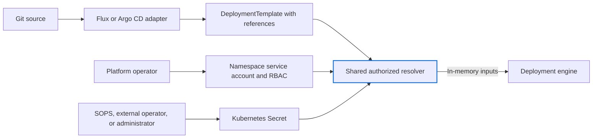
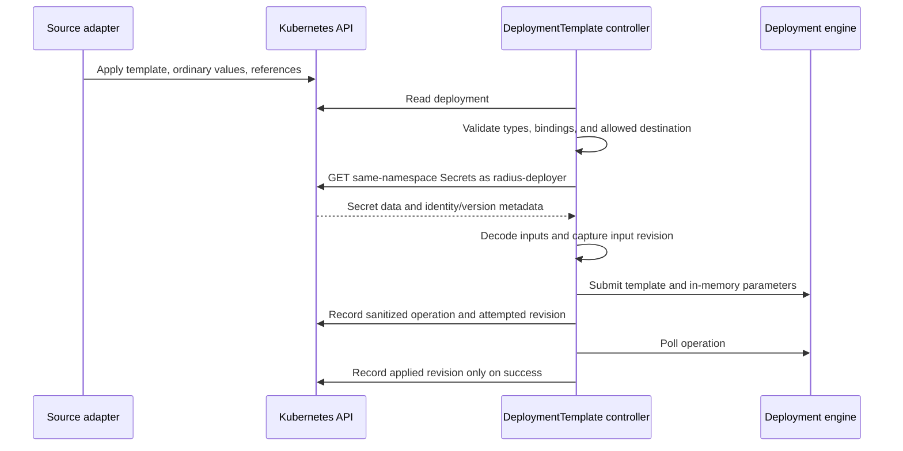

# Resolve GitOps secret parameters from authorized Kubernetes Secret references

## Status

Proposed, 2026-11-04. All API additions below are unimplemented.

Issue: [#13500](https://github.com/radius-project/radius/issues/13500). Shared API and controller coordination: [#12999](https://github.com/radius-project/radius/issues/12999).

Format: [minimal ADR](https://github.com/architecture-decision-record/architecture-decision-record/blob/main/locales/en-001/templates/decision-record-template-by-michael-nygard/index.md).

## Context

The Flux integration compiles Bicep and optional `.bicepparam` files from `GitRepository` artifacts into a `DeploymentTemplate`. It copies string parameters, including `@secure()` values, into `spec.parameters` (`map[string]string`).

Users configure this in `radius-gitops-config.yaml` at the root of the Git repository watched by Flux. Each `config` entry selects a Bicep file with `name` and an optional parameter file with `params`. Parameter values live in that file, not in `radius-gitops-config.yaml`.

DeploymentTemplate readers can therefore read credentials without Kubernetes Secret-read permission. `@secure()` does not prevent this serialization.

Relevant current implementation:

- [Flux configuration and compilation](../../../pkg/controller/reconciler/flux_controller.go): `ConfigEntry`, `runBicepBuildParams`, and `createOrUpdateDeploymentTemplate`.
- [Parameter conversion](../../../pkg/controller/reconciler/util.go): `convertFromARMJSONParameters` and `convertToARMJSONParameters`.
- [DeploymentTemplate API](../../../pkg/controller/api/radapp.io/v1alpha3/deploymenttemplate_types.go): `DeploymentTemplateSpec` and `DeploymentTemplateStatus`.
- [Shared execution](../../../pkg/controller/reconciler/deploymenttemplate_reconciler.go): `startPutOperationIfNeeded`, `computeHash`, and `isUpToDate`.
- [Manifest generation](../../../pkg/cli/cmd/bicep/generatekubernetesmanifest/generatekubernetesmanifest.go): the CLI also serializes parameter values into generated manifests.
- [Controller permissions](../../../deploy/Chart/templates/controller/rbac.yaml): the current role does not grant core Secret reads.

Flux users provision Kubernetes Secrets through [SOPS](https://fluxcd.io/flux/guides/mozilla-sops/), External Secrets Operator, Sealed Secrets, or manually.

Radius reads source-controller artifacts directly, bypassing Kustomization decryption and substitution. Substituting or decrypting a value into a DeploymentTemplate still persists plaintext in the CR.

Source reconciliation and application lifecycle remain as defined in the [Flux design](2025-01-gitops-technical-design.md).

## Decision

Resolve same-namespace Secret name/key references in the shared deployment controller using a namespace-scoped service account and Kubernetes RBAC.

Flux and Argo CD adapters emit references without reading Secrets or provisioning during generation and diff. Neither integration requires the other.

Secret references are additive. Existing `params: app.bicepparam` configurations continue to work without changes; upgrading does not require moving existing values into Secrets.

### Scope and proposed choices

| Choice                    | Proposal                                                      | Trade-off                                                               |
|---------------------------|---------------------------------------------------------------|-------------------------------------------------------------------------|
| Secret provisioning       | Reuse Kubernetes Secrets populated by existing tools          | Operators retain responsibility for provisioning and storage protection |
| Input API                 | Add references alongside the existing literal parameter map   | Requires validation across both fields                                  |
| Consumption authorization | Use a platform-managed service account and Kubernetes RBAC    | All deployment authors in a namespace share its approved Secret access  |
| Secure types              | Initially support references to secure strings only           | Secure-object references need typed transport                           |
| Rotation                  | Poll referenced Secrets with bounded, jittered reconciliation | Rotation has bounded latency but needs no Secret list/watch permission  |
| Compatibility             | Preserve existing parameter files; add optional references    | Existing inline secrets remain exposed until users replace them         |

### User-facing contract

Users keep `params` for file-based values and add `parameterReferences` in `radius-gitops-config.yaml` for secret inputs. Add the latter to Flux `ConfigEntry`:

```yaml
config:
  - name: app.bicep
    params: app.bicepparam
    namespace: my-app
    parameterReferences:
      databasePassword:
        secretKeyRef:
          name: database-credentials
          key: password
```

Declare the secure input without a default:

```bicep
@secure()
param databasePassword string
```

For reference-based deployments, use [`using none`](https://learn.microsoft.com/en-us/azure/azure-resource-manager/bicep/bicep-using#the-using-none-statement) in `.bicepparam` and omit referenced parameters. This Bicep syntax compiles a parameter file without linking it to a template, so the compiler does not check template-specific names, types, or required inputs:

```bicep
using none

param applicationName = 'orders'
```

`build-params` rejects missing required inputs when the parameter file uses `using './app.bicep'` (BCP258). Compile the unbound parameter file and `name` template separately, then validate parameter names, types, and required bindings against the union of literals and references. Do not supply placeholders. Existing configurations without references retain linked parameter-file compilation.

The Flux adapter generates the following DeploymentTemplate fields. Users edit `radius-gitops-config.yaml` and the parameter file, not the generated object:

```yaml
spec:
  parameters:
    applicationName: orders
  parameterReferences:
    databasePassword:
      secretKeyRef:
        name: database-credentials
        key: password
```

Keep `template`, provider configuration, and repository fields unchanged. References cannot specify a namespace.

For reference-bound parameters:

- Reject inline bindings and compiled-template defaults for the same parameter.
- Allow references only to declared secure strings. Reject unknown or ordinary parameter targets, secure objects, and unsupported secure metadata.
- Reject literal/reference conflicts and missing required bindings.
- Validate before submission. Preserve supported ordinary parameter behavior.

Parameters without references retain existing behavior, including inline secure values. Those values remain visible in the DeploymentTemplate.

### Authorization

Use same-namespace Secret name/key references, following [Flux HelmRelease values references](https://fluxcd.io/flux/components/helm/helmreleases/#values-references).

Follow [Flux's service-account authorization model](https://fluxcd.io/flux/installation/configuration/multitenancy/) for Secret reads. Platform operators provision a service account named `radius-deployer` in each deployment namespace. The Radius controller impersonates that account when fetching referenced Secrets.

Bind a namespaced Role to that service account:

```yaml
apiVersion: rbac.authorization.k8s.io/v1
kind: Role
metadata:
  name: radius-secret-inputs
  namespace: my-app
rules:
  - apiGroups: [""]
    resources: ["secrets"]
    resourceNames: ["database-credentials"]
    verbs: ["get"]
```

The RoleBinding, service account, and impersonation permissions are platform-managed manifests. Kubernetes RBAC restricts Secret objects, not individual keys.

Grant the Radius controller `impersonate` on only the `radius-deployer` service account through a Role and RoleBinding in each approved namespace. Do not grant wildcard user, group, or service-account impersonation, or direct Secret reads to the controller. Use an uncached client under the impersonated identity for each Secret GET; no Secret list/watch permissions are required.

Also grant the controller `get` on the `radius-deployer` service account and verify that it exists before resolution. Impersonation alone does not establish account existence. Keep this account dedicated to Secret reads; impersonation carries all permissions granted to that identity.

The reader identity is fixed by namespace, not selected in application configuration. Missing identity, missing impersonation permission, or denied Secret access blocks submission without falling back to the controller identity. Legacy deployments without references do not require this account.

Operators control service accounts, RBAC, destination namespaces, and the sources allowed to deploy into them. Tenant GitOps accounts must not modify these controls. The Radius Flux adapter currently accepts a destination namespace from repository configuration; namespace/source authorization must be enforced before enabling reference execution for tenant repositories.

Treat each deployment namespace as a trust boundary. Anyone permitted to author a Radius deployment there can consume the reader account's approved Secrets. Use separate namespaces for authors requiring different Secret access.

An authorized template can expose its inputs through deployed resources. Restrict template authors and deployment scope accordingly. The controller remains trusted through its impersonation permissions.

Follow [Argo CD's destination-cluster secret-management guidance](https://argo-cd.readthedocs.io/en/stable/operator-manual/secret-management/): provision Secrets independently and leave references in generated manifests. Argo CD does not provide a generic deployment-parameter resolver; Radius owns resolution after sync.

### Architecture



Use workload secret bindings for runtime-only credentials. This resolver handles deployment-time inputs.

### Resolution and execution



Call a shared resolver in `pkg/controller/reconciler` before `DeploymentTemplateReconciler` starts a PUT. Pass resolved values to the request builder without modifying the spec or cached objects.

Read each Secret once per attempt. `Secret.data` is already base64-decoded by the client. Require UTF-8, preserve whitespace, and validate empty strings against template constraints. An empty value is not a missing key.

Keep values out of logs, errors, events, traces, resume tokens, and status. Minimize buffer lifetime; Go does not guarantee memory erasure.

Perform fresh impersonated Secret reads for each submission and retry. Kubernetes enforces current RBAC on each request. Multiple reads are not atomic, and permission revocation cannot recall values already read or submitted.

The engine receives resolved values with the template's secure metadata. Audit and test request persistence, deployment history, diagnostics, providers, and outputs before release.

### Rotation, retries, and lifecycle

Include dependency revisions in `isUpToDate`; the current spec-only check would skip rotation.

Hash the desired spec and sorted Secret UID/resourceVersion metadata. Never hash secret bytes into status. Metadata-only Secret updates may redeploy.

Add `attemptedInputRevision` and `appliedInputRevision` to status. Store the attempted revision with the operation; advance the applied revision only on success. Finish tracking in-flight operations before submitting newer inputs. Preserve asynchronous recovery and test failures between submission and status persistence.

Poll every 60 seconds by default, configurable with jitter and bounded concurrency. Re-read references under the reader identity before comparing input revisions, including for previously Ready deployments. Retry unavailable inputs with bounded backoff. Rotation and access revocation require no Git or spec change.

API outages, rate limits, and in-flight operations delay rotation. Bound parameter counts and payload sizes before allocating requests; determine limits against engine and API constraints.

| Event                                                                        | Required behavior                                                                                                   |
|------------------------------------------------------------------------------|---------------------------------------------------------------------------------------------------------------------|
| Missing Secret/key, denied access, invalid value, or missing reader identity | Mark input failure, submit nothing new, retain existing deployed resources, and retry                               |
| Secret rotation                                                              | Submit current authorized inputs on the next eligible reconciliation                                                |
| Secret deleted and recreated with the same name                              | Treat the new UID as a changed dependency; read it only if current RBAC permits                                     |
| Secret-read or impersonation permission revoked                              | Block further submissions; previously delivered values remain in use                                                |
| Secret changes during an operation                                           | Finish tracking that attempt, then reconcile the latest dependency revision                                         |
| Reference removed                                                            | Stop reading that dependency; validate whether the secure input is now unbound                                      |
| Application or deployment deleted                                            | Follow existing resource cleanup; never delete externally managed Secrets or depend on input resolution to finalize |
| Deployment recreated                                                         | Resolve current inputs using the namespace reader account                                                           |

Do not add deployment owner references or finalizers to Secrets. Operators coordinate Secret provisioning and pruning separately from Radius cleanup.

### Failures and observability

Report `SecretInputUnavailable`, `SecretInputInvalid`, or `SecretInputConflict` with the parameter name and remediation. Do not expose raw API errors that reveal protected Secret existence or contents. Restrict detailed access diagnostics to operator audit facilities.

Set the existing Failed state on input failure, even when generation is unchanged. Record revision progress, lookup failures, and reconciliation latency without values or high-cardinality metric labels.

### Compatibility and optional adoption

Existing configurations and DeploymentTemplates remain valid with unchanged `params` semantics. Adoption is optional and per parameter:

1. Install compatible CRDs and controller. Provision namespace reader accounts, scoped Roles/RoleBindings, and controller impersonation permissions.
2. Provision a Secret through the user's existing secret-management system.
3. Add `parameterReferences` to `radius-gitops-config.yaml`, change the parameter file to `using none`, and remove the corresponding binding and template default.
4. Verify convergence and rotate credentials whose old values were accessible to unauthorized readers.
5. Remove obsolete inline inputs and artifacts. Handle historical Git, backup, and audit copies under operator retention policy.

Add reference-preserving inputs to `rad bicep generate-kubernetes-manifest`; CLI syntax remains open. Producers must preserve references without reading Secrets or inserting resolved values into generated output.

Upgrade CRDs and controllers before enabling references. Do not use mixed controller versions or downgrade with reference-based objects present. Document supported versions and downgrade steps.

Future secure-object reference support requires typed transport, JSON decoding rules, payload limits, and redaction tests. An unsupported or failed reference must not fall back to an inline value or default.

### Verification and delivery

Use synthetic reference-bound secrets to verify delivery to the intended sink and absence from artifacts, DeploymentTemplate spec/status, events, logs, and diagnostics.

- Unit tests cover existing linked parameter files unchanged, `using none` compilation with mixed literal/reference inputs, template validation, secure metadata and defaults, unsupported references, duplicate bindings, UTF-8, empty values, and missing keys.
- API-server tests cover schema validation, impersonated Secret reads, scoped RBAC, permission revocation, missing reader accounts, and absence of direct controller Secret access.
- Tenant-isolation tests reject unauthorized destination namespaces, attempts to change reader identities or RBAC, and cross-namespace references. Denied reads must not fall back to controller credentials.
- Bootstrap tests apply platform RBAC and application manifests in different orders, then recreate deployments without changing authorization.
- Reconciliation tests cover polling, unchanged specs, metadata-only updates, deletion/recreation, failed lookups, restart recovery, status-write failures, and dependency changes during an operation.
- Flux end-to-end tests cover SOPS and an external operator, rotation, ordinary parameters, and deletion. Testing every external provider is out of scope.
- Generated-manifest and Argo CD integration tests consume the same contract without installing Flux. Source adapters must not call the Secret API.
- Redaction tests cover engine success and failures, including failures before outputs exist.
- Scale tests establish lookup rate, request limits, polling latency, and bounded memory use before choosing production limits.

Deliver API validation and namespace authorization, impersonated resolution and revision tracking, then adapters, CLI, and adoption documentation. Enable execution only after authorization and redaction tests pass. Track shared work in #12999 and Flux adoption in #13500.

## Consequences

### Positive

Reference-bound inputs appear as references, not credentials, in generated manifests. Existing configurations and Secret provisioners work unchanged. Flux and Argo CD share resolution, authorization, and rotation logic.

### Negative

The controller gains credential access through impersonation. Operators maintain namespace reader accounts and scoped RBAC. Deployment authors in one namespace share its approved Secret access.

Polling adds API traffic and rotation latency; metadata-only updates can redeploy. Secure-object references are initially unsupported. Existing inline values remain exposed until users replace them.

Values exist in controller/engine memory and intended downstream resources. Operators still need storage encryption, transport protection, and access controls.

### Alternatives not selected

| Alternative                                          | Reason not selected                                                                                     |
|------------------------------------------------------|---------------------------------------------------------------------------------------------------------|
| Inline `.bicepparam` values plus `@secure()`         | Does not protect upstream DeploymentTemplate serialization                                              |
| SOPS decryption inside the Radius Flux adapter       | Duplicates secret distribution and exposes values before the shared execution boundary                  |
| Flux substitution into DeploymentTemplate parameters | Protects Git but persists plaintext in the destination CR                                               |
| Namespace restriction alone                          | Does not prevent deployment authors from consuming unrelated namespace Secrets                          |
| Controller-wide direct Secret access                 | Does not isolate tenant Secret access                                                                   |
| Watching all Secrets                                 | Requires broader list/watch access and risks caching unrelated secret payloads                          |
| Direct Vault or cloud secret-manager integrations    | Expands provider, identity, and rotation scope; existing operators already bridge to Kubernetes Secrets |
| CSI-only secret mounts                               | Useful for workloads, but do not provide an API-readable Secret unless synchronization is enabled       |

### Open questions and approval gates

Review enforcement of source-to-destination namespace authorization for Flux and generated manifests. Untrusted sources must not select a namespace with a more privileged reader account.

Define CLI syntax, parameter/payload limits, polling/backoff bounds, and the supported Bicep versions for `using none`.

Audit engine persistence and downstream redaction. Define the version matrix and downgrade procedure.

### Authoring notes

AI-drafted and edited. Source inspected at `c03f71492c0492e1922b0ed655923529d1b03c16`. Bicep 0.46.1 rejected an omitted required parameter with a linked `using` declaration and compiled the partial file with `using none`. Other compiler versions, engine persistence, production limits, and release timing remain unverified.
