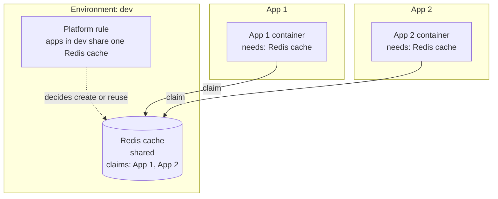
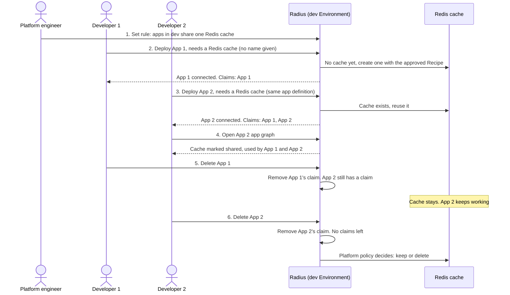

# Topic: Shared resources across apps

- **Author**: Reshma Abdul Rahim (@Reshrahim)
- **Status**: Draft for review
- **Issue**: radius-project/radius#13687

## Topic Summary

Many apps need the same kind of resource, such as a database or a cache. Large enterprises want those apps to share one real server, with each app kept separate inside it. Today a Radius developer must know that a shared resource exists and refer to it by name. Radius also doesn't track which apps use it.

This spec describes what we want instead. Each app makes a claim for what it needs. The platform decides whether to meet that claim with an existing resource or a new one. A shared resource stays while any app still has a claim on it, so removing one app never breaks another.

### Top level goals

- Developers ask for what their app needs, without knowing whether it already exists.
- Platform engineers decide, by policy, when apps share a resource and when each app gets its own.
- Apps that share a resource are kept separate from each other.
- A shared resource stays as long as any app uses it.
- The app graph shows which apps depend on each shared resource.

### Non-goals (out of scope)

- Choosing how this is built. That belongs in the design doc.
- Splitting cost between apps that share a resource.
- Moving an app from a shared resource to its own resource, or back.
- Running systems that other teams own. Radius uses them but does not take them over.

## User profile and challenges

### User persona(s)

- **App developer:** builds and deploys apps. Large enterprises can have thousands of developers. They want to say what the app needs, not how the infrastructure is built.
- **Platform engineer:** owns the catalog of approved resources and the rules for how they are created.
- **Owning team:** runs a system that Radius doesn't create, such as a central database team.

### Challenge(s) faced by the user

- To share a resource, a developer must know it exists and know its name. This leaks infrastructure details into the app.
- Radius doesn't know which apps use a shared resource, so it is hard to tell what will break if something changes.
- Separating each app inside a shared server, such as its own schema and credentials, is done by hand.
- Systems run by other teams don't fit well into how Radius manages resources.

### Positive user outcome

- Developers deploy without asking around for resource names.
- Platform engineers control sharing, cost and sprawl through policy.
- Developers can remove their apps safely, knowing shared resources stay for the apps that still need them.

## Key scenarios

Each scenario runs end to end, from setup to cleanup.

### Scenario 1: Two apps share a cache, from first deploy to removal

1. A platform engineer sets a rule: in the `dev` Environment, apps share one Redis cache.
2. A developer says App 1 needs a Redis cache, without naming one, and deploys it. No cache exists yet, so one is created the approved way.
3. A second developer says App 2 needs a Redis cache and deploys it. App 2 is connected to the same cache. Neither app definition changes based on whether the cache is shared.
4. Developer 2 opens the App 2 app graph. The cache is marked as shared and shows both apps.
5. Developer 1 deletes App 1. The cache stays, and App 2 keeps working.
6. Developer 2 deletes App 2. Platform policy decides whether the cache is kept or deleted.

After both apps are deployed:

Step by step:

Open questions for this scenario:

- What should the platform team's sharing rule include? For example, limits such as how many apps can share one cache before a new one is created, and settings such as size and version.
- What makes the cache a match for App 2? For example, same Environment, same size, same version or same owning team. If App 2 asks for a different size or version, should Radius reuse the cache anyway, create a new one, or reject the deploy?
- When the last app is gone, is the default to keep or delete the cache?

### Scenario 2: Apps share a database server, each with its own schema

1. A platform engineer sets a rule: apps in the `prod` Environment share one PostgreSQL server, and each app gets its own schema.
2. A developer says App 1 needs a PostgreSQL database and deploys it. App 1 gets its own schema and its own credentials on the shared server.
3. A second developer deploys App 2 the same way. App 2 gets a separate schema and credentials, and can't read App 1's data.
4. Developer 2 checks App 2 and sees that all of its needs are met, and which shared server it uses.
5. Developer 1 deletes App 1. Its schema and credentials are removed. The server and App 2's schema stay.

### Scenario 3: Apps use a database that another team runs

1. A central database team makes a server it already runs available to apps in an Environment. Radius did not create this server.
2. A developer says their app needs that kind of database and deploys it. The app is connected to the team's server and gets its own credentials.
3. The developer sees the server in the app graph as shared and owned by another team.
4. The developer deletes the app, and later every other app that uses the server is deleted too. Radius never deletes the server, because the owning team runs it.

### Open question: sharing across Environments

- Should one database be shared by apps in several Environments, such as the VM, Kubernetes and serverless Environments that serve the same business? If so, does this belong in this feature or in Parent Environment (radius-project/radius#13689)?
