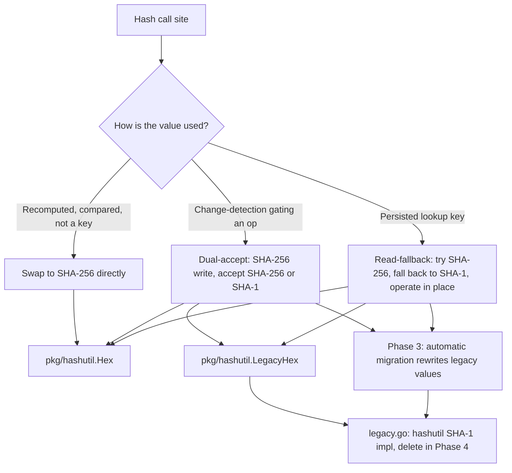

# SHA-1 to SHA-256 Internal Hashing Migration

- **Author**: GitHub Copilot (assisted), on behalf of the Radius maintainers

## Overview

Radius uses hashing in several places to generate deterministic, unique values: resource identifiers (Kubernetes object names, tracked-resource names), Terraform recipe state-secret suffixes, ETags, and change-detection tokens for the Kubernetes controllers. Historically these used **SHA-1**. SHA-1 is cryptographically broken and is flagged by CodeQL (`go/weak-cryptographic-algorithm`), even though Radius only uses it for **non-cryptographic** uniqueness and change detection - never for security (see the [UCP threat model](./2024-11-ucp-component-threat-model.md#use-of-cryptography)).

This document describes the staged migration from SHA-1 to **SHA-256**. The guiding constraint is that the migration must be **non-breaking and transparent to existing installations**: an upgrade must not lose data, must not trigger workload redeployment or pod restarts, and must require no customer action. The migration is delivered in four phases. Phases 1 and 2 added a backward-compatible layer that reads values written with SHA-1. Phase 3 migrates stored values to SHA-256 automatically, in the background, while that layer stays in place. Phase 4 removes the SHA-1 code in a later release, once every installation has recorded a completed migration.

## Terms and definitions

| Term                 | Definition                                                                                                                                                               |
|----------------------|--------------------------------------------------------------------------------------------------------------------------------------------------------------------------|
| Current hash         | SHA-256, used for all newly written values.                                                                                                                              |
| Legacy hash          | SHA-1, retained only to read values written by older versions of Radius.                                                                                                 |
| Dual-accept          | A compare path that treats a stored value as matching if it equals **either** the current (SHA-256) or legacy (SHA-1) hash. Used for change-detection hashes.            |
| Read-fallback        | A lookup path that tries the current (SHA-256) key, then falls back to the legacy (SHA-1) key. Used for persisted identifiers.                                           |
| Operate-in-place     | When an existing record is found under its legacy key, it is updated or deleted under that same legacy key rather than being re-keyed. New records use the current key.  |
| Persisted identifier | A hash used as a stable storage key (datastore object name, Terraform state-secret suffix, tracked-resource name). Changing it without a fallback orphans existing data. |
| Automatic migration  | The Phase 3 background service in each control-plane component that moves the legacy values it owns to their current form.                                               |
| Migration status     | The `radius-sha256-migration` ConfigMap in `radius-system`, with one JSON value per component and migration step.                                                        |
| Tombstone            | The Terraform state lock that the migration keeps held on the legacy name of a state it moved.                                                                           |

## Objectives

> **Issue Reference:** [radius-project/radius#8084](https://github.com/radius-project/radius/issues/8084); CodeQL code-scanning alerts 827 and 928-935.

### Goals

- Replace SHA-1 with SHA-256 for all non-cryptographic hashing in the control plane.
- Guarantee a **non-breaking, transparent upgrade**: no data loss, no redeployment or restart of workloads, no Terraform state recreation, no customer action.
- Isolate backward-compatibility hashing in a clearly documented helper, so the CodeQL surface and eventual removal work are understood.
- Migrate stored values to SHA-256 automatically (Phase 3), and gate the removal of SHA-1 (Phase 4) on a recorded completion signal.

### Non goals

- Changing any public REST API, CLI command, or Bicep/Helm surface. The hashes involved are internal and opaque to users.
- Re-keying stored data in Phases 1 and 2. Those phases read and update existing records under their legacy keys; Phase 3 re-keys them.
- Removing the compatibility layer in the release that migrates the data. Phase 4 removes it in a later release, so a migration that has not finished, a rollback to a release that reads both formats, or an older pod during a rolling upgrade can still read legacy values.
- Migrating Terraform states that no stored resource refers to, and states in S3 or Azure Blob backends, whose keys already use SHA-256.

## Design

### High Level Design

A single foundation package, `pkg/hashutil`, centralizes hashing. `Hex(data) string` returns SHA-256 hex and is used for all new values. `LegacyHex(data) string` returns SHA-1 hex and lives in `pkg/hashutil/legacy.go`, the only SHA-1 implementation in the control plane. Every remaining SHA-1 use goes through it, and only to recognize values written by older versions. Phase 4 deletes `legacy.go` together with its callers and the fallback paths.

Each SHA-1 call site is migrated using one of three patterns, chosen by how the hash is used:

- **Transient / recomputed hashes** swap directly to SHA-256. This is safe because the value is recomputed and compared, never persisted as a lookup key.
- **Change-detection hashes that gate an operation** use **dual-accept**: write SHA-256, but on compare accept SHA-256 **or** legacy SHA-1. This ensures an upgraded control plane recognizes existing state as up-to-date and does **not** trigger an operation.
- **Persisted identifiers** use **read-fallback with operate-in-place**: write and look up under SHA-256, fall back to the SHA-1 key when the requested identity is absent, and keep existing records under their legacy key until the automatic migration moves them. For datastore collision buckets, an existing Kubernetes object does not count as a match unless it contains the requested resource ID.

The **automatic migration** (Phase 3) then moves every stored legacy value to its current form in the background, so Phase 4 can remove the dual-accept and read-fallback paths.



### Detailed Design

Migration status by site. All sites are validated by unit tests; the datastore, tracked resources, and DeploymentTemplate controller are additionally validated by envtest and integration tests.

| Site                                                                                | Compatibility pattern (Phases 1 and 2)                          | Automatic migration (Phase 3)                   |
|-------------------------------------------------------------------------------------|-----------------------------------------------------------------|-------------------------------------------------|
| `pkg/ucp/util/etag/etag.go` (ETags)                                                 | Direct swap (opaque token)                                      | Not needed                                      |
| `pkg/controller/reconciler/annotations.go` (config hash)                            | Dual-accept                                                     | Removed (#12952)                                |
| `pkg/controller/reconciler/deploymenttemplate_reconciler.go` (spec hash)            | Dual-accept                                                     | Rewritten by the reconciler                     |
| `pkg/ucp/trackedresource/{name,update}.go` + `proxy.go` (tracking names)            | Read-fallback (`ResolveTrackingEntry`)                          | UCP `trackedResources` step                     |
| `pkg/recipes/terraform/config/backends/kubernetes.go` (state-secret suffix)         | Read-fallback (`resolveSecretSuffix`)                           | applications-rp and dynamic-rp `terraformState` |
| `pkg/components/database/apiserverstore/apiserverclient.go` (datastore object name) | Read-fallback (`getResourceWithFallback`, `getResourceForSave`) | UCP `datastore` step                            |
| `pkg/kubernetes/secrets.go` (`HashSecretData` to pod annotation)                    | Preserve while unchanged (`NewSecretHashTransformer`)           | applications-rp `containerSecretHash` step      |
| `pkg/corerp/renderers/aci/gateway/render.go` (DNS prefix)                           | Deferred                                                        | Removed (#13293)                                |

Removed sites no longer compute hashes: [#12952](https://github.com/radius-project/radius/pull/12952) removed the annotation-based Kubernetes controller, and [#13293](https://github.com/radius-project/radius/pull/13293) removed legacy ACI support.

#### Automatic migration

Each component that owns legacy values runs a migration service from [`pkg/upgrade/hashmigration`](../../../pkg/upgrade/hashmigration/hashmigration.go) next to its API and worker. The service waits 30 seconds after the component starts, runs each of its steps, records the status of each step, and retries with exponential backoff from 1 to 15 minutes until every step is `Complete` or `NotApplicable`. Then the service stops; the component keeps running.

A step never blocks requests and never fails an upgrade. A value that cannot be migrated now, such as one with an operation in progress or a held Terraform lock, is counted as remaining and retried on a later pass. Every step is idempotent and safe to run concurrently with normal operations and with other replicas. Every write uses optimistic concurrency, and a value is copied to its current name before its legacy copy is removed, so a reader always finds it. The Phase 1 and 2 fallbacks stay in place, so readers find a value whether or not it has been migrated.

| Component       | Step                  | Migrates                                                                                                                                                                                                                                                                                                                                                                                                                                                                                                                                                                                                                                   |
|-----------------|-----------------------|--------------------------------------------------------------------------------------------------------------------------------------------------------------------------------------------------------------------------------------------------------------------------------------------------------------------------------------------------------------------------------------------------------------------------------------------------------------------------------------------------------------------------------------------------------------------------------------------------------------------------------------------|
| ucp             | `trackedResources`    | Tracking entries under legacy tracking IDs, in every resource group of the `radius` plane. An idle entry is saved under its current ID, unless another writer created that ID first, then the legacy entry is deleted with an ETag precondition. An entry with an operation in progress is retried later, because the worker completes the operation under the ID it was queued with. The proxy resolves the tracking entry again on every retry, so it follows a moved entry, and resource-group listings show one entry while both copies exist.                                                                                         |
| ucp             | `datastore`           | With the `apiserver` database provider, entries stored in `Resource` objects under legacy names. This covers the data of every component, because they share the store. Each entry, with its data and ETag, is copied into its current object, then removed from the legacy object, with resource-version preconditions. An identical copy under both names is deduplicated. A legacy copy that changes during the move, which only a writer unaware of current names can do, replaces the copy made from it. Copies that differ otherwise are left in place and reported as conflicts. `Query` returns one entry while both copies exist. |
| applications-rp | `terraformState`      | Kubernetes-backend Terraform states of its resources, as described below.                                                                                                                                                                                                                                                                                                                                                                                                                                                                                                                                                                  |
| applications-rp | `containerSecretHash` | Container Deployments whose pod template still carries a legacy secret hash, as described below.                                                                                                                                                                                                                                                                                                                                                                                                                                                                                                                                           |
| dynamic-rp      | `terraformState`      | Kubernetes-backend Terraform states of its resources.                                                                                                                                                                                                                                                                                                                                                                                                                                                                                                                                                                                      |

The DeploymentTemplate controller needs no step. When only the legacy spec hash matches, `isUpToDate` replaces it with the current hash, and the reconciler saves it with the status, without a deployment. The controller reconciles every DeploymentTemplate when it starts, so the first start after an upgrade migrates them all.

**Terraform states.** The step enumerates the resources in the component's database through the `database.Enumerator` interface, which every database provider implements. It computes the current and legacy secret suffixes of each resource that belongs to an environment, as a deployment does, and moves each state stored under a legacy suffix:

1. If an operation is in progress on the resource that owns the state, the move waits for a later pass, because the operation may already have resolved the legacy name. The resource is read again right before the move.
1. The step acquires the state's Terraform lock (the `lock-tfstate-default-<suffix>` Lease) the way Terraform does, so moves and deployments exclude each other.
1. Every part of the state (`tfstate-default-<suffix>` and its `-part-N` Secrets) is copied to the current name, with the suffix label updated and `radapp.io/sha256-migrated-from` and `radapp.io/sha256-migrated-from-uid` annotations. The first part is written last, because Radius selects the current name as soon as that Secret exists.
1. The legacy parts are deleted with UID and resource-version preconditions, last part first.
1. The legacy lock stays held by `radius-sha256-migration/moved` and is labeled `radapp.io/sha256-migration=tombstone`. A deployment that resolved the legacy name just before the move fails to acquire that lock, already when Terraform loads the state, with lock information that names the new Secret. It cannot create an empty state under the legacy name or run against one. A retry uses the moved state.

An interrupted move resumes on a later pass: copies are recognized by their migrated-from UID, and a migrator that stopped while holding a lock is taken over after its five-minute lease expires. A state stored under both names with different content is left in place and reported as a conflict; Radius uses the current name. A state whose Secrets do not follow the backend's naming is skipped and reported. States in S3 and Azure Blob backends already use SHA-256 keys.

**Container secret hash.** `HashSecretData` returns `sha256:` followed by SHA-256 over a domain-separated, length-prefixed encoding of the sorted keys and values. The legacy form is `LegacyHashSecretData`; its `|key|value` encoding was ambiguous. Changing the annotation alone would roll out every workload with a secret, so:

- A resource transformer for Deployments, `NewSecretHashTransformer`, reads the live Deployment before Radius applies it. If its pod template carries a legacy hash and the secret is unchanged, the transformer keeps the legacy hash, so the pod template and its pods stay as they are. The secret is unchanged when the Deployment's recorded current hash (below) equals the new hash. Without a recorded hash, it is unchanged when the live Secret, which Radius applies before the Deployment, holds the rendered data and its legacy hash equals the pod template's hash. When the secret changes, the current hash replaces the legacy hash and the workload rolls out, as it always has.
- The `containerSecretHash` step lists the Deployments with the `radapp.io/resource` label in the deployment target cluster. For each pod template that carries the legacy hash of its unchanged Secret, it records the current hash in the `radapp.io/secret-hash-sha256` annotation of the Deployment, outside the pod template, so recording it does not roll out the workload. Kubernetes advances the Deployment's generation for an annotation change, but keeps its ReplicaSet and pods. It applies the annotation with server-side apply under its own field manager, so later Radius applies keep it. With the recorded hash, the transformer no longer needs SHA-1. A Deployment whose Secret changed after it was deployed is skipped; its next deployment rolls it out, as before.

The hash stays unkeyed, as it was with SHA-1 and as common `checksum/secret` annotations are. An HMAC with a cluster-local key would hide low-entropy secret values from users who can read Deployments but not Secrets, but every restore into a new control plane would change the key and roll out every workload with a secret.

#### Coverage by starting point

The steps act on what is stored, not on the version an installation was upgraded from, so every starting point is covered:

| Installation first created with              | Legacy values at upgrade                                                                                                                                            | Result                                                                                                                                      |
|----------------------------------------------|---------------------------------------------------------------------------------------------------------------------------------------------------------------------|---------------------------------------------------------------------------------------------------------------------------------------------|
| `v0.59` or earlier (before Phase 1)          | All identifiers, Terraform states, DeploymentTemplate hashes, and secret hashes use SHA-1.                                                                          | Every step migrates. The upgrade preflight allows one minor version per upgrade, so the fallbacks keep the installation working on the way. |
| `v0.60` or `v0.61` (Phases 1 and 2)          | Values written before the upgrade to `v0.60` use SHA-1; values written later use SHA-256. Secret hashes use SHA-1.                                                  | Legacy values are migrated; current values are left as they are; values stored under both names are deduplicated or reported as conflicts.  |
| A fresh `v0.61` install                      | Identifiers, Terraform states, and DeploymentTemplate hashes use SHA-256. Secret hashes use SHA-1, because `HashSecretData` used SHA-1 until the migration release. | Only `containerSecretHash` has work: it records the current hash on each container Deployment.                                              |
| The migration release or later               | None                                                                                                                                                                | Every step completes with nothing to do, or reports `NotApplicable`.                                                                        |
| Any, upgraded without preflight or with Helm | Any of the above                                                                                                                                                    | As above.                                                                                                                                   |

### Advantages

- **Transparent upgrade**: legacy values stay readable throughout, are migrated in the background, and no workload rolls out.
- **Contained compatibility hashing**: `legacy.go` is the only SHA-1 implementation, and every caller only recognizes values written by older versions.
- **Verifiable completion**: the migration status records what each component migrated, what it could not migrate, and when it finished, so the release that removes SHA-1 can require completion.

### Disadvantages

- SHA-1 remains in the binary until Phase 4, a release after the migration completes.
- The migration adds background writes to the control plane once, after the upgrade. They are spread across passes with backoff and use optimistic concurrency.
- The fallback is one-directional: during a rolling upgrade window, data newly written by a new pod in the SHA-256 format is briefly invisible to a still-running old pod that lacks the fallback.
- A Terraform state lock held as a tombstone remains for each moved state until Phase 4 removes it.

### Proposed Option

Ship the compatibility layer (Phases 1 and 2) first, then the automatic migration (Phase 3) with the compatibility layer still in place, then remove SHA-1 (Phase 4) in a later release that requires a completed migration.

## Phased rollout

### Phase 1: Foundation and safe swaps (DONE)

- Introduce `pkg/hashutil` (`Hex` plus isolated `LegacyHex`).
- Migrate transient hashes (ETags) and convert the two controller change-detection hashes to dual-accept, so an upgrade triggers no container PUT, no DeploymentTemplate re-deployment, and no pod rollout. The annotation-based controller and its configuration hash were later removed in #12952; the DeploymentTemplate spec hash remains dual-accept.
- Keep `HashSecretData` on SHA-1 (documented) to avoid a workload rollout.

### Phase 2: Persisted-identifier read-fallback (DONE)

- Tracked resources, the Terraform state-secret suffix, and the datastore object name each migrated to SHA-256 with a SHA-1 read-fallback and operate-in-place semantics.
- Validated with unit tests, the UCP `radius` integration tests, and the apiserverstore envtest suite, including a dedicated test that pre-creates a legacy-named object and confirms it is found, updated **in place** without duplication, and deleted via the fallback.
- Follow-up hardening makes datastore fallback entry-aware: an unrelated entry in the current-name bucket must not hide or duplicate the requested legacy entry. The same resolver serves reads, deletes, and save-target selection while preserving ETags, resource versions, unrelated entries, and error behavior.
- Tracking coverage includes legacy deletion, queued updates and retries, and preseeded legacy entries in both synchronous and asynchronous UCP integration scenarios. Terraform coverage follows the resolved state suffix through initialization, repeated apply, validation, destroy, and cleanup, including lookup and destroy failures.
- The dedicated `Test_HashCompatibilityUpgrade` scenario uses distinct baseline/candidate images with historical-format fixtures, version preflight, and actual control-plane replacement. It checks legacy storage and tracking identities together, a connection-secret-consuming workload, real Terraform state, concurrent writes, no-op and intentional updates, and deletion.
- **Release evidence remains separate:** the fixture scenario establishes compatibility for its recorded builds and stored formats, not mixed-writer safety when one binary understands only SHA-1. The generic CLI upgrade tests that reuse current images with versioned chart copies do not establish that guarantee either.

### Phase 3: Automatic migration (DONE)

- `HashSecretData` uses SHA-256. Unchanged workloads keep their legacy secret hash through the Deployment transformer, so no workload rolls out.
- UCP, applications-rp, and dynamic-rp run the migration steps described under [Automatic migration](#automatic-migration) and record their status. DeploymentTemplate status hashes are rewritten on reconcile.
- All Phase 1 and 2 fallbacks stay in place for interrupted or unfinished migrations, rollbacks to `v0.60` or later, and rolling-upgrade overlap.
- Test hosts disable the migration with `sha256Migration.disabled`, so in-process tests do not record status in whatever cluster the local kubeconfig selects. Production installations must leave it enabled.
- Release notes for the migration release must state that the migration runs automatically after the upgrade, how to check its status, and that the release that removes SHA-1 requires it to be complete.

### Phase 4: Remove SHA-1 (FUTURE)

A release after the migration release deletes `pkg/hashutil/legacy.go`, every `Legacy*` helper, the read-fallback and dual-accept paths, `LegacyHashSecretData`, and the transformer's SHA-1 check, keeping the recorded-hash check. It can also delete the tombstone locks and the recorded hash annotations.

That release must first verify that the migration completed, because an unmigrated legacy value becomes invisible without the fallbacks:

- The pre-upgrade checks, which run for both `rad upgrade kubernetes` and Helm upgrades with the `pre-upgrade` hook enabled, read the `radius-sha256-migration` ConfigMap and require every step of an existing installation to be `Complete` or `NotApplicable`. A missing ConfigMap on an upgrade means the migration never ran, for example because the migration release was skipped.
- A Terraform state that was skipped or left as a conflict stays under its legacy name, and Phase 4 would lose track of it. The check must report such states for operator review instead of passing silently.
- Container Deployments without a recorded hash roll out on their next deployment, which is the only behavior change a skipped step can cause there.

## API design

N/A. No public REST API, CLI, or Bicep/Helm changes. All affected hashes are internal and opaque.

## CLI Design

N/A.

## Implementation Details

### Migration framework

- `pkg/upgrade/hashmigration`: the `Service` that runs a component's `Step`s, the `Result` of a pass, and the recorded `Status`. `ConfigMapReporter` records each status with a JSON merge patch of its own key, so components do not overwrite each other, and creates the `radius-sha256-migration` ConfigMap on first use. `ReadStatus` reads it back.
- `sha256Migration.disabled` in the UCP, applications-rp, and dynamic-rp configuration turns the migration off. Only the in-process test hosts set it.
- `pkg/ucp/server/hashmigration.go`, `pkg/server/hashmigration.go` (applications-rp), and `pkg/dynamicrp/server/server.go` register each component's service and steps. applications-rp runs the container step against the deployment target, which can be an external cluster.
- `database.Enumerator` visits every stored object. The apiserver, PostgreSQL, and in-memory providers implement it, and `test/ucp/storetest` covers it for each provider.
- Chart: the `ucp-sha256-migration` Role and RoleBinding let UCP create the status ConfigMap and get and patch only that ConfigMap. applications-rp and dynamic-rp already have cluster-wide access to ConfigMaps, Secrets, Leases, and Deployments.

### UCP

- `pkg/ucp/util/etag/etag.go`: `New` uses `hashutil.Hex` (SHA-256). ETags are computed at save time, stored, and compared as opaque strings, so existing ETags remain valid until a record is rewritten.
- `pkg/ucp/trackedresource`: `NameFor` uses SHA-256 (truncated to 40 hex to preserve the 63-character ARM/UCP name budget); `LegacyNameFor` and `LegacyIDFor` are added; `ResolveTrackingEntry` performs the current-then-legacy lookup and is used by both `Updater.run` and the proxy enqueue path. `MigrateLegacyEntries` re-keys idle entries. The proxy resolves the entry again on each optimistic-concurrency retry and never recreates a legacy ID, and the resource-group list de-duplicates entries by tracked resource, preferring the current tracking ID.
- `pkg/components/database/apiserverstore/apiserverclient.go`: `resourceName` uses SHA-256 truncated to 40 hex (to stay within the 253-character Kubernetes object-name limit). `getResourceWithFallback` prefers a current entry, then checks the legacy bucket if the entry is absent, even when the current bucket exists. `getResourceForSave` reuses that resolver: existing legacy entries stay in place until migrated, while a new entry uses an existing current bucket or a newly created current bucket, never an unrelated legacy bucket. `Query` returns one result per ID, preferring the current bucket. `MigrateLegacyNames` in `migrate.go` moves entries to their current buckets.

### Portable Resources / Recipes RP

- `pkg/recipes/terraform/config/backends/kubernetes.go`: `generateSecretSuffix` uses the first 40 hexadecimal characters of SHA-256, preserving the legacy width and fitting the Kubernetes label-value limit. `BuildBackend` resolves the suffix current-then-legacy via `ValidateBackendExists` (guarded for the nil-client tooling path). The resolved suffix flows through `generateConfig` and `backendResult.kubernetesSecretName` to both `ValidateBackendExists` and the state-secret `Delete`, keeping apply and destroy consistent. Explicit S3 and Azure Blob backends do not participate in Kubernetes legacy-secret discovery. `SecretSuffixes` returns both suffixes of a resource.
- `pkg/recipes/terraform/config/backends/migrate.go`: `StateMigrator` moves states under the Terraform lock and keeps the tombstone, and `NewStateMigrationStep` runs it over a component's database.

### Core RP / Controller

- `pkg/controller/reconciler/deploymenttemplate_reconciler.go`: `computeHash` uses `hashutil.Hex`; `isUpToDate` accepts SHA-256 **or** legacy SHA-1 and replaces a matching legacy hash with the current hash, which `reconcileUpdate` saves with the status. The former `annotations.go` dual-accept path was removed with the annotation-based controller.
- `pkg/kubernetes/secrets.go`: `HashSecretData` uses SHA-256 with the `sha256:` prefix; `LegacyHashSecretData` reproduces the SHA-1 form through `hashutil.LegacyHex`; `IsLegacySecretHash` recognizes it. `AnnotationSecretHashSHA256` in `labels.go` names the recorded hash.
- `pkg/corerp/renderers/container/secrethash.go`: `NewSecretHashTransformer`, registered for `apps/Deployment` output resources in the application model, and the `containerSecretHash` step (`RecordSecretHashes`).

### Error Handling

Lookup errors other than not-found are propagated after any existing read retries. Datastore lookup also falls back when a current bucket lacks the requested entry. If neither bucket contains the entry, public operations preserve their existing logical `ErrNotFound` and conditional-operation `ErrConcurrency` behavior; a physical bucket's existence alone does not make the logical resource exist. When both names contain the target, reads keep current-first precedence; the migration deduplicates identical copies and reports copies that differ as conflicts instead of choosing one.

A migration step that returns an error or panics is recorded as `Failed` and retried on the next pass; it does not stop the component or the other steps. An error on a single value counts it as remaining. The secret-hash transformer uses the current hash when the Deployment or Secret is missing or cannot be read for lack of permission; other read errors fail the deployment, so it is retried.

## Test plan

- **Unit tests**: `pkg/hashutil` (NIST SHA-256 and SHA-1 vectors); updated expected values in the reconciler, tracked-resource, Terraform-backend, and datastore name tests; new legacy-value tests for each `Legacy*` helper.
- **Behavioral tests**: dual-accept (a stored legacy hash is treated as up-to-date) and read-fallback (a pre-created legacy-keyed record is found, updated in place without duplication, and deleted).
- **Fallback matrix**: current-only, legacy-only, missing, and dual-copy cases; current buckets containing unrelated entries; lookup errors; matching and stale ETags; preservation of unrelated entries and current-first precedence. Fixed legacy vectors and length checks protect naming compatibility.
- **Integration / envtest**: the UCP `radius` integration suite runs new and legacy tracking identities through PUT, track, list, and delete. The datastore envtest suite additionally verifies legacy updates and deletes when an unrelated current bucket exists, including Kubernetes UID/resource-version preservation and a single logical query result.
- **Terraform execution**: subprocess-backed tests verify the selected backend in generated configuration and the secret names used by post-apply validation, pre-destroy checks, and cleanup. Failed resolution must not reach initialization, apply, or destroy; failed destroy must retain state.
- **Automatic migration**: framework tests cover step states, failure isolation, panics, retries with backoff, cancellation, cumulative counts, and the ConfigMap reporter. Datastore tests use a fake client and an envtest subtest for moves, deduplication, promotion of a changed legacy copy, conflicts, shared buckets, concurrent writes, and errors. Tracked-resource tests run against the in-memory and apiserver stores, including busy entries and a racing update, and proxy and list tests follow a moved entry. `Enumerate` has a conformance test for every database provider; PostgreSQL runs when `TEST_POSTGRES_URL` is set.
- **Terraform state move**: fake-clientset tests cover single and multi-part states, locks held by Terraform or by another migrator, tombstone reuse, states under both names, interrupted copies and deletes, copy and delete failures, unexpected Secrets, owners that are busy, become busy, or are deleted, and resolution of the moved state by `BuildBackend`. An API-server test repeats the move with real preconditions and resource versions, waits for a Terraform lock, refuses to delete a legacy state that changed, and runs concurrent migrators that must move a state exactly once. A manual check with Terraform 1.16.5, the version Radius pins, against the same API server moved a five-part state, then confirmed that Terraform reads it under the current name with the same lineage and no changes, and that a run using the legacy name stops at `terraform init` with the tombstone's message.
- **Secret hash**: the SHA-256 encoding and the legacy SHA-1 encoding are pinned. Transformer tests cover new, current, legacy-unchanged, legacy-changed, recorded-hash, and unreadable cases; backfill tests cover recording, skips, conflicts, and failures. An API-server test checks that recording the hash leaves the pod template unchanged, fails on a stale Deployment, and survives a later Radius server-side apply. A DeploymentTemplate envtest proves that a legacy status hash is rewritten without starting a deployment, and a Helm unit test pins the UCP Role.
- **Controlled cluster upgrade**: [`Test_HashCompatibilityUpgrade`](../../../test/functional-portable/upgrade/hash_compatibility_test.go) records distinct image IDs and prepares only test-owned legacy identities while control-plane writers are stopped. Its provider-free `terraform_data` fixture checks lineage, managed-resource identity, and deletion; its connection-backed secret exercises the actual `radapp.io/secret-hash` annotation. After the upgrade it waits for every migration status to be done, then checks that each legacy identity was moved exactly once, that the Terraform state moved with its lineage and managed resource and left a tombstone, that the workload kept its legacy secret hash and gained the recorded hash, and that no workload rolled out. See the [functional-test instructions](../../../docs/contributing/contributing-code/contributing-code-tests/running-functional-tests.md#exercise-persisted-hash-compatibility-during-an-upgrade) for the opt-in baseline/candidate inputs and evidence boundary.
- **Real-upgrade release gate**: use actual source and target artifacts on a supported incremental route. Verify legacy datastore and tracking identities together, Terraform state lineage and managed-resource identity, unchanged workload pod UIDs/templates/ReplicaSets/restart counts, writes during rollout, and a completed migration status. A provenance-checked legacy fixture proves stored-format compatibility only, not mixed-version writer safety.

## Security

SHA-1 in Radius is used only for non-cryptographic uniqueness and change detection (per the [UCP threat model](./2024-11-ucp-component-threat-model.md#use-of-cryptography)). Every new value uses SHA-256. The only remaining SHA-1 implementation is `pkg/hashutil/legacy.go`, and its callers only recognize values written by older versions; Phase 4 deletes it. The secret hash no longer computes SHA-1 directly, which resolves the CodeQL finding on `pkg/kubernetes/secrets.go`.

The migration does not expose secret values. Moved Terraform states stay in the same namespace with the same type and data. The recorded `radapp.io/secret-hash-sha256` annotation holds the same kind of unkeyed hash that the pod template annotation already holds; see [Container secret hash](#detailed-design) for why it stays unkeyed. UCP's new permissions are limited to the status ConfigMap, except for `create`, which Kubernetes cannot limit by name.

## Compatibility

Backward-compatible reads and operate-in-place updates are implemented, and the automatic migration then moves stored values to their current names in the background. No workload rolls out: unchanged secret hashes are preserved, and DeploymentTemplate hashes are rewritten without a deployment. No customer action is required. The end-to-end guarantee of no data loss, workload rollout, or customer action still requires the real-upgrade evidence described above.

The fallback is one-directional: new code reads old data, but old code cannot read new-format identities. The control-plane Deployment templates use `replicas: 1` without an explicit no-overlap strategy, so a rolling update can still run old and new writers concurrently. Retries can recover transient transport failures; they do not make old readers understand new keys or prevent independent backing records or Terraform locks. Do not treat a short replacement window as proof of safe mixed-version writes, or describe manual operator draining as satisfying the no-customer-action goal.

Source inspection identifies `v0.59.0` as SHA-1-based and `v0.60.0` as containing the compatibility layer. A release-gate run must pin real artifacts and follow the supported incremental route to its actual target. The development chart's `edge` version is not a semantic release-to-release target under the current preflight rules; inventing a version label or disabling preflight is not equivalent evidence. Downgrade safety is not implied by forward-read compatibility.

`rad upgrade kubernetes` runs a version preflight by default that allows only patch upgrades or the next minor version, so every supported source for releases after `v0.60` already understands both formats. The SHA-1-only to SHA-256 writer overlap is therefore confined to the `v0.59` to `v0.60` upgrade unless preflight is skipped or Helm is run directly. `rad rollback kubernetes` performs a Helm rollback without a version check: rolling back from `v0.60` or later to `v0.59` or earlier after new records are written hides those records and their Terraform state from the older release.

Rolling back from the migration release to `v0.60` or `v0.61` keeps migrated data readable, because those releases look up current names first and accept current DeploymentTemplate hashes. Their container renderer computes SHA-1 secret hashes again, so a container whose pod template received a `sha256:` hash after the upgrade rolls out once when it is next deployed. A later upgrade resumes the migration, because each component runs it on every start until its steps are done.

## Monitoring and Logging

Each component logs the outcome of every step on every pass (state and the counts of migrated, deduplicated, remaining, conflicting, and skipped values) and logs once when its migration completes. The `radius-sha256-migration` ConfigMap in `radius-system` holds one JSON value per `<component>.<step>` key, with the state, the counts, the last message or error, the Radius version, and the time of the last pass. Operators can check it with:

```bash
kubectl get configmap radius-sha256-migration --namespace radius-system --output yaml
```

`migrated` and `deduplicated` count values since the component started; `remaining`, `conflicts`, and `skipped` describe the last pass. A step that stays `InProgress` has values that are busy or locked; one that stays `Failed` has an error in its message.
