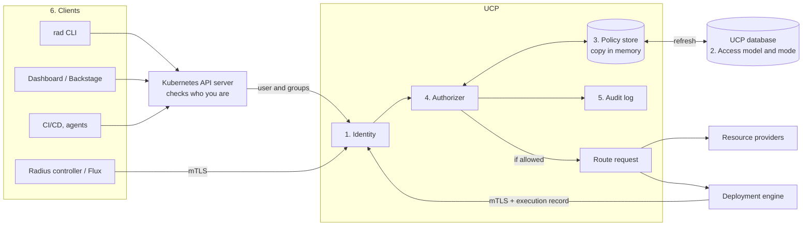

# Built-in Radius Role-Based Access Control

- **Author**: Shruthi Kumar (@sk593)

## Overview

Radius has no built-in RBAC today. A caller that reaches the Radius API through Kubernetes can create or delete any environment, change any Recipe Pack, register cloud credentials, and deploy anywhere. This design adds Radius RBAC. Product requirements are in the [built-in RBAC feature specification](./2026-09-built-in-rbac-feature-spec.md).

The companion [internal component authorization design](./2026-09-internal-component-authorization.md) assumes UCP already produces an authorization decision for a user's request. This design defines that decision:

| This design (user-facing RBAC)                                                              | Internal design                                                                                                                                                                                                                  |
|---------------------------------------------------------------------------------------------|----------------------------------------------------------------------------------------------------------------------------------------------------------------------------------------------------------------------------------|
| Decides if a **user** can do an operation.                                                  | Prevents Radius's **own services** from skipping that decision or exceeding it.                                                                                                                                                  |
| Roles, role assignments, `rad auth` commands, UCP request checks, and deployment preflight. | Service identities (mTLS), the execution record that carries an approval through a deployment, the data-access service, the credential broker, Kubernetes admission controls, and the service-to-service rollout (Off, Enforce). |

## Key terms

Radius RBAC follows the Azure RBAC model because Radius uses ARM-style resource IDs and APIs: principals, permissions, roles, role assignments, scopes, inheritance, and implicit deny.

| Term                | Meaning in Radius                                                                                                         | Example                                                                                            |
|---------------------|---------------------------------------------------------------------------------------------------------------------------|----------------------------------------------------------------------------------------------------|
| Principal           | `{type, issuer, subject}`. `type` is `user`, `group`, or `workload`.                                                      | `{group, kubernetes:<cluster-id>, team-a-devs}`                                                    |
| Issuer              | The system that proves the identity. Radius stores it on each assignment so the same name from two systems never matches. | The Kubernetes cluster that hosts Radius.                                                          |
| Scope               | A Radius resource ID: the installation (`/`), a plane, a resource group, or one resource.                                 | `/planes/radius/local/resourceGroups/team-a`                                                       |
| Permission catalog  | All permissions. Radius generates it from API definitions and registered resource types.                                  | `Radius.Core/environments/write`                                                                   |
| Use permission      | Permission to refer to a resource from another resource.                                                                  | `Radius.Core/environments/use/action` to deploy into an environment.                               |
| Preflight           | The check of every resource in a deployment before the deployment changes anything.                                       |                                                                                                    |
| Execution record    | From the internal design. UCP's saved record of what a deployment may do. Radius services check it during the deployment. | Record `r-123`: Alice may create these two resources in `team-a`, with staging, until `expiresAt`. |
| Namespace principal | The principal that the Radius controller acts as for a Kubernetes namespace.                                              | `{workload, radius-controller, <namespace>}`                                                       |
| Enforcement mode    | `Disabled`, `DryRun` (log what RBAC would block), or `Enforce` (block it).                                                |                                                                                                    |

## How Radius handles a request today

Today, when you run `rad deploy`:

- **Kubernetes authenticates the caller** and checks Kubernetes RBAC on the `api.ucp.dev` API group.
- **UCP discards the caller's identity.** Kubernetes forwards the user and groups in `X-Remote-User` and `X-Remote-Group`. `filterKubernetesAPIServerHeaders` in `pkg/ucp/proxy/kubernetes.go` removes `X-Remote-User`, `X-Remote-Group`, and `X-Remote-Extra-*` because UCP cannot confirm that Kubernetes sent them.
- **Radius services trust each other completely.**

## Objectives

> **Issue Reference:** [radius-project/radius#13030](https://github.com/radius-project/radius/issues/13030), [radius-project/roadmap#27](https://github.com/radius-project/roadmap/issues/27)

Personas and user scenarios are in the [feature specification](./2026-09-built-in-rbac-feature-spec.md#key-scenarios).

| Feature specification investment                            | Where it is designed                                                                       |
|-------------------------------------------------------------|--------------------------------------------------------------------------------------------|
| Feature 1: Permission and scope model                       | [Scopes](#scopes), [Permissions](#permissions)                                             |
| Feature 2: Built-in and custom roles                        | [Roles](#roles)                                                                            |
| Feature 3: Role assignments and effective-access inspection | [Role assignments](#role-assignments), [Checking access](#checking-your-access)            |
| Feature 4: Cross-scope and transitive-use authorization     | [Checking a request](#checking-a-request), [Checking a deployment](#checking-a-deployment) |
| Feature 5: Consistent enforcement and client behavior       | [Identity](#piece-1-identity), [Clients](#clients-cli-dashboard-automation)                |
| Feature 6: Auditability and safe administration             | [Safety rules](#safety-rules), [Audit log](#piece-5-audit-log)                             |
| Feature 7: Migration and compatibility                      | [Turning RBAC on](#turning-rbac-on), [Compatibility](#compatibility-optional)              |

### Goals

- **One place decides.** UCP checks every Radius API request from the CLI, dashboard, CI/CD, and GitOps.
- **Roles are normal Radius resources.** Users manage them with the API, new `rad auth` commands, Bicep and `rad deploy`, or GitOps.
- **New resource types grant no access by default.**
- **Deployments are checked before they start.** Radius blocks a deployment before changing anything if RBAC would block a later step.
- **Safe to enable.** Existing installations can preview RBAC blocks, and the last administrator cannot remove everyone's access.

### Non goals

The feature specification's [non-goals](./2026-09-built-in-rbac-feature-spec.md#non-goals-out-of-scope) apply. This design also does **not**:

- Add a sign-in method other than Kubernetes. Radius stores the issuer on every role assignment so it can add other sign-in systems later.
- Store access decisions. Radius writes them to logs, and they are kept only if the operator runs a log agent.
- Support wildcards like `Radius.Core/*` or deny rules in custom roles.

## User Experience (if applicable)

The [CLI](./2026-09-built-in-rbac-feature-spec.md#proposed-cli-experience), [Bicep](./2026-09-built-in-rbac-feature-spec.md#proposed-bicep-experience), and [GitOps](./2026-09-built-in-rbac-feature-spec.md#proposed-gitops-experience) experiences come from the feature specification.

**Sample Input:** A platform admin lets `team-a-devs` manage apps in their resource group and deploy to staging. A developer then tries to deploy to production.

```console
rad auth assignment create \
  --role application-developer \
  --principal group:team-a-devs \
  --scope /planes/radius/local/resourceGroups/team-a

rad auth assignment create \
  --role environment-deployer \
  --principal group:team-a-devs \
  --scope /planes/radius/local/resourceGroups/platform/providers/Radius.Core/environments/staging

rad deploy app.bicep --group team-a --environment /planes/radius/local/resourceGroups/platform/providers/Radius.Core/environments/production
```

**Sample Output:** Radius blocks the deployment before it creates anything. The error shows what is missing.

```console
Error: Authorization failed before the deployment started.

  Identity:  user alice@contoso.com (issuer: kubernetes)
  Action:    Radius.Core/environments/use/action
  Target:    /planes/radius/local/resourceGroups/platform/providers/Radius.Core/environments/production
  Denied by: Radius RBAC

No Radius resources were changed. Run 'rad auth access explain --action Radius.Core/environments/use/action --scope <target>' for details, or ask a Radius access administrator for the Environment Deployer role on this environment.
```

## Design

### The big idea

UCP receives every Radius API request, so UCP checks access. The design has six pieces:

| # | Piece                                               | What it does                                                                                                            | Where it lives                   |
|---|-----------------------------------------------------|-------------------------------------------------------------------------------------------------------------------------|----------------------------------|
| 1 | [Identity](#piece-1-identity)                       | Reads the user and group names Kubernetes forwards. UCP trusts them only after it verifies they came from Kubernetes.   | UCP                              |
| 2 | [Access model](#piece-2-access-model)               | Defines scopes, permissions, roles, and role assignments. Together they say who can do what and where.                  | New `Radius.Core` API types      |
| 3 | [Policy store](#piece-3-policy-store)               | Saves the access model and mode in the UCP database. Each UCP instance keeps an in-memory copy.                         | UCP database                     |
| 4 | [Authorizer](#piece-4-authorizer)                   | Checks each request and deployment. Applies safety rules such as "never remove the last admin".                         | UCP                              |
| 5 | [Audit log](#piece-5-audit-log)                     | Stores each change to roles, assignments, or mode. Logs each access decision.                                           | UCP database and UCP logs        |
| 6 | [Rollout and clients](#piece-6-rollout-and-clients) | Turns RBAC on in safe steps (`Disabled`, `DryRun`, `Enforce`). Makes the controller, CLI, and dashboard work with RBAC. | Helm, CLI, controller, dashboard |

Resource providers do **not** check roles. They trust UCP's decision. Later hops check the execution record instead of roles: UCP to providers, workers, the data-access service, and the credential broker. The internal design lists these [checks at each hop](./2026-09-internal-component-authorization.md#checks-at-each-hop).



### A worked example

Alice is a member of `team-a-devs`. She runs `rad deploy app.bicep` to staging. Her template creates one application and one container. Labels show the owning design: **RBAC** (this design) or **Internal** (the internal design).

1. **Kubernetes identifies Alice (RBAC).** It reads her kubeconfig and forwards `X-Remote-User: alice@contoso.com` and `X-Remote-Group: team-a-devs` to UCP.
2. **UCP trusts those headers (Internal)** after it verifies that the connection came from the Kubernetes API server.
3. **UCP checks the deployment request (RBAC).** Alice needs `Microsoft.Resources/deployments/write` on resource group `team-a`. Her group has `application-developer` there, which includes that permission. Radius allows the request.
4. **The deployment engine reads the template (RBAC)** and lists planned resources: one application and one container in `team-a`, both using staging.
5. **Preflight: UCP checks everything at once (RBAC).** For each resource, UCP asks:
    - Can Alice write this resource type in `team-a`? Yes, through `application-developer`.
    - Can Alice deploy to the referenced staging environment? Yes, through `environment-deployer` on staging.
6. **All checks pass, so UCP writes an execution record (Internal).** The record lists the approved work: Alice as `subject`, the two resources as `targets`, staging as `environment`, and the deployment engine as `submitter`.
7. **The deployment runs (Internal and RBAC).** Each create request carries the record ID. UCP confirms that the engine is the record's `submitter` and the record is active (Internal). UCP confirms that the resource is on the approved list (RBAC). UCP then forwards the request to the resource provider through mTLS. The provider checks only that UCP sent it.

If Alice points at production, step 5 fails and Radius creates nothing.

### Detailed Design

#### Piece 1: Identity

Kubernetes sends the caller in [authenticating proxy](https://kubernetes.io/docs/reference/access-authn-authz/authentication/#authenticating-proxy) headers, which UCP reads only from the verified API server ([internal design](./2026-09-internal-component-authorization.md)). UCP maps them to principals:

| Header value                                       | Principal                                                                                       |
|----------------------------------------------------|-------------------------------------------------------------------------------------------------|
| `X-Remote-User: system:serviceaccount:<ns>:<name>` | A workload: `{type: workload, issuer: <k8sIssuer>, subject: system:serviceaccount:<ns>:<name>}` |
| Any other `X-Remote-User` value                    | A user: `{type: user, issuer: <k8sIssuer>, subject: <value>}`                                   |
| Each `X-Remote-Group` value                        | A group: `{type: group, issuer: <k8sIssuer>, subject: <value>}`                                 |

UCP checks assignments for the user and each group. An admin can assign `reader` to `system:authenticated` so all signed-in users can read allowed data. UCP never accepts `system:unauthenticated`. Anonymous requests fail with `InvalidAuthenticationInfo`.

**The issuer includes a cluster ID.** Two clusters can both have `alice` or `system:serviceaccount:default:ci`. If Radius stored only `kubernetes`, copied policy could match the wrong principal. Radius stores `kubernetes:<trust-domain>`.

- By default, `rad install` uses the UID of the `kube-system` namespace. That UID lasts for the cluster lifetime.
- Installations with a recreated control plane, such as Repo Radius, set a new Helm value `rbac.kubernetesIssuer`. Example: `kubernetes:repo-radius/<owner>/<repo>`.
- The CLI adds the issuer. Examples use `kubernetes`.

**User names and groups.** Clusters that use OIDC should choose a stable user-name claim, such as `sub`, so assignments keep matching. `rad auth whoami` shows the principal that Radius sees. Kubernetes reads group membership on each request, so a group change applies after the Kubernetes login refreshes.

**Kubernetes RBAC gates access to Radius.** Kubernetes still checks access to the `api.ucp.dev` API group before it forwards the request. The Helm chart adds ClusterRole `radius-api-user` for that gate. With Radius RBAC on, admins can bind it broadly, for example to `system:authenticated`, and let Radius decide.

The deployment engine and the controller act for another principal. See [Clients](#clients-cli-dashboard-automation).

#### Piece 2: Access model

##### Scopes

| Scope level    | Resource ID                                                          | What is inside it                                                                                 |
|----------------|----------------------------------------------------------------------|---------------------------------------------------------------------------------------------------|
| Installation   | `/`                                                                  | Everything. Used only for admin-type roles, `reader`, `auditor`, and the setting for enforcement. |
| Plane          | `/planes/radius/local`, `/planes/azure/<name>`, `/planes/aws/<name>` | Its resource groups, resource type registrations, and cloud credentials.                          |
| Resource group | `/planes/radius/local/resourceGroups/<rg>`                           | All resources in the group.                                                                       |
| Resource       | A resource ID, such as an environment                                | The resource and any child resources.                                                             |

**A reference does not grant access.** Access on an environment does not cover the Recipe Packs that the environment uses.

**Resource-level scopes.** These resource types can be scopes: `Radius.Core/environments`, `Radius.Core/recipePacks`, `Radius.Core/applications`, `Applications.Core/environments`, and `Applications.Core/applications`.

##### Permissions

A permission is `<Namespace>/<type>/<operation>`. The operation is `read`, `write`, `delete`, or `<actionName>/action`.

UCP maps each HTTP request to one permission:

| Request                          | Permission needed            |
|----------------------------------|------------------------------|
| `GET` a resource or list         | `<type>/read`                |
| `PUT` or `PATCH`                 | `<type>/write`               |
| `DELETE`                         | `<type>/delete`              |
| `POST <resourceId>/<actionName>` | `<type>/<actionName>/action` |

`POST .../applications/shop/getGraph` needs `Radius.Core/applications/getGraph/action`.

**Permission catalog.** Radius generates the catalog:

| Source                                  | Which types                                                                                     | How                                                                                                                                                                        |
|-----------------------------------------|-------------------------------------------------------------------------------------------------|----------------------------------------------------------------------------------------------------------------------------------------------------------------------------|
| API definitions (at build time)         | `Radius.Core/*`, `Applications.*/*`, `Microsoft.Resources/deployments`                          | A generator reads Swagger under `swagger/`. TypeSpec for `Radius.Core` lives under `typespec/Radius.Core`. It creates read, write, delete, and actions such as `getGraph`. |
| UCP's own types (fixed list)            | Resource groups, planes, resource type registrations, cloud credentials, and the new RBAC types | Code lists these with UCP routes. Resource type registrations use `System.Resources/resourceProviders/resourceTypes` in `pkg/ucp/datamodel/resourcetype.go`.               |
| Registered resource types (at run time) | User-defined types such as `Radius.Data/mySqlDatabases`                                         | Radius creates read, write, and delete permissions when the type is registered through `System.Resources/resourceProviders/<namespace>/resourceTypes/<type>`.              |

`rad auth permission list` shows the catalog.

**Use permissions.** These work like Azure `join` actions. They protect references from one resource to another.

| Use permission                                                              | Needed when                                                                                                                                                                                                                    |
|-----------------------------------------------------------------------------|--------------------------------------------------------------------------------------------------------------------------------------------------------------------------------------------------------------------------------|
| `Radius.Core/environments/use/action` (and the `Applications.Core` version) | A resource's `environment` property points at the environment. This means "deploy to this environment".                                                                                                                        |
| `Radius.Core/recipePacks/use/action`                                        | An environment's `recipePacks` list includes the Recipe Pack.                                                                                                                                                                  |
| `System.Azure/credentials/use/action`, `System.AWS/credentials/use/action`  | An environment's Azure or AWS provider settings are set or changed, or a template creates cloud resources directly ([see below](#cloud-resources-in-templates)). In both cases, Radius acts with the plane's cloud credential. |
| `<type>/connect/action`                                                     | A resource adds a connection to a resource of that type.                                                                                                                                                                       |

**No `applications/deploy/action`.** Radius has no separate deployment API. "Deploy my app to staging" needs `applications/write` on the app resources and `environments/use/action` on staging.

**New permissions never enter existing custom roles.** New actions and registered types are added to the catalog only.

###### Cloud resources in templates

A Bicep template can create cloud resources directly, such as `AWS.S3/Bucket` or `Microsoft.Storage/storageAccounts`. AWS resources go through UCP's AWS plane, which calls AWS Cloud Control with the plane's registered credential. Azure resources go from the deployment engine to Azure Resource Manager and use a token from the credential broker in the internal design.

Radius does not add cloud resource types to the catalog. Instead:

- **The Radius permission is credential use.** Creating, updating, deleting, or reading a cloud resource needs `System.AWS/credentials/use/action` or `System.Azure/credentials/use/action` on the plane whose credential Radius uses.
- **The cloud credential still limits reach.** To limit cloud resources, constrain the registered IAM role or service principal.
- **Preflight includes cloud resources.** UCP checks the credential permission for each cloud resource and checks that the target matches the deployment's provider scope: AWS account and region, or Azure subscription and resource group. Approved cloud resources go into the execution record's `targets`. UCP checks AWS requests against the record. The credential broker checks the record before it issues an Azure token.
- **Direct API requests** to `/planes/aws/.../providers/AWS.*` resources outside a deployment need the same permission, including reads, because UCP calls AWS with the plane's credential.

Built-in roles: `radius-administrator` and `platform-administrator` include credential use. `application-developer` does not. A developer whose templates create cloud resources directly needs an extra grant of `credentials/use/action` on that plane, or must use a Recipe Pack recipe. Recipes are covered by `recipePacks/use/action` and need no credential permission.

##### Roles

Radius includes nine immutable built-in roles. Admins can create custom roles without wildcards.

###### Role definitions

Role definitions are new `Radius.Core/roleDefinitions` resources. UCP stores and serves them.

```json
{
  "id": "/planes/radius/local/resourceGroups/platform/providers/Radius.Core/roleDefinitions/application-operator",
  "type": "Radius.Core/roleDefinitions",
  "properties": {
    "displayName": "Application Operator",
    "description": "Operate applications without changing platform configuration.",
    "roleType": "Custom",
    "permissions": [
      "Radius.Core/applications/read",
      "Radius.Core/applications/write",
      "Radius.Core/environments/use/action"
    ],
    "assignableScopes": [
      "/planes/radius/local/resourceGroups/platform",
      "/planes/radius/local/resourceGroups/team-a"
    ]
  }
}
```

| Property           | Rules                                                                                                                        |
|--------------------|------------------------------------------------------------------------------------------------------------------------------|
| `permissions`      | Required. Each entry must be in the catalog, or the write fails with `UnknownPermission`. No wildcards.                      |
| `roleType`         | Radius sets this value: `BuiltIn` or `Custom`.                                                                               |
| `assignableScopes` | Where this role can be assigned. Defaults to where the role is defined. You can list only scopes where you can create roles. |

Other rules:

- A custom role can be created at the installation, at a plane, or at a resource group. A custom role at `/` can be used anywhere.
- Built-in roles live at `/providers/Radius.Core/roleDefinitions/<name>`. UCP creates them at startup. A change or delete request fails with `BuiltInRoleImmutable`. Bicep files refer to them with the `existing` keyword.
- You cannot delete a custom role that is still assigned to a principal (`RoleDefinitionInUse`). Remove the assignments first.
- A custom role change changes access for each principal that has it, within the [propagation time](#piece-3-policy-store). `rad auth role update` tells you how many assignments the change affects before you confirm.

###### Built-in roles

| Role                          | What it is for                    | Permissions (summary)                                                                                                                                                                                                                           |
|-------------------------------|-----------------------------------|-------------------------------------------------------------------------------------------------------------------------------------------------------------------------------------------------------------------------------------------------|
| `radius-administrator`        | Full control.                     | Every permission in the catalog, including permission to manage roles and the enforcement setting.                                                                                                                                              |
| `access-administrator`        | Manages who has access.           | Create, change, and delete roles and role assignments. Read the permission catalog. Check others' access. Read resource groups to select scopes. Cannot change other resources directly.                                                        |
| `platform-administrator`      | Runs the platform.                | Manage resource groups and environments, including deployments to them. Read and use Recipe Packs. Use cloud credentials in the planes where assigned. Cannot register or delete credentials or manage roles.                                   |
| `application-developer`       | Builds apps.                      | Manage applications and application resources (see [the application resource set](#the-application-resource-set)). Connect resources. Run deployments. Does **not** include permission to deploy to environments, which needs a separate grant. |
| `environment-deployer`        | Deploys to specific environments. | Read environments and deploy to them. Assign it on one environment or on a resource group of environments.                                                                                                                                      |
| `recipe-pack-administrator`   | Owns Recipe Packs.                | Manage and use Recipe Packs.                                                                                                                                                                                                                    |
| `resource-type-administrator` | Owns resource type registrations. | Manage resource type registrations, including permission to add types to the application resource set. Assignable only at a plane or installation because registrations live at the plane.                                                      |
| `reader`                      | Looks but does not touch.         | Every `read` permission, plus `getGraph` and `getMetadata`. Excludes `listSecrets`, cloud credentials, and role data.                                                                                                                           |
| `auditor`                     | Reviews access.                   | Read roles, role assignments, the enforcement setting, the permission catalog, and access change history. Check and explain anyone's access. No access to resource contents.                                                                    |

Notes:

- **Cloud credentials** (register, remove, read) are only in `radius-administrator`. To let another person manage credentials, an admin creates a custom role and assigns it on the Azure or AWS plane.
- **Built-in roles are fixed per release.** Each role is an explicit list generated at build time and published in the release notes. A new Radius feature enters a built-in role only through a reviewed Radius release change. It never enters automatically at run time. The exception is `radius-administrator`, the superuser role, which always has every permission.
- `rad` uses the lowercase-with-dashes names shown above.

###### The application resource set

- A resource type registration gets an optional `permissionSets` list.
- A type is part of the built-in **application resource set** only if its registration lists `applicationResources`.
- A type in the set grants only `read`, `write`, `delete`, and `connect` on that type, never actions. If the type later adds an action, existing assignments do not gain it.
- Setting or changing `permissionSets` requires `System.Resources/resourceProviders/resourceTypes/joinPermissionSet/action`. Only `resource-type-administrator` and `radius-administrator` have it.
- Built-in types in the set: `Radius.Core/applications`, `Applications.Core/applications`, `containers`, `gateways`, `volumes`, `secretStores`, `extenders`, and the `Applications.Dapr`, `Applications.Datastores`, `Applications.Messaging`, `Radius.Compute`, `Radius.Data`, and `Radius.Security` types. Environments, Recipe Packs, and Bicep and Terraform settings are not in the set.

```yaml
namespace: Radius.Data
types:
  mySqlDatabases:
    permissionSets:
      - applicationResources
    apiVersions:
      "2025-08-01-preview":
        schema: { ... }
```

##### Role assignments

Role assignments are new `Radius.Core/roleAssignments` ARM-style extension resources. The ID shows the scope:

```text
/providers/Radius.Core/roleAssignments/<name>                                     installation
/planes/radius/local/providers/Radius.Core/roleAssignments/<name>                 plane
/planes/radius/local/resourceGroups/team-a/providers/Radius.Core/roleAssignments/<name>   resource group
/planes/radius/local/resourceGroups/platform/providers/Radius.Core/environments/staging/providers/Radius.Core/roleAssignments/<name>   one environment
```

```json
{
  "id": "/planes/radius/local/resourceGroups/team-a/providers/Radius.Core/roleAssignments/3f1c...",
  "type": "Radius.Core/roleAssignments",
  "properties": {
    "roleDefinitionId": "/providers/Radius.Core/roleDefinitions/application-developer",
    "principal": {
      "type": "group",
      "issuer": "kubernetes:6c1e9a8e-...",
      "subject": "team-a-devs",
      "displayName": "Team A developers"
    },
    "description": "Team A owns this resource group.",
    "scope": "/planes/radius/local/resourceGroups/team-a",
    "managedBy": {
      "kind": "GitOps",
      "source": "https://github.com/contoso/platform-config",
      "revision": "8d2f1e0",
      "path": "access/team-a.bicep",
      "principal": "workload:kubernetes:radius-controller/namespace:platform-config"
    },
    "createdBy": "user:kubernetes:alice@contoso.com"
  }
}
```

| Property                              | Rules                                                                                                                                                                                                           |
|---------------------------------------|-----------------------------------------------------------------------------------------------------------------------------------------------------------------------------------------------------------------|
| `roleDefinitionId`                    | Required. Cannot change. The scope must be one of the role's `assignableScopes`.                                                                                                                                |
| `principal.type`, `issuer`, `subject` | Required. Cannot change. `type` is `user`, `group`, or `workload`.                                                                                                                                              |
| `principal.displayName`               | Optional label. Can change.                                                                                                                                                                                     |
| `scope`                               | Radius sets this value from the ID.                                                                                                                                                                             |
| `managedBy`                           | Radius sets this value. It records how the assignment was created: `Imperative` (API or `rad auth`), `Deployment` (`rad deploy`), `GitOps` (with the Git source), or `Bootstrap` (created during installation). |
| `createdBy`                           | Radius sets this value.                                                                                                                                                                                         |

**Assignments cannot be edited.** A `PUT` that changes the role, principal, or scope fails with `RoleAssignmentImmutable`. A `PUT` with the same values does nothing, so repeated `rad deploy` or GitOps runs are safe.

**Assignment names.** `rad auth assignment create` uses the same algorithm as Bicep `guid()` over `(scope, roleDefinitionId, type, issuer, subject)`. Templates that use `guid(resourceGroup().id, role.id, 'group', issuer, subject)` produce the same name, so they do not create duplicates. The feature specification's Bicep example omits scope and type and must be updated.

**Who owns an assignment.**

- If GitOps created an assignment, only the same GitOps source can change or delete it. Anyone else gets `ManagedByConflict`.
- An admin can override with `rad auth assignment delete --take-ownership` (API: `?takeOwnership=true`). Radius logs the override.
- `Bootstrap` assignments can be changed only through [installation settings](#turning-rbac-on).

#### Piece 3: Policy store

**Storage.** UCP saves role definitions, role assignments, the new `authorizationSettings` resource, [access change history](#piece-5-audit-log), and the [dry-run summary](#existing-installations) in the UCP database (`database.Client`, `pkg/components/database`). The backend is Postgres (`pkg/components/database/postgres`) or the Kubernetes API server store (`pkg/components/database/apiserverstore`). No new database is needed.

**In-memory copy.** Each UCP instance keeps these items:

- Assignments by `(scope, principal)`.
- The permission set for each role.
- A **generation number**, which increases by one after each access change.

Every 5 seconds, a UCP instance compares its generation number with the database. It also compares the number immediately after an access change that it handles. If its number is old, it reloads the copy.

**How fast changes apply.** A role or assignment change reaches each UCP instance within **30 seconds**. This includes retries when the database is briefly unavailable. If an instance cannot refresh within 30 seconds, it marks itself not ready and refuses requests with `AuthorizationUnavailable`. It never decides with old data.

**Writing changes safely.** Safety rules examine many assignments together, but `database.Client` checks ETags one object at a time. If two UCP instances each remove a different one of two admins, both could pass. UCP therefore serializes access changes (roles, assignments, mode) through one shared **access version record** that holds the generation number:

1. UCP reads the record. It runs the safety rules against the current access configuration and the new change.
2. UCP saves the record with the next generation number and a note about the change. It uses the current ETag check. Only one request can save a generation. The other request gets a version conflict, reads again, and reruns the safety rules. In the example, it now sees one admin left and fails with `LastAdministratorProtected`.
3. UCP saves the role or assignment and the access change record for this generation. Then it clears the note.

If UCP stops between steps 2 and 3, the next instance that reads the record sees the note and finishes the change first, including the access change record. UCP never saves a change without a new generation. UCP retries conflicts up to 5 times, then fails with 409 `Conflict`. This works on both backends without new database features.

#### Piece 4: Authorizer

##### Checking a request

The authorizer runs in the UCP HTTP handler chain built in `Service.Initialize` (`pkg/ucp/frontend/api/server.go`). It runs after parsing and before route selection. It checks each required permission at the target scope and its parents, for the user and groups.

```text
requiredChecks(request):
  checks = [ (permissionFor(request), request.resourceID) ]
  if request is a PUT or PATCH:
    for each reference in the request body:
      checks += (reference.permission, reference.targetID)
  return checks
```

**References.** Radius checks referenced resources during create and update:

| Property in the request                                                                   | Extra check on the resource it points to                                                   |
|-------------------------------------------------------------------------------------------|--------------------------------------------------------------------------------------------|
| `properties.environment`                                                                  | `<envType>/use/action` (can you deploy here?)                                              |
| `properties.application`                                                                  | `<appType>/write`, so you cannot attach resources to another team's application            |
| `properties.recipePacks[]` on an environment                                              | `Radius.Core/recipePacks/use/action`                                                       |
| `properties.providers.azure` or `.aws` on an environment                                  | `System.Azure/credentials/use/action` or `System.AWS/credentials/use/action` on that plane |
| `properties.connections.*.source`                                                         | `<sourceType>/connect/action`                                                              |
| A property in a user-defined type marked with a new `x-radius-reference` schema extension | `<referencedType>/read`                                                                    |

UCP checks **every** reference in the request body, not only new ones. If you lose permission to deploy to an environment, you cannot update resources already in it. Reads and deletes do not check references.

**Using an environment does not mean seeing what is inside it.** Deploying to staging uses its Recipe Packs, configuration, and cloud credentials, but gives you no read or write access to them. The [internal design](./2026-09-internal-component-authorization.md) limits that use to approved work.

**Do not reveal what exists.** UCP checks access **before** it looks up the resource. Without access, you get `403 AuthorizationFailed` whether the resource exists or not. With read access, you get the normal `404`.

**Lists.** For list operations, such as `GET .../applications`:

- If you have `read` on the parent scope, UCP returns the full list.
- Otherwise, UCP removes items that you cannot read. It does not report how many it removed.
- A page can contain fewer items than requested. Page navigation still works.

Resource group lists are filtered the same way.

**Application graphs.** `getGraph` needs `Radius.Core/applications/getGraph/action`. If your application connects to a resource that you cannot read, such as a shared database in another team's group, the graph hides that node's details. The node appears with no ID, name, or properties. It is marked `hidden: true`, and its connections remain. The response sets `incomplete: true`.

**Operation status.** Long-running operations use status URLs under `operationStatuses` and `operationResults`. To read one, you need `read` on the operation's resource. The person who started the operation can always read its status.

##### Checking a deployment

1. **Submit.** UCP checks `Microsoft.Resources/deployments/write` on the resource group.
2. **Expand.** The deployment engine processes the template's parameters, conditions, and loops. It produces the resources to create, with IDs and contents.
    - Some resources have names or references that depend on another resource's output. The engine knows that output only when the deployment runs. These are **deferred** resources. For them, the engine sends what it knows: resource type, scope, and known references. The scope is almost always a fixed resource group.
3. **Preflight.** The engine sends the list to a new internal UCP endpoint, `POST /internal/authorization/preflight`, over mTLS. UCP checks each resource as its own request for the user who started the deployment.
    - For a deferred resource, UCP checks the permission at the known scope. Inheritance covers any name inside that scope. UCP saves that scope as a **bound**.
    - If the scope or an important reference is unknown, preflight fails with `AuthorizationIndeterminate` in `Enforce` mode. In `DryRun` mode, it logs only. Radius refuses the deployment instead of approving work it cannot check.
4. **Decide.** If any check fails, UCP returns all failures together. The engine fails the deployment before it creates anything. The CLI shows each missing permission. If all checks pass, UCP writes the execution record with the approved list in `targets`, including bounds for deferred resources, and returns its ID.
5. **Run.** Each resource request includes the record ID. After the internal design's record checks, UCP checks that the resource is on the approved list. For a deferred resource, UCP checks that the resource is inside its bound. UCP also checks that the user still has the required permission. A request outside the approved list fails with `GrantScopeExceeded`, even if the user later got access.

**Access changes during a deployment.** If the user loses access, the deployment stops at its next step.

- UCP revokes active execution records that need a removed permission, within 30 seconds.
- The deployment's next request fails with `ExecutionRecordNotActive`. Tokens the credential broker already issued remain valid until they expire.
- Radius does not roll back completed work. The deployment fails and reports what it left behind:
  - **CLI.** `rad deploy` lists the resources that were created or changed and not rolled back, the resource that was denied, and the resources that never started.
  - **Audit log.** UCP writes one `radius.audit` event with the `executionRecordId` and the same resource lists in `partialDeployment`.
- A retry or new `rad deploy` is a new deployment. Radius checks it against current access.
- The execution record expires at `expiresAt` (default 24 hours) and is never extended.

**Nested deployments** (Bicep modules) expand as part of the parent. UCP checks their resources in the same preflight. UCP fills each module's child record (internal design) from the parent's approved list without new role checks.

**Templates that contain roles or assignments** also run the [safety rules](#safety-rules) in preflight.

##### Safety rules

These rules run in UCP on every role or assignment change from any client, in addition to the permission check.

| Rule                                    | What it does                                                                                                                                                                                                                  |
|-----------------------------------------|-------------------------------------------------------------------------------------------------------------------------------------------------------------------------------------------------------------------------------|
| Keep at least one admin                 | There must always be at least one `radius-administrator` assignment at `/` to a user or group. Temporary bootstrap assignments do not count. A change that would remove the last one fails with `LastAdministratorProtected`. |
| No giving out what you do not have      | To assign role R at scope S, you must already have each permission in R at S, **or** be an `access-administrator` or `radius-administrator` there. Otherwise, the request fails with `PrivilegeEscalationDenied`.             |
| No growing a role you do not fully have | Unless you are an Access Administrator or Radius Administrator, you can add a permission to a custom role only if you already have that permission everywhere the role can be assigned.                                       |
| Assign only where allowed               | An assignment's scope must be in the role's `assignableScopes`.                                                                                                                                                               |
| Respect ownership                       | See [who owns an assignment](#role-assignments).                                                                                                                                                                              |

**Access Administrator can grant admin**, as in Azure. Radius makes it visible:

- If you give `radius-administrator` or `access-administrator`, the CLI asks for confirmation.
- If you create an assignment that includes yourself, the CLI asks for confirmation.
- The audit log marks these `highImpact: true`, and a metric counts them.
- Treat `access-administrator` with the same care as `radius-administrator`.

**Emergency recovery ("break-glass").** If nobody can sign in as an admin, a Kubernetes cluster admin creates this Secret:

```yaml
apiVersion: v1
kind: Secret
metadata:
  name: radius-rbac-recovery
  namespace: radius-system
stringData:
  principal: user:kubernetes:oncall@contoso.com
  expiresAt: "2026-10-02T18:00:00Z"
  reason: "INC-4211 admin group deleted"
```

How it works:

- UCP checks this Secret by name every 10 seconds with `GET`. Its Kubernetes permissions allow `get` only on this Secret name, `resourceNames: [radius-rbac-recovery]`, so it cannot read any other Secret.
- While the Secret exists and is valid, the named person has `radius-administrator` at `/`. This access ends at `min(expiresAt, metadata.creationTimestamp + 4h)`. The Kubernetes API server sets `creationTimestamp`, so a UCP restart cannot extend the grant. UCP ignores a Secret older than 4 hours.
- UCP holds this access only in memory and never saves it to the database. Delete the Secret to remove access.
- Each request that uses it is logged with `recovery: true`. UCP raises an alert and a metric while it is active.
- **Only cluster admins can create it.** Kubernetes RBAC alone is not enough. Namespace admins, CI identities, and Radius service accounts can create Secrets in `radius-system`. The Helm chart installs a `ValidatingAdmissionPolicy` and binding that reject `CREATE` and `UPDATE` of `radius-rbac-recovery` unless the requester is in `system:masters` or a group listed in the new Helm value `rbac.recoveryGroups`. Delete is always allowed, because delete only removes access. Changing the policy or binding needs cluster-scoped permissions, which only cluster admins have.
- **UCP refuses recovery if the policy is missing.** Before it honors the Secret, UCP confirms these conditions:
  - The policy and its binding exist.
  - They are unchanged from what Helm installed.
  - They use `Deny`.

If not, UCP ignores the Secret and logs an alert.

#### Piece 5: Audit log

UCP records two kinds of audit events:

| Event                                        | When                             | Where it is kept                                                                                    |
|----------------------------------------------|----------------------------------|-----------------------------------------------------------------------------------------------------|
| **Access change** (roles, assignments, mode) | Every mode, including `Disabled` | The UCP database, as a new read-only `Radius.Core/accessChanges` resource. Also written to the log. |
| **Access decision** (allow, deny, wouldDeny) | `DryRun` and `Enforce`           | Only the log. Radius does not store them.                                                           |

**Access changes.** UCP writes one `accessChanges` record for each applied change, keyed by the generation number from [Writing changes safely](#piece-3-policy-store). UCP writes it in the same serialized step as the change and never deletes it. The `auditor` and `radius-administrator` roles can read them with `rad auth history list`.

**Access decisions.** UCP writes one event for each decision on a new dedicated `radius.audit` logger. Like all Radius logs (`pkg/ucp/ucplog`), they go only to stdout and are kept only if the operator runs a log agent.

Event fields:

| Field                                    | What it contains                                                                                                                                  |
|------------------------------------------|---------------------------------------------------------------------------------------------------------------------------------------------------|
| `time`, `requestId`, `correlationId`     | When it happened, and IDs to match it with the internal design's logs.                                                                            |
| `principal`, `groups`, `issuer`          | Who was checked. Group lists are cut off at 50 with a count.                                                                                      |
| `viaComponent`, `executionRecordId`      | For requests the deployment engine or controller made for someone.                                                                                |
| `permission`, `target`, `checks[]`       | Each check and its result.                                                                                                                        |
| `result`, `mode`                         | `allow`, `deny`, or `wouldDeny` (in `DryRun` mode).                                                                                               |
| `grantingAssignment`, `roleDefinitionId` | Which assignment allowed it.                                                                                                                      |
| `policyChange`                           | For changes to roles, assignments, or settings: before and after, and where the change came from.                                                 |
| `highImpact`                             | True for admin-level grants and self-assignments.                                                                                                 |
| `recovery`                               | True for requests that use the recovery Secret.                                                                                                   |
| `partialDeployment`                      | For a deployment stopped by access loss: resources created or changed and not rolled back, the denied resource, and resources that never started. |

Events never include request bodies, secrets, or credentials.

#### Piece 6: Rollout and clients

##### Turning RBAC on

###### Modes

The mode is stored in `authorizationSettings` at `/providers/Radius.Core/authorizationSettings/default`.

| Mode       | Checks run? | Blocks requests?      | When to use it                                       |
|------------|-------------|-----------------------|------------------------------------------------------|
| `Disabled` | No          | No                    | Current behavior. Upgraded installations start here. |
| `DryRun`   | Yes         | No, all requests pass | Test RBAC. UCP logs requests that RBAC would block.  |
| `Enforce`  | Yes         | Yes                   | Normal use.                                          |

The [internal design](./2026-09-internal-component-authorization.md)'s service-to-service security is set separately with Helm values (`global.rbac.enabled`, `global.rbac.dryRun`). User RBAC can be `Enforce` only when service-to-service security is also `Enforce`. Otherwise UCP rejects the change with `ComponentProtocolNotEnforced`.

**Recommended order for existing installations:**

1. Enable the internal dry run (`global.rbac.dryRun=true`) and user RBAC `DryRun` (`rad auth enforcement dry-run`).
2. Fix what both reports show: absent assignments from `rad auth enforcement report`, and services, templates, or pods from the dry run.
3. Move service-to-service security to `Enforce` with a Helm upgrade.
4. Run `rad auth enforcement enable`.

###### New installations

1. `rad install kubernetes` (`pkg/cli/cmd/install/kubernetes/kubernetes.go`) calls the Kubernetes `SelfSubjectReview` API for the installing user. It saves that identity in the proposed Helm value `rbac.bootstrapAdministrators`.
2. Before UCP accepts requests, UCP creates a `radius-administrator` assignment at `/` for each listed identity. It marks each assignment as `Bootstrap` and sets the mode from the proposed Helm value `rbac.mode` (default `Enforce`).
3. UCP does not accept requests until both steps finish.

`rad install kubernetes --skip-rbac` from the internal design sets user RBAC to `Disabled`. It leaves service-to-service security `Off` (`global.rbac.enabled=false`), so cert-manager is not required.

Helm sets the mode only on first install. `helm upgrade` does not overwrite `authorizationSettings`. If the Helm value differs from the saved mode, the pre-upgrade check fails and tells the operator to use `rad auth enforcement`.

###### Existing installations

An upgrade keeps the mode `Disabled` and creates no assignments. Nothing changes until an admin opts in:

1. **Dry run.** `rad auth enforcement dry-run` changes the mode to `DryRun` and makes the caller a bootstrap admin. Only Kubernetes cluster admins can run this. Kubernetes reads the request path as resource `providers`, which `radius-api-user` already permits, so UCP makes an explicit `SubjectAccessReview` for the caller: `update` on `authorizationsettings`, name `default`, in `api.ucp.dev`. Only the new `radius-rbac-bootstrap` ClusterRole grants it, and Helm binds it to nobody. If the review fails, UCP returns 403. The same check protects each write to `authorizationSettings` while the mode is `Disabled` or `DryRun`.
2. **Observe.** In `DryRun`, UCP records who uses Radius and what they do.
3. **Review.** `rad auth enforcement report` lists who used Radius, what RBAC would block, and suggested assignments using the smallest built-in role at the resource-group level.
4. **Enable.** `rad auth enforcement enable` changes the mode to `Enforce`. It requires 24 complete hours of dry-run history, no would-be blocks (or `--accept-denials`), and an admin.
5. **Roll back if needed.** For the period in each release's notes, a Radius Administrator can return to `DryRun` with `rad auth enforcement disable`. UCP logs and alerts. To go from `Enforce` back to `Disabled`, use the [recovery procedure](#safety-rules).

**Where the report gets its data.** The report and enable check do not read logs. In `DryRun`, each UCP instance also keeps a summary of its decisions in the UCP database:

- **What is kept.** One row per principal, permission, scope, and result, with a count and first and last time seen.
- **Where it is kept.** Each instance writes to the UCP database once a minute, in hourly buckets with a heartbeat. A crash loses at most one minute.
- **How big it gets.** Each hourly bucket has a limit of 100,000 rows. UCP deletes buckets older than 7 days. UCP deletes all buckets when the mode leaves `DryRun`.
- **Missing history is not treated as "no denials".** An hour is complete only if the mode was `DryRun` the whole hour, every instance sent its heartbeat, and no bucket hit the cap. The report shows incomplete hours. `enable` refuses with `DryRunHistoryIncomplete` until 24 complete hours exist. You can pass `--accept-incomplete-history`, which UCP logs as a `highImpact` change.

###### Repo Radius and short-lived installations

The workflow identity becomes the bootstrap admin. Restored state cannot change `Bootstrap` assignments or the mode.

##### Controllers and GitOps

Controller deployments (`DeploymentTemplate` objects in `pkg/controller/reconciler/deploymenttemplate_reconciler.go` and objects that `pkg/controller/reconciler/flux_controller.go` creates) have no user request behind them. The controller uses its mTLS identity ([internal design](./2026-09-internal-component-authorization.md)) and acts for the object's namespace.

**Namespaces are principals.** UCP uses the **namespace principal**: `{type: workload, issuer: radius-controller, subject: <namespace>}`. UCP accepts it only from the mTLS-verified controller. Admins give it roles like any other principal:

```console
rad auth assignment create --role application-developer \
  --principal workload:team-a --issuer radius-controller \
  --scope /planes/radius/local/resourceGroups/team-a
rad auth assignment create --role environment-deployer \
  --principal workload:team-a --issuer radius-controller \
  --scope /planes/radius/local/resourceGroups/platform/providers/Radius.Core/environments/staging
```

A namespace with no assignments can do nothing. Kubernetes RBAC still controls who can create `DeploymentTemplate` objects.

**Rules from the internal design.** For namespace principals:

- **Deleting an object** gets a delete-only record for resources it created, even if the namespace lost access.
- **When a namespace loses access**, new reconciles stop. Existing resources stay, and the object gets an out-of-scope condition.
- **References outside the namespace's access** fail at reconcile ([Checking a request](#checking-a-request)).
- **Flux-created templates** go only in the `GitRepository`'s own namespace, or in a namespace whose `radapp.io/gitops-sources` annotation lists that repository. Only a cluster admin can set the annotation. Otherwise the controller creates nothing and records an event on the `GitRepository`. In `Disabled` and `DryRun` modes, it logs a warning and continues.

**Managing roles through GitOps.** Give the repository's namespace principal `access-administrator`, or a custom role with `roleAssignments/write`, at the scopes it manages. The [safety rules](#safety-rules) still apply.

**Where a change came from.** The controller sends the Git URL, commit, and path in headers. UCP accepts them only from the verified controller and saves them in `managedBy`.

##### Clients (CLI, dashboard, automation)

- **`rad` CLI, CI/CD, agents:** the identity in the kubeconfig. Sign-in is unchanged. Give each pipeline and agent its own identity.
- **Radius controller:** the namespace principal ([Controllers and GitOps](#controllers-and-gitops)).
- **Deployment engine:** never acts as itself. It acts for the user who started the deployment.
- **Dashboard and Backstage plugin:** the dashboard service account, unless identity forwarding is enabled.

**The dashboard.** Today, `deploy/Chart/templates/dashboard/rbac.yaml` gives the dashboard service account `*` on `api.ucp.dev`, shared by every dashboard user. Under Radius RBAC, it has **no access by default**.

The dashboard can forward the signed-in user with Kubernetes impersonation (`Impersonate-User` and `Impersonate-Group`). This requires:

- The dashboard sign-in to use the same identity provider as the cluster.
- The Kubernetes `impersonate` permission for the dashboard service account, which is powerful.

The new Helm value `dashboard.forwardUserIdentity` enables it.

In `Enforce` without forwarding, the dashboard shows that identity forwarding is required and no data. An admin can instead give the service account a role. `rad auth assignment create` warns that every dashboard user shares it.

Role management in the dashboard stays out of scope.

**Not covered.** `rad run` log streaming and port forwarding go directly through Kubernetes, so Kubernetes RBAC controls them.

##### Checking your access

UCP serves these APIs and checks them like any other request.

| API                                                                           | Who can call it                                                                          | What it returns                                                                                                                                                                                       |
|-------------------------------------------------------------------------------|------------------------------------------------------------------------------------------|-------------------------------------------------------------------------------------------------------------------------------------------------------------------------------------------------------|
| `GET /providers/Radius.Core/whoAmI`                                           | Any signed-in user                                                                       | Your principal, groups, issuer, the enforcement mode, and whether you are a Radius Administrator.                                                                                                     |
| `POST {scope}/providers/Radius.Core/checkAccess`                              | Anyone, for themselves. A check for someone else needs `Radius.Core/checkAccess/action`. | For each permission and target that you ask about: allowed or denied.                                                                                                                                 |
| `POST {scope}/providers/Radius.Core/explainAccess`                            | Same as `checkAccess`                                                                    | Same, plus **why**: the assignment and role that allowed it, or the roles that would allow it if denied. Assignment details appear only if you can read role assignments at that scope.               |
| `GET {scope}/providers/Radius.Core/effectiveAccess?principal=...`             | Needs `roleAssignments/read`                                                             | Each direct and inherited assignment for that principal and its groups, and the combined permissions. For a group, this shows the group's own assignments. Radius cannot list the members of a group. |
| `GET {scope}/providers/Radius.Core/roleAssignments?$filter=atScopeAndBelow()` | Needs `roleAssignments/read`                                                             | Assignments at and below the scope. `rad auth assignment list --include-inherited` also checks each parent scope.                                                                                     |

### API design (if applicable)

Add resource types in TypeSpec under `typespec/Radius.Core/`. They use API version `2025-08-01-preview`.

| Resource type                       | Where it can live                               | Operations             | Served by |
|-------------------------------------|-------------------------------------------------|------------------------|-----------|
| `Radius.Core/roleDefinitions`       | `/`, plane, resource group                      | GET, LIST, PUT, DELETE | UCP       |
| `Radius.Core/roleAssignments`       | `/`, plane, resource group, supported resources | GET, LIST, PUT, DELETE | UCP       |
| `Radius.Core/authorizationSettings` | `/` only, one instance named `default`          | GET, PUT               | UCP       |
| `Radius.Core/permissions`           | `/`                                             | LIST                   | UCP       |
| `Radius.Core/accessChanges`         | `/`                                             | GET, LIST (read-only)  | UCP       |

Actions: `whoAmI`, `checkAccess`, `explainAccess`, and `effectiveAccess` (see [Checking your access](#checking-your-access)).

**Routing.** Today, UCP sends most `Radius.Core` requests to Applications RP through the catch-all route in `pkg/ucp/frontend/radius/routes.go`. UCP must serve the new types itself:

- Add explicit routes for the new types in `pkg/ucp/frontend/radius/routes.go`, before `planeScopedProxyHandler` and `resourceGroupScopedProxyHandler`. Also add routes at the root path and in the Azure and AWS plane routers.
- For assignments under a resource, such as `.../environments/staging/providers/Radius.Core/roleAssignments/<name>`, the resource-group proxy handler checks the last type in the parsed ID and handles it in UCP.
- Remove these types from Applications RP (`cmd/applications-rp`, `pkg/corerp`) generated routes.

Other API changes:

- Resource type registrations (`System.Resources/resourceProviders/resourceTypes`) get the optional `permissionSets` property.
- A new internal operation, `POST /internal/authorization/preflight`, is available only on the internal mTLS endpoint from the [internal design](./2026-09-internal-component-authorization.md).

**Error format.** Errors use the existing ARM error shape (`pkg/armrpc/api/v1/errorcodes.go`). Authorization errors add one `details` entry per failed check. `additionalInfo` has type `RadiusAuthorization` and contains `principal`, `permission`, `target`, and `source: "Radius"`. A deployment that fails preflight reports all of its problems at once.

### CLI Design (if applicable)

A new `rad auth` command group is in `pkg/cli/cmd/auth/`. Commands use the Radius API through the current workspace.

| Command                                                         | What it does                                                                                                                                                                                                                                                                                                 |
|-----------------------------------------------------------------|--------------------------------------------------------------------------------------------------------------------------------------------------------------------------------------------------------------------------------------------------------------------------------------------------------------|
| `rad auth whoami`                                               | Shows who Radius thinks you are.                                                                                                                                                                                                                                                                             |
| `rad auth status`                                               | Shows mode, admin status, active recovery grants, and warnings, including bootstrap-only admin warnings.                                                                                                                                                                                                     |
| `rad auth permission list [--type <type>]`                      | Lists permissions.                                                                                                                                                                                                                                                                                           |
| `rad auth role list\|show\|create\|update\|delete`              | Manages roles. `create` and `update` take repeated `--permission` and `--assignable-scope` flags, or `--from-file role.json`.                                                                                                                                                                                |
| `rad auth assignment list\|show\|create\|delete`                | Manages assignments. Flags: `--principal <type>:<subject>`, `--issuer` (defaults to this installation's Kubernetes issuer), `--role <name or ID>`, `--scope <ID>` (defaults to the workspace resource group). `list` supports `--include-inherited` and `--principal`. `delete` supports `--take-ownership`. |
| `rad auth access check\|explain\|list`                          | Checks, explains, or lists access. `--principal` checks another principal.                                                                                                                                                                                                                                   |
| `rad auth history list [--principal] [--scope] [--since]`       | Lists access changes from `Radius.Core/accessChanges` (see [Audit log](#piece-5-audit-log)).                                                                                                                                                                                                                 |
| `rad auth enforcement status\|dry-run\|report\|enable\|disable` | Manages the mode (see [Turning RBAC on](#turning-rbac-on)).                                                                                                                                                                                                                                                  |

Behavior shared by all commands:

- **Role names** resolve at the given scope, then its parents, then built-in roles. If a name matches more than one role, the command fails and lists the IDs. It never guesses.
- **Every change** shows the resolved principal, role ID, and scope before it applies the change.
- **Risky changes ask for confirmation:** assignments for `radius-administrator` or `access-administrator`, assignments that include yourself, deletions, and mode changes. `--yes` skips the question but never skips the checks.
- **Output:** all read commands support `--output json` and `--output table`.

Changes to `rad deploy`:

- Before submit, the CLI examines the compiled template and modules for role definitions and role assignments. If it finds any, it shows role, principal, and scope, then asks for confirmation, with No as the default.
- A new `--yes` flag skips the question. Without a terminal and `--yes`, such deployments fail.
- Access errors list each absent permission, not only the first one.

**Which system blocked you.** Each command identifies Kubernetes RBAC (a Kubernetes `Status` error), Radius RBAC (`source: Radius`), or a cloud provider or registry (a recipe error).

### Implementation Details

#### Piece 1: Identity

| Where                               | Change                                                                                               |
|-------------------------------------|------------------------------------------------------------------------------------------------------|
| `pkg/ucp/frontend/api/server.go`    | Add identity resolution middleware. In `Disabled`, it logs identity only.                            |
| `pkg/ucp/proxy/kubernetes.go`       | Read identity headers on verified connections, then keep them out of requests to resource providers. |
| New package `pkg/ucp/authorization` | Add principals and issuers as plain Go with no network calls.                                        |

#### Piece 2: Access model

| Where                                                                                                                                       | Change                                                                        |
|---------------------------------------------------------------------------------------------------------------------------------------------|-------------------------------------------------------------------------------|
| `typespec/`                                                                                                                                 | Add `Radius.Core` types for role definitions, role assignments, and settings. |
| New package `pkg/ucp/authorization`                                                                                                         | Add the permission map.                                                       |
| New package `pkg/ucp/frontend/controller/authorization`                                                                                     | Add handlers for roles, assignments, and the permission catalog.              |
| `pkg/ucp/frontend/radius/routes.go`, `pkg/ucp/frontend/azure/routes.go`, `pkg/ucp/frontend/aws/routes.go`, `pkg/ucp/frontend/api/routes.go` | Register the new routes, including root routes.                               |
| New catalog generator under `hack/` or `bicep-tools/`                                                                                       | Generate the permission table from Swagger in `make generate`.                |
| Applications RP (`cmd/applications-rp`, `pkg/corerp`)                                                                                       | Stop serving the new `Radius.Core` RBAC types. UCP serves them.               |

**Bicep.** Existing code generation adds the new types to the Radius Bicep extension.

- **Resource-group assignments** need no Bicep changes.
- **Assignments on a single resource** need Bicep `scope:` to point at a Radius resource. They require Radius Bicep extension and deployment engine support. See [Open Questions](#open-questions).
- **Plane and installation assignments** cannot be deployed with `rad deploy` today. Use `rad auth` or the API.

#### Piece 3: Policy store

| Where                               | Change                                                                                       |
|-------------------------------------|----------------------------------------------------------------------------------------------|
| New package `pkg/ucp/authorization` | Add the in-memory policy copy, refresh, and access version record.                           |
| `pkg/components/database`           | No change. The policy store uses the current database and optimistic concurrency with ETags. |

#### Piece 4: Authorizer

| Where                                         | Change                                                                                                                                                              |
|-----------------------------------------------|---------------------------------------------------------------------------------------------------------------------------------------------------------------------|
| `pkg/ucp/frontend/api/server.go`              | Add authorizer middleware. In `Disabled`, it does not block requests.                                                                                               |
| New package `pkg/ucp/authorization`           | Add reference checks, evaluator, and safety rules.                                                                                                                  |
| `pkg/ucp/frontend/controller/radius/proxy.go` | Check execution records against the preflight approved list and the user's current permissions. Revoke active records after permission loss. Filter list responses. |
| Core RP and Recipes RP                        | No change. UCP hides graph nodes.                                                                                                                                   |

**Deployment engine:**

- Expand the template and call preflight before creating the first resource. Reuse the engine's what-if logic.
- Send the execution record ID with each request. Ask UCP for a child record for each module, per the internal design.
- Report each failed check and the resources left in place.

#### Piece 5: Audit log

| Where                                                    | Change                                                                                                                        |
|----------------------------------------------------------|-------------------------------------------------------------------------------------------------------------------------------|
| New package `pkg/ucp/authorization`                      | Write audit events on the new `radius.audit` logger and add the metrics in [Monitoring and Logging](#monitoring-and-logging). |
| New package `pkg/ucp/authorization`                      | Write an `accessChanges` record in the serialized write step of the policy store.                                             |
| `typespec/`, `pkg/ucp/frontend/controller/authorization` | Add the read-only `Radius.Core/accessChanges` type and its GET and LIST handlers.                                             |
| `pkg/cli/cmd/auth/`                                      | Add `rad auth history list`.                                                                                                  |

#### Piece 6: Rollout and clients

| Where                                                   | Change                                                                                                                                                                                                                                            |
|---------------------------------------------------------|---------------------------------------------------------------------------------------------------------------------------------------------------------------------------------------------------------------------------------------------------|
| New package `pkg/ucp/frontend/controller/authorization` | Add handlers for the enforcement setting and access checks.                                                                                                                                                                                       |
| `pkg/ucp/initializer/service.go`                        | Create built-in roles and bootstrap assignments, set the starting mode, and report ready after initialization.                                                                                                                                    |
| `rad auth` commands                                     | See [CLI Design](#cli-design-if-applicable).                                                                                                                                                                                                      |
| `radius-project/dashboard` repository                   | Send `Impersonate-User` and `Impersonate-Group` for the signed-in user when `dashboard.forwardUserIdentity` is set. In `Enforce` without forwarding, show that identity forwarding is required. See [Clients](#clients-cli-dashboard-automation). |

**Controller:**

- In `pkg/controller/reconciler/flux_controller.go`, add the `radapp.io/gitops-sources` namespace check before creating anything.
- Send the namespace principal and Git source details to UCP on each request. Use the controller mTLS identity from the internal design, not today's `aztoken.AnonymousCredential` in `pkg/controller/reconciler/radius_client.go`.
- Show `AuthorizationFailed`, `LastAdministratorProtected`, and `ManagedByConflict` as a failed `Ready` condition and a Kubernetes event on the `DeploymentTemplate`.
- Stop retries for access errors that cannot repair themselves until the object or access rules change.

**Helm and installation.**

Add under `deploy/Chart/templates`:

- These values.
- The `radius-api-user` ClusterRole.
- The `radius-rbac-bootstrap` ClusterRole with `update` on `authorizationsettings` in `api.ucp.dev`. Bind it to nobody by default. Add a ClusterRole that lets UCP `create` `subjectaccessreviews` while the mode is `Disabled` or `DryRun`.
- In `dashboard/rbac.yaml`, the `impersonate` permission for the dashboard service account when `dashboard.forwardUserIdentity` is set.
- A Role that lets UCP `get` only the `radius-rbac-recovery` Secret by `resourceNames`. Add a test that UCP cannot read any other Secret through it.
- The `ValidatingAdmissionPolicy` and binding that limit who can create or update `radius-rbac-recovery`. Add a ClusterRole that lets UCP `get` only that policy and binding by `resourceNames`.

`rad install kubernetes` fills the bootstrap admin from `SelfSubjectReview`.

| Value                           | From            | Purpose                                                                                      |
|---------------------------------|-----------------|----------------------------------------------------------------------------------------------|
| `global.rbac.enabled`           | Internal design | Service-to-service security `Off` or `Enforce`. `--skip-rbac` sets it to `false`.            |
| `global.rbac.dryRun`            | Internal design | Log service-to-service failures without blocking. Cannot be combined with `Enforce`.         |
| `rbac.mode`                     | This design     | Starting user RBAC mode on first install. Must be `Disabled` if `global.rbac.enabled=false`. |
| `rbac.bootstrapAdministrators`  | This design     | Identities that become the first admins.                                                     |
| `rbac.kubernetesIssuer`         | This design     | Issuer value for Kubernetes principals.                                                      |
| `rbac.recoveryGroups`           | This design     | Groups, in addition to `system:masters`, that can create the recovery Secret.                |
| `dashboard.forwardUserIdentity` | This design     | Dashboard sends each signed-in user's identity.                                              |

The pre-install check fails if `rbac.mode=Enforce` and `global.rbac.enabled=false`.

### Error Handling

| Code                           | HTTP status | Meaning                                                                                                                                                              | What to do                                                          |
|--------------------------------|-------------|----------------------------------------------------------------------------------------------------------------------------------------------------------------------|---------------------------------------------------------------------|
| `InvalidAuthenticationInfo`    | 401         | Radius could not confirm who you are. You are anonymous, or identity headers came from an unverified connection. Existing code in `pkg/armrpc/api/v1/errorcodes.go`. | Check your kubeconfig.                                              |
| `AuthorizationFailed`          | 403         | You do not have one or more permissions. `details` lists each one. Existing code.                                                                                    | Run `rad auth access explain` and ask for the suggested role.       |
| `AuthorizationIndeterminate`   | 403         | Preflight could not tell where a deferred resource would go.                                                                                                         | Make the resource group or reference a fixed value in the template. |
| `GrantScopeExceeded`           | 403         | A deployment step tried to do something outside its approval. From the internal design.                                                                              | Rerun the deployment.                                               |
| `PrivilegeEscalationDenied`    | 403         | You tried to give out or add permissions you do not have.                                                                                                            | Ask an Access Administrator.                                        |
| `LastAdministratorProtected`   | 409         | The change would leave no admin.                                                                                                                                     | Add another admin first.                                            |
| `ManagedByConflict`            | 409         | GitOps or bootstrap manages the assignment.                                                                                                                          | Change it in Git, or use `--take-ownership`.                        |
| `RoleAssignmentImmutable`      | 409         | You tried to change an assignment's role, principal, or scope.                                                                                                       | Delete it and create a new one.                                     |
| `BuiltInRoleImmutable`         | 409         | You tried to change or delete a built-in role.                                                                                                                       | Create a custom role instead.                                       |
| `RoleDefinitionInUse`          | 409         | The custom role is still assigned.                                                                                                                                   | Delete its assignments first.                                       |
| `ComponentProtocolNotEnforced` | 409         | You tried to enable `Enforce` before Radius services enforce the internal protocol.                                                                                  | Finish the internal design rollout first.                           |
| `DryRunHistoryIncomplete`      | 409         | There are fewer than 24 complete hours of dry-run history.                                                                                                           | Wait for more history, or use `--accept-incomplete-history`.        |
| `UnknownPermission`            | 400         | A role lists a permission that does not exist.                                                                                                                       | Check `rad auth permission list`.                                   |
| `ScopeNotAssignable`           | 400         | The scope is not allowed for this role, or that resource type cannot be a scope.                                                                                     | Choose another scope.                                               |
| `AuthorizationUnavailable`     | 503         | UCP's access data is too old, or the database is down.                                                                                                               | Retry later.                                                        |

**Fail closed.** In `Enforce`, any access-check error makes UCP deny the request with `AuthorizationUnavailable`. UCP never permits the request. In `DryRun`, UCP logs errors and continues.

**Codes from the internal design.** Users can also see the internal design [error codes](./2026-09-internal-component-authorization.md#error-codes), such as `ExecutionRecordNotActive` (rerun `rad deploy`). `rad` says a role assignment will not fix them.

**Do not leak information.** Error messages show your identity, the permission, and the requested target, but never other people, assignments you cannot read, or whether a resource exists.

## Test plan

**Unit tests** in `pkg/ucp/authorization`, as table tests:

- Inheritance at each level, with no inheritance between sibling planes or resource groups.
- Access based on groups.
- `assignableScopes`.
- Reference checks for each built-in type and for `x-radius-reference`.
- Each safety rule, with `PrivilegeEscalationDenied`, `LastAdministratorProtected`, and `highImpact` audit events when an Access Administrator assigns `radius-administrator`.
- A user without access gets the same 403 for an existing resource and a missing resource.
- A new registered resource type gives no access until `permissionSets` is set.
- `application-developer` cannot write or delete environments, Recipe Packs, or Bicep or Terraform settings.
- `getGraph` hides nodes the caller cannot read, sets `incomplete: true`, and leaks no IDs.
- An execution record past `expiresAt` returns `ExecutionRecordNotActive`, using a fake clock.
- Refresh for the in-memory copy and the "too old" case.
- Access version record, run against the Postgres and Kubernetes API server backends. Two concurrent removals of different admins leave one admin. The other request fails with `LastAdministratorProtected`. If UCP stops between the record save and the change save, the next instance finishes it and writes its `accessChanges` record. Each instance ends at the same generation, with one `accessChanges` record per generation.
- Fuzz the request-to-permission map with broken resource IDs, to confirm bad input is denied.

**Catalog tests:**

- CI fails if the generated permission table is out of date with the Swagger files.
- A test confirms each UCP route maps to a permission, so a new route cannot ship without a check.

**Functional tests** cover cross-component behavior or real Kubernetes API server behavior. They run in `test/functional-portable` on a cluster configured to verify Kubernetes's client certificate, using several test users and service accounts.

| Scenario                                                                                                                     | Expected result                                                                                                                              |
|------------------------------------------------------------------------------------------------------------------------------|----------------------------------------------------------------------------------------------------------------------------------------------|
| Developer deploys to an environment they can use, then to a different one, then a template with allowed and denied resources | The first succeeds. The others fail in preflight with `AuthorizationFailed`, list each denied resource, and create nothing.                  |
| A UCP instance restarts during the dry run, then `enable` is run                                                             | `DryRunHistoryIncomplete` until 24 complete hours exist. The report shows the gap.                                                           |
| A role is removed during a long deployment                                                                                   | The record is revoked. The next step fails with `ExecutionRecordNotActive`. `rad deploy` and the audit log list the resources left in place. |
| Remove the last admin using the CLI                                                                                          | `LastAdministratorProtected`.                                                                                                                |
| While `Disabled`, a user with only `radius-api-user` runs `rad auth enforcement dry-run`                                     | UCP's `SubjectAccessReview` returns 403. Mode stays `Disabled`. No bootstrap admin is created.                                               |
| While `DryRun`, a user with only `radius-api-user` changes the mode                                                          | UCP's `SubjectAccessReview` returns 403. Mode stays `DryRun`.                                                                                |
| Upgrade an existing install, then dry run, report, enable                                                                    | Nothing is blocked before enable. The report suggests assignments. Enable succeeds.                                                          |
| Enable `Enforce` while service-to-service security is `Off`                                                                  | `ComponentProtocolNotEnforced`. Mode stays the same.                                                                                         |
| Recovery Secret is created, then expires                                                                                     | Admin access works only during that time, and UCP logs it.                                                                                   |
| A Git repository targets a namespace that does not list it in `radapp.io/gitops-sources`                                     | In `Enforce`, nothing is created and the `GitRepository` gets an event.                                                                      |
| A namespace admin or Radius service account creates `radius-rbac-recovery`                                                   | The admission policy rejects it. No recovery grant exists.                                                                                   |
| The recovery admission policy is deleted, then the Secret is created                                                         | UCP ignores the Secret and logs a warning.                                                                                                   |

**Cloud functional tests** run in `test/functional-portable/corerp/cloud` because they need AWS and Azure credentials:

| Scenario                                                                   | Expected result                                                    |
|----------------------------------------------------------------------------|--------------------------------------------------------------------|
| Template creates an `AWS.S3/Bucket` without AWS credential use             | Fails in preflight with `AuthorizationFailed`. Nothing is created. |
| Template creates an Azure resource outside the deployment's provider scope | Fails in preflight. The credential broker issues no token.         |

**Dashboard tests** in the dashboard repository check that without identity forwarding and an assignment, the dashboard says identity forwarding is required and returns no data.

**Test infrastructure changes:**

| Where                                                                      | Change                                                                                                                                                                                  |
|----------------------------------------------------------------------------|-----------------------------------------------------------------------------------------------------------------------------------------------------------------------------------------|
| `.github/workflows/functional-test-noncloud.yaml`                          | Add an `rbac-noncloud` matrix leg that installs with `rbac.mode=Enforce` and service-to-service security set to `Enforce`. Other legs stay `Disabled`, so existing tests do not change. |
| New `test/functional-portable/rbac`                                        | The non-cloud RBAC functional tests.                                                                                                                                                    |
| `test/k8sutil`                                                             | Add a helper that creates test users as service accounts and writes a kubeconfig per user. Group tests set `as-groups` in that kubeconfig.                                              |
| `test/radcli`                                                              | Run `rad` as a given test user, using a Radius config and workspace for that user's kubeconfig. Add wrappers for `rad auth` commands.                                                   |
| `.github/workflows/functional-test-cloud.yaml`                             | Run the cloud RBAC scenarios with `rbac.mode=Enforce`.                                                                                                                                  |
| `.github/workflows/functional-test-noncloud.yaml` (`upgrade-noncloud` leg) | After upgrade, run dry run, report, and enable.                                                                                                                                         |

**Performance tests:** see [Performance](#performance).

## Security

| Threat                                                                 | How this design handles it                                                                                                                                                                      |
|------------------------------------------------------------------------|-------------------------------------------------------------------------------------------------------------------------------------------------------------------------------------------------|
| A pod that can reach UCP sends fake identity headers                   | UCP reads identity headers only on connections with Kubernetes's verified client certificate (internal design).                                                                                 |
| Someone skips UCP and calls a resource provider directly               | Internal design mTLS. `Enforce` cannot be enabled until each service enforces it.                                                                                                               |
| A Radius service does more than the user's deployment was approved for | The execution record's preflight approved list. The internal design checks it at each hop, with database writes through the data-access service and cloud tokens through the credential broker. |
| A user gives themselves more access                                    | No-giving-out-what-you-do-not-have, immutable assignments, and checks on each path, including GitOps and Bicep.                                                                                 |
| An Access Administrator grants admin to someone they control           | Expected for that role. Confirmation, `highImpact` audit events, and alerts expose it.                                                                                                          |
| Everyone gets locked out                                               | The keep-at-least-one-admin rule, bootstrap admins, and the recovery Secret.                                                                                                                    |
| The recovery path is abused                                            | An admission policy limits the Secret to cluster admins. UCP ignores it if the policy is missing. The grant has a time limit, uses memory only, and is logged with alerts.                      |
| Errors, lists, graphs, or access checks leak information               | UCP checks before lookup, filters lists without counts, hides graph nodes, and shows policy details only to callers that can read assignments.                                                  |
| A removed user keeps access                                            | Changes apply within 30 seconds, and UCP revokes the user's active execution records. An out-of-date UCP instance refuses requests. Already-issued cloud tokens last until they expire.         |
| A new type or action quietly grants access                             | Custom roles have no wildcards. Built-in roles change only in reviewed releases. Types join the application set only by opt-in.                                                                 |
| The dashboard's shared account leaks data                              | It has no access by default. The supported path is per-user forwarding.                                                                                                                         |
| Assignments copied from another cluster match the wrong people         | The issuer includes a cluster-specific trust domain.                                                                                                                                            |
| Restored data replaces bootstrap admins                                | Restored data cannot change `Bootstrap` assignments or the mode.                                                                                                                                |

**What Radius must trust.** Radius must trust UCP, the Kubernetes API server, your identity provider, and your Kubernetes cluster admins. Anyone who can change Secrets, Deployments, or the database in the Radius namespace can bypass Radius RBAC. Limit Kubernetes access to the Radius namespace and database access to the platform team.

**Access is per application. Runtime isolation is per environment.** Radius RBAC can stop Team B from changing Team A's application. If both teams deploy to the same environment, their pods share one Kubernetes namespace and can reach each other's Secrets and service accounts. Teams that need runtime isolation must use separate environments, with `environment-deployer` only on their own.

## Performance

**Where RBAC adds time.**

| Path           | Added work                                                                                                                                 |
|----------------|--------------------------------------------------------------------------------------------------------------------------------------------|
| Every request  | Look up assignments in memory for the scope and each parent scope, for the user and each group. No database call.                          |
| List requests  | One check per returned item, after the resource provider responds ([Checking a request](#checking-a-request)).                             |
| Deployments    | One preflight call per deployment. Nested modules get child records without new role checks. Each step checks the execution record.        |
| Access changes | Each instance compares generation numbers every 5 seconds and reloads only when something changed ([Policy store](#piece-3-policy-store)). |

**Limits.** Radius supports up to 10,000 role assignments and 1,000 custom roles per installation. Radius rejects anything past a limit.

**Load testing.** Before release, measure at the limits:

- Check time per request for a user in many groups, with 10,000 assignments and 1,000 custom roles.
- Deployment time for a 200-resource template in `Enforce` compared to `Disabled`.
- List time when most items are filtered out.
- Reload time and memory for the in-memory copy, and confirm that changes still apply within 30 seconds.

The results set latency targets and whether the limits can increase.

## Compatibility (optional)

- **Upgrades and new installs** behave as described in [Turning RBAC on](#turning-rbac-on). On new installs, scripts that use a different Kubernetes identity than the installer need access.
- **Older `rad` CLIs** still work but show raw 403 errors without the useful format.
- **The dashboard** shows no data in `Enforce` until identity forwarding is enabled or an admin gives its service account a role.
- **Templates that create AWS or Azure resources directly** need `credentials/use/action` on that plane, which `application-developer` does not include. Admins either grant it or move those resources into recipes.
- **Templates** that attach resources to another team's application or connect to another team's resources need the matching `write` or `connect` permission.
- **GitOps repositories that deploy outside their own namespace** need that namespace's `radapp.io/gitops-sources` annotation set before `Enforce`.
- **`Enforce` needs the internal design's service-to-service security**, and therefore cert-manager, on the control-plane cluster.

## Monitoring and Logging

**Audit events.** The audit event format is in [Piece 5: Audit log](#piece-5-audit-log).

**New metrics:**

- `radius_authz_decisions_total{result,mode,permission_namespace}`: count of decisions.
- `radius_authz_evaluation_seconds`: how long checks take.
- `radius_authz_policy_generation_lag_seconds`: how far behind a UCP instance's copy is.
- `radius_authz_recovery_grant_active`: whether a recovery Secret is in use.
- `radius_authz_unavailable_total`: requests refused because access data was unavailable.
- `radius_authz_high_impact_changes_total`: admin-level grants.

**Recommended alerts:** any recovery grant, any high-impact change, `AuthorizationUnavailable` that continues, and policy lag above 30 seconds.

## Development plan

Each stage ships with RBAC `Disabled` until stage 5.

| Stage                         | What gets built                                                                                                                                                                           | Needs first                                                                                                   |
|-------------------------------|-------------------------------------------------------------------------------------------------------------------------------------------------------------------------------------------|---------------------------------------------------------------------------------------------------------------|
| 1. Model and catalog          | TypeSpec for the new types, the permission catalog generator, and the `pkg/ucp/authorization` checker with unit tests. No checks run yet.                                                 | Nothing                                                                                                       |
| 2. Identity and `DryRun` mode | Verify Kubernetes's certificate, read identity, run checks in `DryRun`, audit events and metrics, `rad auth whoami`, `status`, and `access check`.                                        | Internal design stage 1, "Identify and authenticate callers" (Kubernetes certificate check)                   |
| 3. Managing access            | UCP APIs for roles and assignments, safety rules, access change history, bootstrap, recovery, the rest of `rad auth role`, `assignment`, and `access`, and Bicep at resource-group scope. | Stage 1                                                                                                       |
| 4. Deployments and lists      | Preflight, approved list in the execution record, list filtering, hidden graph nodes, `rad deploy` summary and `--yes`.                                                                   | Internal design stage 2, "Carry permissions through execution" (execution records)                            |
| 5. Enforcement and clients    | `Enforce`, adoption commands, controller namespace principals, dashboard changes, and docs.                                                                                               | Internal design stage 3, "Restrict remaining direct access", and service-to-service security set to `Enforce` |

Functional tests for each scenario land in the stage that builds it.

## Open Questions

**Q: Should a running deployment stop when the user loses access?**

**Answer: yes.** The deployment stops at its next step and reports what was not rolled back. See [Checking a deployment](#checking-a-deployment). The feature specification will be updated to match.

**Q: Is a single preflight enough for nested deployments?**

This design checks module resources in the parent's preflight. The internal design creates a child record for each module as a subset of the parent. These fit if UCP fills each child record from the parent's approved list. Deferred module resources keep the bounds from preflight. The deployment engine team must confirm that each module's resources can be listed before the first resource is created.

**Q: Can Bicep and the deployment engine support role assignments on a single Radius resource?**

Resource-group assignments work today. Assignments on one resource need the Radius Bicep extension and deployment engine support for extension resources scoped to a Radius resource. If that is not ready when RBAC ships, single-resource assignments are managed only with `rad auth` and the API.

**Q: Is log-only storage of access decisions enough for the Auditor?**

Radius stores access changes but not access decisions. To see who attempted an action, an auditor needs the operator's log system. This is narrower than the specification's Auditor and needs product sign-off.

**Q: How should the dashboard identify users long-term?**

Kubernetes impersonation works today but needs a powerful Kubernetes permission. An alternative is for UCP to accept an "on behalf of" user only from the dashboard's mTLS identity and check a token from an OIDC provider. That avoids impersonation but needs a second issuer. Decide with the dashboard design.

## Alternatives considered

| Alternative                                            | Why we did not choose it                                                                                                                                                                                                                        |
|--------------------------------------------------------|-------------------------------------------------------------------------------------------------------------------------------------------------------------------------------------------------------------------------------------------------|
| Use Kubernetes RBAC with SubjectAccessReview           | Kubernetes RBAC uses Kubernetes-style API groups, resources, and verbs. It cannot express Radius planes, resource groups, resources, pointing-to checks, or user-defined resource types.                                                        |
| A policy engine like Open Policy Agent (OPA) or Cedar  | Flexible, but admins would write policy code instead of assigning roles, which the specification rules out. The checker's interface could use an engine internally later without changing the API.                                              |
| A relationship-based system like OpenFGA or SpiceDB    | Good at resource relationships, but adds a stateful service to every install and a second source of truth next to the UCP database. Radius's structure is a simple tree with a few kinds of references, which the ARM-style model handles well. |
| Check access in each resource provider                 | Each provider would repeat the same logic, and user-defined types would need a separate path. Results could differ between providers. UCP as the single checker is simpler and matches what the internal design expects.                        |
| Name the new types `System.Authorization/*`            | Matches other UCP-only types like `System.Resources`, but not the specification's Bicep examples. UCP serves the types either way, so this is a name choice. Kept as a backup if `Radius.Core` routing gets complicated.                        |
| Add every AWS and Azure type to the permission catalog | Gives per-type control, but copies thousands of cloud types and actions that change outside Radius releases. The cloud's own IAM on the registered credential already controls this.                                                            |
| Allow wildcards in custom roles                        | Convenient, but new types and actions would be included quietly, which the specification forbids.                                                                                                                                               |
| Check each deployment resource only when it is created | Simpler, but a deployment could fail after changing resources.                                                                                                                                                                                  |

## Design Review Notes

Pending review.
