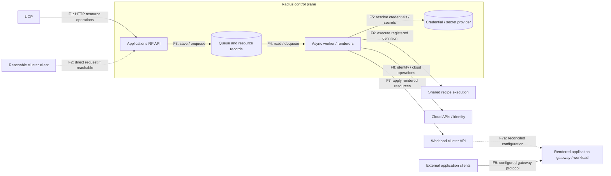

# Radius Applications RP Component Threat Model: v0.62.0

- **Historical author**: @nithyatsu.
- **Status**: Draft; security review pending.
- **Baseline**: Radius v0.62.0, commit `37a8cbd33e990886460f4fd1987d6a4fefd901c5`.
- **Prior model**: [August 2024 Applications RP model](2024-08-applications-rp-component-threat-model.md). The original document and both images remain unchanged.

## Overview

This document provides a threat model for the Radius Applications RP component. It identifies potential security threats, describes the system and its assets, and records existing controls and recommended mitigations.

Applications RP manages core and portable application resources under the permissions of the Radius installation. An application definition can therefore cause Kubernetes and cloud actions beyond the submitting user's direct permissions.

The main risks are untrusted workload code, misuse of shared deployment identities, and exposure of application secrets. The scenarios below describe risks, not confirmed exploits.

## Terms and Definitions

| Term              | Definition                                                                                                 |
|-------------------|------------------------------------------------------------------------------------------------------------|
| RP                | Resource provider.                                                                                         |
| Portable resource | Application-facing resource implemented by the Dapr, Datastores or Messaging providers.                    |
| Target cluster    | Kubernetes cluster receiving application output resources, which can differ from the Radius control plane. |
| Recipe            | Registered infrastructure deployment definition executed for a resource.                                   |
| UCP               | Radius request router and cloud/credential integration point.                                              |
| DE                | Deployment Engine; receives template deployments through UCP.                                              |

## System Description

Applications RP is a Radius control-plane microservice that acts as resource provider for an application and its resources. When users deploy an application using Radius, Applications RP manages the lifecycle of the created resources on the user's behalf.

- Deploying an application may launch the user application's code on the same cluster as Radius, or a different cluster.
- Deploying an application may create resources in the cloud using recipes. These recipes are Bicep or Terraform code responsible for creating application infrastructure components such as databases.
- As a result, Applications RP has access to the user's configured cloud credentials and can manage resources within the permissions of those credentials.

The [Applications RP process][root] hosts core and portable providers. Its [UCP routes][ucp] include `Applications.Core`, `Radius.Core`, `Applications.Dapr`, `Applications.Datastores`, and `Applications.Messaging`. [Dynamic RP](2026-11-dynamic-rp-component-threat-model-v0.62.0.md) handles generic types in a separate process.

Resource providers communicate over HTTP and manage the lifecycle of resources. Users and clients normally communicate with UCP, which forwards relevant requests to Applications RP. This routing arrangement does not prevent direct requests from a client that can reach the RP over the network.

The RP has a datastore for Radius resource records, a message queue for asynchronous requests, and a secret provider for sensitive information. These are configurable shared components. Their credentials and access rules are part of the RP's security boundary.

Assets include application definitions, workload manifests, connection values, TLS materials, cloud credentials, managed identities, operation records, and Kubernetes/cloud permissions. Actors include application authors, trusted recipe publishers, operators, and neighboring workloads.

### Architecture

The RP contains providers for several groups of application resources:

- **Core resources:** `Applications.Core` manages applications, environments, containers, gateways, volumes and secret stores. Core renderers produce Kubernetes objects and related identity/access configuration.
- **Dapr resources:** `Applications.Dapr` manages application-facing Dapr resources.
- **Datastore resources:** `Applications.Datastores` supports portable database resources such as SQL databases, MongoDB and Redis caches.
- **Messaging resources:** `Applications.Messaging` supports messaging resources such as RabbitMQ queues.

Applications RP uses the shared recipe engine to execute recipes. Bicep recipes are fetched from OCI-compliant registries. Terraform recipes use module sources and can download modules and provider binaries. Recipe publishers supply executable infrastructure definitions, not just passive resource data.

The [Terraform executor][execute] runs a subprocess with access to the RP container's environment and files. The [RP Pod][deployment] has a `/terraform` working volume. Chart startup pre-downloads the configured Terraform version, `1.16.5`, by default; the [installer][install] uses a shared binary and per-execution directories. These directories do not isolate recipes from the RP. Recipe outputs are converted into Radius output resources and recorded in the datastore.

To deploy a Bicep recipe, Applications RP sends a request to UCP, which forwards it to the Deployment Engine. The [recipe execution model](2026-11-recipe-execution-threat-model-v0.62.0.md) covers artifact retrieval, execution credentials, state and process access in more detail.

The RP uses a queue to process requests asynchronously. Information about resources that are deployed or being deployed is stored in the datastore.

The [chart][config] listens on `0.0.0.0:5443`; UCP uses an HTTP URL despite the port number. API-server state and queues and Kubernetes Secrets are defaults. PostgreSQL is optional. [Target-cluster configuration][values] is disabled by default; when enabled it supplies a kubeconfig Secret to supported execution paths. It does not move the control-plane queue or Terraform's default state backend to the target cluster.

#### Example application deployment

Consider a Bicep application definition with a container that queries a SQL database. A registered SQL recipe supplies the database infrastructure.

1. The CLI compiles the definition and sends a deployment request to UCP.
2. UCP sends the template deployment to the Deployment Engine.
3. The Deployment Engine sends resource requests back through UCP. UCP forwards the core and portable resource operations to Applications RP.
4. For the container, Applications RP renders the Kubernetes Deployment, service account, Role and RoleBinding. It renders a Service when the container declares ports.
5. If the container requires supported Azure workload identity, rendering also creates the managed/federated identity resources and access configuration required for that connection. These actions use the configured cloud credentials; they are not required for every container.
6. For the SQL resource, Applications RP resolves the registered recipe and retrieves its Bicep artifact from the OCI registry.
7. Applications RP requests deployment of that recipe through UCP and records resource and operation state.
8. UCP forwards the recipe deployment to the Deployment Engine. Subsequent resource operations use the relevant cloud or Kubernetes provider.
9. Workers resolve output values and connections and update stored resource state. The container uses its resulting identity and connection configuration to access the database.

The exact output objects depend on the resource definition, environment and recipe. The data-flow diagram below shows the shared boundaries for this example and other application operations.

### Implementation Details

#### Use of Cryptography

The [Terraform Kubernetes backend][backend] hashes the environment, application and resource identity to construct a state-Secret suffix. New suffixes use the Go SHA-256 helper, truncated to 40 hexadecimal characters. Existing SHA-1-named state Secrets are located for compatibility so an upgrade does not abandon their state. The hash identifies the backend; it does not encrypt the state or authorize a caller.

Kubernetes/cloud client transports use their configured credentials and trust stores. TLS certificates and private keys can be application assets. Internal UCP-to-RP traffic is not encrypted by the chart's HTTP endpoint.

Applications RP also uses the shared queue, store and secret-provider libraries. Their cryptography and storage defaults are described in the [UCP model](2026-11-ucp-component-threat-model-v0.62.0.md#implementation-details).

#### Storage of secrets

Applications RP handles both application secrets and credentials used to manage Kubernetes and cloud resources.

##### Managing cloud credentials

Applications RP requires AWS or Azure credentials when a deployment manages resources in those clouds. It reads registered credentials through the shared secret provider. With the default Kubernetes provider, a principal with sufficient Secret read access in the release namespace can read those credentials.

Federated identity is supported for Azure and AWS. Operators should prefer it where supported to avoid storing long-lived cloud secrets. Federation still grants the RP authority to act in the selected cloud scope, so role assignments must remain limited.

##### Managing secrets for applications

[Core secret stores][secretstore] use Kubernetes Secrets to hold application values such as TLS certificates and private keys. The handler validates types and encodings. When a reference omits the namespace, the handler resolves it from the application or environment.

For `Applications.Core/secretStores`, `properties.resource` names a Kubernetes Secret as `namespace/name` or `name`. For example, an application-scoped store can refer to an existing Secret with `properties.resource: 'team-a/db-credentials'` and select its `password` key with `properties.data.password: {}`. The handler checks that the referenced Secret and selected key exist. It rejects `properties.data.<key>.valueFrom`; that field is reserved for other secret-store implementations.

###### Managing secrets for datastores

Portable datastore resources can require connection strings, usernames and passwords. The 2024 model described a planned removal of inline secrets. That plan does not establish a release-wide guarantee for v0.62.0; each portable type's secret contract must be checked before supplying credentials.

Values can also enter resource definitions, rendered objects, recipe inputs/outputs, Terraform state and diagnostics. Operators must protect Secret access and configure storage encryption.

#### Access to cluster

The RP can create and manage Kubernetes resources on behalf of the user. For example, it can deploy a container from a user-selected image. That image executes code with the Pod's identity and can access the resources allowed to that identity and network.

The RP authenticates to the control-plane cluster using its configured Kubernetes credentials. Supported external-target paths can instead use the injected target kubeconfig. Operators must scope both identities, protect the kubeconfig Secret, and apply admission policies to the resulting workloads.

#### Exposing User Application to Internet

The [gateway renderer][gateway] creates Contour HTTPProxy objects that expose a Kubernetes Service outside the cluster. Gateways can use HTTP or HTTPS. Operators and application owners must select HTTPS and protect the required certificates when the application's access policy requires encrypted traffic.

#### Bicep Recipe execution

The recipe engine retrieves a Bicep artifact from an OCI-compliant registry, using the configured registry/cloud credentials when authentication is required. After retrieval, the RP requests deployment through UCP. A recipe can create infrastructure within the permissions of the execution identity.

Registry clients use TLS by default. Plain HTTP support for local registries is a separate, weaker configuration; it permits observation or modification of traffic on that path. Transport protection does not by itself establish that the recipe publisher or its infrastructure changes are trusted.

#### Terraform Recipe execution

Terraform retrieves modules and providers and executes them in the RP container. Source authentication and transport depend on the selected module source and configuration; this model does not assume every possible Terraform source is HTTPS-only.

The executor inherits the process environment and adds configured recipe overrides and secrets. Providers have the process's allowed file and network access. The released path is not a separate per-recipe container, and a temporary directory does not isolate a malicious provider from credentials readable by that process.

#### Data Serialization / Formats

Radius resource IDs use a custom string format and a shared parser. JSON resource bodies, image references, connection data, base manifests and recipe artifacts enter through application operations. Go JSON libraries handle resource interchange; Kubernetes and recipe tooling parse their own formats.

### Clients

**UCP** is the intended resource API caller. It forwards application and portable resource operations and returns the RP's responses to the requesting client. A reachable workload may also contact the RP directly unless networking prevents it.

Workers consume asynchronous operations. Kubernetes APIs, registry/cloud endpoints, health probes, metrics clients and profiling clients participate in the other execution and diagnostic flows.

## Trust Boundaries

Applications RP and UCP run in the configured release namespace, normally `radius-system`. Kubernetes RBAC must restrict changes to their Deployments, service accounts, configuration and Secrets.

The workload cluster is a separate boundary even when it is also the control-plane cluster. Applications use their configured namespace, while Radius's own state and queue remain in the control plane. The Kubernetes API server is a trusted dependency; its physical placement need not be a Pod in `kube-system`.

| Boundary                      | Authority or data crossing it                                                                           |
|-------------------------------|---------------------------------------------------------------------------------------------------------|
| Application author to RP      | Desired state interpreted under installation authority.                                                 |
| UCP to RP                     | HTTP resource payloads and operation responses.                                                         |
| RP to workload cluster        | Manifests, service accounts, roles, bindings, Services and ingress objects as required by the resource. |
| RP to identity/cloud services | Credentials and permission to create or connect infrastructure.                                         |
| RP to stores/queue            | Durable desired state and asynchronous operation data.                                                  |
| Recipe publisher to executor  | Executable infrastructure definitions; detailed in the recipe model.                                    |

Application namespaces help scope Kubernetes grants, but do not alone isolate networks, validate container images, or limit Radius cloud authority. Gateway creation can expose workloads outside the cluster and must be treated as an application security decision.

The RP does not implement a separate granular authorization system for each application author. The release's reserved RBAC mode settings do not enforce that boundary. The intended UCP routing path therefore needs Kubernetes access controls and network restrictions; the HTTP listener does not itself prove a request came from UCP.

## Assumptions

This threat model assumes that:

1. The Radius installation, including the RP image and configuration, has not been tampered with.
2. The Kubernetes control plane and the selected cloud APIs are not compromised.
3. Kubernetes authenticates and authorizes requests made through its API. Radius cannot prevent actions by a cluster administrator.
4. Operators protect Radius stores, queues, Secret access and cloud IAM. A store or queue writer can affect the work the RP performs.
5. The intended UCP path is restricted to approved callers. Direct network callers are not considered authorized merely because they can reach the RP.

Application authors need not be trusted to change recipes or grant cloud roles. Other namespace users and workload images are not assumed trusted. Workload-cluster admission, network isolation, trusted-image policies and HTTPS ingress are not assumed to be installed by Radius.

## Data Flows

### Diagram

F1-F4 convert desired state into worker actions. F5-F8 cross privileged service boundaries. The selected workload cluster can be external, while state remains in the control plane. F9 is application traffic, not the Radius management API.

1. UCP forwards resource operations to Applications RP and receives the corresponding response.
2. The RP saves desired state and queues asynchronous work. By default, both use Kubernetes API-server records.
3. A worker reads the operation and resolves the resource's credentials, secrets and environment configuration.
4. For a recipe-backed resource, the worker retrieves the registered recipe. Bicep deployment goes through UCP; Terraform executes locally and calls the required infrastructure APIs.
5. For a rendered Kubernetes resource, such as a container, the RP applies the generated objects through the selected workload cluster's API.
6. Resource results, output references and operation status are saved for later reads. Gateway traffic follows the application's separately configured HTTP/HTTPS path.

## Threats

### APP-01: A direct or spoofed caller submits resource operations

**Description:** A cluster client with network access uses F2 to submit operations without going through UCP. Alternatively, an actor changes discovery or configuration so that UCP sends requests to a server impersonating Applications RP.

**Impact:** A direct caller can request unintended resource changes. An impersonating server can receive deployment payloads, return false results or prevent application updates. Misuse of the RP's credentials can also create cloud resources and unexpected costs.

**Mitigation:** Restrict control-plane ingress and configuration access. Establish authenticated service-to-service requests as future work.

**Status:** [Shared NetworkPolicies](2026-11-ucp-component-threat-model-v0.62.0.md#shared-default-control-matrix) are opt-in and allow same-namespace traffic. Internal authorization is not enforced by reserved RBAC settings.

### APP-02: HTTP traffic is read or changed

**Description:** An actor with access to the F1 network path observes or alters resource payloads. Captured requests may also be replayed against a reachable endpoint; the result depends on the operation and current resource state.

**Impact:** Sensitive input disclosure, false responses, or resource operation changes.

**Mitigation:** Protect privileged networking, limit service reachability, and use authenticated encrypted internal transport in a future implementation.

**Status:** HTTP is the configured default. Standard Kubernetes client TLS protects a different path and does not mitigate F1.

### APP-03: An application definition runs an untrusted workload

**Description:** A permitted application author submits an untrusted image or manifest settings through F1, leading to F7. The resulting container executes application-supplied code; Radius does not determine that the code is safe.

**Impact:** Code runs with the resulting Pod identity and its allowed access to secrets, network, CPU and memory. It can disclose accessible credentials, consume cluster capacity, or change resources its identity is permitted to manage.

**Mitigation:** Restrict authorship, enforce workload admission and image policy, scope service accounts, and apply workload resource/network limits.

**Status:** Kubernetes admission/RBAC can enforce operator policies. Radius does not make an arbitrary application image trusted merely by placing it in an application namespace.

### APP-04: Identity or recipe authority exceeds the author's intended scope

**Description:** An author uses allowed resource inputs or a changed recipe to trigger F6/F8 under a more powerful installation identity.

**Impact:** Cloud privilege misuse, unauthorized infrastructure changes, or unexpected costs.

**Mitigation:** Limit recipe/identity configuration changes to trusted operators, constrain IAM and deployment scopes, and review role assignments.

**Status:** IAM and source review are operator controls. Fine-grained Radius delegation is not supplied by the release's RBAC mode settings. Execution details belong to the [recipe model](2026-11-recipe-execution-threat-model-v0.62.0.md).

### APP-05: Stored or rendered values expose secrets

**Description:** A reader of F3/F5 state, rendered workload data, backend state or diagnostics obtains sensitive values.

**Impact:** Application credential disclosure or use of cloud/registry permissions.

**Mitigation:** For core secret stores, reference an existing Kubernetes Secret through `properties.resource` and select the needed entries in `properties.data`. Restrict access to that Secret, resource state and logs. Configure cluster storage encryption. Check each portable type's own secret contract before supplying credentials.

**Status:** The core secret-store handler checks references and removes supplied secret values before saving its metadata. That finding applies to this handler, not every portable field. The portable API and diagnostic paths listed in Open Questions still need review.

### APP-06: Target selection or gateway settings cross an unintended boundary

**Description:** A configuration writer changes the target kubeconfig, application namespace, or gateway settings used in F7/F9.

**Impact:** Resources reach an unintended cluster or namespace, or an application becomes reachable without the intended TLS/access controls.

**Mitigation:** Protect kubeconfig Secrets and configuration, restrict target credentials, and review ingress exposure and certificates.

**Status:** External-target configuration is opt-in. Namespace and ingress choices are not automatic tenant isolation or mandatory HTTPS enforcement.

### APP-07: Deployment work consumes shared capacity

**Description:** A caller submits repeated or expensive operations, causing F3-F8 work and retries.

**Impact:** Worker/queue pressure, delayed deployments, or infrastructure costs.

**Mitigation:** Restrict API access, set budgets and quotas, monitor operations, and bound workload/recipe resources.

**Status:** The chart configures worker concurrency/retry settings and memory resources. These settings limit shared workers; they do not assign each user a quota. External execution costs and installation-specific limits were not tested.

## Open Questions

- Which legacy portable fields still accept sensitive inline values, and which read/error paths expose them?
- Are target-cluster credentials constrained to the intended namespaces and resource kinds?
- Which workload admission and gateway TLS policies does each installation require?

## Action Items

| Owner       | Follow-up and completion criteria                                                                                                                                                             | Tracking  |
|-------------|-----------------------------------------------------------------------------------------------------------------------------------------------------------------------------------------------|-----------|
| Operators   | Record approved recipe publishers, cloud roles, target namespaces and gateway exposure. Verify that workload admission rejects an image or manifest outside that policy.                      | Untracked |
| Maintainers | Inventory sensitive fields in the portable APIs. For each field, record its write, storage, read and error paths, with tests for any claimed redaction.                                       | Untracked |
| Maintainers | Review APP-01/APP-02 with the UCP follow-ups. Record allowed callers and verify that rejected callers cannot submit operations through direct RP access.                                      | Untracked |
| Maintainers | Review the original parser fuzz-testing and least-privilege actions. Record current parser test coverage and the required Kubernetes/cloud grants; add missing cases or remove excess grants. | Untracked |

## Review Notes

Review covers the cited release source. No live cluster or exploit tests were run. Security review is pending.

The two old RP impersonation threats and arbitrary-API threat are consolidated into APP-01/APP-04. Sniffing remains APP-02. Recipe escalation and managed-identity misuse remain APP-04. Malicious containers remain APP-03. Secrets, external targeting, gateway exposure and capacity are explicit APP-05 through APP-07 risks.

The shared recipe model covers OCI/Terraform execution. It replaces the old latest-version download and proposed-containerization account with the released behavior. The cryptography and secret-store sections distinguish current controls from portable API paths that still need review. The historical review does not approve this revision.

## References

- [Process composition][root], [UCP routes][ucp], [RP configuration][config], and [chart defaults][values].
- [Container renderers][containers], [gateway renderer][gateway], and [secret-store implementation][secretstore].
- [Terraform backend naming and compatibility][backend].
- [Terraform process execution][execute], [installer][install], and [RP Pod mounts][deployment].

[root]: https://github.com/radius-project/radius/blob/37a8cbd33e990886460f4fd1987d6a4fefd901c5/cmd/applications-rp/cmd/root.go
[ucp]: https://github.com/radius-project/radius/blob/37a8cbd33e990886460f4fd1987d6a4fefd901c5/deploy/Chart/templates/ucp/configmaps.yaml
[config]: https://github.com/radius-project/radius/blob/37a8cbd33e990886460f4fd1987d6a4fefd901c5/deploy/Chart/templates/rp/configmaps.yaml
[values]: https://github.com/radius-project/radius/blob/37a8cbd33e990886460f4fd1987d6a4fefd901c5/deploy/Chart/values.yaml
[containers]: https://github.com/radius-project/radius/tree/37a8cbd33e990886460f4fd1987d6a4fefd901c5/pkg/corerp/renderers/container
[gateway]: https://github.com/radius-project/radius/blob/37a8cbd33e990886460f4fd1987d6a4fefd901c5/pkg/corerp/renderers/gateway/render.go
[secretstore]: https://github.com/radius-project/radius/blob/37a8cbd33e990886460f4fd1987d6a4fefd901c5/pkg/corerp/frontend/controller/secretstores/kubernetes.go
[backend]: https://github.com/radius-project/radius/blob/37a8cbd33e990886460f4fd1987d6a4fefd901c5/pkg/recipes/terraform/config/backends/kubernetes.go
[execute]: https://github.com/radius-project/radius/blob/37a8cbd33e990886460f4fd1987d6a4fefd901c5/pkg/recipes/terraform/execute.go
[install]: https://github.com/radius-project/radius/blob/37a8cbd33e990886460f4fd1987d6a4fefd901c5/pkg/recipes/terraform/install.go
[deployment]: https://github.com/radius-project/radius/blob/37a8cbd33e990886460f4fd1987d6a4fefd901c5/deploy/Chart/templates/rp/deployment.yaml
