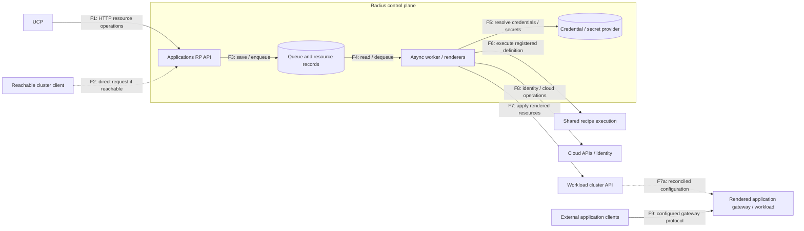

# Radius Applications RP Component Threat Model: v0.62.0

- **Historical author**: @nithyatsu.
- **Status**: Draft; security review pending.
- **Baseline**: Radius v0.62.0, commit `37a8cbd33e990886460f4fd1987d6a4fefd901c5`.
- **Prior model**: [August 2024 Applications RP model](2024-08-applications-rp-component-threat-model.md). The original document and both images remain unchanged.

## Overview

Applications RP manages core and portable application resources under the permissions of the Radius installation. An application definition can therefore cause Kubernetes and cloud actions beyond the submitting user's direct permissions.

The main risks are untrusted workload code, misuse of shared deployment identities, and exposure of application secrets. Dynamic RP's field encryption does not establish protection for the separate portable APIs. The scenarios below describe risks, not confirmed exploits.

## Terms and Definitions

| Term              | Definition                                                                                                 |
|-------------------|------------------------------------------------------------------------------------------------------------|
| RP                | Resource provider.                                                                                         |
| Portable resource | Application-facing resource implemented by the Dapr, Datastores or Messaging providers.                    |
| Target cluster    | Kubernetes cluster receiving application output resources, which can differ from the Radius control plane. |
| Recipe            | Registered infrastructure deployment definition executed for a resource.                                   |
| UCP               | Radius request router and cloud/credential integration point.                                              |

## System Description

The [Applications RP process][root] hosts core and portable providers. Its [UCP routes][ucp] include `Applications.Core`, `Radius.Core`, `Applications.Dapr`, `Applications.Datastores`, and `Applications.Messaging`. [Dynamic RP](2026-11-dynamic-rp-component-threat-model-v0.62.0.md) handles generic types in a separate process.

Assets include application definitions, workload manifests, connection values, TLS materials, cloud credentials, managed identities, operation records, and Kubernetes/cloud permissions. Actors include application authors, trusted recipe publishers, operators, and neighboring workloads.

### Architecture

Core renderers produce Kubernetes resources for containers, gateways, volumes, identity and access configuration. Portable-resource processing can invoke the shared recipe engine. Resource state and asynchronous work use the configured shared providers.

The [chart][config] listens on `0.0.0.0:5443`; UCP uses an HTTP URL despite the port number. API-server state and queues and Kubernetes Secrets are defaults. PostgreSQL is optional. [Target-cluster configuration][values] is disabled by default; when enabled it supplies a kubeconfig Secret to supported execution paths. It does not move the control-plane queue or Terraform's default state backend to the target cluster.

### Implementation Details

**Is there any use of cryptography?**

Yes. Kubernetes/cloud client transports use their configured credentials and trust stores. TLS certificates and private keys can be application assets. Current Terraform backend naming uses SHA-256, with [legacy SHA-1 lookup][backend] for compatibility; it is not a security check. Internal UCP-to-RP traffic is not encrypted by the chart's HTTP endpoint.

**Does the component store secrets?**

Yes. The RP reads cloud credentials through shared providers. [Core secret stores][secretstore] support Kubernetes-backed data and validate types/encodings. When a reference omits the namespace, the handler resolves it from the application or environment.

For `Applications.Core/secretStores`, `properties.resource` names a Kubernetes Secret as `namespace/name` or `name`. For example, an application-scoped store can refer to an existing Secret with `properties.resource: 'team-a/db-credentials'` and select its `password` key with `properties.data.password: {}`. These are property fragments, not a complete deployment. The handler checks that the referenced Secret and selected key exist. It rejects `properties.data.<key>.valueFrom`; that field is reserved for other secret-store implementations.

Values can also enter resource definitions, rendered objects, recipe inputs/outputs, Terraform state and diagnostics. Operators must protect Secret access and configure storage encryption. This source review did not inventory every inline secret field or read/error path in the portable APIs.

**Does the component process untrusted data or does the component parse any custom formats?**

Yes. JSON resource bodies, custom Radius IDs, image references, connection data, base manifests, and recipe artifacts enter through application operations. Standard libraries reduce parser implementation work; they do not prove semantic safety or prevent resource exhaustion.

### Clients

UCP is the intended resource API caller. A reachable workload may also contact the RP directly unless networking prevents it. Workers, Kubernetes APIs, registry/cloud endpoints, probes, metrics clients and profiling clients participate in other flows.

## Trust Boundaries

| Boundary                      | Authority or data crossing it                                                                           |
|-------------------------------|---------------------------------------------------------------------------------------------------------|
| Application author to RP      | Desired state interpreted under installation authority.                                                 |
| UCP to RP                     | HTTP resource payloads and operation responses.                                                         |
| RP to workload cluster        | Manifests, service accounts, roles, bindings, Services and ingress objects as required by the resource. |
| RP to identity/cloud services | Credentials and permission to create or connect infrastructure.                                         |
| RP to stores/queue            | Durable desired state and asynchronous operation data.                                                  |
| Recipe publisher to executor  | Executable infrastructure definitions; detailed in the recipe model.                                    |

Application namespaces help scope Kubernetes grants, but do not alone isolate networks, validate container images, or limit Radius cloud authority. Gateway creation can expose workloads outside the cluster and must be treated as an application security decision.

## Assumptions

Operators protect the RP image, service account, configuration, Secret access and cloud IAM. Kubernetes/cloud APIs are external trust anchors.

Application authors need not be trusted to change recipes or grant cloud roles. Other namespace users and workload images are not assumed trusted. Workload-cluster admission, network isolation, trusted-image policies and HTTPS ingress are not assumed to be installed by Radius.

## Data Flows

### Diagram

F1-F4 convert desired state into worker actions. F5-F8 cross privileged service boundaries. The selected workload cluster can be external, while state remains in the control plane. F9 is application traffic, not the Radius management API.

## Threats

### APP-01: A direct or spoofed caller submits resource operations

**Description:** A cluster client with network access uses F2, or an actor changes UCP/RP discovery or configuration.

**Impact:** Unexpected resource changes, deployment payload disclosure, or outage.

**Mitigation:** Restrict control-plane ingress and configuration access. Establish authenticated service-to-service requests as future work.

**Status:** [Shared NetworkPolicies](2026-11-ucp-component-threat-model-v0.62.0.md#shared-default-control-matrix) are opt-in and allow same-namespace traffic. Internal authorization is not enforced by reserved RBAC settings.

### APP-02: HTTP traffic is read or changed

**Description:** An actor with access to the F1 network path observes or alters resource payloads.

**Impact:** Sensitive input disclosure, false responses, or resource operation changes.

**Mitigation:** Protect privileged networking, limit service reachability, and use authenticated encrypted internal transport in a future implementation.

**Status:** HTTP is the configured default. Standard Kubernetes client TLS protects a different path and does not mitigate F1.

### APP-03: An application definition runs an untrusted workload

**Description:** A permitted application author submits an untrusted image or manifest settings through F1, leading to F7.

**Impact:** Code runs with the resulting Pod identity and its allowed access to secrets, network, CPU and memory.

**Mitigation:** Restrict authorship, enforce workload admission and image policy, scope service accounts, and apply workload resource/network limits.

**Status:** Kubernetes admission/RBAC can enforce operator policies. Radius does not make an arbitrary application image trusted merely by placing it in an application namespace.

### APP-04: Identity or recipe authority exceeds the author's intended scope

**Description:** An author uses allowed resource inputs or a changed recipe to trigger F6/F8 under a more powerful installation identity.

**Impact:** Cloud privilege misuse, unauthorized infrastructure changes, or unexpected costs.

**Mitigation:** Limit recipe/identity configuration changes to trusted operators, constrain IAM and deployment scopes, and review role assignments.

**Status:** IAM and source review are operator controls. Fine-grained Radius delegation is not supplied by the release's RBAC mode settings. Execution details belong to the [recipe model](2026-11-recipe-execution-threat-model-v0.62.0.md).

### APP-05: Stored or rendered values expose secrets

**Description:** A reader of F3/F5 state, rendered workload data, backend state or diagnostics obtains sensitive values.

**Impact:** Application credential disclosure or use of cloud/registry permissions.

**Mitigation:** For core secret stores, reference an existing Kubernetes Secret through `properties.resource` and select the needed entries in `properties.data`. Restrict access to that Secret, resource state and logs. Configure cluster storage encryption. Check each portable type's own secret contract before supplying credentials.

**Status:** The core secret-store handler checks references and removes supplied secret values before saving its metadata. That finding applies to this handler, not every portable field. The portable API and diagnostic paths listed in Open Questions still need review.

### APP-06: Target selection or gateway settings cross an unintended boundary

**Description:** A configuration writer changes the target kubeconfig, application namespace, or gateway settings used in F7/F9.

**Impact:** Resources reach an unintended cluster or namespace, or an application becomes reachable without the intended TLS/access controls.

**Mitigation:** Protect kubeconfig Secrets and configuration, restrict target credentials, and review ingress exposure and certificates.

**Status:** External-target configuration is opt-in. Namespace and ingress choices are not automatic tenant isolation or mandatory HTTPS enforcement.

### APP-07: Deployment work consumes shared capacity

**Description:** A caller submits repeated or expensive operations, causing F3-F8 work and retries.

**Impact:** Worker/queue pressure, delayed deployments, or infrastructure costs.

**Mitigation:** Restrict API access, set budgets and quotas, monitor operations, and bound workload/recipe resources.

**Status:** The chart configures worker concurrency/retry settings and memory resources. These settings limit shared workers; they do not assign each user a quota. External execution costs and installation-specific limits were not tested.

## Open Questions

- Which legacy portable fields still accept sensitive inline values, and which read/error paths expose them?
- Are target-cluster credentials constrained to the intended namespaces and resource kinds?
- Which workload admission and gateway TLS policies does each installation require?

## Action Items

| Owner       | Follow-up and completion criteria                                                                                                                                        | Tracking  |
|-------------|--------------------------------------------------------------------------------------------------------------------------------------------------------------------------|-----------|
| Operators   | Record approved recipe publishers, cloud roles, target namespaces and gateway exposure. Verify that workload admission rejects an image or manifest outside that policy. | Untracked |
| Maintainers | Inventory sensitive fields in the portable APIs. For each field, record its write, storage, read and error paths, with tests for any claimed redaction.                  | Untracked |
| Maintainers | Review APP-01/APP-02 with the UCP follow-ups. Record allowed callers and verify that rejected callers cannot submit operations through direct RP access.                 | Untracked |

## Review Notes

Review covers the cited release source. No live cluster or exploit tests were run. Security review is pending.

The two old RP impersonation threats and arbitrary-API threat are consolidated into APP-01/APP-04. Sniffing remains APP-02. Recipe escalation and managed-identity misuse remain APP-04. Malicious containers remain APP-03. Secrets, external targeting, gateway exposure and capacity are explicit APP-05 through APP-07 risks.

The shared recipe model covers OCI/Terraform execution. It replaces the old latest-version download and proposed-containerization account with the released behavior. The cryptography and secret-store sections distinguish current controls from portable API paths that still need review. The historical review does not approve this revision.

## References

- [Process composition][root], [UCP routes][ucp], [RP configuration][config], and [chart defaults][values].
- [Container renderers][containers], [gateway renderer][gateway], and [secret-store implementation][secretstore].
- [Terraform backend naming and compatibility][backend].

[root]: https://github.com/radius-project/radius/blob/37a8cbd33e990886460f4fd1987d6a4fefd901c5/cmd/applications-rp/cmd/root.go
[ucp]: https://github.com/radius-project/radius/blob/37a8cbd33e990886460f4fd1987d6a4fefd901c5/deploy/Chart/templates/ucp/configmaps.yaml
[config]: https://github.com/radius-project/radius/blob/37a8cbd33e990886460f4fd1987d6a4fefd901c5/deploy/Chart/templates/rp/configmaps.yaml
[values]: https://github.com/radius-project/radius/blob/37a8cbd33e990886460f4fd1987d6a4fefd901c5/deploy/Chart/values.yaml
[containers]: https://github.com/radius-project/radius/tree/37a8cbd33e990886460f4fd1987d6a4fefd901c5/pkg/corerp/renderers/container
[gateway]: https://github.com/radius-project/radius/blob/37a8cbd33e990886460f4fd1987d6a4fefd901c5/pkg/corerp/renderers/gateway/render.go
[secretstore]: https://github.com/radius-project/radius/blob/37a8cbd33e990886460f4fd1987d6a4fefd901c5/pkg/corerp/frontend/controller/secretstores/kubernetes.go
[backend]: https://github.com/radius-project/radius/blob/37a8cbd33e990886460f4fd1987d6a4fefd901c5/pkg/recipes/terraform/config/backends/kubernetes.go
