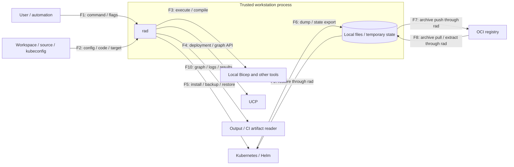

# Radius CLI Component Threat Model: v0.62.0

- **Author**: AI-assisted draft; human review pending.
- **Status**: Draft, not a security approval.
- **Baseline**: Radius v0.62.0, commit `37a8cbd33e990886460f4fd1987d6a4fefd901c5`.
- **Related models**: [UCP](2026-11-ucp-component-threat-model-v0.62.0.md) and [recipe execution](2026-11-recipe-execution-threat-model-v0.62.0.md).

## Overview

`rad` runs on a developer or operator workstation and connects local inputs to privileged cluster and cloud operations. Workspace selection, local tools, kubeconfig files, registry credentials and output artifacts are security boundaries even though the CLI is not a network service.

This model adds coverage for CLI deployment, installation/upgrade, graph generation and durable state commands. It does not evaluate arbitrary user applications or the internal DE implementation. Risks are based on released source, not a demonstrated exploit.

## Terms and Definitions

| Term          | Definition                                                                                         |
|---------------|----------------------------------------------------------------------------------------------------|
| Workspace     | Local Radius configuration selecting a connection and resource scope.                              |
| Kubeconfig    | Kubernetes client configuration; it can contain credentials and executable authentication plugins. |
| Modeled graph | Graph computed from a compiled local application definition rather than only live resources.       |
| State archive | OCI artifact containing a directory snapshot used by state commands.                               |
| Restore       | Applying archived databases/state into a selected installation, not merely reading a file.         |

## System Description

The [CLI architecture][architecture] identifies workspace/config loading, SDK clients, local Bicep use, and direct Kubernetes/Helm operations. Deployment requests go through UCP. Install/upgrade commands operate directly with the user's cluster authority and chart inputs.

The [graph command][graph] can read deployed state, compile a local definition, write `app-graph.json`, or save a modeled graph to an OCI archive in GitHub Actions mode. The [state archive][archive] is also used by shutdown/startup commands to persist and restore selected durable state.

Assets include user credentials, kubeconfig contents, local source and parameters, binaries, selected target/scope, output files, registry credentials, database dumps and Terraform state. Actors include the workstation user, local file writers, repository contributors, tool/artifact publishers and registry administrators.

### Architecture

The local process is trusted with the invoking user's permissions. [Bicep execution][build] resolves a binary path and launches it with an argument list. A configured executable override or kubeconfig plugin is executable code, not just data to parse.

Installation gives selected charts, images and hooks cluster authority. The released chart includes readiness and optional pre-upgrade hooks and the enabled-by-default encryption-key rotation job. Their configuration belongs to the installation trust decision, not a separate unprivileged user path.

`rad shutdown` [backs up][shutdown] PostgreSQL control-plane databases and Terraform state Secrets to an OCI archive. It refuses to replace the archive when the inspected backup has no resource groups. `rad startup` [restores][startup] databases and Terraform state while scaling database-backed control-plane deployments down, then attempts to scale them back up.

These are not full cluster backups. The default chart uses API-server storage, while these state commands explicitly handle PostgreSQL data and Terraform state. Do not promise that arbitrary API-server records, application Secrets, cloud-backend state, encryption keys and cloud credentials are all captured.

### Implementation Details

**Is there any use of cryptography?**

Yes. Kubernetes/cloud client transports, HTTPS tool downloads, OCI content digests and credential stores are dependencies. The [published release lock][lock] records CLI OCI artifacts tied to the release source. Release checksums/digests are useful only when the receiving installation path verifies and trusts them.

The [Bicep download helper][download] pins `v0.46.1` and fetches from its HTTPS GitHub release URL. This function copies the response into an executable file; it does not perform an independent signature or checksum comparison. Do not extend the Radius release's provenance checks into a claim about all downloaded tools.

**Does the component store secrets?**

Yes. Local configuration/credential mechanisms, kubeconfigs, parameter files, dump files, Terraform state and archives can contain sensitive data. The OCI archive packs regular files into a compressed layer; compression is not encryption. Registry access control is therefore a confidentiality requirement.

**Does the component process untrusted data or does the component parse any custom formats?**

Yes. Commands and paths, YAML/JSON configuration, Bicep, ARM templates, custom Radius IDs, graph properties and OCI manifests/tar entries are processed. The archive implementation rejects non-regular extracted entries and checks that paths are local to the destination root. Those checks do not approve the contents of a valid database dump.

### Clients

People and automation invoke `rad`. Dependencies include local tools, Kubernetes/Helm, UCP, cloud authentication libraries, tool distribution endpoints, and OCI registries. Standard output/error and CI artifact consumers are data recipients too.

## Trust Boundaries

| Boundary                             | Security responsibility                                                  |
|--------------------------------------|--------------------------------------------------------------------------|
| Repository/files to local process    | Decide whether definitions, parameters and referenced tools are trusted. |
| Workspace/kubeconfig to target       | Confirm cluster, scope and identity before a mutating operation.         |
| Downloaded executable to workstation | Approve the executable source and protect local binary paths.            |
| Installer to cluster                 | Review chart/image/hook content and installation privileges.             |
| Live state to local/OCI archive      | Protect confidentiality, integrity and retention.                        |
| Archive to restore target            | Approve the snapshot and target before replacing live state.             |
| Resource metadata to graph consumers | Preserve appropriate redaction and restrict output readers.              |

## Assumptions

The invoking user is authorized to operate the selected target. The OS, configured credential helpers, cluster APIs and approved artifact services are trust dependencies.

Do not assume the current directory/workspace is the intended target, all repository content is trusted, every archive is private, or a registry digest authenticates who produced it. A malicious local administrator is outside the prevention boundary; a less-privileged writer of an input repository remains a relevant actor.

## Data Flows

### Diagram

F1-F3 determine both executable input and target. F4-F5 use the user's selected connection. F6-F9 move sensitive state across local and registry trust boundaries. F10 can disclose data independently of whether a deployment succeeds.

## Threats

### CLI-01: Configuration selects the wrong target or identity

**Description:** A local file writer or automation configuration changes F2 so a mutating command reaches an unintended cluster, scope or endpoint.

**Impact:** Resource changes, credential disclosure to a wrong endpoint, or backup/restore of the wrong installation.

**Mitigation:** Protect workspace/kubeconfig files, verify target identity in automation, and scope credentials to intended operations.

**Status:** Workspace and connection selection are implemented. They cannot establish operator intent from a valid but unintended configuration.

### CLI-02: A local or downloaded tool executes hostile code

**Description:** An actor changes a configured binary, executable override, authentication plugin or downloaded tool used in F3.

**Impact:** Code runs with workstation/runner permissions and can access its files or credentials.

**Mitigation:** Use approved tool sources, protect binary/config directories, and verify authenticity through the applicable distribution mechanism.

**Status:** The Bicep helper pins a version and uses HTTPS, but its download function does not independently check a signature/checksum. Arguments are not evaluated as one shell command in the Bicep runner; this does not make the executable safe.

### CLI-03: Installation content without review obtains cluster authority

**Description:** An operator installs a changed chart, image, hook or values set through F5.

**Impact:** Elevated cluster access, exposed services, weakened policy, or replaced control-plane code.

**Mitigation:** Review installation sources and overrides; use release provenance; scope installer access and inspect security-sensitive values.

**Status:** Released chart settings are inspectable. Optional RBAC mode, NetworkPolicy and BuildKit settings have the specific limits in the UCP/recipe models; they are not blanket hardening guarantees.

### CLI-04: Graphs, parameters or diagnostics disclose secrets

**Description:** A reader obtains F10 output, generated graph files, CI logs or temporary inputs that include author-provided sensitive values.

**Impact:** Credential, source-path or infrastructure metadata disclosure.

**Mitigation:** Use supported secret references, restrict output/log/artifact readers and retain only necessary data.

**Status:** Graph-specific sanitization and template-path display helpers exist. They do not prove every property, compiler message, legacy API result or arbitrary parameter is secret-free.

### CLI-05: Archive readers obtain sensitive infrastructure state

**Description:** A registry/local-file reader accesses database dumps or Terraform state at F6-F8.

**Impact:** Disclosure of deployment data and any secrets retained in those formats.

**Mitigation:** Use private, access-controlled repositories, protect credential helpers and local working files, and apply suitable storage encryption/retention.

**Status:** OCI authentication uses Docker credential-store integration and HTTPS by default; a plain-HTTP option exists for local registry use. The archive layer is compressed, not application-encrypted.

### CLI-06: An accepted archive contains malicious or stale state

**Description:** A party able to publish the selected archive supplies validly packaged but malicious/outdated data, or automation selects the wrong snapshot for F9.

**Impact:** Resource-state replacement, loss of deployment tracking, unintended later operations, or restore outage.

**Mitigation:** Restrict archive writers, bind approved snapshots to targets, retain known recovery points and validate restore procedures.

**Status:** Local-path/type checks reject certain unsafe tar entries. OCI content addressing does not authenticate a publisher or determine whether restoring that state is authorized. No universal signature/rollback policy is established.

### CLI-07: Restore completeness or key mismatch breaks recovery

**Description:** F9 restores records without all required state, credentials or encryption key versions, or a restore step fails after state changes.

**Impact:** Pending data cannot be decrypted, reconciliation fails, recovery is partial, or infrastructure is no longer tracked correctly.

**Mitigation:** Maintain a recovery inventory for all providers/backends and keys, validate compatibility and rehearse recovery on an isolated target.

**Status:** Startup coordinates scaling and attempts recovery of replica counts; shutdown rejects an empty resource-group backup. Neither provides transactional whole-cluster restore or proof that all external secrets/state were captured.

### CLI-08: Shared archive operations lose history or exhaust resources

**Description:** Separate writers update the same archive, or a large valid archive consumes workstation/runner capacity.

**Impact:** Lost snapshot updates, storage exhaustion, failed restore or reduced availability.

**Mitigation:** Serialize publishers across processes, bound retention/size and monitor recovery operations.

**Status:** The archive has an in-process lock by repository/name. It is not a distributed lock across CI jobs or users. A universal download/extraction resource budget is not established.

## Open Questions

- Which installer/tool paths verify signed provenance versus only using a version or checksum?
- Which records, Secrets, keys and external state backends must be restored together for each supported installation?
- What cross-runner serialization and retention policy should archive publishers use?

## Action Items

1. Operators: verify mutating targets, restrict executable/config writers, and protect output and archive readers.
2. Operators: document and rehearse recovery with required keys, credentials and backend state.
3. Maintainers: evaluate stronger tool verification, archive publisher/rollback policy, and bounded archive processing.

## Review Notes

This is a new AI-assisted model. Human review is pending. No install, upgrade, backup, restore or executable download was performed for runtime testing.

The baseline archive guards, command behavior and Bicep download path were read directly. [Published release metadata][manifest] records release asset/image/chart checks, but this model does not treat them as independent verification of every tool or live deployment.

## References

- [CLI architecture][architecture], [Bicep runner][build], and [tool download helper][download].
- [Graph command][graph], [archive implementation][archive], [shutdown][shutdown], and [startup][startup].
- [State backup client][backupclient], [restore client][restoreclient], and [released hooks/chart][chart].
- [Core release lock][lock] and [release manifest][manifest].

[architecture]: https://github.com/radius-project/radius/blob/37a8cbd33e990886460f4fd1987d6a4fefd901c5/docs/architecture/rad-cli.md
[build]: https://github.com/radius-project/radius/blob/37a8cbd33e990886460f4fd1987d6a4fefd901c5/pkg/cli/bicep/build.go
[download]: https://github.com/radius-project/radius/blob/37a8cbd33e990886460f4fd1987d6a4fefd901c5/pkg/cli/bicep/tools/download_tools.go
[graph]: https://github.com/radius-project/radius/blob/37a8cbd33e990886460f4fd1987d6a4fefd901c5/pkg/cli/cmd/app/graph/graph.go
[archive]: https://github.com/radius-project/radius/blob/37a8cbd33e990886460f4fd1987d6a4fefd901c5/pkg/statearchive/oci/oci.go
[shutdown]: https://github.com/radius-project/radius/blob/37a8cbd33e990886460f4fd1987d6a4fefd901c5/pkg/cli/cmd/shutdown/shutdown.go
[startup]: https://github.com/radius-project/radius/blob/37a8cbd33e990886460f4fd1987d6a4fefd901c5/pkg/cli/cmd/startup/startup.go
[backupclient]: https://github.com/radius-project/radius/blob/37a8cbd33e990886460f4fd1987d6a4fefd901c5/pkg/cli/cmd/shutdown/stateclient.go
[restoreclient]: https://github.com/radius-project/radius/blob/37a8cbd33e990886460f4fd1987d6a4fefd901c5/pkg/cli/cmd/startup/stateclient.go
[chart]: https://github.com/radius-project/radius/tree/37a8cbd33e990886460f4fd1987d6a4fefd901c5/deploy/Chart/templates
[lock]: https://github.com/radius-project/radius/releases/download/v0.62.0/core-release-lock.json
[manifest]: https://github.com/radius-project/radius/releases/download/v0.62.0/release-manifest.json
