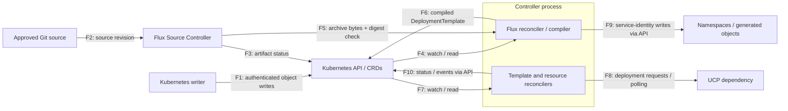

# Radius Controller Component Threat Model: v0.62.0

- **Historical author**: ytimocin.
- **Status**: Draft; security review pending.
- **Baseline**: Radius v0.62.0, commit `37a8cbd33e990886460f4fd1987d6a4fefd901c5`.
- **Prior model**: [August 2024 Controller model](2024-08-controller-component-threat-model.md). The original document and both images remain unchanged.

## Overview

This document provides a threat model for the Radius Controller component. It describes the system, its assets, potential threats and recommended mitigations.

The controller turns Kubernetes objects and Flux source artifacts into Radius deployments. Permission to submit those inputs can cause actions under the controller's broader service identity.

The released controller registers DeploymentTemplate, DeploymentResource and Flux reconcilers. The original model's Recipe/Deployment reconcilers and validating webhook no longer describe this service. The scenarios below describe risks, not confirmed exploits.

## Terms and Definitions

| Term               | Definition                                                                             |
|--------------------|----------------------------------------------------------------------------------------|
| Reconciler         | Loop that compares desired state with observed state and performs updates.             |
| DeploymentTemplate | Radius Kubernetes resource carrying deployment template information.                   |
| DeploymentResource | Radius Kubernetes resource used in deployment resource reconciliation.                 |
| Flux artifact      | Source Controller archive referenced by a GitRepository status, with a URL and digest. |
| UCP                | Radius API routing service.                                                            |

## System Description

The Controller component enables users to manage Radius resources through the Kubernetes API. Users and automation submit desired state as Kubernetes resources. Reconciliation loops monitor those objects and take the actions needed to bring Radius and Kubernetes into that state.

The 2024 model described Recipe and Deployment controllers and a Recipe validating webhook. In v0.62.0, these are replaced by DeploymentTemplate, DeploymentResource and Flux reconcilers. Kubernetes still authenticates and authorizes object writes, but those checks do not automatically restrict every downstream action to the submitting user's privileges.

[Service registration][service] creates a controller-runtime manager and registers the three reconcilers. The manager also serves health checks and optional configured metrics. There is no Recipe validating webhook registered in this service setup.

Kubernetes admission still applies to objects submitted through the API. Installed admission controllers can validate or mutate those objects before persistence. They are cluster controls, not evidence that the removed Radius webhook is running. See the [Kubernetes controller documentation](https://kubernetes.io/docs/concepts/architecture/controller/) and [admission controller documentation](https://kubernetes.io/docs/reference/access-authn-authz/admission-controllers/) for those platform mechanisms.

Assets include desired deployment state, source contents, template parameters, generated objects, and the controller's Kubernetes/UCP authority. Inputs can be changed by Kubernetes object writers and approved source contributors. Cluster administrators and maintainers of approved source repositories are distinct trust roles.

### Architecture

The Controller component consists of these key parts:

- **Flux reconciler:** Watches Flux GitRepository objects and reads their source artifacts. It loads `radius-gitops-config.yaml`, compiles the selected Bicep inputs, and creates or updates DeploymentTemplate objects. Source configuration can select a target namespace and resource group; the controller can create namespaces.
- **DeploymentTemplate reconciler:** Watches DeploymentTemplate objects containing a compiled template, parameters and provider configuration. It submits create/update operations to Radius, records the long-running operation, and polls it on later reconciliations. Successful results are compared with previously recorded output resources to create or remove the corresponding DeploymentResource objects. Owner references and finalizers coordinate cleanup when a template is deleted.
- **DeploymentResource reconciler:** Tracks individual output resources and handles their deletion through Radius. Before starting a delete, it checks that the owning DeploymentTemplate exists with the expected UID and that the resource ID is within that template's deployment scope. It polls an outstanding delete and updates status/finalizers when it completes. These deletion guards are not a general authorization check on every create/update target.
- **Health checks:** The manager registers `healthz` and `readyz` checks. Kubernetes probes use them to determine whether the controller process is responding. They do not authenticate deployment inputs or verify that a recipe is safe.
- **Metrics:** The manager serves metrics when the metrics provider is enabled. Access to that listener is a separate network decision.

The reconcilers coordinate Radius operations through UCP and update Kubernetes state. Their [ClusterRole][rbac] includes broad access to deployment CRDs, namespace operations, Flux reads, and wildcard verbs/resources for `api.ucp.dev`. A source or CRD author's own cloud identity is not automatically used for the resulting operations.

### Implementation Details

#### Use of Cryptography

The controller uses Kubernetes client authentication and TLS for API-server calls. Operators must protect its credentials and API trust configuration.

Flux artifact retrieval delegates digest verification to the archive fetcher. A matching digest confirms the bytes named in Flux status; it does not independently authenticate their author. Someone who can change both the artifact and its trusted digest can supply different content.

The old SHA-1 configuration and connection-Secret hashes belonged to the removed Recipe/Deployment reconcilers. Replacing those hashes is not an outstanding migration task for these registered reconcilers. The current model instead considers integrity of source status, downloaded artifacts, templates and API requests.

#### Storage of secrets

The old model's per-Recipe and Deployment connection-Secret lifecycle is not a description of the registered reconcilers. Current templates, parameters, generated objects, status, events, and logs must still be treated as potentially sensitive. A template can include sensitive inputs even if its API field is not named `secret`.

DeploymentTemplate objects persist deployment input and operation state through Kubernetes. DeploymentResource objects persist resource IDs, ownership and deletion state. Anyone who can read these objects or their diagnostics may learn application topology or supplied values.

Secret access remains subject to Kubernetes RBAC and storage configuration. The presence of a Kubernetes Secret does not by itself provide encryption at rest. The source review did not establish redaction for every template field, failure message or event.

#### Data Serialization / Formats

The controller reads CRDs and Flux status through Kubernetes clients, downloads and extracts source archives, parses YAML/JSON, and compiles Bicep. Radius resource IDs use a shared custom parser. Standard-format parsers do not establish that a syntactically valid deployment is authorized or inexpensive.

[Archive fetcher construction][fetcher] supplies retries and digest handling but sets both maximum download and extraction sizes to unlimited. The chart's memory limits constrain the Pod, not the size of an accepted archive. These settings are relevant to resource exhaustion, not proof of an exploitable archive bug.

### Clients

1. **Kubernetes API Server:** Users and automation create, update or delete watched objects through the API. The controller initiates authenticated watches and reads to observe those changes. API-server watch delivery is not a separate unauthenticated inbound controller API.
2. **Flux Source Controller:** Publishes GitRepository status and serves source artifacts. Approved source contributors can change the content compiled into a deployment, even when they cannot edit the controller Pod.
3. **Health Check Probes:** Kubernetes calls the controller manager's health and readiness endpoints.
4. **Metrics Scrapers:** Monitoring clients can scrape the configured metrics listener.

UCP is a downstream dependency. The controller submits resource deployments and polls operations using its configured Radius connection.

## Trust Boundaries

The controller normally runs in `radius-system` with UCP and the other Radius services. A different Helm release namespace changes that location, not the need to protect its service account and configuration.

Namespaces separate object names and provide a scope for grants and admission rules. They do not automatically isolate network traffic or prevent a controller with cluster-wide grants from writing elsewhere. The Kubernetes API server is a trusted dependency; managed clusters need not host it as a Pod in `kube-system`.

| Boundary                                | Protection                                                        | Limit                                                                                      |
|-----------------------------------------|-------------------------------------------------------------------|--------------------------------------------------------------------------------------------|
| User to watched Kubernetes object       | Kubernetes authentication, RBAC and installed admission policies. | The operator must restrict who can submit deployment/source inputs.                        |
| Flux source to downloaded bytes         | Artifact digest supplied to the fetcher.                          | Source status and the party producing that digest must be trusted.                         |
| Artifact to compiler/controller process | Libraries parse the archive and files.                            | Compilation and extraction consume controller resources; this is not a sandbox claim.      |
| Controller to UCP                       | SDK connection configured from the installation.                  | Radius authorization mode settings do not supply user-level checks.                        |
| Controller to output namespaces         | ClusterRole grants enable writes.                                 | Namespace selection is not evidence that a source author is authorized for that namespace. |

The [UCP model](2026-11-ucp-component-threat-model-v0.62.0.md) lists shared transport and network defaults. The removed webhook's mTLS connection does not protect the current controller-to-UCP path.

### Key Points of Namespaces

1. **Resource scope:** Source and deployment objects belong to namespaces, but the controller can act with permissions beyond an individual object's author.
2. **Access controls:** Operators must configure Kubernetes grants and admission for deployment CRDs, GitRepository objects, status writers and controller credentials.
3. **Separation of teams:** Separate namespaces and approved sources help organize trust groups. Source-selected target namespaces/resource groups still need an explicit policy.

## Assumptions

This threat model assumes that:

1. The Radius installation and controller image/configuration have not been tampered with.
2. The Kubernetes control plane and approved Flux Source Controller are not compromised.
3. Kubernetes authenticates and authorizes API requests. Radius cannot prevent actions taken by a cluster administrator.
4. Operators protect the controller service account and restrict approved source selection and status writes.

Namespace users, source contributors and cluster administrators are separate trust roles. A matching digest does not make an artifact safe to compile or deploy. Operators must review source changes and permitted deployment targets.

## Data Flows

### Diagram

F1 admits desired state under the submitting user's Kubernetes permissions. F2-F6 translate repository content into deployment inputs. F7-F8 act on those inputs under the controller's identity. F9-F10 return objects and operational information. Direct DeploymentTemplate submission can bypass the Flux path but not Kubernetes API controls.

1. **A user changes a source or deployment object:** Kubernetes authenticates and authorizes the object write and applies installed admission controls before saving it.
2. **Flux publishes an artifact:** Source Controller fetches an approved repository revision, publishes an archive, and records its URL and digest in GitRepository status.
3. **The Flux reconciler creates a template:** It downloads and checks the archive against the supplied digest, extracts it, reads `radius-gitops-config.yaml`, compiles the selected Bicep and writes DeploymentTemplate objects.
4. **The DeploymentTemplate reconciler starts a Radius operation:** It compares desired and observed state, submits the template and parameters through UCP, records the operation, and polls on subsequent reconciliations.
5. **The controller records results:** Successful output resources are represented by owned DeploymentResource objects. Status and Kubernetes events describe progress or failure.
6. **Deletion is reconciled:** The DeploymentResource reconciler validates ownership and deployment scope before requesting deletion through Radius. It polls for completion and removes the finalizer. Template finalizers coordinate dependent cleanup.

The controller communicates with Kubernetes to read watched objects, create namespaces and generated objects, and update status, events, ownership and finalizers. It communicates with UCP to submit deployments, query their results and delete eligible resources. Kubernetes authorizes the controller identity on these calls, not the original Git contributor's cloud identity.

## Threats

### CTRL-01: A narrow object write causes broad deployment actions

**Description:** A user able to write deployment CRDs or approved source content uses F1/F6 to request operations beyond the scope intended for that user.

**Impact:** Resource creation/deletion or cloud costs through the controller's Radius authority.

**Mitigation:** Restrict CRD and GitRepository writes; review source contributors and selected revisions; constrain cloud identities and deployment targets.

**Status:** Kubernetes checks apply on F1. Operator policy is required; the wildcard Radius role does not provide fine-grained delegation.

### CTRL-02: Source configuration targets another namespace or resource group

**Description:** A contributor changes namespace/resource-group selections in the Flux configuration consumed at F5-F6.

**Impact:** Desired state could be created in a scope that the contributor could not write directly, subject to controller and backend permissions.

**Mitigation:** Treat approved source configuration as privileged, validate permitted targets through operator policy, and separate sources by trust group.

**Status:** The reconciler selects targets and can create namespaces. This review did not trace every downstream check that could restrict those targets. Source-author-to-target authorization remains an open review item.

### CTRL-03: An artifact source is substituted

**Description:** A party able to change Flux artifact status or its trusted producer supplies a malicious archive and corresponding digest.

**Impact:** Unexpected template execution, deployment changes, or compiler exposure to hostile input.

**Mitigation:** Protect Source Controller, status write permissions and repository credentials; approve source revisions and publishers.

**Status:** Digest checking is implemented through the fetcher. It does not authenticate a publisher independently of the trusted status/source path.

### CTRL-04: Downloads, extraction or compilation exhaust resources

**Description:** A permitted source writer supplies a large or expensive artifact for F5-F6.

**Impact:** Controller memory, disk or CPU exhaustion and delayed reconciliation for other applications.

**Mitigation:** Restrict approved source writers and review artifact contents. Set `controller.resources.requests.memory` and `controller.resources.limits.memory` for the expected workload. Download-byte, extracted-byte and compilation-time limits require further product work.

**Status:** The [chart defaults][values] request `60Mi` of memory and limit the controller to `300Mi`. These Pod settings do not cap archive download or expansion size. The fetcher explicitly sets both size limits to unlimited and exposes no finite limit through this constructor. No malformed-archive exploit was tested.

### CTRL-05: Configuration or network changes spoof a dependency

**Description:** An actor able to alter the controller's connection settings or trusted network path directs F4/F8 toward an unintended server.

**Impact:** Template/parameter disclosure, false reconciliation results, or outage.

**Mitigation:** Protect configuration and credentials, preserve Kubernetes TLS verification, and restrict network access using the shared installation controls.

**Status:** Kubernetes client security applies to API-server calls. The chart's UCP-to-RP connections still use HTTP; see the UCP model for those separate paths.

### CTRL-06: Deployment data leaks through Kubernetes state or diagnostics

**Description:** A reader of generated template objects, status, events, logs, or diagnostics obtains values supplied at F1/F5/F10.

**Impact:** Exposure of application metadata, deployment parameters, or embedded credentials.

**Mitigation:** Use references rather than inline secrets where supported, limit read access, and review diagnostic sinks and retention.

**Status:** Operators control reads of generated objects and diagnostics. This review did not check every template field or error path for redaction.

### CTRL-07: Reconciliation is misattributed

**Description:** Actions at F8 are recorded under a service identity after a source revision or object change, without sufficient linkage to its author.

**Impact:** Operators may not identify the initiator of an unwanted deployment.

**Mitigation:** Retain Git review/revision history, Kubernetes audit, and correlated Radius logs.

**Status:** The controller emits reconciliation logs/events. Linking a source author to a cloud action and retaining that history require installation-specific audit checks; those checks were not run.

## Open Questions

- Which target namespace/resource-group policies will operators require for Flux inputs?
- What download, expansion and compile limits are acceptable for approved repositories?
- Which template fields and failure paths can reach logs, status, and events without redaction?

## Action Items

| Owner       | Follow-up and completion criteria                                                                                                                                                                             | Tracking  |
|-------------|---------------------------------------------------------------------------------------------------------------------------------------------------------------------------------------------------------------|-----------|
| Operators   | List approved CRD/source writers and target namespaces/resource groups. Verify that object grants and source review rules match that list.                                                                    | Untracked |
| Maintainers | Define permitted source-to-target mappings and finite download, extraction and compile limits. Add tests that reject disallowed targets and inputs over each approved limit.                                  | Untracked |
| Operators   | Restrict template/status/log readers and record a source revision, Kubernetes change and Radius operation for one deployment. Complete when the records can be joined without exposing secret values.         | Untracked |
| Maintainers | Review the original least-privilege, NetworkPolicy and non-root actions against the released controller Pod and role. Record required grants, allowed peers and process UID; test the accepted configuration. | Untracked |

## Review Notes

Review covers the released source. No live controller tests were run. Security review is pending.

The old spoofed UCP/API-server threats are corrected and retained in CTRL-05. The old webhook spoofing threat is retired for this model because that webhook is not registered. Invalid-input denial of service becomes CTRL-04. Secret disclosure becomes CTRL-06 without assuming payloads contain no secrets. Kubernetes privilege delegation becomes CTRL-01/CTRL-02.

Old SHA-1 deployment-hash migration work does not apply to the removed reconcilers. The least-privilege, non-root and network-policy actions remain installation/source checks, not completed controls inferred from the age of the original model. The original PNGs are preserved but not reused as current diagrams.

## References

- [Controller service and registration][service].
- [Controller ClusterRole][rbac] and [chart deployment][deployment].
- [Flux reconciliation][flux] and [archive fetcher][fetcher].
- [DeploymentTemplate reconciler][template] and [DeploymentResource reconciler][resource].
- [Released CRDs][crds].

[service]: https://github.com/radius-project/radius/blob/37a8cbd33e990886460f4fd1987d6a4fefd901c5/pkg/controller/service.go
[rbac]: https://github.com/radius-project/radius/blob/37a8cbd33e990886460f4fd1987d6a4fefd901c5/deploy/Chart/templates/controller/rbac.yaml
[deployment]: https://github.com/radius-project/radius/blob/37a8cbd33e990886460f4fd1987d6a4fefd901c5/deploy/Chart/templates/controller/deployment.yaml
[values]: https://github.com/radius-project/radius/blob/37a8cbd33e990886460f4fd1987d6a4fefd901c5/deploy/Chart/values.yaml
[flux]: https://github.com/radius-project/radius/blob/37a8cbd33e990886460f4fd1987d6a4fefd901c5/pkg/controller/reconciler/flux_controller.go
[fetcher]: https://github.com/radius-project/radius/blob/37a8cbd33e990886460f4fd1987d6a4fefd901c5/pkg/controller/reconciler/archivefetcher.go
[template]: https://github.com/radius-project/radius/blob/37a8cbd33e990886460f4fd1987d6a4fefd901c5/pkg/controller/reconciler/deploymenttemplate_reconciler.go
[resource]: https://github.com/radius-project/radius/blob/37a8cbd33e990886460f4fd1987d6a4fefd901c5/pkg/controller/reconciler/deploymentresource_reconciler.go
[crds]: https://github.com/radius-project/radius/tree/37a8cbd33e990886460f4fd1987d6a4fefd901c5/deploy/Chart/crds/radius
