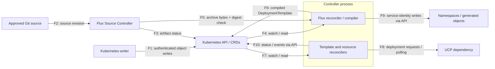

# Radius Controller Component Threat Model: v0.62.0

- **Author**: AI-assisted revision; human review pending.
- **Historical author**: ytimocin.
- **Status**: Draft, not a security approval.
- **Baseline**: Radius v0.62.0, commit `37a8cbd33e990886460f4fd1987d6a4fefd901c5`.
- **Prior model**: [August 2024 Controller model](2024-08-controller-component-threat-model.md). The original document and both images remain unchanged.

## Overview

The controller turns Kubernetes objects and Flux source artifacts into Radius deployments. Permission to submit those inputs can cause actions under the controller's broader service identity.

The released controller no longer matches the original model's Recipe/Deployment reconciler and validating-webhook topology. This revision models the registered DeploymentTemplate, DeploymentResource, and Flux reconcilers. It describes source-based risks, not demonstrated vulnerabilities.

## Terms and Definitions

| Term               | Definition                                                                             |
|--------------------|----------------------------------------------------------------------------------------|
| Reconciler         | Loop that compares desired state with observed state and performs updates.             |
| DeploymentTemplate | Radius Kubernetes resource carrying deployment template information.                   |
| DeploymentResource | Radius Kubernetes resource used in deployment resource reconciliation.                 |
| Flux artifact      | Source Controller archive referenced by a GitRepository status, with a URL and digest. |
| UCP                | Radius API routing service.                                                            |

## System Description

[Service registration][service] creates a controller-runtime manager and registers the three reconcilers. The manager also serves health checks and optional configured metrics. There is no Recipe validating webhook registered in this service setup.

Assets include desired deployment state, source contents, template parameters, generated objects, and the controller's Kubernetes/UCP authority. Inputs can be changed by Kubernetes object writers and approved source contributors. Cluster administrators and maintainers of approved source repositories are distinct trust roles.

### Architecture

The [Flux reconciler][flux] reads `radius-gitops-config.yaml` from an artifact, compiles selected Bicep inputs, and creates or updates DeploymentTemplate objects. Source configuration can select a target namespace and resource group; the controller can create namespaces.

The other reconcilers coordinate Radius operations through UCP and update Kubernetes state. Their [ClusterRole][rbac] includes broad access to deployment CRDs, namespace operations, Flux reads, and wildcard verbs/resources for `api.ucp.dev`. A source or CRD author's own cloud identity is not automatically used for the resulting operations.

### Implementation Details

**Is there any use of cryptography?**

Yes, through Kubernetes client authentication/TLS and artifact digest verification delegated to the Flux archive fetcher. A digest ties downloaded bytes to the supplied digest, not to an independently trusted author. Do not reuse the original model's SHA-1 configuration/secret-hash account for removed reconcilers.

**Does the component store secrets?**

The old model's per-Recipe and Deployment connection-Secret lifecycle is not a description of the registered reconcilers. Current templates, parameters, generated objects, status, events, and logs must still be treated as potentially sensitive. A template can include sensitive inputs even if its API field is not named `secret`.

**Does the component process untrusted data or does the component parse any custom formats?**

Yes. It reads CRDs and Flux status, downloads/extracts archives, parses YAML/JSON, and compiles Bicep. [Archive fetcher construction][fetcher] supplies retries and digest handling but sets both maximum download and extraction sizes to unlimited. These settings are relevant to resource exhaustion, not proof of an exploitable archive bug.

### Clients

Kubernetes users and automation submit watched objects through the API. Flux Source Controller publishes source status/artifacts. The controller initiates API watches and UCP requests; API-server watch delivery is not a separate unauthenticated inbound controller API. Health and metrics clients use separate surfaces.

## Trust Boundaries

| Boundary                                | Protection                                                        | Limit                                                                                      |
|-----------------------------------------|-------------------------------------------------------------------|--------------------------------------------------------------------------------------------|
| User to watched Kubernetes object       | Kubernetes authentication, RBAC and installed admission policies. | The operator must restrict who can submit deployment/source inputs.                        |
| Flux source to downloaded bytes         | Artifact digest supplied to the fetcher.                          | Source status and the party producing that digest must be trusted.                         |
| Artifact to compiler/controller process | Libraries parse the archive and files.                            | Compilation and extraction consume controller resources; this is not a sandbox claim.      |
| Controller to UCP                       | SDK connection configured from the installation.                  | Radius authorization mode settings do not supply user-level checks.                        |
| Controller to output namespaces         | ClusterRole grants enable writes.                                 | Namespace selection is not evidence that a source author is authorized for that namespace. |

The [UCP model](2026-11-ucp-component-threat-model-v0.62.0.md) owns shared transport and network defaults. The old webhook diagram's mTLS claim must not be used as a control for this release.

## Assumptions

The Kubernetes API and approved Flux Source Controller are trust anchors. Operators protect the controller image, service account, configuration, and approved source selection.

Do not assume all namespace users are trusted source authors, all GitRepository writers are cluster administrators, or a source artifact is safe merely because its digest matches. Application source review and target-scope policy remain separate requirements.

## Data Flows

### Diagram

F1 admits desired state under the submitting user's Kubernetes permissions. F2-F6 translate repository content into deployment inputs. F7-F8 act on those inputs under the controller's identity. F9-F10 return objects and operational information. Direct DeploymentTemplate submission can bypass the Flux path but not Kubernetes API controls.

## Threats

### CTRL-01: A narrow object write causes broad deployment actions

**Description:** A user able to write deployment CRDs or approved source content uses F1/F6 to request operations beyond the scope intended for that user.

**Impact:** Resource creation/deletion or cloud costs through the controller's Radius authority.

**Mitigation:** Restrict CRD and GitRepository writes; review source contributors and selected revisions; constrain cloud identities and deployment targets.

**Status:** Kubernetes checks apply on F1. Operator policy is required; the wildcard Radius role does not provide fine-grained delegation.

### CTRL-02: Source configuration targets another namespace or resource group

**Description:** A contributor changes namespace/resource-group selections in the Flux configuration consumed at F5-F6.

**Impact:** Desired state could be created in a scope that the contributor could not write directly, subject to controller and backend permissions.

**Mitigation:** Treat approved source configuration as privileged, validate permitted targets through operator policy, and separate sources by trust group.

**Status:** Target selection and namespace creation are implemented. An authorization check tying each source author to each selected target is not established by this review.

### CTRL-03: An artifact source is substituted

**Description:** A party able to change Flux artifact status or its trusted producer supplies a malicious archive and corresponding digest.

**Impact:** Unexpected template execution, deployment changes, or compiler exposure to hostile input.

**Mitigation:** Protect Source Controller, status write permissions and repository credentials; approve source revisions and publishers.

**Status:** Digest checking is implemented through the fetcher. It does not authenticate a publisher independently of the trusted status/source path.

### CTRL-04: Downloads, extraction or compilation exhaust resources

**Description:** A permitted source writer supplies a large or expensive artifact for F5-F6.

**Impact:** Controller memory, disk or CPU exhaustion and delayed reconciliation for other applications.

**Mitigation:** Apply source admission and cluster resource limits. Add explicit artifact/expansion limits and compilation budgets as future defenses.

**Status:** Chart memory settings exist. Fetcher size limits are explicitly unlimited. No malformed-archive exploit or universal request budget was tested.

### CTRL-05: Configuration or network changes spoof a dependency

**Description:** An actor able to alter the controller's connection settings or trusted network path directs F4/F8 toward an unintended server.

**Impact:** Template/parameter disclosure, false reconciliation results, or outage.

**Mitigation:** Protect configuration and credentials, preserve Kubernetes TLS verification, and restrict network access using the shared installation controls.

**Status:** Standard Kubernetes client security is used. It is not proof that all internal UCP/RP paths use mutual TLS; see the UCP model.

### CTRL-06: Deployment data leaks through Kubernetes state or diagnostics

**Description:** A reader of generated template objects, status, events, logs, or diagnostics obtains values supplied at F1/F5/F10.

**Impact:** Exposure of application metadata, deployment parameters, or embedded credentials.

**Mitigation:** Use references rather than inline secrets where supported, limit read access, and review diagnostic sinks and retention.

**Status:** Access restrictions are operator duties. No universal redaction of arbitrary template content or all error paths is claimed.

### CTRL-07: Reconciliation is misattributed

**Description:** Actions at F8 are recorded under a service identity after a source revision or object change, without sufficient linkage to its author.

**Impact:** Operators may not identify the initiator of an unwanted deployment.

**Mitigation:** Retain Git review/revision history, Kubernetes audit, and correlated Radius logs.

**Status:** Reconciliation logs/events exist. Complete author-to-cloud attribution and audit retention are not verified.

## Open Questions

- Which target namespace/resource-group policies will operators require for Flux inputs?
- What download, expansion and compile limits are acceptable for approved repositories?
- Which template fields and failure paths can reach logs, status, and events without redaction?

## Action Items

1. Operators: review CRD/source write grants and approved repository contributors as deployment privileges.
2. Maintainers: evaluate target-scope checks and bounded artifact/compile processing.
3. Operators: restrict diagnostics and retain revision-to-deployment audit evidence.

## Review Notes

This AI-assisted draft is based on released source, not a running controller. Human review is pending.

The old spoofed UCP/API-server threats are corrected and retained in CTRL-05. The old webhook spoofing threat is retired for this model because that webhook is not registered. Invalid-input denial of service becomes CTRL-04. Secret disclosure becomes CTRL-06 without assuming payloads contain no secrets. Kubernetes privilege delegation becomes CTRL-01/CTRL-02.

Old SHA-1 deployment-hash migration work does not apply to the removed reconcilers. Old blanket non-root and network-policy action items are replaced with checks of actual chart controls; neither change proves source execution is isolated. The original PNGs are preserved but not reused as current diagrams.

## References

- [Controller service and registration][service].
- [Controller ClusterRole][rbac] and [chart deployment][deployment].
- [Flux reconciliation][flux] and [archive fetcher][fetcher].
- [DeploymentTemplate reconciler][template] and [DeploymentResource reconciler][resource].
- [Released CRDs][crds].

[service]: https://github.com/radius-project/radius/blob/37a8cbd33e990886460f4fd1987d6a4fefd901c5/pkg/controller/service.go
[rbac]: https://github.com/radius-project/radius/blob/37a8cbd33e990886460f4fd1987d6a4fefd901c5/deploy/Chart/templates/controller/rbac.yaml
[deployment]: https://github.com/radius-project/radius/blob/37a8cbd33e990886460f4fd1987d6a4fefd901c5/deploy/Chart/templates/controller/deployment.yaml
[flux]: https://github.com/radius-project/radius/blob/37a8cbd33e990886460f4fd1987d6a4fefd901c5/pkg/controller/reconciler/flux_controller.go
[fetcher]: https://github.com/radius-project/radius/blob/37a8cbd33e990886460f4fd1987d6a4fefd901c5/pkg/controller/reconciler/archivefetcher.go
[template]: https://github.com/radius-project/radius/blob/37a8cbd33e990886460f4fd1987d6a4fefd901c5/pkg/controller/reconciler/deploymenttemplate_reconciler.go
[resource]: https://github.com/radius-project/radius/blob/37a8cbd33e990886460f4fd1987d6a4fefd901c5/pkg/controller/reconciler/deploymentresource_reconciler.go
[crds]: https://github.com/radius-project/radius/tree/37a8cbd33e990886460f4fd1987d6a4fefd901c5/deploy/Chart/crds/radius
