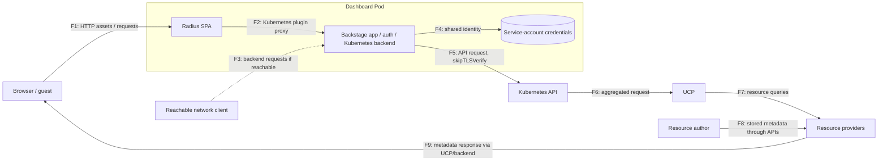

# Radius Dashboard Component Threat Model: v0.62.0

- **Historical author**: @nithyatsu.
- **Status**: Draft; security review pending.
- **Baselines**: Radius v0.62.0 at `37a8cbd33e990886460f4fd1987d6a4fefd901c5`; Dashboard v0.62.0 at `b2b8934c2fb70724c48511cb606be244dcf20a79`.
- **Prior model**: [August 2024 Dashboard model](2024-08-dashboard-component-threat-model.md). The original document and both images remain unchanged.

## Overview

Dashboard displays Radius resources through Backstage and the Kubernetes backend plugin. Its UI issues read requests, but its shared Kubernetes service account has broader Radius API permissions. Read-only screens are not a backend authorization boundary.

The released chart enables Dashboard by default, sets `NODE_ENV=development`, and uses guest authentication. Per-user access checks and HTTPS require operator configuration. The scenarios below describe risks; no public exposure or proxy exploit was tested.

## Terms and Definitions

| Term            | Definition                                                                                             |
|-----------------|--------------------------------------------------------------------------------------------------------|
| SPA             | Single-page browser application.                                                                       |
| Backstage       | Framework hosting the Dashboard frontend and backend plugins.                                          |
| Guest provider  | Backstage authentication provider used for automatic guest sign-in.                                    |
| Service account | Kubernetes identity used by the Dashboard backend, not the browser user's individual cluster identity. |
| UCP             | Radius API behind Kubernetes aggregation.                                                              |

## System Description

The [frontend Radius API client][api] uses Backstage's Kubernetes API proxy. It lists resources and types and fetches individual resources; it is not limited to the old model's application-graph description.

The [backend entry point][backend] loads the app, proxy, auth, guest auth, catalog and Kubernetes backend modules. It does not register the separate Radius backend router found in the source tree.

Assets include application/environment/resource metadata, relationships and schema content, backend tokens, and the Kubernetes service-account authority. Browser users, operators, resource authors and in-cluster clients have different capabilities.

### Architecture

The SPA calls the Kubernetes plugin, which contacts the configured Kubernetes API using `authProvider: serviceAccount`. The [Dashboard overlay][overlay] points at the in-cluster API, sets `skipTLSVerify: true`, and binds the backend listener to `:7007`.

The [Service][service] exposes HTTP port 80 to the Pod port. No public ingress or HTTPS termination is provided by this template. A ClusterIP Service is reachable within its network; it is not equivalent to a loopback-only process.

The chart's [role][rbac] grants wildcard verbs on wildcard `api.ucp.dev` resources. Kubernetes sees this shared backend identity for API calls, not each browser user's own cluster permissions.

### Implementation Details

**Is there any use of cryptography?**

Yes. Backstage uses authentication tokens and the Kubernetes connection uses TLS. The supplied configuration disables API certificate verification, so that connection does not verify the API server's identity. Browser/backend URLs use HTTP.

**Does the component store secrets?**

The Pod has access to Kubernetes service-account credentials. Optional integrations can add credentials through configuration. The [base configuration][base] uses in-memory SQLite, but that does not make process memory, mounted credentials, responses or plugin data non-sensitive.

**Does the component process untrusted data or does the component parse any custom formats?**

Yes. Browser requests, Radius JSON bodies, resource identifiers and schema/resource properties are processed. Resource authors can supply strings later displayed to users. No stored-script execution or HTML injection was demonstrated by this review.

### Clients

Browsers are intended clients. In-cluster callers or users reaching a forwarded/exposed port can also reach the backend. `backend.baseUrl: http://localhost:7007` tells clients which URL to use; it does not restrict a listener bound to all interfaces.

## Trust Boundaries

| Boundary                           | Default or supported behavior                                            | Security meaning                                             |
|------------------------------------|--------------------------------------------------------------------------|--------------------------------------------------------------|
| Browser to backend                 | HTTP URLs and HTTP Service; guest auth enabled by supplied setup.        | No default authenticated multi-user boundary is established. |
| Backend to Kubernetes API          | Shared service-account credentials; TLS verification skipped by overlay. | Browser permissions are not automatically delegated.         |
| Kubernetes API to UCP              | Aggregated API path.                                                     | Broad Dashboard role permits broad API use by its identity.  |
| Resource author to browser display | Resource properties and schemas enter UI components.                     | Metadata is untrusted display input, not trusted UI code.    |
| Operator to plugins/configuration  | Operator selects deployment and integrations.                            | Adding plugins changes the process trust surface.            |

The [UCP model](2026-11-ucp-component-threat-model-v0.62.0.md) lists shared network defaults. Optional namespace ingress policies allow all same-namespace sources and do not authenticate Dashboard users.

## Assumptions

The default installation is for trusted access, not an Internet-facing multi-tenant portal. Operators control port forwarding, ingress and network policy. Their installed settings were not tested.

Operators must configure HTTPS, a production auth provider and Backstage permissions for shared remote access. Guest users do not have separate cluster identities. Kubernetes port-forward authorizes the person opening the tunnel; it does not provide application-level login to everyone who can reach that local port.

## Data Flows

### Diagram

F1-F3 reach a backend with a shared identity. F5-F7 retrieve data using that identity. F8-F9 carry author-controlled data toward another user's browser. The diagram does not imply the resource provider connects directly to the browser; the response follows the request path.

## Threats

### DASH-01: An unintended user reaches guest-accessible data

**Description:** An operator exposes F1/F3 beyond its intended trusted users, including through a forwarded port or ingress.

**Impact:** Resource, environment, schema and relationship information may be disclosed without an individual login.

**Mitigation:** Restrict network/port-forward access. Configure a production auth provider and Backstage permissions before broader use. Verify that an unauthorized user cannot read resource data; disable Dashboard where not needed.

**Status:** Dashboard and the supplied guest setup are enabled by default. Per-user production auth and authorization are operator configuration, not active default controls.

### DASH-02: A stolen backend credential grants broad Radius authority

**Description:** An attacker obtains the Dashboard service-account token and calls the Kubernetes API with it. The chart grants that identity wildcard verbs on wildcard `api.ucp.dev` resources, beyond the frontend's GET requests.

**Impact:** Broad Radius operations under the Dashboard service account, potentially affecting infrastructure.

**Mitigation:** Restrict access to the Pod and service-account token. Reduce the role to the resources and methods the Dashboard needs, after checking the backend plugin's requirements.

**Status:** The chart role confirms the token's broad authority. This scenario requires access to the token; guest access alone is not evidence that an attacker has it. Whether a guest can trigger writes through the Backstage proxy is a separate, untested question.

### DASH-03: A network actor reads traffic or spoofs the Kubernetes endpoint

**Description:** A party able to observe the HTTP browser path or intercept F5 obtains or changes data. The overlay's skipped certificate verification weakens endpoint authentication.

**Impact:** Metadata disclosure, altered displayed state, or exposure of credentials sent to a spoofed API endpoint.

**Mitigation:** Provide browser-side TLS for remote access, keep certificate verification enabled with the correct API trust configuration, and restrict network paths.

**Status:** Browser/backend HTTP and `skipTLSVerify: true` are source defaults. Remote TLS termination and verified API certificate trust require operator configuration.

### DASH-04: Stored resource data attacks the display boundary

**Description:** A resource author inserts hostile text, links or large content into data returned at F9.

**Impact:** Misleading UI, unsafe navigation, availability loss, or script execution if a rendering sink fails to keep data separate from code.

**Mitigation:** Keep framework escaping, validate links and render paths, and test hostile/large resource values.

**Status:** The render paths were not tested with hostile values. Script execution remains a conditional risk, not a confirmed rendering flaw.

### DASH-05: Repeated list requests exhaust shared capacity

**Description:** A reachable client repeats requests that enumerate groups and fetch individual resources.

**Impact:** Backend, UCP and RP load; delayed service for legitimate users.

**Mitigation:** Restrict access, monitor expensive routes, and apply resource/request limits at the appropriate boundary.

**Status:** The API client can turn one list operation into multiple resource fetches. The chart sets Pod memory resources. Per-user request limits in the pinned Backstage dependencies were not assessed.

### DASH-06: Credentials or shared identity hide the initiating user

**Description:** A credential reader uses the service account, or an operator investigates guest-originated actions that all reach Kubernetes under the same identity.

**Impact:** Broader API access and weak user attribution.

**Mitigation:** Protect Pod/Secret/service-account access, minimize identity grants, and correlate backend logs with external access and Kubernetes audit records.

**Status:** Kubernetes records the shared service-account identity. Whether backend/access logs can identify the originating user and how long they are retained were not checked in a running installation.

## Open Questions

- What exact proxy routes and methods can each configured backend caller use in the pinned Backstage dependencies?
- Which auth provider and permission rules must an operator configure before shared or remote access?
- Which stored property displays and link handlers need hostile-input regression tests?

## Action Items

| Owner       | Follow-up and completion criteria                                                                                                                                                        | Tracking  |
|-------------|------------------------------------------------------------------------------------------------------------------------------------------------------------------------------------------|-----------|
| Operators   | Keep guest access within the approved network or disable Dashboard. Before remote use, test that unauthorized users cannot read data and that both TLS paths verify the intended server. | Untracked |
| Maintainers | List the Kubernetes plugin's required methods/resources and test guest access to proxy routes. Reduce the role where possible; record any writes that must remain and why.               | Untracked |
| Operators   | Trace a browser request through backend/access logs to a Kubernetes audit record. Record which users remain indistinguishable and set an audit retention policy.                         | Untracked |

## Review Notes

Review covers both pinned repositories. Security review is pending. No browser, cluster, proxy exploitation or dependency vulnerability tests were run.

The [published Radius release manifest][manifest] records Dashboard image `ghcr.io/radius-project/dashboard:0.62.0`, digest `sha256:9ad5f18a465f5aac1406a81cd9c50a14fd4695eeca0ff0cd83bcf401d91ac643`, and source `b2b8934c2fb70724c48511cb606be244dcf20a79`. It also records chart/app version `0.62.0`. This is release metadata evidence, not an independent image rebuild.

Old denial-of-service and metadata disclosure threats remain DASH-05/DASH-01. Service-account spoofing becomes DASH-02/DASH-06. Browser sniffing remains DASH-03. The old claims that localhost baseUrl hides the backend, no secrets/formats are involved, robust login is assumed, or read-only UI removes write risk are corrected. Prior Backstage audit work is not marked complete based on an old issue's status.

## References

- [Base Backstage configuration][base], [Dashboard overlay][overlay], [enabled backend modules][backend], and [Radius API client][api].
- [Pod settings][deployment], [HTTP Service][service], [identity role][rbac], and [Radius chart defaults][values].
- [Radius v0.62.0 release manifest][manifest].

[base]: https://github.com/radius-project/dashboard/blob/b2b8934c2fb70724c48511cb606be244dcf20a79/app-config.yaml
[overlay]: https://github.com/radius-project/dashboard/blob/b2b8934c2fb70724c48511cb606be244dcf20a79/app-config.dashboard.yaml
[backend]: https://github.com/radius-project/dashboard/blob/b2b8934c2fb70724c48511cb606be244dcf20a79/packages/backend/src/index.ts
[api]: https://github.com/radius-project/dashboard/blob/b2b8934c2fb70724c48511cb606be244dcf20a79/plugins/plugin-radius/src/api/api.ts
[deployment]: https://github.com/radius-project/radius/blob/37a8cbd33e990886460f4fd1987d6a4fefd901c5/deploy/Chart/templates/dashboard/deployment.yaml
[service]: https://github.com/radius-project/radius/blob/37a8cbd33e990886460f4fd1987d6a4fefd901c5/deploy/Chart/templates/dashboard/service.yaml
[rbac]: https://github.com/radius-project/radius/blob/37a8cbd33e990886460f4fd1987d6a4fefd901c5/deploy/Chart/templates/dashboard/rbac.yaml
[values]: https://github.com/radius-project/radius/blob/37a8cbd33e990886460f4fd1987d6a4fefd901c5/deploy/Chart/values.yaml
[manifest]: https://github.com/radius-project/radius/releases/download/v0.62.0/release-manifest.json
