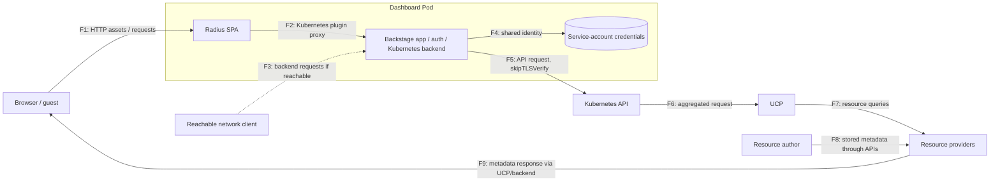

# Radius Dashboard Component Threat Model: v0.62.0

- **Historical author**: @nithyatsu.
- **Status**: Draft; security review pending.
- **Baselines**: Radius v0.62.0 at `37a8cbd33e990886460f4fd1987d6a4fefd901c5`; Dashboard v0.62.0 at `b2b8934c2fb70724c48511cb606be244dcf20a79`.
- **Prior model**: [August 2024 Dashboard model](2024-08-dashboard-component-threat-model.md). The original document and both images remain unchanged.

## Overview

This document provides a threat model for the Radius Dashboard component. It describes the system, its assets, potential threats and recommended mitigations.

The Radius Dashboard provides the frontend experience for Radius. It presents visual and textual information about applications, environments, resource types and resources.

Dashboard displays Radius resources through Backstage and the Kubernetes backend plugin. Its UI issues read requests, but its shared Kubernetes service account has broader Radius API permissions. Read-only screens are not a backend authorization boundary.

The released chart enables Dashboard by default, sets `NODE_ENV=development`, and uses guest authentication. Per-user access checks and HTTPS require operator configuration. The scenarios below describe risks; no public exposure or proxy exploit was tested.

## Terms and Definitions

| Term            | Definition                                                                                             |
|-----------------|--------------------------------------------------------------------------------------------------------|
| SPA             | Single-page browser application.                                                                       |
| Backstage       | Framework hosting the Dashboard frontend and backend plugins.                                          |
| Guest provider  | Backstage authentication provider used for automatic guest sign-in.                                    |
| Service account | Kubernetes identity used by the Dashboard backend, not the browser user's individual cluster identity. |
| UCP             | Radius API behind Kubernetes aggregation.                                                              |

## System Description

The Dashboard component is an instance of [Backstage](https://backstage.io/). Radius customizes Backstage with a Radius frontend plugin and the community-supported Kubernetes plugin. Dashboard is a client of the Radius API and constructs views from the returned resource data.

The [frontend Radius API client][api] uses Backstage's Kubernetes API proxy. It lists resources and types and fetches individual resources; it is not limited to the old model's application-graph description.

The [backend entry point][backend] loads the app, proxy, auth, guest auth, catalog and Kubernetes backend modules. It does not register the separate Radius backend router found in the source tree.

Assets include application/environment/resource metadata, relationships and schema content, backend tokens, and the Kubernetes service-account authority. Browser users, operators, resource authors and in-cluster clients have different capabilities.

### Architecture

Backstage provides a core single-page application, a backend, and configurable database support. Plugins extend the frontend and backend. The Radius SPA plugin presents the application and resource views inside that framework.

The released backend registers the app, proxy, authentication, guest authentication, catalog and Kubernetes modules. The 2024 model described a separate Radius backend plugin as part of the active request path. That router exists in the source tree but is not registered by the pinned backend entry point.

The SPA calls the Kubernetes plugin, which contacts the configured Kubernetes API using `authProvider: serviceAccount`. The [Dashboard overlay][overlay] points at the in-cluster API, sets `skipTLSVerify: true`, and binds the backend listener to `:7007`.

The application runs as a Dashboard Pod in the release namespace, normally `radius-system`, alongside the other Radius Pods. The base configuration selects in-memory SQLite. This database choice does not make the backend inaccessible or remove the credentials and resource data available to its process.

The [Service][service] exposes HTTP port 80 to the Pod port. No public ingress or HTTPS termination is provided by this template. A ClusterIP Service is reachable within its network; it is not equivalent to a loopback-only process.

The chart's [role][rbac] grants wildcard verbs on wildcard `api.ucp.dev` resources. Kubernetes sees this shared backend identity for API calls, not each browser user's own cluster permissions.

### Implementation Details

Dashboard depends on Backstage for its display, authentication and backend plugin behavior. The [Backstage threat model](https://backstage.io/docs/overview/threat-model/) describes framework trust roles; deployment configuration still determines which controls apply here.

The application uses `app-config.yaml` and `app-config.dashboard.yaml`. The Dashboard overlay merges with the base configuration for the Radius installation. The relevant released settings are shown below.

#### Radius API connection

The Kubernetes plugin uses one configured cluster and the backend service-account identity:

```yaml
kubernetes:
  serviceLocatorMethod:
    type: singleTenant
  clusterLocatorMethods:
    - type: config
      clusters:
        - name: self
          url: https://kubernetes.default.svc.cluster.local
          authProvider: serviceAccount
          skipTLSVerify: true
          skipMetricsLookup: true
```

Kubernetes sees the backend service account, not each browser user's cluster identity. The chart grants that account wildcard verbs on wildcard Radius API resources.

#### Backend listener and browser URL

The Dashboard overlay uses:

```yaml
app:
  baseUrl: http://localhost:7007
backend:
  baseUrl: http://localhost:7007
  listen: ':7007'
```

`baseUrl` tells clients which URL to use. It does not restrict a listener bound to all interfaces. The HTTP ClusterIP Service and a port-forward are access paths, not application-level authentication.

#### Database and sign-in configuration

The base configuration uses an in-memory SQLite database and enables the guest auth provider:

```yaml
backend:
  database:
    client: better-sqlite3
    connection: ':memory:'
auth:
  providers:
    guest: {}
```

The supplied UI signs in through guest auth without an individual login. The chart sets `NODE_ENV=development`. Operators must configure a production auth provider and appropriate Backstage permissions before shared remote use.

The Radius frontend client issues read requests. This describes the UI's behavior, not all operations allowed to the backend identity. A stolen service-account token has the authority granted by the chart role regardless of which buttons the SPA exposes.

#### Storage of secrets

The Pod has access to Kubernetes service-account credentials. Optional integrations can add credentials through configuration. The [base configuration][base] uses in-memory SQLite, but that does not make process memory, mounted credentials, responses or plugin data non-sensitive.

#### Data Serialization / Formats

Browser requests, Radius JSON bodies, resource identifiers and schema/resource properties are processed by the frontend and backend. Resource authors can supply strings later displayed to users. No stored-script execution or HTML injection was demonstrated by this review.

### Cryptography

Backstage uses authentication tokens and the Kubernetes connection uses TLS. The supplied configuration disables API certificate verification, so that connection does not verify the API server's identity. Browser/backend URLs use HTTP. HTTPS for remote browser access and verified API certificate trust require operator configuration.

### Clients

The primary user of Dashboard is a browser. The browser loads the SPA and sends API requests to the Backstage backend. In-cluster callers or users reaching a forwarded/exposed port can also reach that backend.

Operators can add plugins or integrations. Each addition can introduce clients, credentials and routes beyond those included in this model.

## Trust Boundaries

Dashboard and UCP normally live in the `radius-system` namespace. Namespace-scoped RBAC can restrict changes to the Dashboard Pod, its configuration and credentials. A namespace alone does not deny traffic from another Pod.

Backstage distinguishes several trust roles:

- **Internal users:** People allowed to use the portal and view the data granted to them.
- **Operators:** People who maintain the Backstage installation, configuration and access policy.
- **Builders:** Contributors who can change and deploy plugin or application code. That access can give them privileges comparable to operators.
- **External users:** People outside the intended user group. Operators must prevent their direct access unless a separate deployment and permission policy explicitly supports it.

The supplied guest setup does not enforce a separate identity or permission set for each internal user. Operators must configure those controls rather than treating Backstage framework support as an active installation policy.

| Boundary                           | Default or supported behavior                                            | Security meaning                                             |
|------------------------------------|--------------------------------------------------------------------------|--------------------------------------------------------------|
| Browser to backend                 | HTTP URLs and HTTP Service; guest auth enabled by supplied setup.        | No default authenticated multi-user boundary is established. |
| Backend to Kubernetes API          | Shared service-account credentials; TLS verification skipped by overlay. | Browser permissions are not automatically delegated.         |
| Kubernetes API to UCP              | Aggregated API path.                                                     | Broad Dashboard role permits broad API use by its identity.  |
| Resource author to browser display | Resource properties and schemas enter UI components.                     | Metadata is untrusted display input, not trusted UI code.    |
| Operator to plugins/configuration  | Operator selects deployment and integrations.                            | Adding plugins changes the process trust surface.            |

The [UCP model](2026-11-ucp-component-threat-model-v0.62.0.md) lists shared network defaults. Optional namespace ingress policies allow all same-namespace sources and do not authenticate Dashboard users.

Dashboard is intended for trusted access rather than a public multi-tenant portal. An operator can access the default Service with a loopback port-forward:

```bash
kubectl port-forward --namespace=radius-system svc/dashboard 7007:80
```

That command uses the selected Kubernetes context and the install namespace. Kubernetes authorizes the person opening the tunnel. It does not provide application-level login to another person or process that can reach the forwarded port.

## Assumptions

This threat model assumes that:

1. The Radius/Dashboard installation and approved plugin code have not been tampered with.
2. The Kubernetes control plane is not compromised.
3. Kubernetes authenticates and authorizes API requests and access to port-forwarding. Radius cannot prevent actions by a cluster administrator.
4. Operators control port forwarding, ingress, plugin configuration and network policy. Their installed settings were not tested.
5. Access is limited to the intended trusted users unless an operator explicitly configures and verifies a broader access policy.

The 2024 assumptions of HTTPS, configured per-user access and robust login are not release defaults. Operators must configure HTTPS, a production auth provider and Backstage permissions for shared remote access. Guest users do not have separate cluster identities.

## Data Flows

### Diagram



F1-F3 reach a backend with a shared identity. F5-F7 retrieve data using that identity. F8-F9 carry author-controlled data toward another user's browser. The diagram does not imply the resource provider connects directly to the browser; the response follows the request path.

1. A user opens the Dashboard URL and loads the Radius SPA. The supplied setup signs in through the guest provider.
2. The SPA requests resource, type, application or environment data through the Backstage Kubernetes plugin.
3. The backend calls the configured in-cluster Kubernetes API with its service-account credentials. The supplied overlay skips verification of the API server's certificate.
4. Kubernetes forwards Radius API requests to UCP through API aggregation, subject to the backend identity's Kubernetes grants.
5. UCP queries the appropriate resource provider and returns the result through Kubernetes and Backstage.
6. The SPA constructs visuals from the returned data and frontend components. Resource-controlled text and links cross into the display boundary at this step.

## Threats

### DASH-01: An unintended user reaches guest-accessible data

**Description:** An operator exposes F1/F3 beyond its intended trusted users, including through a forwarded port or ingress.

**Impact:** Resource, environment, schema and relationship information may be disclosed without an individual login. An attacker can use application dependencies and topology to select targets for a later attack.

**Mitigation:** Restrict network/port-forward access. Configure a production auth provider and Backstage permissions before broader use. Verify that an unauthorized user cannot read resource data; disable Dashboard where not needed.

**Status:** Dashboard and the supplied guest setup are enabled by default. Per-user production auth and authorization are operator configuration, not active default controls.

### DASH-02: A stolen backend credential grants broad Radius authority

**Description:** An attacker obtains the Dashboard service-account token and calls the Kubernetes API with it. The chart grants that identity wildcard verbs on wildcard `api.ucp.dev` resources, beyond the frontend's GET requests.

**Impact:** Broad Radius operations under the Dashboard service account, potentially affecting infrastructure.

**Mitigation:** Restrict access to the Pod and service-account token. Reduce the role to the resources and methods the Dashboard needs, after checking the backend plugin's requirements.

**Status:** The chart role confirms the token's broad authority. This scenario requires access to the token; guest access alone is not evidence that an attacker has it. Whether a guest can trigger writes through the Backstage proxy is a separate, untested question.

### DASH-03: A network actor reads traffic or spoofs the Kubernetes endpoint

**Description:** A party able to observe the HTTP browser path or intercept F5 obtains or changes data. The overlay's skipped certificate verification weakens endpoint authentication.

**Impact:** Metadata disclosure, altered displayed state, or exposure of credentials sent to a spoofed API endpoint.

**Mitigation:** Provide browser-side TLS for remote access, keep certificate verification enabled with the correct API trust configuration, and restrict network paths.

**Status:** Browser/backend HTTP and `skipTLSVerify: true` are source defaults. Remote TLS termination and verified API certificate trust require operator configuration.

### DASH-04: Stored resource data attacks the display boundary

**Description:** A resource author inserts hostile text, links or large content into data returned at F9.

**Impact:** Misleading UI, unsafe navigation, availability loss, or script execution if a rendering sink fails to keep data separate from code.

**Mitigation:** Keep framework escaping, validate links and render paths, and test hostile/large resource values.

**Status:** The render paths were not tested with hostile values. Script execution remains a conditional risk, not a confirmed rendering flaw.

### DASH-05: Repeated list requests exhaust shared capacity

**Description:** A reachable client repeats requests that enumerate groups and fetch individual resources.

**Impact:** Backend, UCP and RP load; delayed service for legitimate users.

**Mitigation:** Restrict access, monitor expensive routes, and apply resource/request limits at the appropriate boundary.

**Status:** The API client can turn one list operation into multiple resource fetches. The chart sets Pod memory resources. Per-user request limits in the pinned Backstage dependencies were not assessed.

### DASH-06: Credentials or shared identity hide the initiating user

**Description:** A credential reader uses the service account, or an operator investigates guest-originated actions that all reach Kubernetes under the same identity.

**Impact:** Broader API access and weak user attribution.

**Mitigation:** Protect Pod/Secret/service-account access, minimize identity grants, and correlate backend logs with external access and Kubernetes audit records.

**Status:** Kubernetes records the shared service-account identity. Whether backend/access logs can identify the originating user and how long they are retained were not checked in a running installation.

## Open Questions

- What exact proxy routes and methods can each configured backend caller use in the pinned Backstage dependencies?
- Which auth provider and permission rules must an operator configure before shared or remote access?
- Which stored property displays and link handlers need hostile-input regression tests?

## Action Items

| Owner       | Follow-up and completion criteria                                                                                                                                                        | Tracking  |
|-------------|------------------------------------------------------------------------------------------------------------------------------------------------------------------------------------------|-----------|
| Operators   | Keep guest access within the approved network or disable Dashboard. Before remote use, test that unauthorized users cannot read data and that both TLS paths verify the intended server. | Untracked |
| Maintainers | List the Kubernetes plugin's required methods/resources and test guest access to proxy routes. Reduce the role where possible; record any writes that must remain and why.               | Untracked |
| Operators   | Trace a browser request through backend/access logs to a Kubernetes audit record. Record which users remain indistinguishable and set an audit retention policy.                         | Untracked |

The original multi-user access guidance was tracked in [radius-project/dashboard#105](https://github.com/radius-project/dashboard/issues/105). It remains relevant to HTTPS, login and Backstage permissions. This revision does not infer completion from that historical link. Revisit the backend role when Radius authorization changes. The original [Backstage audit-log discussion](https://github.com/backstage/backstage/issues/23950) is also background, not evidence that this installation records individual guest users.

## Review Notes

Review covers both pinned repositories. Security review is pending. No browser, cluster, proxy exploitation or dependency vulnerability tests were run.

The [published Radius release manifest][manifest] records Dashboard image `ghcr.io/radius-project/dashboard:0.62.0`, digest `sha256:9ad5f18a465f5aac1406a81cd9c50a14fd4695eeca0ff0cd83bcf401d91ac643`, and source `b2b8934c2fb70724c48511cb606be244dcf20a79`. It also records chart/app version `0.62.0`. This is release metadata evidence, not an independent image rebuild.

Old denial-of-service and metadata disclosure threats remain DASH-05/DASH-01. Service-account spoofing becomes DASH-02/DASH-06. Browser sniffing remains DASH-03. The old claims that localhost baseUrl hides the backend, no secrets/formats are involved, robust login is assumed, or read-only UI removes write risk are corrected. Prior Backstage audit work is not marked complete based on an old issue's status.

## References

- [Base Backstage configuration][base], [Dashboard overlay][overlay], [enabled backend modules][backend], and [Radius API client][api].
- [Pod settings][deployment], [HTTP Service][service], [identity role][rbac], and [Radius chart defaults][values].
- [Radius v0.62.0 release manifest][manifest].

[base]: https://github.com/radius-project/dashboard/blob/b2b8934c2fb70724c48511cb606be244dcf20a79/app-config.yaml
[overlay]: https://github.com/radius-project/dashboard/blob/b2b8934c2fb70724c48511cb606be244dcf20a79/app-config.dashboard.yaml
[backend]: https://github.com/radius-project/dashboard/blob/b2b8934c2fb70724c48511cb606be244dcf20a79/packages/backend/src/index.ts
[api]: https://github.com/radius-project/dashboard/blob/b2b8934c2fb70724c48511cb606be244dcf20a79/plugins/plugin-radius/src/api/api.ts
[deployment]: https://github.com/radius-project/radius/blob/37a8cbd33e990886460f4fd1987d6a4fefd901c5/deploy/Chart/templates/dashboard/deployment.yaml
[service]: https://github.com/radius-project/radius/blob/37a8cbd33e990886460f4fd1987d6a4fefd901c5/deploy/Chart/templates/dashboard/service.yaml
[rbac]: https://github.com/radius-project/radius/blob/37a8cbd33e990886460f4fd1987d6a4fefd901c5/deploy/Chart/templates/dashboard/rbac.yaml
[values]: https://github.com/radius-project/radius/blob/37a8cbd33e990886460f4fd1987d6a4fefd901c5/deploy/Chart/values.yaml
[manifest]: https://github.com/radius-project/radius/releases/download/v0.62.0/release-manifest.json
