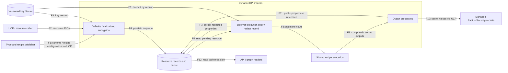

# Radius Dynamic RP Component Threat Model: v0.62.0

- **Author**: AI-assisted draft; human review pending.
- **Status**: Draft, not a security approval.
- **Baseline**: Radius v0.62.0, commit `37a8cbd33e990886460f4fd1987d6a4fefd901c5`.
- **Related models**: [UCP](2026-11-ucp-component-threat-model-v0.62.0.md) and [recipe execution](2026-11-recipe-execution-threat-model-v0.62.0.md).

## Overview

Dynamic RP implements resource lifecycle operations for registered Radius types. Type schemas and recipe configuration control how user data is validated, protected, and turned into infrastructure actions. Their authors are therefore part of the security boundary.

The original four component models did not cover this generic provider. This model describes the released frontend, worker, sensitive-field handling and managed secret outputs. It does not claim that every property or artifact is secret-free, or that a tested vulnerability exists.

## Terms and Definitions

| Term            | Definition                                                                                  |
|-----------------|---------------------------------------------------------------------------------------------|
| Dynamic type    | Registered resource type handled through generic provider routes.                           |
| Sensitive field | Field selected by the schema's `x-radius-sensitive` annotation.                             |
| Associated data | Authenticated context bound to ciphertext without itself being encrypted.                   |
| Managed secret  | `Radius.Security/secrets` resource created for a resource's declared recipe secret outputs. |
| Recipe pack     | Registered collection used to resolve infrastructure definitions for types.                 |

## System Description

UCP's [default downstream endpoint][ucp] points to Dynamic RP. The [service configuration][config] uses an HTTP listener, API-server state/queue by default, Kubernetes Secrets, and shared worker settings. Type/schema lookup and recipe resolution use UCP APIs.

Assets include schemas, desired resource state, protected inputs awaiting execution, managed secret references, output resources, keys, graph data and execution authority. Actors include resource authors, type/recipe publishers, operators, backend dependencies, and cluster clients.

### Architecture

The [route setup][routes] applies defaults, plaintext validation, then encryption before asynchronous PUT persistence. GET and LIST have [redaction controllers][get]. Schema/handler failures produce errors rather than intentionally falling back to exposing sensitive values.

The worker uses shared [recipe-resource processing][worker]. For resources with schema-sensitive inputs, it decrypts an execution copy and persists a redacted resource before recipe execution. Failure after that redaction is handled as terminal where retry would require removed inputs. An empty/redacted input is not a retained encrypted secret that callers can recover later.

[Dynamic output processing][processor] copies permitted computed properties and handles declared secret outputs. Types opt into managed secrets through a schema `secrets` block. For those types, all recipe secret outputs are materialized, including additional keys; the owner exposes a secret-name reference rather than the values. Without that block, secret outputs are dropped rather than persisted on the owner. Empty outputs or removal of the block cause cleanup of the prior managed secret and its reference. Materialization returns after the API accepts the PUT; a stored reference does not prove that the backing Kubernetes Secret is already ready.

### Implementation Details

**Is there any use of cryptography?**

Yes. The [encryptor][crypto] uses ChaCha20-Poly1305 with 32-byte keys and random nonces. The [field handler][sensitive] binds associated data to the resource ID and field path. Versioned keys come from `radius-encryption-key` through a [Kubernetes key provider][keyprovider]. Ciphertext authentication is not caller authorization.

The chart enables the [rotation CronJob][rotation] by default. It adds a key version and removes sufficiently old versions while retaining the current and previous versions. The job updates the key Secret; it does not sweep resource records to re-encrypt old ciphertext.

**Does the component store secrets?**

Yes. Sensitive PUT inputs are encrypted while awaiting the worker's consume/redact path. Plaintext is needed in memory for execution and can enter external deployment state. [Managed secret materialization][materializer] submits sensitive values to `Radius.Security/secrets`; the [secret loader][loader] later locates its backing Kubernetes Secret through recorded output resources.

Protect backing Secrets, keys, resource records, pending operations, external state and backups separately. Redacting the owner is not deleting data from all those locations.

**Does the component process untrusted data or does the component parse any custom formats?**

Yes. JSON properties, resource IDs, schemas and schema paths, defaults, recipe outputs, references and operation responses are processed. Schema/type publishers can change what counts as sensitive. Validation is not a guarantee that a recipe is safe to execute.

### Clients

UCP, deployment clients, controllers, recipe callbacks and internal workers participate. Other cluster workloads can be callers if direct networking allows access. Probes and observability use additional endpoints.

## Trust Boundaries

| Boundary                          | Security responsibility                                                                            |
|-----------------------------------|----------------------------------------------------------------------------------------------------|
| Caller to generic API             | Authenticate/authorize the entry path; shared UCP controls do not protect every direct connection. |
| Publisher to schema/defaults      | Trust publishers to constrain data and mark sensitive paths correctly.                             |
| Schema to encryption/redaction    | Protection applies only to recognized annotated paths.                                             |
| Worker to execution copy          | Plaintext leaves encrypted-at-rest handling and enters execution memory.                           |
| Output to managed secret          | Separate owner metadata from values and protect the backing Kubernetes Secret.                     |
| Live records to graph/API readers | Apply path-specific redaction and do not assume all metadata is public.                            |

The in-process frontend and worker are not separate tenant sandboxes. A cluster principal able to read both keys and records is outside the confidentiality benefit of field encryption.

## Assumptions

Operators protect type/recipe registration, worker configuration, key access and backing Secrets. Standard Kubernetes and cloud identities are external trust dependencies.

Do not assume every schema is correct, every computed output is nonsensitive, all operations complete before rotation, or old ciphertext never exists in backups. Resource users and schema publishers are separate trust roles even when the current authorization model cannot fully enforce that separation.

## Data Flows

### Diagram

F1 defines the protection rules for F2-F7. F8 is the handoff to executable infrastructure content. F9-F11 separate declared secret outputs from owner properties. F12 represents controller-mediated API/graph reads, not a direct reader connection to storage.

## Threats

### DYN-01: A reachable caller performs generic resource operations

**Description:** A workload uses the direct listener rather than an entry path with the operator's intended Kubernetes checks.

**Impact:** Infrastructure actions under provider authority.

**Mitigation:** Restrict control-plane reachability and privileged API grants; implement internal identity and authorization in future work.

**Status:** NetworkPolicy is opt-in. The released RBAC modes are reserved. See the UCP model for shared defaults.

### DYN-02: A schema change weakens validation or sensitive-field protection

**Description:** A schema publisher removes an annotation, supplies unsafe defaults or changes the shape governing F1-F4/F12.

**Impact:** A secret can be treated as ordinary data, or infrastructure can receive inputs outside the intended contract.

**Mitigation:** Treat schema/default/recipe-pack changes as privileged code changes. Test sensitive nested maps/arrays and schema version changes.

**Status:** Validation and annotation-based protection are implemented. They depend on correct, trusted schemas and are not an independent authorization policy.

### DYN-03: Key or execution-memory access exposes protected inputs

**Description:** A principal reads keys plus pending records, controls the worker process, or observes plaintext at F8.

**Impact:** Disclosure of deployment secrets or credentials.

**Mitigation:** Restrict key/record/Pod access, minimize plaintext lifetime, and constrain execution identities and diagnostics.

**Status:** Authenticated field encryption and redaction are implemented on their named paths. Encryption does not isolate a recipe/provider from the process authority used to execute it.

### DYN-04: Key loss or pruning makes pending work or backups unusable

**Description:** A required key version disappears before ciphertext at F5 or in a restored archive is consumed.

**Impact:** Decryption fails and resource operations or recovery can fail.

**Mitigation:** Preserve required key versions with matching recovery data; monitor pending work and rotation; validate recovery before removing keys.

**Status:** Version lookup and automatic rotation exist. The rotation job retains at least the current/previous versions but performs no re-encryption sweep. Safe lifetime alignment is not established for every pending record or backup.

### DYN-05: Output handling stores or discloses an unexpected secret

**Description:** A recipe/schema incorrectly labels sensitive output as an ordinary computed property, or a backing Secret is readable outside the intended application.

**Impact:** Secret disclosure through resource APIs, graphs, Kubernetes reads or external state.

**Mitigation:** Use the schema secret contract, review computed outputs, and protect managed/backing Secrets and their readers.

**Status:** Declared secret output materialization and owner references are implemented. They do not automatically classify every arbitrary computed value as sensitive.

### DYN-06: Graph or list data bypasses assumed redaction

**Description:** A consumer assumes every API version, resource type and graph field has the same secret-removal behavior.

**Impact:** Sensitive metadata or author-supplied values can be copied into a display, file or archive.

**Mitigation:** Keep schema-based API redaction and graph-specific sanitization, restrict consumers, and test each read surface.

**Status:** GET/LIST controllers are implemented. The [graph helper][graph] removes environment maps for `Radius.Compute/containers`; this is a scoped rule, not a universal secret classifier.

### DYN-07: Hostile inputs or retries consume shared capacity

**Description:** A caller submits expensive schemas/properties or repeated operations that amplify lookup and worker work.

**Impact:** Resource exhaustion and delays across applications.

**Mitigation:** Restrict callers/publishers and apply request, worker, memory and infrastructure budgets.

**Status:** Worker settings and chart memory limits exist. A 24-hour asynchronous operation timeout is not a per-user quota or a limit on all parsing/execution costs.

## Open Questions

- What key-retention policy covers pending ciphertext and the supported archive recovery period?
- Which schema changes are allowed while operations are pending?
- Which graph/API/error paths need additional sensitive-value tests?

## Action Items

1. Operators: protect schema/recipe registration, keys and backing Secrets as separate privileges.
2. Maintainers: verify rotation, pending-operation and recovery lifetimes together.
3. Maintainers: test read and output paths with malformed schema, nested sensitive values, failures and extra recipe secret outputs.

## Review Notes

This is a new AI-assisted model for the stable release. Human review is pending. No runtime exploit or cluster control was tested.

Evidence includes the route filter order, fail-closed read controllers, consume/redact worker path, key provider/rotation code, and managed secret contract. Retained keys, encryption and redaction are described only for those paths. External recipes without review and arbitrary metadata are not assumed safe.

## References

- [Generic routes and filter order][routes], [encryption filter][filter], [GET redaction][get], and [LIST redaction][list].
- [Consume/redact worker][worker], [output processor][processor], [materializer][materializer], and [secret loader][loader].
- [Encryptor][crypto], [field handler][sensitive], [key rotation][rotation], and [graph sanitization][graph].
- [UCP routing][ucp] and [Dynamic RP configuration][config].

[routes]: https://github.com/radius-project/radius/blob/37a8cbd33e990886460f4fd1987d6a4fefd901c5/pkg/dynamicrp/frontend/routes.go
[filter]: https://github.com/radius-project/radius/blob/37a8cbd33e990886460f4fd1987d6a4fefd901c5/pkg/dynamicrp/frontend/encryptionfilter.go
[get]: https://github.com/radius-project/radius/blob/37a8cbd33e990886460f4fd1987d6a4fefd901c5/pkg/dynamicrp/frontend/getresource.go
[list]: https://github.com/radius-project/radius/blob/37a8cbd33e990886460f4fd1987d6a4fefd901c5/pkg/dynamicrp/frontend/listresources.go
[worker]: https://github.com/radius-project/radius/blob/37a8cbd33e990886460f4fd1987d6a4fefd901c5/pkg/portableresources/backend/controller/createorupdateresource.go
[processor]: https://github.com/radius-project/radius/blob/37a8cbd33e990886460f4fd1987d6a4fefd901c5/pkg/dynamicrp/backend/processor/dynamicresource.go
[materializer]: https://github.com/radius-project/radius/blob/37a8cbd33e990886460f4fd1987d6a4fefd901c5/pkg/dynamicrp/backend/secret/materializer.go
[loader]: https://github.com/radius-project/radius/blob/37a8cbd33e990886460f4fd1987d6a4fefd901c5/pkg/recipes/configloader/security_secrets.go
[crypto]: https://github.com/radius-project/radius/blob/37a8cbd33e990886460f4fd1987d6a4fefd901c5/pkg/crypto/encryption/encryption.go
[sensitive]: https://github.com/radius-project/radius/blob/37a8cbd33e990886460f4fd1987d6a4fefd901c5/pkg/crypto/encryption/sensitive.go
[keyprovider]: https://github.com/radius-project/radius/blob/37a8cbd33e990886460f4fd1987d6a4fefd901c5/pkg/crypto/encryption/keyprovider.go
[rotation]: https://github.com/radius-project/radius/blob/37a8cbd33e990886460f4fd1987d6a4fefd901c5/deploy/Chart/templates/encryption-rotation-cronjob.yaml
[graph]: https://github.com/radius-project/radius/blob/37a8cbd33e990886460f4fd1987d6a4fefd901c5/pkg/graph/sanitization/properties.go
[ucp]: https://github.com/radius-project/radius/blob/37a8cbd33e990886460f4fd1987d6a4fefd901c5/deploy/Chart/templates/ucp/configmaps.yaml
[config]: https://github.com/radius-project/radius/blob/37a8cbd33e990886460f4fd1987d6a4fefd901c5/deploy/Chart/templates/dynamic-rp/configmaps.yaml
