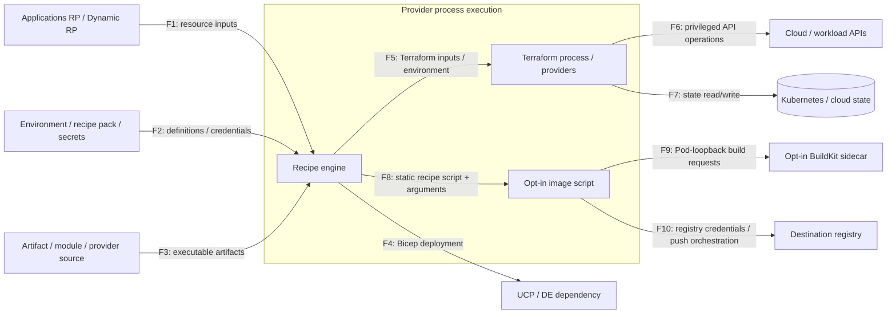

# Radius Recipe Execution Threat Model: v0.62.0

- **Author**: AI-assisted draft; human review pending.
- **Status**: Draft, not a security approval.
- **Baseline**: Radius v0.62.0, commit `37a8cbd33e990886460f4fd1987d6a4fefd901c5`.
- **Related models**: [Applications RP](2026-11-applications-rp-component-threat-model-v0.62.0.md), [Dynamic RP](2026-11-dynamic-rp-component-threat-model-v0.62.0.md), and [UCP](2026-11-ucp-component-threat-model-v0.62.0.md).

## Overview

Recipe execution turns registered infrastructure artifacts and resource parameters into actions under Radius-held identities. A recipe, Terraform provider or build script is executable infrastructure content, not harmless application metadata.

This model covers the shared execution path used by Applications RP and Dynamic RP, including opt-in image builds. It does not create a separate model or internal assessment for DE. Threats are source-based risk scenarios, not demonstrated vulnerabilities.

## Terms and Definitions

| Term               | Definition                                                                |
|--------------------|---------------------------------------------------------------------------|
| OCI                | Registry format used for Bicep artifacts and container images.            |
| Recipe pack        | Registered collection that supplies recipe definitions to an environment. |
| Terraform provider | Executable plugin used by Terraform to operate external APIs.             |
| BuildKit           | Image builder; an optional rootless sidecar in the Dynamic RP Pod.        |
| Target kubeconfig  | Operator-supplied connection file selecting the workload cluster.         |

## System Description

The [engine and drivers][engine] resolve a registered recipe, load environment configuration, and execute Bicep or Terraform. Bicep deployments cross the UCP/DE request boundary. Terraform runs through `terraform-exec`, downloads modules/providers, and writes state through its configured backend.

Assets include cloud/registry credentials, kubeconfigs, module and provider code, inputs/outputs, Terraform state, local files, pushed images, and the authority to create/delete infrastructure. Recipe/type publishers and resource parameter authors are distinct roles.

### Architecture

The [Terraform executor][execute] prepares the process environment and backend settings before fetching modules, then performs init/apply or destroy. It starts with the current process environment and applies configured overrides/secrets. It is not a separate per-tenant container.

The [installer][install] uses a shared Terraform binary and per-execution working directories. Chart startup pre-download is enabled by default and pins Terraform `1.16.5`; a custom download URL can override that source. This replaces the old model's unqualified latest-version download statement, not the need to trust downloaded tools.

The [cluster resolver][cluster] prefers `RADIUS_TARGET_KUBECONFIG`, otherwise the local/control-plane strategy. Invalid injected target configuration is not permission to silently use another cluster. Terraform's default Kubernetes state backend remains a separate control-plane concern.

### Implementation Details

**Is there any use of cryptography?**

Yes. Registry/cloud/Kubernetes clients use their configured transport and credential mechanisms. Kubernetes backend names use SHA-256 with [legacy SHA-1 lookup][backend]. Hashing a state key does not encrypt state. TLS protects transport only where configured and verified; it does not authenticate a recipe publisher or sandbox a module.

**Does the component store secrets?**

Yes. Execution can use cloud credentials, registry credentials, secret references, target kubeconfigs, generated configuration, and state containing sensitive attributes. Backends can include Kubernetes or configured cloud storage. Terraform's `sensitive` marking must not be interpreted as encryption of state.

The [security secret loader][loader] locates backing Kubernetes Secrets from Radius output-resource metadata. [Dynamic RP](2026-11-dynamic-rp-component-threat-model-v0.62.0.md) owns field encryption and managed output-secret rules; they do not erase plaintext from every external state store or process.

**Does the component process untrusted data or does the component parse any custom formats?**

Yes. Recipe references, module source addresses, parameters, downloaded code, provider results, templates, image-build inputs and custom Radius IDs are processed. Approved artifacts can still request broad infrastructure changes.

### Clients

RPs invoke the shared engine. Artifact registries, Terraform sources/providers, cloud APIs, workload clusters and state stores are dependencies. DE is only the external template deployment/callback dependency at the UCP boundary.

## Trust Boundaries

| Boundary                                | Released behavior                                                | Limit                                                             |
|-----------------------------------------|------------------------------------------------------------------|-------------------------------------------------------------------|
| Publisher to registered recipe          | Environment/pack configuration selects executable content.       | Registration is a privileged operation.                           |
| Artifact source to executor             | Modules, Bicep and provider binaries enter a privileged process. | Download transport is not content approval.                       |
| Resource author to execution parameters | Values influence infrastructure actions.                         | Schema validity is not proof of least privilege.                  |
| Executor to cloud/workload API          | Shared service credentials or target kubeconfig are used.        | Author permissions are not automatically delegated.               |
| Executor to state store                 | Resource state and possibly secrets are persisted.               | State needs independent access, integrity and retention controls. |

### Opt-in image build boundary

`dynamicrp.buildkit.enabled=false` by default. When enabled, the [chart][deployment] starts rootless BuildKit on Pod-loopback TCP and shares build tools/state as configured. There is no host Docker socket. Local build contexts can be mounted read-only from an operator-approved PVC.

The [Bicep image hook][imagehook] applies only to `Radius.Compute/containerImages`. It reads a static script from the compiled recipe, constructs command arguments, and runs that script in the Dynamic RP container. Registry and credential Secret settings come from recipe registration, not developer resource overrides. The script can still be malicious if the trusted recipe is malicious.

The sidecar uses Unconfined seccomp/AppArmor profiles, `allowPrivilegeEscalation: true`, and `--oci-worker-no-process-sandbox`. It therefore needs admission settings that permit those choices. Rootless execution and loopback access are useful limits, not per-build tenant isolation.

## Assumptions

Operators approve recipe/pack publishers, tool sources, cloud IAM, state backends, target credentials and registry destinations. Cluster/cloud/registry services are dependencies, not systems evaluated internally here.

Do not assume approved resource authors can safely supply arbitrary recipes, Terraform providers are sandboxed, all downloads use an independently verified digest, or rootless image builds are suitable for mutually untrusted tenants. External target credentials and their refresh lifecycle are operator-managed.

## Data Flows

### Diagram

F1-F3 select executable content and authority. F4 uses the external template-deployment path. F5-F7 run Terraform and persist results. F8-F10 exist only for the image hook; the script coordinates BuildKit and image pushes, and is not constrained by a trust guarantee merely because it uses arguments.

## Threats

### RECIPE-01: A publisher or mutable artifact changes infrastructure behavior

**Description:** A party able to change a selected recipe, module or provider source supplies different executable content at F2/F3.

**Impact:** Arbitrary actions within execution identity permissions, disclosure of accessible secrets, or outage/cost.

**Mitigation:** Restrict registration, approve publishers/revisions, pin artifacts where supported, and constrain IAM/network access.

**Status:** Artifact selection is implemented. Universal signature verification, immutable content selection and publisher approval are not established for all source kinds.

### RECIPE-02: Valid parameters misuse shared infrastructure authority

**Description:** A resource author selects values that cause the approved recipe to act outside the intended resource group, namespace or cloud scope.

**Impact:** Privilege misuse or cross-application resource changes within the executor's actual permissions.

**Mitigation:** Constrain recipe interfaces and deployment identities; validate scopes and keep operator-only parameters out of developer overrides.

**Status:** Parameter/schema handling exists. Image registry settings are explicitly registration-owned, but that is not proof that all parameters in all recipes enforce least privilege.

### RECIPE-03: Executable content reaches process credentials and files

**Description:** A malicious module/provider or image script uses the network, environment or files available to its execution process.

**Impact:** Cloud, Kubernetes or registry credential disclosure and lateral actions.

**Mitigation:** Limit trusted publishers, identities and environment variables; separate untrusted execution and apply egress policy.

**Status:** Terraform is launched as a process and the image script runs in Dynamic RP. Bundled policies do not restrict egress. Per-recipe isolation is not provided by a temporary directory.

### RECIPE-04: State leaks, is replaced, or is lost

**Description:** A state-store reader/writer accesses F7 or an operator loses the backend data required for safe lifecycle operations.

**Impact:** Secret disclosure, unintended destroy/update behavior, orphaned infrastructure, or failed recovery.

**Mitigation:** Scope state credentials, enable appropriate storage encryption/access controls, protect integrity and backups, and test restore.

**Status:** Backend selection and native state mechanisms exist. Backend-name hashing and Terraform-sensitive metadata do not encrypt all state. Whole-cluster or cloud-backend backup is not promised by the [CLI archive](2026-11-cli-component-threat-model-v0.62.0.md).

### RECIPE-05: Target credentials redirect execution

**Description:** A principal able to change the injected kubeconfig or backend configuration redirects F6/F7.

**Impact:** Deployment to an unintended cluster or exposure of state/credentials to an unintended endpoint.

**Mitigation:** Protect target configuration, certificate trust, kubeconfig Secret access and backend IAM; audit target changes.

**Status:** External-target selection is opt-in and fail-closed on invalid injected configuration. It does not authorize the selected cluster for a given resource author.

### RECIPE-06: Image builds cross a stronger trust boundary than expected

**Description:** An approved build source or recipe runs hostile build steps against the shared BuildKit sidecar at F8-F10.

**Impact:** Shared builder interference, resource exhaustion or access to data reachable within that build/process boundary.

**Mitigation:** Keep BuildKit disabled unless needed; approve sources/recipes; separate trust groups; restrict registry identity and local context PVC contents.

**Status:** Rootless builder, loopback endpoint, read-only local contexts and registration-owned registry settings are implemented when configured. Unconfined profiles, privilege escalation and disabled process sandbox remain explicit limitations; no escape was demonstrated.

### RECIPE-07: Concurrent execution exhausts shared capacity

**Description:** Repeated or expensive recipes, provider downloads or image builds consume RP memory, disk, queue slots or infrastructure budget.

**Impact:** Other resource operations are delayed or fail; costs increase.

**Mitigation:** Budget concurrency and resource use, monitor state/queues, and restrict submitters.

**Status:** Worker limits and memory settings exist. BuildKit `maxParallelism` defaults to one worker step, but it is not per-build isolation or a universal memory bound.

### RECIPE-08: Outputs and diagnostics disclose secrets or obscure actions

**Description:** A recipe emits a credential as an ordinary output/error, or shared execution identity prevents attribution to the initiating author.

**Impact:** Secret disclosure and reduced ability to investigate infrastructure changes.

**Mitigation:** Use declared secret outputs/references, review recipe diagnostics, and correlate operation, source revision and cloud audit records.

**Status:** Managed output-secret handling is implemented for opted-in dynamic types. Complete log redaction and end-user attribution across every driver/backend are unverified.

## Open Questions

- Which artifact kinds can operators require to be immutable or signature-verified?
- What execution isolation is required for mutually untrusted publishers or build sources?
- Which state backends and retention/locking policies are supported by each production environment?

## Action Items

1. Operators: approve executable artifacts and separate recipe publishers from resource authors.
2. Operators: scope execution/state/registry identities and keep optional BuildKit off unless its security trade-offs are accepted.
3. Maintainers: evaluate bounded execution, stronger isolation and end-to-end secret-safe diagnostics.

## Review Notes

This new AI-assisted model consolidates recipe risks formerly embedded in Applications RP. Human review is pending. No recipe, Terraform provider, build step or cloud operation was executed during this review.

The source establishes the shared process execution, environment handling, target selection, image-hook restrictions and sidecar settings. An upstream tool's security claims or an operator's hardening policy are not marked active without evidence.

## References

- [Recipe engine/drivers][engine], [Terraform executor][execute], [installer][install], and [Kubernetes state naming][backend].
- [Target cluster resolver][cluster], [secret loader][loader], [container image hook][imagehook], [Dynamic RP deployment][deployment], and [chart defaults][values].

[engine]: https://github.com/radius-project/radius/tree/37a8cbd33e990886460f4fd1987d6a4fefd901c5/pkg/recipes
[execute]: https://github.com/radius-project/radius/blob/37a8cbd33e990886460f4fd1987d6a4fefd901c5/pkg/recipes/terraform/execute.go
[install]: https://github.com/radius-project/radius/blob/37a8cbd33e990886460f4fd1987d6a4fefd901c5/pkg/recipes/terraform/install.go
[backend]: https://github.com/radius-project/radius/blob/37a8cbd33e990886460f4fd1987d6a4fefd901c5/pkg/recipes/terraform/config/backends/kubernetes.go
[cluster]: https://github.com/radius-project/radius/blob/37a8cbd33e990886460f4fd1987d6a4fefd901c5/pkg/recipes/kubernetes/clusteraccess/resolver.go
[loader]: https://github.com/radius-project/radius/blob/37a8cbd33e990886460f4fd1987d6a4fefd901c5/pkg/recipes/configloader/security_secrets.go
[imagehook]: https://github.com/radius-project/radius/blob/37a8cbd33e990886460f4fd1987d6a4fefd901c5/pkg/recipes/driver/bicep/containerimages.go
[deployment]: https://github.com/radius-project/radius/blob/37a8cbd33e990886460f4fd1987d6a4fefd901c5/deploy/Chart/templates/dynamic-rp/deployment.yaml
[values]: https://github.com/radius-project/radius/blob/37a8cbd33e990886460f4fd1987d6a4fefd901c5/deploy/Chart/values.yaml
