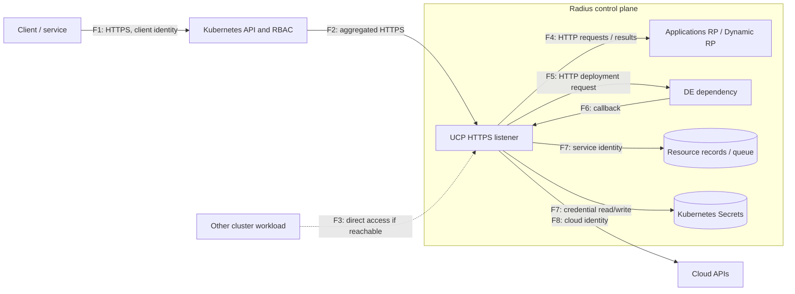

# Radius UCP Component Threat Model: v0.62.0

- **Historical author**: ytimocin.
- **Status**: Draft; security review pending.
- **Baseline**: Radius v0.62.0, commit `37a8cbd33e990886460f4fd1987d6a4fefd901c5`, released 2026-10-27.
- **Prior model**: [November 2024 UCP model](2024-11-ucp-component-threat-model.md). That document and its images remain unchanged.

## Overview

This document provides a threat model for the Radius Universal Control Plane (UCP). It describes the system, its assets, potential threats and recommended mitigations.

Radius supports application portability across platforms and environments. UCP exposes ARM-style resource operations through Radius APIs and routes them to internal providers or the supported Azure and AWS integrations.

UCP routes Radius API requests and uses service identities and cloud credentials to act on a caller's behalf. Protecting the Kubernetes API path alone does not protect direct access to UCP or its downstream services.

The 2024 model described custom provider support as future work. The release includes provider/type registration and routing to Dynamic RP for generic resources. Fine-grained internal authorization is still not implemented by the reserved RBAC mode settings, and chart-configured internal provider connections still use HTTP.

The baseline is the stable release, not current `main`. The scenarios below describe risks, not confirmed exploits. The shared control matrix distinguishes release defaults from settings an operator must supply.

## Terms and Definitions

| Term        | Definition                                                                                       |
|-------------|--------------------------------------------------------------------------------------------------|
| UCP         | Universal Control Plane, hosted by `ucpd`.                                                       |
| RP          | Resource provider that implements resource operations.                                           |
| Aggregation | Kubernetes forwards requests for `api.ucp.dev` to the UCP Service.                               |
| CNI         | Cluster networking implementation; it must support NetworkPolicy for those rules to take effect. |
| DE          | Deployment Engine; an external dependency, not a separate assessment in this model set.          |

## System Description

UCP serves planes, resource groups, provider/type registration, credentials, routing, and cloud adaptation. The released [configuration][config] routes core and portable resources to Applications RP, template deployments to DE, and other resource requests to Dynamic RP.

An example deployment flow:

1. A user runs `rad deploy app.bicep`. The definition includes a Radius environment, an application and a recipe-backed datastore on AWS.
2. The CLI compiles Bicep into an ARM JSON template.
3. Through its configured connection, the CLI sends a PUT to `/planes/radius/local/resourcegroups/{rg}/providers/Microsoft.Resources/deployments/{name}`. In the normal Kubernetes connection, this travels through API aggregation.
4. UCP forwards the template deployment to the Deployment Engine.
5. The Deployment Engine sends requests back through UCP for the environment, application and datastore.
6. UCP routes each request to the relevant provider. Applications RP handles the portable datastore; recipe execution can result in further cloud resource operations.
7. Asynchronous operations are polled until completion. Resource records and operation results are retained in the configured stores.

This example shows UCP's routing and credential boundaries. The Deployment Engine remains an external request/callback dependency; its internals are outside this model.

Assets include provider endpoints and schemas, resource records, pending operations, cloud credentials, and authority to manage cloud infrastructure. Actors include API users, trusted operators, internal services, other cluster workloads, and cloud or registry administrators.

### Architecture

UCP consists of the following shared components:

- **Storage Provider:** Stores resource records, routing/configuration state and operation data. The [released factory][storefactory] supports API-server storage, PostgreSQL and in-memory storage. API-server storage is the chart default. PostgreSQL is optional; in-memory storage is not durable. The 2024 list of Cosmos DB and direct etcd implementations does not describe the current factory.
- **Secret Provider:** Stores credentials separately from ordinary resource metadata. The [released factory][secretfactory] supports Kubernetes Secrets and in-memory secrets. The chart selects Kubernetes Secrets. This provider does not make arbitrary resource properties encrypted.
- **Queue Provider:** Adds asynchronous operations to a queue for later processing. The [released factory][queuefactory] supports API-server and in-memory queues. API-server queues are the chart default. Queue write access can influence work performed by a privileged service.
- **Worker:** Retrieves queued operations and invokes the appropriate handlers. Operation records allow callers to query progress and results without holding the original HTTP request open.
- **Frontend and routing:** Serves plane, resource-group, provider/type and credential APIs, then forwards resource operations to the configured provider or cloud integration.

The `ucp` [Service][service] exposes port `443` and forwards to UCP's HTTPS listener on Pod port `9443`. The API path starts with `/apis/api.ucp.dev/v1alpha3`. Its [APIService configuration][apiservice] supplies a CA bundle. The [server][server] adds request context, logs and tracing but does not check each user's or component's permissions.

Outbound provider URLs in the chart use HTTP. Requests to Kubernetes and cloud APIs use their respective client identities and transport settings.

| Endpoint | Released setting                   | Intended access to verify at installation                                            |
|----------|------------------------------------|--------------------------------------------------------------------------------------|
| UCP API  | Service `443` to Pod `9443`, HTTPS | Kubernetes API aggregation and required Radius peers; deny untrusted direct callers. |
| Metrics  | Pod `9090`, HTTP `/metrics`        | Approved collectors only.                                                            |
| Profiler | Pod `6060`, HTTP profiler listener | Restricted operator diagnostics; deny untrusted workloads.                           |

The [configuration][config] enables metrics and profiling. The [profiler service][profiler] binds to all interfaces on its configured port. The UCP Service exposes only the API port; that does not prevent direct Pod access to the other listeners.

### Implementation Details

#### UCP Container runs as Non-Root

The [UCP image][image] sets `USER 65532:65532`. Running as a non-root user limits some effects of a process compromise, but does not reduce the Kubernetes or cloud API permissions granted to its credentials. Operators must also review the rendered Pod security settings and injected volumes.

#### Use of Cryptography

The original model identified four uses of cryptography in the shared components. Their released behavior is:

1. **Queue message keys:** The [API-server queue][queueclient] reads 16 random bytes with Go's `crypto/rand` and combines them with queue name and time. This produces message identifiers; it does not authenticate a queue writer.
2. **Data-store resource names:** The [API-server store][storeclient] hashes normalized resource IDs with SHA-256 for new names, truncated to 40 hexadecimal characters. Legacy SHA-1 lookup remains for existing records, including updating them without duplicating state.
3. **Tracked-resource names:** The [tracked-resource naming helper][trackednames] combines a resource-name prefix with a truncated SHA-256 suffix. Legacy SHA-1 helpers locate older tracking entries.
4. **ETags:** The [ETag helper][etags] generates content-based tags with SHA-256. A separate revision helper encodes a backend revision. These values support resource versioning, not caller authentication or secret protection.

The [hash helpers][hashes] retain SHA-1 only for compatibility paths; the old blanket statement that current naming uses SHA-1 no longer applies. None of these naming hashes encrypts stored data.

The chart generates and stores a UCP server certificate and key for HTTPS aggregation. Cloud and Kubernetes clients use their configured transport and credential mechanisms. [Dynamic RP sensitive-field encryption](2026-11-dynamic-rp-component-threat-model-v0.62.0.md) covers a separate set of marked fields, not the whole UCP database.

#### Storage of Secrets

Creating or updating a cloud credential can write its sensitive value through the secret provider. [Azure registration][credentials] stores the credential and clears the client secret from its ordinary resource representation. [AWS registration][awscredentials] similarly clears the secret access key before storing credential metadata. The [Azure][azuredelete] and [AWS][awsdelete] delete handlers remove stored credentials when the credential resource is deleted.

The default provider stores these values in Kubernetes Secrets. A principal with sufficient Secret access can still read them. The 2024 claim that credentials cannot be updated through API calls was incorrect: create/update handlers accept registration changes, while secret values are kept separate from normal metadata.

Azure workload identity and AWS IRSA are supported alternatives to long-lived credentials; their chart switches are disabled by default. Operators must protect both the configured identity's permissions and any stored credential material. Storage encryption, backup protection and optional database transport remain separate responsibilities.

#### Data Serialization / Formats

Radius resource IDs use a custom string format and a shared parser. API versions, JSON bodies, registered schemas/endpoints and cloud responses also cross this boundary. Standard JSON/client libraries handle their respective formats, but valid data can still request an operation outside the submitter's intended scope.

Storage, secret and queue providers are selected by the configured factories. Different backends change storage, credential and recovery boundaries; selecting PostgreSQL does not move Kubernetes-backed Secrets or automatically encrypt the connection.

### Clients

1. **Radius components:** `rad`, Dashboard, controllers, Applications RP, Dynamic RP and Deployment Engine callbacks use UCP APIs. Some clients use Kubernetes aggregation; internal service connections must be assessed separately.
2. **Health Check Probes:** Kubernetes calls the UCP process's health/readiness endpoints.
3. **Metrics Scrapers and Diagnostic Clients:** Collectors use the enabled metrics endpoint, and approved operators may use profiling. Network access to these listeners is not user-level permission to submit Radius operations.

## Trust Boundaries

### Trust Model of UCP Clients

UCP is a [Kubernetes aggregated API service](https://kubernetes.io/docs/concepts/extend-kubernetes/api-extension/apiserver-aggregation/). Requests under `/apis/api.ucp.dev/v1alpha3` travel through the Kubernetes API server, where Kubernetes authenticates and authorizes the caller before forwarding them.

That protection applies to the aggregated path. A client that can reach the UCP Service or Pod directly takes a different path. The listener and reserved authorization settings do not supply the same per-user checks.

### Trust Model of Internal Resource Providers

UCP routes requests to Applications RP, Dynamic RP and the Deployment Engine using the configured internal endpoints. Those chart endpoints use HTTP and do not establish an authenticated service-to-service boundary. Payloads can include sensitive resource inputs, so configuration changes or network interception can disclose more than metadata.

Operators must restrict who can change provider registrations, routing state, service configuration and discovery. An `AnonymousCredential` in an SDK client does not by itself describe every transport layer; the endpoint, connection configuration and API entry path determine the actual checks.

### Trust Model of External Resource Managers (Azure and AWS)

UCP uses the user's registered or federated cloud credentials to call the supported Azure and AWS APIs. Those services authenticate and authorize the selected identity over their configured HTTPS client transports. A user's narrower Kubernetes privileges are not automatically delegated as cloud IAM restrictions.

The model treats the cloud control planes as trusted dependencies, not systems evaluated here. Operators remain responsible for the permissions and lifecycle of Radius's cloud identities.

### Boundary summary

| Boundary                    | Released behavior                                               | Residual limitation                                                                    |
|-----------------------------|-----------------------------------------------------------------|----------------------------------------------------------------------------------------|
| Client to Kubernetes API    | Kubernetes authentication and authorization apply on this path. | Grants to `api.ucp.dev` can carry broad Radius authority.                              |
| API server to UCP           | Server TLS and APIService CA bundle are configured.             | This is not a mutual authentication or per-request authorization claim.                |
| Cluster workload to UCP/RPs | Direct Services/Pod networking can be reachable.                | Aggregation is not a network barrier.                                                  |
| UCP to RPs/DE               | Chart endpoints use HTTP.                                       | No default authenticated, encrypted internal channel is established by these settings. |
| UCP to stores/cloud         | Service credentials and selected provider clients are used.     | Store and IAM permissions bound the resulting authority.                               |

Namespaces group resources; they do not by themselves deny traffic. A managed Kubernetes API server need not run as a Pod in `kube-system`.

### Shared default-control matrix

| Control                            | State in v0.62.0                           | Evidence or condition                                                                                                                    |
|------------------------------------|--------------------------------------------|------------------------------------------------------------------------------------------------------------------------------------------|
| UCP server TLS                     | Default                                    | [APIService][apiservice] and [server][server].                                                                                           |
| Internal authorization             | Proposed enforcement, not a released check | [Chart values][values] reserve `global.rbac`; services log the mode. Helpers in `pkg/authz` do not establish checks at API entry points. |
| Namespace ingress policies         | Opt-in                                     | `networkPolicies.enabled=false`; an enforcing CNI and control-plane CIDRs are required.                                                  |
| Same-namespace isolation           | Not provided by bundled policies           | [Policies][network] allow traffic from the whole release namespace, not just named service accounts.                                     |
| Egress restriction                 | Operator responsibility                    | Bundled policies restrict ingress only.                                                                                                  |
| At-rest protection for all Secrets | Operator responsibility                    | Kubernetes Secret encoding is not encryption at rest.                                                                                    |
| Cloud federation                   | Opt-in                                     | Azure workload identity and AWS IRSA switches default to false.                                                                          |
| Metrics/profiling exposure         | Enabled in service configuration           | Pod ports `9090` and `6060`; operators must restrict collectors and diagnostic users.                                                    |
| PostgreSQL                         | Opt-in                                     | `database.enabled=false`; chart database URLs use `sslmode=disable` when selected.                                                       |

### Model coverage

| Owner                                                                        | Scope                                                                               |
|------------------------------------------------------------------------------|-------------------------------------------------------------------------------------|
| This UCP model                                                               | Shared ingress, routing, live stores, cloud adapters, network and control defaults. |
| [Applications RP](2026-11-applications-rp-component-threat-model-v0.62.0.md) | Core/portable providers, rendered workloads, gateways and identities.               |
| [Controller](2026-11-controller-component-threat-model-v0.62.0.md)           | Kubernetes reconciliation and Flux sources.                                         |
| [Dashboard](2026-11-dashboard-component-threat-model-v0.62.0.md)             | Browser, Backstage and its shared Kubernetes identity.                              |
| [Dynamic RP](2026-11-dynamic-rp-component-threat-model-v0.62.0.md)           | Generic types, validation, sensitive fields and managed secret outputs.             |
| [Recipe execution](2026-11-recipe-execution-threat-model-v0.62.0.md)         | Executable artifacts, Terraform, image builds and state.                            |
| [CLI](2026-11-cli-component-threat-model-v0.62.0.md)                         | Workstation, install/upgrade, static graphs and durable archives.                   |

DE is covered only as an external request/callback dependency. No DE threat model or internal DE assessment is included.

## Assumptions

This threat model assumes that:

1. The Radius installation has not been tampered with. Trusted operators select approved images and protect configuration.
2. The Kubernetes control plane is not compromised.
3. Kubernetes authenticates and authorizes requests made through its API. Radius cannot prevent actions taken by a cluster administrator.
4. The selected resource datastore is protected from unauthorized reads and writes.
5. The selected secret provider and its backing credentials are protected.
6. The queue is protected from unauthorized insertion, modification or deletion of operations.
7. External cloud control planes are not compromised and enforce their own identity and authorization models.

Other cluster workloads and ordinary Radius users are not trusted as operators. Operators must check CNI policy enforcement, audit collection, ingress TLS and storage encryption. A compromised cluster administrator is outside the prevention boundary; access to an ordinary workload namespace is a lower-privilege threat.

## Data Flows

### Diagram

F1-F2 are the normal aggregated path. F3 is a distinct network entry point and must not inherit F1's authorization assumptions. F4-F6 carry resource payloads and operation data. F7 stores state and retrieves credentials. F8 converts Radius authority into cloud actions.

1. **The user deploys a template:** `rad deploy app.bicep` compiles the file to ARM JSON and submits it using the configured connection. Normal Kubernetes connections use the aggregated API path.
2. **UCP forwards the template:** The deployment request goes to the configured Deployment Engine endpoint.
3. **Resource requests return through UCP:** The Deployment Engine calls UCP for individual resource operations and later polls their status/results.
4. **UCP selects a provider:** Core/portable operations go to Applications RP, generic resource operations go to Dynamic RP, and supported cloud operations use their provider integrations.
5. **State and credentials are accessed:** Handlers and workers read or update resource/operation records and retrieve cloud credentials through the secret provider. Asynchronous work uses the configured queue.
6. **Results return to callers:** Providers report resource and operation state through UCP. Internal service identities and downstream cloud identities can differ from the original user's identity.

## Threats

### UCP-01: A reachable client bypasses the intended API entry path

**Description:** A workload with network access sends requests directly to UCP or an RP instead of using F1-F2.

**Impact:** The workload could invoke resource operations under Radius service authority without the Kubernetes API checks expected by the operator.

**Mitigation:** Restrict control-plane ingress and access to the release namespace. Use the bundled NetworkPolicies with an enforcing CNI for namespace-level restrictions. For tighter same-namespace isolation, replace the broad internal allow with operator-managed rules.

**Status:** Policies are opt-in. Namespace and network access controls are operator duties. Internal authorization switches are reserved, not an active mitigation.

### UCP-02: Provider or plane configuration redirects privileged requests

**Description:** A principal able to change provider registration, routing state, or service configuration points F4-F5 at an unintended endpoint.

**Impact:** Resource payload disclosure, altered results, service outage, or actions under Radius-held cloud credentials.

**Mitigation:** Restrict registration and store/configuration writes to trusted operators. Review endpoint changes and protect service discovery. Authenticated internal channels remain a proposed defense.

**Status:** Kubernetes grants can restrict configuration writes. The grants applied by a particular installation were not checked. Sensitive request payloads increase the impact of redirection; they offer no protection.

### UCP-03: Internal traffic is read or changed

**Description:** An actor able to observe or alter the network path for F4-F5 reads or modifies HTTP traffic.

**Impact:** Disclosure of deployment inputs and unauthorized or failed resource operations.

**Mitigation:** Prevent access to privileged networking and configure ingress restrictions. Add authenticated encryption to internal channels as future work.

**Status:** HTTP provider endpoints are the default. Network restrictions are optional and do not provide transport encryption. Packet capture does not necessarily require write access to `radius-system`.

### UCP-04: Store or credential access exposes authority beyond one application

**Description:** A principal with access to F7 reads cloud credentials or changes resource/queue data used by workers.

**Impact:** Cloud resource misuse, secret disclosure, unexpected operations, or loss of control-plane availability.

**Mitigation:** Limit Secret, record, and queue access; restrict cloud IAM; prefer federation where appropriate; protect backups and database transport.

**Status:** Secret-provider separation is implemented. IAM, Kubernetes grants and storage encryption are operator duties. Optional PostgreSQL transport is not encrypted by the default chart URL.

### UCP-05: Broad API access becomes broad cloud access

**Description:** A user granted Radius API access submits operations that exceed the authority the operator intended for that user.

**Impact:** Resource creation, deletion, or cost under a shared cloud identity.

**Mitigation:** Treat broad Radius API access as privileged. Separate trust groups and installations where needed, constrain cloud identities, and review recipe/provider changes.

**Status:** Operator controls are required. The presence of authorization mode and decision types does not implement resource-level permission checks.

### UCP-06: Expensive requests or auxiliary endpoints exhaust or disclose state

**Description:** A reachable client repeats list/deploy/poll requests or queries profiling/metrics surfaces.

**Impact:** CPU/memory or queue pressure, delayed operations, and operational information disclosure.

**Mitigation:** Restrict Pod ports `9443`, `9090` and `6060` to the callers listed above. For bundled ingress rules, set `networkPolicies.enabled` and `networkPolicies.controlPlaneCIDRs` with an enforcing CNI. Use an operator-managed policy set for narrower peer/collector access; it must replace the broad same-namespace allow, since additional allow rules cannot remove that access. Per-user API throttling would require a separate control.

**Status:** Bundled policies are off by default. When enabled they allow the entire release namespace, not just approved collectors or operators. UCP's chart memory limit is `300Mi`; it is not a request quota. This review did not audit every route for throttling or test an installation's listener access.

### UCP-07: Shared service identities weaken attribution

**Description:** An operator cannot reliably connect F4-F8 actions to the original user when internal services act with their own credentials.

**Impact:** Investigation and detection of misuse become harder.

**Mitigation:** Correlate Radius request logs with Kubernetes audit and cloud activity records. Avoid logging sensitive bodies.

**Status:** UCP emits logs/traces. Whether external audit records retain the original user and how long those records survive were not checked in a running installation.

## Open Questions

- What network and Kubernetes grants does each supported production installation actually apply?
- Which audit records preserve caller identity across service and cloud operations?
- How should future authorization checks distinguish users, internal services, and operator-owned registrations?

## Action Items

| Owner       | Follow-up and completion criteria                                                                                                                                                                               | Tracking  |
|-------------|-----------------------------------------------------------------------------------------------------------------------------------------------------------------------------------------------------------------|-----------|
| Operators   | Record allowed sources for API `9443`, metrics `9090` and profiler `6060`, plus Secret and cloud IAM grants. Test allowed and denied sources, including same-namespace callers, against the installed policies. | Untracked |
| Maintainers | Define user and service identities and permission checks at each API entry path. Complete when tests reject an unauthorized direct caller and preserve authorized aggregated/internal calls.                    | Untracked |
| Maintainers | Select authenticated internal transport and optional database TLS settings. Add tests that reject an untrusted peer or server certificate and verify successful calls with the intended trust roots.            | Untracked |

These follow-ups propose work; they do not record completed controls. Their completion criteria have not been linked to current tracking issues.

The original model linked [#8080](https://github.com/radius-project/radius/pull/8080) for least-privilege work and [#8083](https://github.com/radius-project/radius/issues/8083) for authenticated internal communication. These remain historical references; their existence does not establish that the released API paths enforce those controls.

## Review Notes

Review covers the cited release source and published metadata. Security review is pending. No live infrastructure or exploit tests were run. Installation-specific access and audit checks remain open.

The original model records reviews on 5 and 15 November 2024. Those dates describe the original document, not approval of this versioned update.

The old spoofed-provider threat is retained as UCP-02. Secret disclosure is retained as UCP-04. Unauthenticated communication is split into direct-entry and transport risks, UCP-01/UCP-03. Old RBAC and secure-channel action items remain open where the release lacks checks; the new optional NetworkPolicies are no longer described as wholly absent. Unsupported old datastore listings are replaced with the current factories.

The [release lock][lock] records the core image source SHA; the [release manifest][manifest] records chart and app version `0.62.0`. These records are source/provenance evidence, not proof of any installation's settings.

## References

- [Release v0.62.0](https://github.com/radius-project/radius/releases/tag/v0.62.0).
- [UCP configuration][config], [APIService TLS][apiservice], [HTTP server][server], and [chart defaults][values].
- [NetworkPolicies][network], [storage provider factory][providers], [credential registration][credentials], and [hash helpers][hashes].
- [Storage implementations][storefactory], [secret implementations][secretfactory], [queue implementations][queuefactory], and [non-root image][image].
- [Queue identifiers][queueclient], [API-server record names][storeclient], [tracked-resource names][trackednames], [ETags][etags], and [AWS credential registration][awscredentials].

[config]: https://github.com/radius-project/radius/blob/37a8cbd33e990886460f4fd1987d6a4fefd901c5/deploy/Chart/templates/ucp/configmaps.yaml
[apiservice]: https://github.com/radius-project/radius/blob/37a8cbd33e990886460f4fd1987d6a4fefd901c5/deploy/Chart/templates/ucp/apiservice.yaml
[server]: https://github.com/radius-project/radius/blob/37a8cbd33e990886460f4fd1987d6a4fefd901c5/pkg/ucp/frontend/api/server.go
[service]: https://github.com/radius-project/radius/blob/37a8cbd33e990886460f4fd1987d6a4fefd901c5/deploy/Chart/templates/ucp/service.yaml
[profiler]: https://github.com/radius-project/radius/blob/37a8cbd33e990886460f4fd1987d6a4fefd901c5/pkg/components/profiler/profilerservice/service.go
[values]: https://github.com/radius-project/radius/blob/37a8cbd33e990886460f4fd1987d6a4fefd901c5/deploy/Chart/values.yaml
[network]: https://github.com/radius-project/radius/blob/37a8cbd33e990886460f4fd1987d6a4fefd901c5/deploy/Chart/templates/networkpolicies.yaml
[providers]: https://github.com/radius-project/radius/blob/37a8cbd33e990886460f4fd1987d6a4fefd901c5/pkg/components/database/databaseprovider/storageprovider.go
[credentials]: https://github.com/radius-project/radius/blob/37a8cbd33e990886460f4fd1987d6a4fefd901c5/pkg/ucp/frontend/controller/credentials/azure/createorupdateazurecredential.go
[hashes]: https://github.com/radius-project/radius/tree/37a8cbd33e990886460f4fd1987d6a4fefd901c5/pkg/hashutil
[lock]: https://github.com/radius-project/radius/releases/download/v0.62.0/core-release-lock.json
[manifest]: https://github.com/radius-project/radius/releases/download/v0.62.0/release-manifest.json
[storefactory]: https://github.com/radius-project/radius/blob/37a8cbd33e990886460f4fd1987d6a4fefd901c5/pkg/components/database/databaseprovider/factory.go
[secretfactory]: https://github.com/radius-project/radius/blob/37a8cbd33e990886460f4fd1987d6a4fefd901c5/pkg/components/secret/secretprovider/factory.go
[queuefactory]: https://github.com/radius-project/radius/blob/37a8cbd33e990886460f4fd1987d6a4fefd901c5/pkg/components/queue/queueprovider/factory.go
[image]: https://github.com/radius-project/radius/blob/37a8cbd33e990886460f4fd1987d6a4fefd901c5/deploy/images/ucpd/Dockerfile
[queueclient]: https://github.com/radius-project/radius/blob/37a8cbd33e990886460f4fd1987d6a4fefd901c5/pkg/components/queue/apiserver/client.go
[storeclient]: https://github.com/radius-project/radius/blob/37a8cbd33e990886460f4fd1987d6a4fefd901c5/pkg/components/database/apiserverstore/apiserverclient.go
[trackednames]: https://github.com/radius-project/radius/blob/37a8cbd33e990886460f4fd1987d6a4fefd901c5/pkg/ucp/trackedresource/name.go
[etags]: https://github.com/radius-project/radius/blob/37a8cbd33e990886460f4fd1987d6a4fefd901c5/pkg/ucp/util/etag/etag.go
[awscredentials]: https://github.com/radius-project/radius/blob/37a8cbd33e990886460f4fd1987d6a4fefd901c5/pkg/ucp/frontend/controller/credentials/aws/createorupdateawscredential.go
[azuredelete]: https://github.com/radius-project/radius/blob/37a8cbd33e990886460f4fd1987d6a4fefd901c5/pkg/ucp/frontend/controller/credentials/azure/deleteazurecredential.go
[awsdelete]: https://github.com/radius-project/radius/blob/37a8cbd33e990886460f4fd1987d6a4fefd901c5/pkg/ucp/frontend/controller/credentials/aws/deleteawscredential.go
