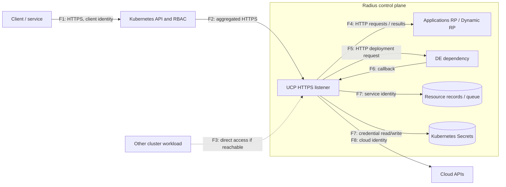

# Radius UCP Component Threat Model: v0.62.0

- **Historical author**: ytimocin.
- **Status**: Draft; security review pending.
- **Baseline**: Radius v0.62.0, commit `37a8cbd33e990886460f4fd1987d6a4fefd901c5`, released 2026-10-27.
- **Prior model**: [November 2024 UCP model](2024-11-ucp-component-threat-model.md). That document and its images remain unchanged.

## Overview

UCP routes Radius API requests and uses service identities and cloud credentials to act on a caller's behalf. Protecting the Kubernetes API path alone does not protect direct access to UCP or its downstream services.

The baseline is the stable release, not current `main`. The scenarios below describe risks, not confirmed exploits. The shared control matrix distinguishes release defaults from settings an operator must supply.

## Terms and Definitions

| Term        | Definition                                                                                       |
|-------------|--------------------------------------------------------------------------------------------------|
| UCP         | Universal Control Plane, hosted by `ucpd`.                                                       |
| RP          | Resource provider that implements resource operations.                                           |
| Aggregation | Kubernetes forwards requests for `api.ucp.dev` to the UCP Service.                               |
| CNI         | Cluster networking implementation; it must support NetworkPolicy for those rules to take effect. |
| DE          | Deployment Engine; an external dependency, not a separate assessment in this model set.          |

## System Description

UCP serves planes, resource groups, provider/type registration, credentials, routing, and cloud adaptation. The released [configuration][config] routes core and portable resources to Applications RP, template deployments to DE, and other resource requests to Dynamic RP.

Assets include provider endpoints and schemas, resource records, pending operations, cloud credentials, and authority to manage cloud infrastructure. Actors include API users, trusted operators, internal services, other cluster workloads, and cloud or registry administrators.

### Architecture

The `ucp` [Service][service] exposes port `443` and forwards to UCP's HTTPS listener on Pod port `9443`. The API path starts with `/apis/api.ucp.dev/v1alpha3`. Its [APIService configuration][apiservice] supplies a CA bundle. The [server][server] adds request context, logs and tracing but does not check each user's or component's permissions.

Outbound provider URLs in the chart use HTTP. Requests to Kubernetes and cloud APIs use their respective client identities and transport settings.

| Endpoint | Released setting                   | Intended access to verify at installation                                            |
|----------|------------------------------------|--------------------------------------------------------------------------------------|
| UCP API  | Service `443` to Pod `9443`, HTTPS | Kubernetes API aggregation and required Radius peers; deny untrusted direct callers. |
| Metrics  | Pod `9090`, HTTP `/metrics`        | Approved collectors only.                                                            |
| Profiler | Pod `6060`, HTTP profiler listener | Restricted operator diagnostics; deny untrusted workloads.                           |

The [configuration][config] enables metrics and profiling. The [profiler service][profiler] binds to all interfaces on its configured port. The UCP Service exposes only the API port; that does not prevent direct Pod access to the other listeners.

### Implementation Details

**Is there any use of cryptography?**

Yes. The chart generates and stores a UCP server certificate and key. Queue message generation uses random bytes. New identifiers and ETags use SHA-256 helpers; [legacy SHA-1 helpers][hashes] remain for compatibility lookups. These hashes are not permissions checks. [Sensitive-field encryption](2026-11-dynamic-rp-component-threat-model-v0.62.0.md) does not encrypt the whole UCP database.

**Does the component store secrets?**

Yes. The default secret provider uses Kubernetes Secrets. For example, [Azure credential registration][credentials] writes the credential through the secret client and clears the client secret from the resource representation. This does not prevent a principal with sufficient Kubernetes Secret access from reading it. Workload identity and AWS IRSA are supported options; their chart switches are disabled by default.

**Does the component process untrusted data or does the component parse any custom formats?**

Yes. Resource IDs, API versions, JSON bodies, registered schemas/endpoints, and cloud responses cross this boundary. Radius resource IDs have a custom parser. Storage, secret, and queue providers are selected by [provider factories][providers]; the current default is API-server records/queues and Kubernetes Secrets. PostgreSQL is optional, not the default.

### Clients

Clients include `rad`, Dashboard, controllers, RPs, and DE callbacks. Kubernetes probes and enabled metrics/profiling endpoints are additional callers or surfaces, not evidence that an API caller has user-level permission.

## Trust Boundaries

| Boundary                    | Released behavior                                               | Residual limitation                                                                    |
|-----------------------------|-----------------------------------------------------------------|----------------------------------------------------------------------------------------|
| Client to Kubernetes API    | Kubernetes authentication and authorization apply on this path. | Grants to `api.ucp.dev` can carry broad Radius authority.                              |
| API server to UCP           | Server TLS and APIService CA bundle are configured.             | This is not a mutual authentication or per-request authorization claim.                |
| Cluster workload to UCP/RPs | Direct Services/Pod networking can be reachable.                | Aggregation is not a network barrier.                                                  |
| UCP to RPs/DE               | Chart endpoints use HTTP.                                       | No default authenticated, encrypted internal channel is established by these settings. |
| UCP to stores/cloud         | Service credentials and selected provider clients are used.     | Store and IAM permissions bound the resulting authority.                               |

Namespaces group resources; they do not by themselves deny traffic. A managed Kubernetes API server need not run as a Pod in `kube-system`.

### Shared default-control matrix

| Control                            | State in v0.62.0                           | Evidence or condition                                                                                                                    |
|------------------------------------|--------------------------------------------|------------------------------------------------------------------------------------------------------------------------------------------|
| UCP server TLS                     | Default                                    | [APIService][apiservice] and [server][server].                                                                                           |
| Internal authorization             | Proposed enforcement, not a released check | [Chart values][values] reserve `global.rbac`; services log the mode. Helpers in `pkg/authz` do not establish checks at API entry points. |
| Namespace ingress policies         | Opt-in                                     | `networkPolicies.enabled=false`; an enforcing CNI and control-plane CIDRs are required.                                                  |
| Same-namespace isolation           | Not provided by bundled policies           | [Policies][network] allow traffic from the whole release namespace, not just named service accounts.                                     |
| Egress restriction                 | Operator responsibility                    | Bundled policies restrict ingress only.                                                                                                  |
| At-rest protection for all Secrets | Operator responsibility                    | Kubernetes Secret encoding is not encryption at rest.                                                                                    |
| Cloud federation                   | Opt-in                                     | Azure workload identity and AWS IRSA switches default to false.                                                                          |
| Metrics/profiling exposure         | Enabled in service configuration           | Pod ports `9090` and `6060`; operators must restrict collectors and diagnostic users.                                                    |
| PostgreSQL                         | Opt-in                                     | `database.enabled=false`; chart database URLs use `sslmode=disable` when selected.                                                       |

### Model coverage

| Owner                                                                        | Scope                                                                               |
|------------------------------------------------------------------------------|-------------------------------------------------------------------------------------|
| This UCP model                                                               | Shared ingress, routing, live stores, cloud adapters, network and control defaults. |
| [Applications RP](2026-11-applications-rp-component-threat-model-v0.62.0.md) | Core/portable providers, rendered workloads, gateways and identities.               |
| [Controller](2026-11-controller-component-threat-model-v0.62.0.md)           | Kubernetes reconciliation and Flux sources.                                         |
| [Dashboard](2026-11-dashboard-component-threat-model-v0.62.0.md)             | Browser, Backstage and its shared Kubernetes identity.                              |
| [Dynamic RP](2026-11-dynamic-rp-component-threat-model-v0.62.0.md)           | Generic types, validation, sensitive fields and managed secret outputs.             |
| [Recipe execution](2026-11-recipe-execution-threat-model-v0.62.0.md)         | Executable artifacts, Terraform, image builds and state.                            |
| [CLI](2026-11-cli-component-threat-model-v0.62.0.md)                         | Workstation, install/upgrade, static graphs and durable archives.                   |

DE is covered only as an external request/callback dependency. No DE threat model or internal DE assessment is included.

## Assumptions

Cluster administrators and Radius operators are trusted to install approved code and protect control-plane configuration. Kubernetes and cloud control planes are external trust anchors, not systems evaluated here.

Other cluster workloads and ordinary Radius users are not trusted as operators. Operators must check CNI policy enforcement, audit collection, ingress TLS and storage encryption. A compromised cluster administrator is outside the prevention boundary; access to an ordinary workload namespace is a lower-privilege threat.

## Data Flows

### Diagram

F1-F2 are the normal aggregated path. F3 is a distinct network entry point and must not inherit F1's authorization assumptions. F4-F6 carry resource payloads and operation data. F7 stores state and retrieves credentials. F8 converts Radius authority into cloud actions.

## Threats

### UCP-01: A reachable client bypasses the intended API entry path

**Description:** A workload with network access sends requests directly to UCP or an RP instead of using F1-F2.

**Impact:** The workload could invoke resource operations under Radius service authority without the Kubernetes API checks expected by the operator.

**Mitigation:** Restrict control-plane ingress and access to the release namespace. Use the bundled NetworkPolicies with an enforcing CNI for namespace-level restrictions. For tighter same-namespace isolation, replace the broad internal allow with operator-managed rules.

**Status:** Policies are opt-in. Namespace and network access controls are operator duties. Internal authorization switches are reserved, not an active mitigation.

### UCP-02: Provider or plane configuration redirects privileged requests

**Description:** A principal able to change provider registration, routing state, or service configuration points F4-F5 at an unintended endpoint.

**Impact:** Resource payload disclosure, altered results, service outage, or actions under Radius-held cloud credentials.

**Mitigation:** Restrict registration and store/configuration writes to trusted operators. Review endpoint changes and protect service discovery. Authenticated internal channels remain a proposed defense.

**Status:** Kubernetes grants can restrict configuration writes. The grants applied by a particular installation were not checked. Sensitive request payloads increase the impact of redirection; they offer no protection.

### UCP-03: Internal traffic is read or changed

**Description:** An actor able to observe or alter the network path for F4-F5 reads or modifies HTTP traffic.

**Impact:** Disclosure of deployment inputs and unauthorized or failed resource operations.

**Mitigation:** Prevent access to privileged networking and configure ingress restrictions. Add authenticated encryption to internal channels as future work.

**Status:** HTTP provider endpoints are the default. Network restrictions are optional and do not provide transport encryption. Packet capture does not necessarily require write access to `radius-system`.

### UCP-04: Store or credential access exposes authority beyond one application

**Description:** A principal with access to F7 reads cloud credentials or changes resource/queue data used by workers.

**Impact:** Cloud resource misuse, secret disclosure, unexpected operations, or loss of control-plane availability.

**Mitigation:** Limit Secret, record, and queue access; restrict cloud IAM; prefer federation where appropriate; protect backups and database transport.

**Status:** Secret-provider separation is implemented. IAM, Kubernetes grants and storage encryption are operator duties. Optional PostgreSQL transport is not encrypted by the default chart URL.

### UCP-05: Broad API access becomes broad cloud access

**Description:** A user granted Radius API access submits operations that exceed the authority the operator intended for that user.

**Impact:** Resource creation, deletion, or cost under a shared cloud identity.

**Mitigation:** Treat broad Radius API access as privileged. Separate trust groups and installations where needed, constrain cloud identities, and review recipe/provider changes.

**Status:** Operator controls are required. The presence of authorization mode and decision types does not implement resource-level permission checks.

### UCP-06: Expensive requests or auxiliary endpoints exhaust or disclose state

**Description:** A reachable client repeats list/deploy/poll requests or queries profiling/metrics surfaces.

**Impact:** CPU/memory or queue pressure, delayed operations, and operational information disclosure.

**Mitigation:** Restrict Pod ports `9443`, `9090` and `6060` to the callers listed above. For bundled ingress rules, set `networkPolicies.enabled` and `networkPolicies.controlPlaneCIDRs` with an enforcing CNI. Use an operator-managed policy set for narrower peer/collector access; it must replace the broad same-namespace allow, since additional allow rules cannot remove that access. Per-user API throttling would require a separate control.

**Status:** Bundled policies are off by default. When enabled they allow the entire release namespace, not just approved collectors or operators. UCP's chart memory limit is `300Mi`; it is not a request quota. This review did not audit every route for throttling or test an installation's listener access.

### UCP-07: Shared service identities weaken attribution

**Description:** An operator cannot reliably connect F4-F8 actions to the original user when internal services act with their own credentials.

**Impact:** Investigation and detection of misuse become harder.

**Mitigation:** Correlate Radius request logs with Kubernetes audit and cloud activity records. Avoid logging sensitive bodies.

**Status:** UCP emits logs/traces. Whether external audit records retain the original user and how long those records survive were not checked in a running installation.

## Open Questions

- What network and Kubernetes grants does each supported production installation actually apply?
- Which audit records preserve caller identity across service and cloud operations?
- How should future authorization checks distinguish users, internal services, and operator-owned registrations?

## Action Items

| Owner       | Follow-up and completion criteria                                                                                                                                                                               | Tracking  |
|-------------|-----------------------------------------------------------------------------------------------------------------------------------------------------------------------------------------------------------------|-----------|
| Operators   | Record allowed sources for API `9443`, metrics `9090` and profiler `6060`, plus Secret and cloud IAM grants. Test allowed and denied sources, including same-namespace callers, against the installed policies. | Untracked |
| Maintainers | Define user and service identities and permission checks at each API entry path. Complete when tests reject an unauthorized direct caller and preserve authorized aggregated/internal calls.                    | Untracked |
| Maintainers | Select authenticated internal transport and optional database TLS settings. Add tests that reject an untrusted peer or server certificate and verify successful calls with the intended trust roots.            | Untracked |

These follow-ups propose work; they do not record completed controls. No tracking issues have been linked to them here.

## Review Notes

Review covers the cited release source and published metadata. Security review is pending. No live infrastructure or exploit tests were run. Installation-specific access and audit checks remain open.

The old spoofed-provider threat is retained as UCP-02. Secret disclosure is retained as UCP-04. Unauthenticated communication is split into direct-entry and transport risks, UCP-01/UCP-03. Old RBAC and secure-channel action items remain open where the release lacks checks; the new optional NetworkPolicies are no longer described as wholly absent. Unsupported old datastore listings are replaced with the current factories.

The [release lock][lock] records the core image source SHA; the [release manifest][manifest] records chart and app version `0.62.0`. These records are source/provenance evidence, not proof of any installation's settings.

## References

- [Release v0.62.0](https://github.com/radius-project/radius/releases/tag/v0.62.0).
- [UCP configuration][config], [APIService TLS][apiservice], [HTTP server][server], and [chart defaults][values].
- [NetworkPolicies][network], [storage provider factory][providers], [credential registration][credentials], and [hash helpers][hashes].

[config]: https://github.com/radius-project/radius/blob/37a8cbd33e990886460f4fd1987d6a4fefd901c5/deploy/Chart/templates/ucp/configmaps.yaml
[apiservice]: https://github.com/radius-project/radius/blob/37a8cbd33e990886460f4fd1987d6a4fefd901c5/deploy/Chart/templates/ucp/apiservice.yaml
[server]: https://github.com/radius-project/radius/blob/37a8cbd33e990886460f4fd1987d6a4fefd901c5/pkg/ucp/frontend/api/server.go
[service]: https://github.com/radius-project/radius/blob/37a8cbd33e990886460f4fd1987d6a4fefd901c5/deploy/Chart/templates/ucp/service.yaml
[profiler]: https://github.com/radius-project/radius/blob/37a8cbd33e990886460f4fd1987d6a4fefd901c5/pkg/components/profiler/profilerservice/service.go
[values]: https://github.com/radius-project/radius/blob/37a8cbd33e990886460f4fd1987d6a4fefd901c5/deploy/Chart/values.yaml
[network]: https://github.com/radius-project/radius/blob/37a8cbd33e990886460f4fd1987d6a4fefd901c5/deploy/Chart/templates/networkpolicies.yaml
[providers]: https://github.com/radius-project/radius/blob/37a8cbd33e990886460f4fd1987d6a4fefd901c5/pkg/components/database/databaseprovider/storageprovider.go
[credentials]: https://github.com/radius-project/radius/blob/37a8cbd33e990886460f4fd1987d6a4fefd901c5/pkg/ucp/frontend/controller/credentials/azure/createorupdateazurecredential.go
[hashes]: https://github.com/radius-project/radius/tree/37a8cbd33e990886460f4fd1987d6a4fefd901c5/pkg/hashutil
[lock]: https://github.com/radius-project/radius/releases/download/v0.62.0/core-release-lock.json
[manifest]: https://github.com/radius-project/radius/releases/download/v0.62.0/release-manifest.json
