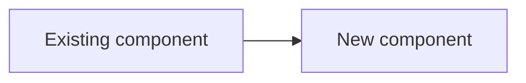
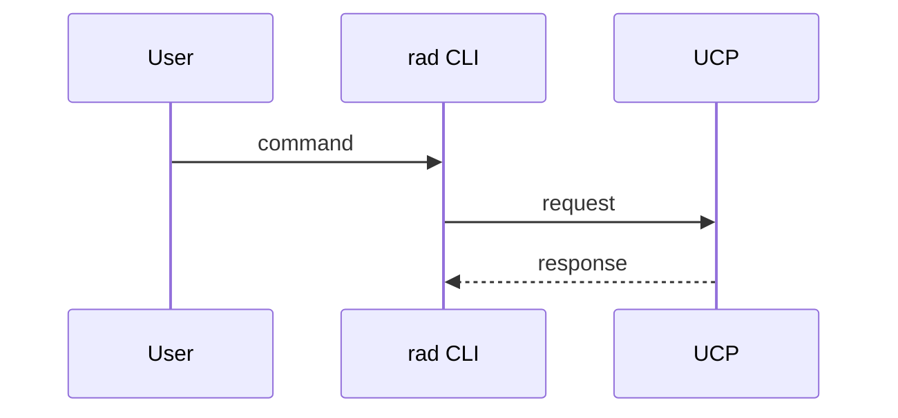

# Title

- **Author**: Your name (@YourGitHubUserName)
- **Status**: Draft | In review | Approved | Superseded by <!-- link -->
- **Feature spec**: <!-- link, or N/A -->
- **Issue**: <!-- link, or N/A -->
- **Authoring notes**: <!-- Which sections were AI-drafted, and what you verified by hand (code paths read, commands run, APIs checked). List any claim you have not verified. -->

<!--
How to use this template
- Write for a reviewer who has 15 minutes. Sections go from "what we decide" to "how we build it".
- Tier 1 (Review guide through User Experience) must be readable on its own. Reviewers approve the design from Tier 1.
- Tier 2 (Design through Alternatives considered) supports the decisions. Reviewers skim it.
- Tier 3 (Appendix) holds long code, full schemas, and exhaustive tables. Reviewers read it only when needed.
- Every section heading below must stay. If a section does not apply, write one sentence saying why (for example, "No CLI changes."). Do not pad it.
- Short sentences. Bullets and tables over paragraphs. Link to code instead of describing it.
- See the radius-author-design-note skill and docs/contributing/contributing-code/contributing-code-design/README.md for the writing guide.
-->

## Review guide

<!--
Tell reviewers what you need from them. Example:
"Approve decisions D1–D3. D4 is informational. Security and Compatibility need a sign-off from @owner."
-->

## Decisions for review

<!--
This table is the review meeting agenda. The author walks through each row, and the meeting ends when every row has an outcome.
- One row per decision that a reviewer could reasonably disagree with. Typically 2–6 rows.
- Link each row to its section under "Decision details".
- After review, update Status to Accepted, Rejected, or Deferred, and record it in "Design Review Notes".
-->

| #  | Decision                    | Options considered | Recommendation | Risk if wrong   | Status |
|----|-----------------------------|--------------------|----------------|-----------------|--------|
| D1 | [Short question](#d1-title) | A / B / C          | A              | One-line impact | Open   |

## Overview

<!--
One to three short paragraphs that someone outside the Radius team can understand. Cover:
- The problem, in about three sentences.
- The proposal, in up to five bullets.
- What changes for users, and anything that breaks.
Leave design details for the Design section.
-->

## Terms and definitions

<!--
Terms, definitions, or acronyms used in this document. Use a two-column table. Delete rows for terms every Radius contributor already knows.
-->

| Term | Definition |
|------|------------|
|      |            |

## Objectives

<!--
Why we are doing this work and how we judge success.
- If the feature shares objectives with an existing design, link to it instead of repeating it.
- If a feature spec or UX doc exists, link it and summarize only what this design depends on.
- If this design diverges from the feature spec, list each divergence and why.
-->

> **Issue Reference:** <!-- (If appropriate) Reference an existing issue that describes the feature or bug. -->

### Goals

<!--
Bulleted, measurable where possible. These drive priority decisions.
-->

### Non goals

<!--
What we will not do in this design, with a one-line reason each. List planned follow-ups here.
-->

### User scenarios (optional)

<!--
Name the persona (for example, application developer or platform engineer) in each story. Link to an existing issue instead of repeating it.
-->

#### User story 1

#### User story 2

## User Experience (if applicable)

<!--
Show the expected interaction. Prefer real input and output over prose. Write "No user-facing change." if none.
-->

**Sample Input:**

<!--
A sample CLI command and/or Bicep or Helm code.
-->

**Sample Output:**

<!--
Sample output for the input above.
-->

**Sample Recipe Contract:**

<!--
Updated recipe contract (input parameters, output schema), if this proposal changes it.
-->

## Design

### High Level Design

<!--
Components as black boxes and how they relate. Highlight new components and new dependencies. Keep it to a few bullets plus the diagram below.
-->

### Architecture Diagram

<!--
A Mermaid diagram of the components touched by this proposal. Mark new components clearly. Add component-specific diagrams only where they help.
-->

### Data flow and sequence

<!--
Show the main request or reconcile path step by step. Use a Mermaid sequence diagram, then a numbered list that explains only the non-obvious steps. Include the main failure path if it differs.
-->

### Detailed Design

<!--
Enough detail that another developer could implement the design and estimate its cost, without restating the code. Cover every important decision, including names. Align subsections with Radius layers where possible. Consider testability.
-->

#### Decision details

<!--
One subsection per row in "Decisions for review", using the same ID. Keep each to about one screen.
-->

##### D1: Title

**Context:** <!-- What forces this decision. Two or three sentences. -->

**Options:**

| Option | Advantages | Disadvantages |
|--------|------------|---------------|
| A      |            |               |
| B      |            |               |

**Proposed Option:** <!-- The recommended option and the deciding reason. -->

**How we'll know it's right:** <!-- Test, metric, or rollback signal. -->

### API design (if applicable)

<!--
Changes to the public REST API, TypeSpec, or Go APIs of shared components. Write "No API changes." if none.
- REST: resource type, API path, and a short sample request and response. Put full schemas in the Appendix.
- Go: new or changed exported interfaces and types.
-->

### CLI Design (if applicable)

<!--
New or changed rad commands and flags. Show the command, its flags, and sample output. Write "No CLI changes." if none.
-->

### Implementation Details

<!--
Which sub-components change and how (for example controller, processor, renderer, recipe engine, driver). Use one or two bullets per component. Delete component headings that this design does not touch, and add others as needed (for example Dynamic RP or Controller).
-->

#### UCP (if applicable)

#### Bicep (if applicable)

#### Deployment Engine (if applicable)

#### Core RP (if applicable)

#### Portable Resources / Recipes RP (if applicable)

### Error Handling

<!--
A table of error scenario, detection, user-visible behavior, and recovery.
-->

| Scenario | Detection | User sees | Recovery |
|----------|-----------|-----------|----------|
|          |           |           |          |

## Test plan

<!--
Unit, functional, and end-to-end coverage per change. Call out new testing challenges:
- New dependencies.
- External assets tests need to access.
- Features that do I/O or change OS state and are hard to unit test.
-->

## Security

<!--
Required. Describe changes to the Radius security model. For each threat, give the threat and its mitigation, for example in a table. Topics include authentication, authorization, storing secrets and credentials, and cryptography.
If nothing changes, say which existing Radius security features the design relies on. For larger changes, link a threat model based on templates/threat-model-template.md.
-->

## Compatibility (optional)

<!--
Breaking changes to APIs, CLI, Bicep, or behavior; compatibility with older CLIs or control planes; and upgrade or migration steps. Write "No compatibility impact." if none.
-->

## Monitoring and Logging

<!--
Metrics, logs, and traces added, and how an operator uses them to troubleshoot this feature.
-->

## Development plan

<!--
How the work is delivered: a table of work items or PRs with scope, dependencies, and estimate. Include unit and functional tests in estimates.
-->

## Open Questions

<!--
Unknowns that are not yet ready to be decisions, in Q&A format. When a question needs a reviewer's choice, move it to "Decisions for review".
-->

## Alternatives considered

<!--
Alternatives to the whole approach, with a one-line reason each was rejected. Per-decision alternatives belong in "Decision details".
-->

## Appendix (optional)

<!--
Long code samples, full schemas, scripts, exhaustive tables, and background research. Link to these from the sections above.
-->

## Design Review Notes

<!--
Update after each review meeting and before merge:
- Date and attendees.
- Outcome per decision (Accepted, Rejected, or Deferred), with an owner for any follow-up.
- Changes made to the document as a result.
-->
