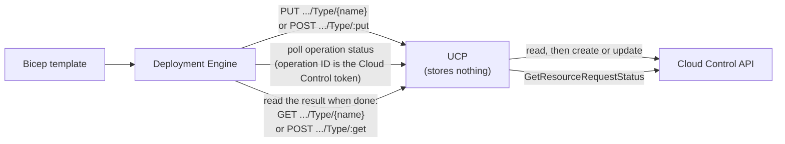
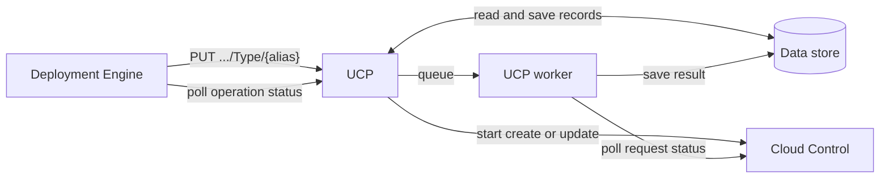
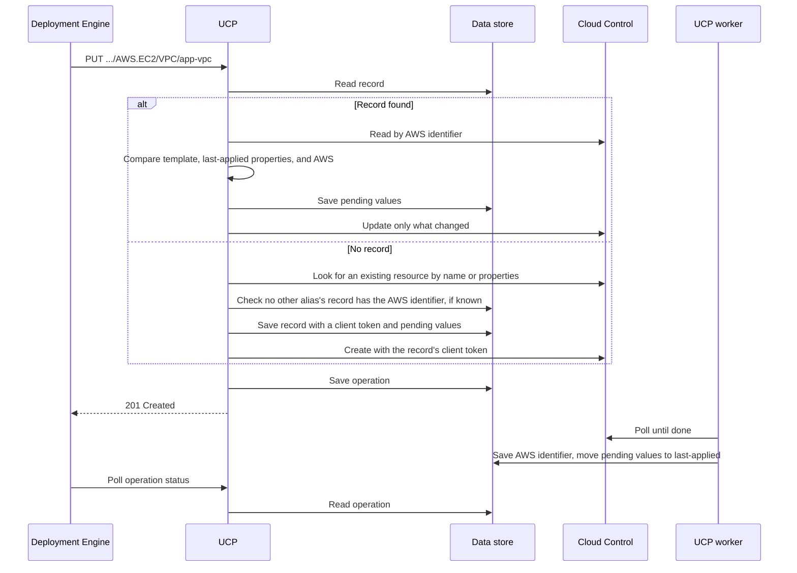
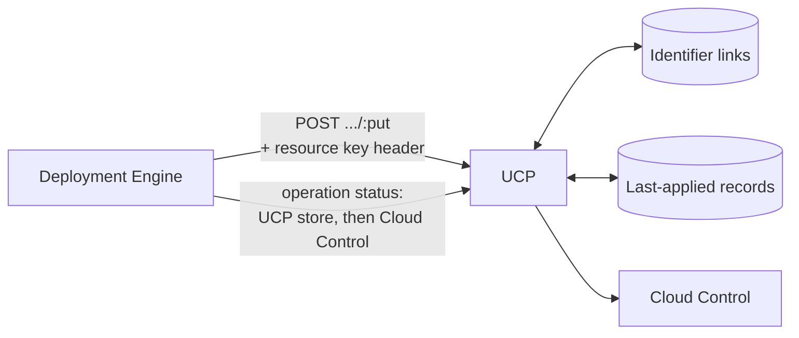

# Making AWS deployments idempotent

- **Author**: Karishma Chawla (@kachawla)
- **Date**: 2026-10
- **Status**: In review

## Summary

Deploying the same Bicep template twice should leave AWS in the same state as deploying it once. For AWS resources, Radius does not do this today. A second deploy can create a duplicate VPC, leave a property set after it was removed from the template, or fail because it resends a password that AWS will not accept again.

All three problems have one cause: UCP keeps no state about the AWS resources it deploys. It forwards each request to the AWS Cloud Control API and then forgets it.

The duplicate VPC shows the core difficulty. For many AWS types, including the VPC, AWS assigns the identifier when it creates the resource, so the template cannot know it ahead of time. That is why every AWS resource in Bicep must declare an `alias`, a label the template author chooses. The alias was meant to let UCP track these resources, but nothing reads it today.

This design puts the alias to work. UCP keeps a small internal record for each AWS resource, keyed by its alias, that remembers which AWS resource the alias refers to and what Radius last applied to it. That is enough to make redeploys idempotent. Templates do not change.

## Background

### How an AWS resource is deployed today

A Bicep template declares an AWS resource with an `AWS.*` type, such as `AWS.S3/Bucket`. The Deployment Engine sends it to UCP's AWS plane, and UCP calls Cloud Control to create or update it.



The Deployment Engine uses one of two routes:

- **PUT `.../AWS.S3/Bucket/{name}`** when the template sets `name`. UCP passes `name` to Cloud Control as the AWS identifier.
- **POST `.../AWS.S3/Bucket/:put`** otherwise. UCP looks for the AWS identifier in the request properties, such as `BucketName` for a bucket. If it finds one and AWS has that resource, UCP updates it. Otherwise UCP creates a new resource.

Cloud Control runs each create or update asynchronously and returns a request token. UCP puts that token in the operation URL it returns, without storing it. When the Deployment Engine polls that URL, UCP passes the token back to Cloud Control to get the status.

UCP stores the AWS plane and its credentials. It stores nothing about the resources themselves.

### Why Azure does not have this problem

UCP does not store state for Azure resources either, and does not need to. It forwards them to Azure Resource Manager (ARM), where two things make redeploys simple:

- The name in the template is the resource's identity. A PUT to that name creates the resource the first time and updates it after that.
- A PUT carries the full desired state, so the caller does not have to work out what changed.

Cloud Control differs on both:

- It finds a resource only by its AWS identifier (AWS calls it the primary identifier), and for many types AWS chooses that identifier when it creates the resource. The template cannot know it ahead of time.
- An update is a JSON patch against the resource's current state, so the caller has to work out what to add, change, and remove.

### `name` and `alias`

Each AWS type's schema says which property identifies a resource. For a bucket it is `BucketName`, an ordinary property the template sets like any other, and that is how a template names a bucket. For a VPC it is `VpcId`, which AWS fills in when it creates the VPC. A few types combine several properties. UCP reads the schema to know which properties hold the identifier.

Besides `properties`, every AWS type in Bicep has two fields:

- **`name`** (optional) gives UCP the identifier of a resource that already exists, so UCP can find it without looking in the properties. It does not name a new resource. To create a bucket with a chosen name, the template sets `BucketName`.
- **`alias`** (required) is a label the template author chooses. It was added so UCP could track AWS resources by a stable label, but the Deployment Engine never sends it and UCP never reads it. Today it has no effect.

## Problem

This template declares a VPC, a bucket, and a database. It is used as the running example through the rest of the doc.

```bicep
extension aws

@secure()
param dbPassword string

resource vpc 'AWS.EC2/VPC@default' = {
  alias: 'app-vpc'
  properties: {
    CidrBlock: '10.0.0.0/16'
  }
}

resource bucket 'AWS.S3/Bucket@default' = {
  alias: 'app-bucket'
  properties: {
    BucketName: 'contoso-app-assets'
    VersioningConfiguration: { Status: 'Enabled' }
  }
}

resource db 'AWS.RDS/DBInstance@default' = {
  alias: 'app-db'
  properties: {
    DBInstanceIdentifier: 'contoso-app-db'
    Engine: 'postgres'
    DBInstanceClass: 'db.t3.micro'
    AllocatedStorage: '20'
    MasterUsername: 'appadmin'
    MasterUserPassword: dbPassword
  }
}
```

Deploying it a second time, with or without a small edit, goes wrong in three ways.

**Duplicates.** A VPC has no identifier the template can set. AWS assigns one, such as `vpc-0a1b2c3d`, when it creates the VPC. On the next deploy UCP has nothing to find that VPC by, so it creates another one, `vpc-0e5f6a7b`. The old one stays in AWS until someone deletes it.

**Removed properties stay set.** Remove `VersioningConfiguration` from the bucket and deploy again: versioning stays on. When UCP builds an update, it keeps every property that AWS reports and the template does not mention. Without state, it cannot tell a property Radius set earlier from one that AWS defaulted or someone set by hand, so leaving all of them alone is the only safe choice. As a result, nothing Radius sets can ever be cleared.

**Write-only values are always resent.** AWS accepts some properties, such as the database's `MasterUserPassword`, but never returns them. UCP cannot compare the template's password with the one in AWS, so every deploy sends it again as a password change, even when nothing changed. For types whose password cannot change after create, every redeploy fails.

Each failure comes from one missing piece of memory:

| Failure                     | What UCP needs to remember                                         |
|-----------------------------|--------------------------------------------------------------------|
| Duplicates                  | Which AWS resource this template resource created                  |
| Removed properties stay set | Which properties Radius applied last time                          |
| Write-only values resent    | What value Radius sent last time, without storing the value itself |

## Goals and non-goals

### Goals

1. Redeploying a resource whose identifier AWS assigns updates that resource instead of creating another.
2. Removing a property from the template clears it in AWS on the next deploy.
3. Redeploying an unchanged password or other write-only value changes nothing in AWS.
4. Changing a property that cannot change after create fails before UCP calls AWS, with an error that names the property.
5. Redeploying a property that AWS reports in a different form, such as reordered subnets or a fuller engine version, changes nothing in AWS.

### Non-goals

1. **Detecting changes made outside Radius.** Radius does not watch AWS between deploys. The next deploy changes back any property the template sets, as it does today.
2. **Moving a resource to a new alias or owner**, such as renaming its alias, moving it to another template, or moving the app to another environment. The only way is to delete the resource and deploy it again under the new alias or owner.
3. **Carrying over AWS resources deployed with Bicep before this change.** UCP has no records for them, so a deploy after this change treats them like resources created outside Radius, and deleting them through Radius does nothing in AWS. A migration path would need to keep deleting by AWS identifier, which can delete an unrelated resource whose identifier matches an alias.
4. **Returning alias-based IDs from a list request.** A list of AWS resources still returns IDs that end in the AWS identifier, which do not work for GET because GET expects the alias. Recipes are the main way to deploy AWS resources, and a recipe saves each resource's alias-based ID on the Radius resource, so Radius never needs a list to find them.

## Design overview

UCP stores one **resource record** for each AWS resource it deploys. The Deployment Engine addresses each AWS resource by its alias, so the resource ID ends in the alias instead of the AWS identifier:

```text
/planes/aws/aws/accounts/{account}/regions/{region}/providers/AWS.EC2/VPC/app-vpc
```

This ID is known before the resource exists and never changes, so UCP finds the same record on every deploy. A stable ID also removes the reasons the POST `/:put` and `/:delete` routes exist, and UCP never has to fit an ARN into a resource ID.

The record fills in `datamodel.AWSResource`, which is an empty placeholder in UCP today:

```go
// AWSResource is UCP's record for one AWS resource it deploys, stored under
// the resource ID that ends in the alias.
type AWSResource struct {
    // ID, name (the alias), type, and provisioningState. A provisioningState
    // that is not terminal means an operation is in progress.
    v1.BaseResource

    Properties AWSResourceProperties `json:"properties"`
}

type AWSResourceProperties struct {
    // AWSIdentifier is what Cloud Control finds the resource by, such as
    // vpc-0a1b2c3d. Saved before the create when the properties give it,
    // such as BucketName, and when the create finishes otherwise.
    AWSIdentifier string `json:"awsIdentifier,omitempty"`

    // Owner is who deploys this alias, in the format described in
    // "Alias ownership".
    Owner string `json:"owner"`

    // LastApplied is the properties from the last successful deploy, without
    // write-only values.
    LastApplied map[string]any `json:"lastApplied,omitempty"`

    // Fingerprints maps each write-only property to an HMAC-SHA-256 of its
    // value, prefixed with the ID of the key that made it.
    Fingerprints map[string]string `json:"fingerprints,omitempty"`

    // PendingLastApplied and PendingFingerprints hold the new values while an
    // operation is in progress. The worker moves them to LastApplied and
    // Fingerprints when AWS succeeds, and clears them when it fails.
    PendingLastApplied  map[string]any    `json:"pendingLastApplied,omitempty"`
    PendingFingerprints map[string]string `json:"pendingFingerprints,omitempty"`

    // ClientToken is a UUID that UCP generates before the first create and
    // sends with every attempt to create the resource, so Cloud Control treats
    // a retry as the same request. Cleared when the create finishes.
    ClientToken string `json:"clientToken,omitempty"`

    // RequestToken is the token Cloud Control returns when it accepts a
    // create, update, or delete. UCP also uses it as the operation ID.
    RequestToken string `json:"requestToken,omitempty"`
}
```



In the example, the first deploy creates `vpc-0a1b2c3d` and records it under `app-vpc`. Every later deploy finds that record and updates the same VPC. If the author removes `VersioningConfiguration`, the bucket's record shows that Radius set it, so the next deploy turns versioning off. The database's record holds a fingerprint of `MasterUserPassword`, so an unchanged password is not sent.

The record is internal to UCP. A GET on the resource still fetches it from AWS via `GetResource`.

## Detailed design

### Deploying a resource



A PUT goes through four steps.

**1. Read the record.** If there is no record, this is the first deploy under this alias.

**2. With no record, take over or create.** UCP looks for an existing AWS resource the same way POST `/:put` does today: first by `name`, then by the AWS identifier in the properties. Before it takes over or creates a resource whose identifier it knows, UCP checks that no other alias manages it, as described in [Alias ownership](#alias-ownership). If AWS has that resource, UCP **takes it over**: it saves a record and continues as an update. Otherwise UCP creates the resource, unless the template sets `name`, as described in [The `name` field](#the-name-field). Before it creates anything, UCP saves the record with a new client token, and with the AWS identifier when the properties give one. It sends that token with every attempt to create the resource, so Cloud Control treats a retry as the same request instead of creating a second resource.

**3. With a record, compute the update.** If the record still has a client token, its first create has not finished: the PUT gets 409 while that create is in progress, and otherwise resumes it, as described in [Operations](#operations). Otherwise UCP reads the resource from AWS by the identifier in the record, and compares it with the template and the last-applied properties, as described in [Comparing properties](#comparing-properties). If nothing differs, UCP saves the new last-applied properties and fingerprints and returns 200 without calling AWS. Saving them matters when the template starts setting a property that already matches AWS: Radius now owns it, so removing it later clears it.

**4. Finish the operation.** Before it calls AWS, UCP saves the new last-applied properties and fingerprints on the record as **pending values**. It then saves an operation and returns 201. A UCP worker polls Cloud Control until AWS finishes. On success, it saves the identifier if AWS assigned it, moves the pending values to last-applied, and clears the client token. When an update fails, it clears the pending values, so the previous last-applied properties stay. When a create fails, it removes the record, so the next deploy starts over.

### Comparing properties

UCP compares properties by path, the way `GeneratePatch` in `pkg/aws/operations` does today: nested objects are flattened, so `VersioningConfiguration/Status` is one property. An array is one value, so if any item differs, UCP sends the whole array.

AWS often reports a value in a different form than the template set it. UCP uses the type's schema, which it already loads with `DescribeType`, so that these count as unchanged:

- **Arrays where order does not matter.** The schema marks them `"insertionOrder": false`, such as `SubnetIds` on a DB subnet group and `Tags` on most types. UCP compares them ignoring order, because AWS returns their items in its own order.
- **Values AWS rewrites.** The schema's `propertyTransform` turns the template's value into a pattern that AWS's value must match. For example, an RDS `EngineVersion` of `8.4` matches a running `8.4.11`, and `DBInstanceIdentifier` is compared in lowercase. UCP supports the functions most schemas use: `$lowercase`, `$uppercase`, `$join`, and `$OR`. A property whose transform uses any other function is compared as it is.

Without these rules, an unchanged redeploy of an RDS instance sends `EngineVersion` again. When the running minor version is below AWS's default for `8.4`, RDS upgrades the database to that default and reboots it right away. A template that names the instance in mixed case would also fail every redeploy, because `DBInstanceIdentifier` cannot change after create and AWS reports it in lowercase.

| Property                                                                     | What UCP does                                                                                                                                             |
|------------------------------------------------------------------------------|-----------------------------------------------------------------------------------------------------------------------------------------------------------|
| In the template, and different from AWS                                      | Sends it                                                                                                                                                  |
| Write-only, in the template                                                  | Sends it only when it differs from its fingerprint. A value with no usable fingerprint is handled as described in [Write-only values](#write-only-values) |
| In the last-applied properties, but not in the template                      | Clears it, because Radius set it and the template no longer asks for it                                                                                   |
| Returned by AWS, but in neither the template nor the last-applied properties | Leaves it alone, because AWS or someone else set it                                                                                                       |
| Create-only, and changed or removed in the template                          | Fails with 400 naming the property, without its value, because AWS cannot change or clear it after create. Nothing is sent to AWS                         |

### Write-only values

A **write-only property** is one AWS accepts but never returns. The record never stores these values, and they are left out of the last-applied properties. Instead, the record stores a fingerprint of each one: an HMAC-SHA-256 of the value, made with a random key that lives in its own Kubernetes Secret, which UCP mounts read-only. The key is never in the data store, so someone who can read the data store cannot recover a short password by hashing guesses.

A write-only value has no usable fingerprint in two cases: UCP just took the resource over, or the key was replaced. The key does not rotate on a schedule, but each fingerprint records the ID of its key, so UCP can tell which fingerprints an old key made. UCP handles a value with no usable fingerprint like this:

- A value that can be updated, such as `MasterUserPassword`, is sent once.
- A value that cannot change after create is not sent, and the deploy does not fail, because UCP cannot tell whether it changed.

Either way, UCP then saves a fingerprint made with the current key. Today UCP never sends a write-only value that cannot change after create, so this keeps that behavior for taken-over resources.

### The `name` field

`name` lets a template take over an AWS resource that already exists, instead of creating a new one. For example, a platform team created `vpc-0a1b2c3d` in the AWS console, and the app's template should manage it from now on:

```bicep
resource vpc 'AWS.EC2/VPC@default' = {
  alias: 'app-vpc'
  name: 'vpc-0a1b2c3d'
  properties: {
    CidrBlock: '10.0.0.0/16'
  }
}
```

On the first deploy there is no record for `app-vpc`, so UCP finds `vpc-0a1b2c3d` in AWS and takes it over. From then on, Radius manages that VPC as if it had created it, and UCP finds it through the record. If the template later changes `name` to a different VPC, the deploy fails with 409, because `app-vpc` already points to `vpc-0a1b2c3d`.

If AWS has no resource with that `name`, the deploy fails with 400 before UCP calls AWS, for example when `name` has a typo. Creating a resource would not help, because its identifier would come from the properties or from AWS, not from `name`, and every later deploy would fail with 409. The one exception is when the properties set the same identifier, such as `name: 'contoso-app-assets'` with `BucketName: 'contoso-app-assets'`. Then UCP creates the bucket under that name.

`name` stays on AWS types because removing it would break templates that set it, and because it is the only way to take over a resource whose identifier AWS assigns. A template cannot set `VpcId` in `properties`.

### Alias ownership

Nothing has read `alias` until now, so existing templates may reuse one. For example, a recipe that sets `alias: 'vpc'` might be used by two apps in the same account and region. Once the alias decides which resource a deploy updates, the second app's deploy would update the first app's VPC.

To prevent that, each record stores an owner. The owner is one string of Radius IDs, separated by `;`:

- for a recipe: `recipe;<application ID>;<environment ID>;<Radius resource ID>`
- for a template deployed with `rad deploy`: `deploy;<resource group ID>;<application ID>;<environment ID>`, with an empty application ID when there is no application

Two owners match when the strings are equal, ignoring case, because Radius IDs are not case-sensitive.

The record says who owns the alias, so each request has to say who is asking. UCP cannot work that out on its own, because a request carries only the alias-based ID and the properties. The caller sends the owner in a header, as described in [Changes outside UCP](#changes-outside-ucp). A PUT or DELETE without the header fails with 400. A PUT or DELETE from the same owner proceeds as usual. One from a different owner fails with 409, naming the alias and the owner that holds it, and nothing changes in AWS.

An AWS resource has one record, and so one alias that updates and deletes it. Two aliases can point at the same resource, for example when two recipes set the same `BucketName`, or when a template sets `name` to a VPC that another alias created. So before UCP takes over a resource, or creates one whose identifier the properties give, it searches the records in the same account, region, and type for that AWS identifier. If a record under another alias has it, the deploy fails with 409 naming that alias, and nothing changes in AWS. Because UCP saves the identifier before a create when the properties give it, the search also finds a create that is still in progress. The search and the save are separate steps, so two deploys that take over the same resource at the same moment can both succeed. This needs two apps to deploy the same resource within seconds of each other, so the design accepts it.

An app that needs a resource another app owns references it with `existing`, which reads it without managing it.

Recipe authors make aliases unique by building them from `context.aws.resourceNameHash`, a new recipe context value that works like `context.azure.resourceNameHash`: a hash of the AWS account and region, application ID, environment ID, and Radius resource ID.

### Reading and `existing`

A GET by alias reads the record and then reads AWS by the AWS identifier. It always reads AWS, so the result shows changes made outside Radius.

Every `existing` block has an alias, because Bicep requires one, so the Deployment Engine picks the route by whether the block also sets `properties` or `name`. It does not read AWS schemas, so it cannot tell which properties are identifiers. GET by alias ignores `name`, so a block that sets `name` must use POST `/:get` to read a resource Radius did not create.

| `existing` block                                                    | Route                                                                                                                                                                       |
|---------------------------------------------------------------------|-----------------------------------------------------------------------------------------------------------------------------------------------------------------------------|
| Sets `properties` or `name`, such as `LogGroupName` for a log group | POST `/:get`, with `name` in the request body. UCP reads AWS by `name` if it is set, and otherwise by the identifier in the properties, for resources Radius did not create |
| Sets neither, only an alias                                         | GET by alias. UCP reads the record and then AWS, so one template can reference a VPC that another created without its ID. 404 if there is no record                         |

Neither route saves a record or checks the owner, because reading another owner's resource does not change it. A type whose Bicep `properties` field is required cannot use an alias-only `existing` block.

### Deleting a resource

A DELETE by alias reads the record, checks the owner, deletes the resource in AWS by the record's identifier, and then removes the record. If the record has no AWS identifier yet, or AWS says the resource does not exist, UCP only removes the record. If there is no record, UCP returns 204 without calling AWS, so a retried DELETE never deletes a different resource that happens to have the alias as its identifier.

### Operations

The Deployment Engine polls UCP for operation status, today and with this design. What changes is who talks to Cloud Control:

- **Today**, UCP passes each poll straight to Cloud Control, using the request token in the status URL. Nothing in UCP sees an operation finish.
- **With this design**, UCP saves an operation for every create, update, and delete, and answers polls from its data store. A UCP worker polls Cloud Control with the request token and updates the record when AWS finishes.

This is the standard ARM-RPC pattern: the resource provider owns its async operations, and the client only polls. UCP already works this way for resource groups and resource providers.

A second PUT or DELETE while an operation is in progress gets 409. An operation is in progress from when UCP queues it until it finishes, as long as the worker keeps polling it. The worker records each poll, and an operation that has not been polled for 10 minutes is stale. A create that UCP never queued, because UCP failed after saving the record, has no operation in progress. The next PUT resumes a stale or never-queued create instead of getting 409: with a request token, the worker polls the original request again, and without one, UCP sends the create again with the record's client token.

UCP queues AWS operations with a timeout longer than any Cloud Control request can run, instead of the async worker's default of 2 minutes, so UCP never gives up on a request that Cloud Control is still running. Cloud Control applies each type's own time limit. A long create, such as an RDS instance that takes 30 minutes, never looks stale while the worker is polling it.

### Changes outside UCP

**Deployment Engine.** For AWS resources, the Deployment Engine:

- sends PUT by alias instead of POST `/:put`
- sends `name`, when the template sets it, in the request body instead of the URL, because the URL now ends in the alias
- copies `owner` from the deployment's `providerConfig` into a header on each AWS PUT and DELETE
- reads an `existing` resource as described in [Reading and `existing`](#reading-and-existing)

**Bicep recipe driver.** Sets a new `owner` field in the deployment's `providerConfig`, which the Deployment Engine already reads to find the AWS account and region. It also sends the owner in a header on each DELETE of a recipe's output resources, because it sends those DELETEs to UCP itself.

**Recipe context.** Adds `context.aws.resourceNameHash` for building unique aliases.

**`rad deploy`.** Sets the same `owner` field.

**Helm chart.** Generates the HMAC key once at install, keeps it across upgrades, and mounts it into UCP, the same way it creates `radius-encryption-key`.

**UCP routes.** POST `/:put` and `/:delete` are removed. POST `/:get` stays for `existing` references with properties.

**Bicep types.** No change. `alias` is already required.

The Deployment Engine lives in its own repo, but the Radius chart deploys it together with UCP, so both changes ship in the same Radius release.

## Failure handling

One rule runs through every case: when UCP cannot tell whether a resource exists, it fails instead of creating one. UCP saves state before it calls AWS and moves it forward only after AWS confirms, so a retry always has enough to pick up where the last attempt stopped.

**Rejected before anything changes in AWS.** The user fixes the template or setup, or waits for the running operation, and deploys again.

- A record exists, but the template names a different AWS identifier: 409 naming the alias and both identifiers.
- Another owner holds the alias: 409 naming the alias and that owner.
- The owner header is missing: 400.
- Another alias's record has the same AWS identifier: 409 naming that alias.
- The template sets `name`, AWS has no such resource, and the properties do not set the same identifier: 400 naming `name`.
- Another operation is in progress on the resource: 409.
- A create-only property changed or was removed: 400 naming the property, without its value.
- The alias contains `/`: 400, because the alias becomes the last part of the resource ID.
- The HMAC key Secret is missing or unreadable: an AWS PUT whose template sets a write-only value, such as a password, fails with 500 naming the Secret before UCP saves anything or calls AWS, because UCP needs the key to make or compare that value's fingerprint. Other AWS PUTs, reads, deletes, and other UCP requests still work. UCP also logs an error when it starts without the key, so a broken install shows up before the first deploy that sets a password.
- AWS rejects a create, update, or delete: 400 with AWS's message.

**Safe to retry.** A retry picks up where the last attempt stopped, and nothing is created twice.

- Reading or searching records fails for a reason other than "not found": 500, which the Deployment Engine retries. A failed read is never treated as "no record", because UCP would then create a duplicate.
- Saving a record or pending values fails before UCP calls AWS: 500, and AWS is not called.
- Reading the resource from AWS fails for a reason other than "not found": the deploy fails, and nothing is created or changed.
- UCP stops after AWS accepted a create, before it saved the request token: the retry sends the same client token, and Cloud Control returns the first request. Cloud Control only remembers a client token for 36 hours, so a retry after that creates a second resource.
- UCP stops before it queues an operation, or the worker stops polling: the next PUT resumes the operation, as described in [Operations](#operations).
- Saving the result fails after AWS finished: the worker retries, and the operation stays in progress until the result is saved.
- Removing the record fails after AWS deleted the resource: the worker retries until it is removed.

**Repaired by the next deploy.**

- The resource was deleted outside Radius: AWS returns "not found", so UCP creates it again and updates the record.

## Security

- Write-only values are never stored. The record keeps only keyed fingerprints, and the key lives in its own Kubernetes Secret, not in the data store.
- Helm also keeps the HMAC key in its release history, because the chart generates the Secret. Anyone who can read Helm release history or its backups can recover the key. The fingerprints protect against someone who can read only the data store, not against those readers.
- Errors name properties but never include their values.
- The owner check stops one app from changing another app's resource through a shared alias by accident. It is not access control: the caller sets the owner header, so anyone who can call UCP can send any owner.
- UCP makes the same kinds of AWS calls with the same credential as today, so no new AWS permissions are needed.

## Test plan

- **Unit tests**
  - take over or create when there is no record: by `name`, by properties, and neither
  - each row of the property comparison table, including nested paths, a changed array item, and a removed create-only property
  - a DB subnet group whose `SubnetIds` AWS returns in a different order: no AWS call
  - an RDS instance with `EngineVersion: 8.4` against a running `8.4.11`: no AWS call. Changing the template to `8.0` sends it
  - an RDS instance whose template sets `DBInstanceIdentifier` in mixed case: no 400 and no AWS call
  - a property whose `propertyTransform` uses an unsupported function: compared as it is
  - the client token on a retried create
  - a stale operation that the next PUT resumes instead of returning 409, and a long operation that the worker keeps polling, which neither goes stale nor hits the async worker's timeout
  - a retry after UCP failed between saving the record and queuing the create, which resumes the create with the same client token right away
  - pending values moved to last-applied on success, cleared when an update fails, the record removed when a create fails, and a failed save retried
  - the no-op path saving last-applied properties, so a property the template starts setting is cleared when removed later
  - a taken-over resource with write-only values and no fingerprints: an updatable value is sent once, a create-only value is not sent and does not fail, and fingerprints are saved
  - `name` taking over an existing resource, `name` that differs from the record, `name` that matches nothing in AWS (400), and `name` that matches the identifier in the properties (create)
  - the owner: a missing header (400), a different owner on PUT and DELETE (409), owners that differ only by case (match), and one app deployed to two environments in one resource group (409)
  - another alias's record with the same AWS identifier (409), including one whose create is still in progress and a VPC taken over by `name` after another alias created it
  - DELETE by an alias, by an alias whose record has no AWS identifier or whose resource AWS no longer has (record removed), and by an alias with no record (204, nothing sent to AWS)
  - a missing HMAC key: UCP logs an error at startup, an AWS PUT that sets a write-only value fails with 500 before saving a record or calling AWS, and an AWS PUT without one, reads, and deletes still work
  - operation status from UCP's data store
- **Functional tests through the Deployment Engine**
  - deploy a VPC with only an alias twice, and check that one VPC exists
  - remove a property, and check that it is cleared
  - change a create-only property, and check for the 400
  - redeploy an unchanged password, and check that nothing is sent
  - reference a VPC created by another template with an alias-only `existing` block, and check that the read returns that VPC
- **Existing tests to update**
  - `pkg/ucp/frontend/controller/awsproxy`: delete the tests for POST `/:put` and `/:delete`. Rewrite the PUT, DELETE, and GET tests to go through the record, the identifier search, and the owner check. Update the operation status and result tests to read UCP's data store, and `routes_test.go` for the removed routes.
  - `pkg/recipes/driver/bicep`: the owner in `providerConfig`, and the owner header on DELETE.
  - `pkg/recipes/recipecontext` and `pkg/recipes/paramresolver`: `context.aws.resourceNameHash`.
  - `pkg/cli/deployment`: the owner in `GetProviderConfigs`.
  - The AWS functional tests check AWS directly by identifier, and their templates set `alias` to the identifier, so they keep working. Check `aws_multi_identifier_resource_test.go`: its metric filter's resource ID used to end in `logGroup|filter` and now ends in its alias, the filter name.
  - Deployment Engine: PUT by alias, the owner header, and the `existing` routes.

## Alternatives considered

### Patch the current UCP flow

Keep resource IDs that end in the AWS identifier, keep the POST routes, and add each missing piece separately:



- The Deployment Engine sends a new header with a stable key for each template resource, and UCP stores a link from that key to the AWS identifier.
- UCP escapes `/` in AWS identifiers, because an ARN as the last ID segment breaks the resource ID.
- UCP stores last-applied properties in a separate record.
- UCP tracks operations in its own store, so it can save last-applied properties when AWS finishes. The status route checks UCP's store first, then asks Cloud Control.

|                                                           | Patch the current flow              | Resource records (this design)                     |
|-----------------------------------------------------------|-------------------------------------|----------------------------------------------------|
| Resource ID ends in                                       | AWS identifier, escaped             | Alias                                              |
| How a resource is found again                             | Header key, then a link table       | Record found by alias                              |
| Deployment Engine change                                  | Send a new header with a stable key | Send the alias as the resource name, and the owner |
| Bicep change                                              | None                                | None, the alias is already required                |
| POST `/:put` and `/:delete`                               | Kept                                | Removed                                            |
| Where the AWS identifier and last-applied properties live | Two stores                          | One record                                         |
| Operation status                                          | UCP store, then Cloud Control       | UCP store                                          |
| Existing AWS deployments                                  | Keep working                        | Not carried over, see [Non-goals](#non-goals)      |

Each piece is small, and existing AWS deployments keep working. But the resource ID still changes form between the first deploy and later ones, the POST routes stay, and one resource's data is split across several stores. This option treats each symptom. Resource records fix the cause, remove code instead of adding it, make AWS work like the rest of Radius, and use the alias every template already sets. The cost is a larger change, and AWS resources deployed before this change are not carried over.

### Other alternatives

- **Keep state in the Deployment Engine.** A deployment is a log of one run, not a long-lived object, so it is the wrong place for state that must survive across runs.
- **Find resources again by AWS tags.** One recipe can create several resources of the same type, some types cannot be tagged, and two deploys running at once can both decide to create.
- **Require `name` instead of using the alias.** This is a breaking Bicep change, when every template already sets the alias.
- **Key the record by owner and alias, so each owner gets its own resource.** Two Radius resources would then hold the same resource ID for different AWS resources.
