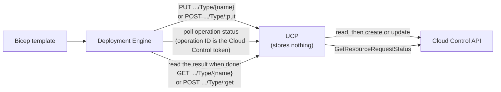
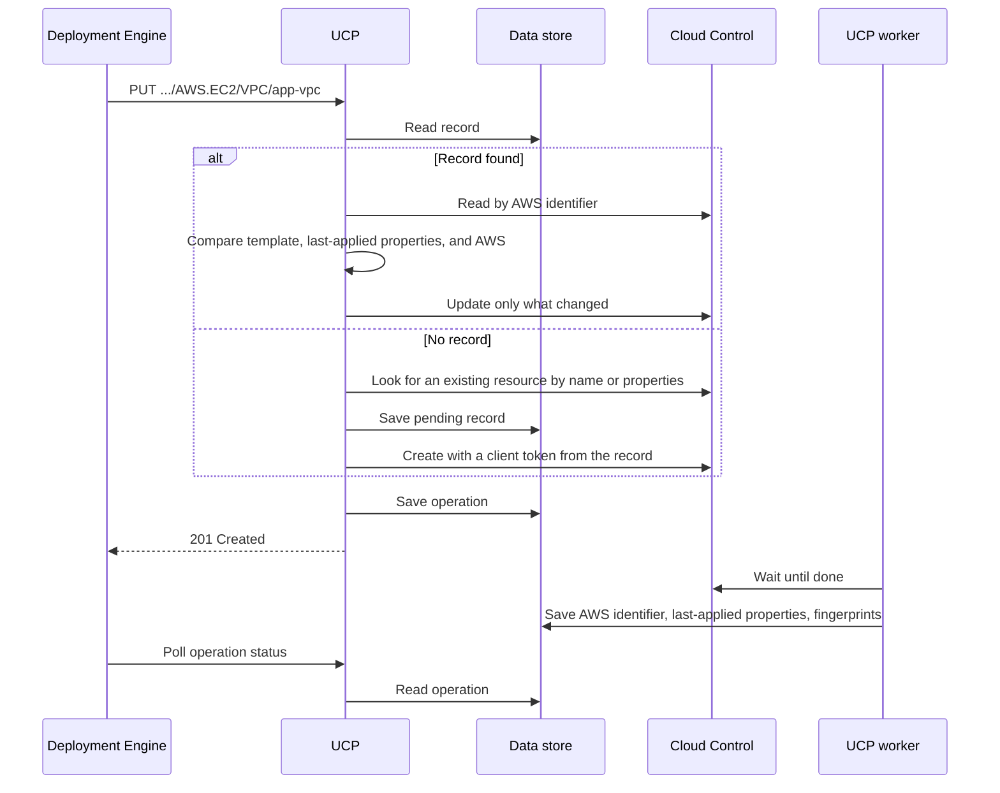
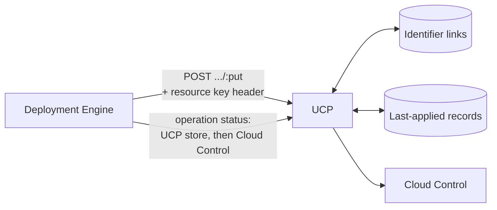

# Making AWS deployments idempotent

- **Author**: Karishma Chawla (@kachawla)
- **Date**: 2026-10
- **Status**: Draft

## Summary

Deploying the same Bicep template twice should leave AWS in the same state as deploying it once. For AWS resources, Radius does not do this today. A second deploy can create a duplicate VPC, leave a property set after it was removed from the template, or fail because it resends a password that AWS will not accept again.

All three problems have one cause: UCP keeps no state about the AWS resources it deploys. It forwards each request to the AWS Cloud Control API and then forgets it.

The duplicate VPC shows the core difficulty. For many AWS types, including the VPC, AWS assigns the identifier when it creates the resource, so the template cannot know it ahead of time. That is why every AWS resource in Bicep must declare an `alias`, a label the template author chooses. The alias was meant to let UCP track these resources, but nothing reads it today.

This design puts the alias to work. UCP keeps a small internal record for each AWS resource, keyed by its alias, that remembers which AWS resource the alias refers to and what Radius last applied to it. That is enough to make redeploys idempotent. Templates do not change.

## Background

### How an AWS resource is deployed today

A Bicep template declares an AWS resource with an `AWS.*` type, such as `AWS.S3/Bucket`. The Deployment Engine sends it to UCP's AWS plane, and UCP calls Cloud Control to create or update it.



The Deployment Engine uses one of two routes:

- **PUT `.../AWS.S3/Bucket/{name}`** when the template sets `name`. UCP passes `name` to Cloud Control as the AWS identifier.
- **POST `.../AWS.S3/Bucket/:put`** otherwise. UCP looks for the AWS identifier in the request properties, such as `BucketName` for a bucket. If it finds one and AWS has that resource, UCP updates it. Otherwise UCP creates a new resource.

Cloud Control runs each create or update asynchronously and returns a request token. UCP puts that token in the operation URL it returns, without storing it. When the Deployment Engine polls that URL, UCP passes the token back to Cloud Control to get the status.

UCP stores the AWS plane and its credentials. It stores nothing about the resources themselves.

### Why Azure does not have this problem

UCP does not store state for Azure resources either, and does not need to. It forwards them to Azure Resource Manager (ARM), where two things make redeploys simple:

- The name in the template is the resource's identity. A PUT to that name creates the resource the first time and updates it after that.
- A PUT carries the full desired state, so the caller does not have to work out what changed.

Cloud Control differs on both:

- It finds a resource only by its AWS identifier (AWS calls it the primary identifier), and for many types AWS chooses that identifier when it creates the resource. The template cannot know it ahead of time.
- An update is a JSON patch against the resource's current state, so the caller has to work out what to add, change, and remove.

### `name` and `alias`

Each AWS type's schema says which property identifies a resource. For a bucket it is `BucketName`, an ordinary property the template sets like any other, and that is how a template names a bucket. For a VPC it is `VpcId`, which AWS fills in when it creates the VPC. A few types combine several properties. UCP reads the schema to know which properties hold the identifier.

Besides `properties`, every AWS type in Bicep has two fields:

- **`name`** (optional) gives UCP the identifier of a resource that already exists, so UCP can find it without looking in the properties. It does not name a new resource. To create a bucket with a chosen name, the template sets `BucketName`.
- **`alias`** (required) is a label the template author chooses. It was added so UCP could track AWS resources by a stable label, but the Deployment Engine never sends it and UCP never reads it. Today it has no effect.

## Problem

This template declares a VPC, a bucket, and a database. It is used as the running example through the rest of the doc.

```bicep
extension aws

@secure()
param dbPassword string

resource vpc 'AWS.EC2/VPC@default' = {
  alias: 'app-vpc'
  properties: {
    CidrBlock: '10.0.0.0/16'
  }
}

resource bucket 'AWS.S3/Bucket@default' = {
  alias: 'app-bucket'
  properties: {
    BucketName: 'contoso-app-assets'
    VersioningConfiguration: { Status: 'Enabled' }
  }
}

resource db 'AWS.RDS/DBInstance@default' = {
  alias: 'app-db'
  properties: {
    DBInstanceIdentifier: 'contoso-app-db'
    Engine: 'postgres'
    DBInstanceClass: 'db.t3.micro'
    AllocatedStorage: '20'
    MasterUsername: 'appadmin'
    MasterUserPassword: dbPassword
  }
}
```

Deploying it a second time, with or without a small edit, goes wrong in three ways.

**Duplicates.** A VPC has no identifier the template can set. AWS assigns one, such as `vpc-0a1b2c3d`, when it creates the VPC. On the next deploy UCP has nothing to find that VPC by, so it creates another one, `vpc-0e5f6a7b`. The old one stays in AWS until someone deletes it.

**Removed properties stay set.** Remove `VersioningConfiguration` from the bucket and deploy again: versioning stays on. When UCP builds an update, it keeps every property that AWS reports and the template does not mention. Without state, it cannot tell a property Radius set earlier from one that AWS defaulted or someone set by hand, so leaving all of them alone is the only safe choice. As a result, nothing Radius sets can ever be cleared.

**Write-only values are always resent.** AWS accepts some properties, such as the database's `MasterUserPassword`, but never returns them. UCP cannot compare the template's password with the one in AWS, so every deploy sends it again as a password change, even when nothing changed. For types whose password cannot change after create, every redeploy fails.

Each failure comes from one missing piece of memory:

| Failure                     | What UCP needs to remember                                         |
|-----------------------------|--------------------------------------------------------------------|
| Duplicates                  | Which AWS resource this template resource created                  |
| Removed properties stay set | Which properties Radius applied last time                          |
| Write-only values resent    | What value Radius sent last time, without storing the value itself |

## Goals and non-goals

### Goals

1. Redeploying a resource whose identifier AWS assigns updates that resource instead of creating another.
2. Removing a property from the template clears it in AWS on the next deploy.
3. Redeploying an unchanged password or other write-only value changes nothing in AWS.
4. Changing a property that cannot change after create fails with an error that names the property, instead of replacing the resource. An unchanged value never fails.

### Non-goals

1. **Detecting changes made outside Radius.** Radius does not watch AWS between deploys or report when someone changes a resource outside Radius, for example in the AWS console. The next deploy reads the resource from AWS and changes back any property the template sets, as it does today.

## Design overview

UCP stores one **resource record** for each AWS resource it deploys. The Deployment Engine addresses each AWS resource by its alias, so the resource ID ends in the alias instead of the AWS identifier:

```text
/planes/aws/aws/accounts/{account}/regions/{region}/providers/AWS.EC2/VPC/app-vpc
```

This ID is known before the resource exists and never changes, so UCP finds the same record on every deploy. A stable ID also removes the reasons the POST `/:put` and `/:delete` routes exist, and UCP never has to fit an ARN into a resource ID.

The record fills in `datamodel.AWSResource`, which is an empty placeholder in UCP today:

```go
// AWSResource is UCP's record for one AWS resource it deploys, stored under
// the resource ID that ends in the alias.
type AWSResource struct {
    // ID, name (the alias), type, and provisioningState. A provisioningState
    // that is not terminal means an operation is running, so a second PUT or
    // DELETE gets 409.
    v1.BaseResource

    Properties AWSResourceProperties `json:"properties"`
}

type AWSResourceProperties struct {
    // AWSIdentifier is what Cloud Control finds the resource by, such as
    // vpc-0a1b2c3d. Empty while the first create is pending.
    AWSIdentifier string `json:"awsIdentifier,omitempty"`

    // Owner identifies who holds the alias: for a recipe, its application ID,
    // environment ID, and Radius resource ID; for rad deploy, the Radius
    // resource group, application ID if set, and environment ID.
    Owner string `json:"owner"`

    // LastApplied is the properties from the last successful deploy, without
    // write-only values.
    LastApplied map[string]any `json:"lastApplied,omitempty"`

    // Fingerprints maps each write-only property to an HMAC-SHA-256 of its
    // value, prefixed with the ID of the key that made it.
    Fingerprints map[string]string `json:"fingerprints,omitempty"`

    // ClientToken is a UUID that UCP generates before the first create and
    // passes to CreateResource. If the create is retried, UCP sends the same
    // token, and Cloud Control returns the first request instead of creating
    // a second resource. Cleared when the create fails.
    ClientToken string `json:"clientToken,omitempty"`

    // RequestToken is the token Cloud Control returns when it accepts a create,
    // update, or delete. The worker passes it to GetResourceRequestStatus to
    // check whether AWS has finished.
    RequestToken string `json:"requestToken,omitempty"`
}
```


In the example, the first deploy creates `vpc-0a1b2c3d` and records it under `app-vpc`. Every later deploy finds that record and updates the same VPC. If the author removes `VersioningConfiguration`, the bucket's record shows that Radius set it, so the next deploy turns versioning off. The database's record holds a fingerprint of `MasterUserPassword`, so an unchanged password is not sent.

The record is internal to UCP. A GET on the resource still fetches it from AWS via `GetResource`.

## Detailed design

### Deploying a resource



A PUT goes through four steps.

**1. Read the record.** If there is no record, this is the first deploy under this alias. Any other read error returns 500, which the Deployment Engine retries. UCP never treats an error as "no record", because it would then create a duplicate.

**2. With no record, take over or create.** This is the first deploy under this alias, or the first deploy after upgrading Radius. UCP looks for an existing AWS resource the same way POST `/:put` does today: first by `name`, then by the AWS identifier in the properties. If AWS has that resource, UCP **takes it over**: it saves a record and continues as an update. Otherwise UCP creates the resource.

Before it asks AWS to create anything, UCP saves the record as pending with a new Cloud Control client token. If UCP stops after AWS accepts the create, the retry finds the pending record and sends the same token. Cloud Control then returns the original request, with its AWS identifier, instead of creating a second resource. After a create fails, UCP drops the client token, so the next deploy starts a new create.

**3. With a record, compute the update.** UCP reads the resource from AWS by the identifier in the record. If AWS says the resource does not exist, someone deleted it outside Radius, so UCP creates it again and updates the record. Any other read error fails the deploy.

UCP then compares the template, the last-applied properties, and what AWS returns:

- A property in the template is sent when it differs from AWS.
- A write-only property in the template is sent only when it differs from its fingerprint.
- A property in the last-applied properties but not in the template is cleared, because Radius set it and the template no longer asks for it.
- A property that AWS returns but that is in neither the template nor the last-applied properties is left alone, because AWS or someone else set it.
- A create-only property whose value changed fails the deploy with 400. The error names the property but not its value.

If nothing differs, UCP returns 200 without calling AWS.

**4. Finish the operation.** UCP saves an operation on the record and returns 201. A UCP worker waits for AWS to finish, then saves the AWS identifier, the new last-applied properties, and the fingerprints. Last-applied properties are written only after a successful deploy, so a failed deploy keeps the previous ones.

### Write-only values

A **write-only property** is one AWS accepts but never returns. The record never stores these values, and they are left out of the last-applied properties. Instead, the record stores a **fingerprint** of each one: an HMAC-SHA-256 of the value. The HMAC key is a random key in its own Kubernetes Secret, which UCP mounts read-only. It is never in the data store, so someone who can read the data store cannot recover a short password by hashing guesses. The key does not rotate on a schedule. If it is ever replaced, UCP can no longer check fingerprints made with the old key. Each fingerprint records the ID of its key, so UCP can tell which ones those are. On the next deploy, UCP handles each of them like this:

- A value that can be updated, such as `MasterUserPassword`, is sent once.
- A value that cannot change after create is not sent, and the deploy does not fail, because UCP cannot tell whether it changed.

Either way, UCP then saves a new fingerprint made with the new key.

### The `name` field

`name` lets a template take over an AWS resource that already exists, instead of creating a new one. For example, a platform team created `vpc-0a1b2c3d` in the AWS console, and the app's template should manage it from now on:

```bicep
resource vpc 'AWS.EC2/VPC@default' = {
  alias: 'app-vpc'
  name: 'vpc-0a1b2c3d'
  properties: {
    CidrBlock: '10.0.0.0/16'
  }
}
```

On the first deploy there is no record for `app-vpc`, so UCP finds `vpc-0a1b2c3d` in AWS and **takes it over**: it saves a record that points to it. From then on, Radius manages that VPC as if it had created it, and UCP finds it through the record. If the template later changes `name` to a different VPC, the deploy fails with 409, because `app-vpc` already points to `vpc-0a1b2c3d`.

`name` stays on AWS types because removing it would break templates that set it, and because it is the only way to take over a resource whose identifier AWS assigns. A template cannot set `VpcId` in `properties`.

### Alias ownership

Nothing has read `alias` until now, so existing templates may reuse one. For example, a recipe that sets `alias: 'vpc'` might be used by two apps in the same account and region. Once the alias decides which resource a deploy updates, the second app's deploy would update the first app's VPC.

To prevent that, each record stores an **owner**:

- for a recipe, the application ID, environment ID, and Radius resource ID
- for a template deployed with `rad deploy`, the Radius resource group, the application ID if one is set, and the environment ID.

The record says who owns the alias, so each request has to say who is asking. UCP cannot work that out on its own, because a request carries only the alias-based ID and the properties. The caller passes the owner along, as described in [Changes outside UCP](#changes-outside-ucp).

A PUT or DELETE from the same owner proceeds as usual. One from a different owner fails with 409, naming the alias and the owner that holds it, and nothing changes in AWS.

An AWS resource has one record, and so one owner that updates and deletes it. Two aliases can point at the same resource, for example when two recipes set the same `BucketName`. So when UCP takes over a resource, it first checks whether another record already holds that AWS identifier. If one does, the deploy fails with 409, naming the alias that holds it. An app that needs a resource another app owns references it with `existing`, which reads it without managing it.

Recipe authors make aliases unique by building them from `context.aws.resourceNameHash`, a new recipe context value that works like `context.azure.resourceNameHash`: a hash of the AWS account and region, application ID, environment ID, and Radius resource ID.

### Reading and `existing`

A GET by alias reads the record and then reads AWS by the AWS identifier. It always reads AWS, so the result reflects changes made outside Radius.

A template that references a resource with `existing` follows the ARM pattern: it reads by the same ID a PUT would use. The Deployment Engine picks the route from what the template gives:

- **Only an alias.** GET `.../AWS.EC2/VPC/app-vpc`, which reads the record and then AWS. This lets one template reference a VPC that another template created, without knowing its VPC ID. If there is no record, UCP returns 404.
- **Identifier properties, such as `VpcId`.** POST `/:get`, as today. UCP reads AWS by that identifier. This is for resources Radius did not create, which have no record.

Neither route saves a record or checks the owner, because reading another owner's resource does not change it.

### Deleting a resource

A DELETE by alias reads the record and deletes the resource in AWS by its AWS identifier. UCP removes the record after AWS confirms the delete.

### Operations

The Deployment Engine polls UCP for operation status, today and with this design. What changes is who talks to Cloud Control:

- **Today**, UCP passes each poll straight to Cloud Control, using the request token in the status URL. Nothing in UCP sees an operation finish.
- **With this design**, UCP creates its own operation for every create, update, and delete, and answers polls from its data store. A UCP worker polls Cloud Control with the request token and updates the record when AWS finishes.

This is the standard ARM-RPC pattern: the resource provider owns its async operations, and the client only polls. UCP already works this way for resource groups and resource providers.

Because the record shows the current operation, a second PUT or DELETE while one is running gets 409.

### Changes outside UCP

**Deployment Engine.** For AWS resources, the Deployment Engine:

- sends PUT by alias instead of POST `/:put`
- sends `name`, when the template sets it, in the request body instead of the URL, because the URL now ends in the alias
- copies `owner` from the deployment's `providerConfig` into a header on each PUT, so UCP knows who is asking
- reads an `existing` resource with GET by alias when the template gives only an alias, and with POST `/:get` when it gives identifier properties

**Bicep recipe driver.** Sets a new `owner` field in the deployment's `providerConfig`, which the Deployment Engine already reads to find the AWS account and region. The owner is the application ID, environment ID, and Radius resource ID. The driver also sends the owner in a header on each DELETE of a recipe's output resources, because it sends those DELETEs to UCP itself.

**Recipe context.** Adds `context.aws.resourceNameHash` for building unique aliases.

**`rad deploy`.** Sets the same `owner` field from the Radius resource group, application ID, and environment ID.

**Helm chart.** Generates the HMAC key once at install, keeps it across upgrades, and mounts it into UCP, the same way it creates `radius-encryption-key`.

**Bicep types.** No change. `alias` is already required.

**UCP routes.** POST `/:put` and `/:delete` are removed. POST `/:get` stays for `existing` references by identifier properties.

## Upgrade

Upgrading changes one thing: AWS resource IDs end in the alias instead of the AWS identifier. The first deploy after the upgrade saves a record for each AWS resource.

| Before the upgrade                                                         | First deploy after the upgrade                                                                                                             |
|----------------------------------------------------------------------------|--------------------------------------------------------------------------------------------------------------------------------------------|
| A resource the template names, such as the bucket                          | UCP finds it by `BucketName` and takes it over. Nothing new is created                                                                     |
| A resource AWS names, such as the VPC                                      | UCP cannot find it, so it creates one more. This is the last duplicate. The user deletes the old ones                                      |
| A recipe's output resources, stored under the old IDs                      | The recipe's cleanup sends a DELETE for each old ID. UCP skips it for a resource now tracked under an alias, and deletes the rest as today |
| Two templates that used the same alias, or took over the same AWS resource | The first to deploy gets it. The second gets 409, and its author changes the alias or references the resource with `existing`              |
| A deployment running during the upgrade                                    | It fails at its next AWS resource. Rerunning it works                                                                                      |
| An operation started before the upgrade                                    | For one release, UCP reads its status from Cloud Control                                                                                   |

## Failure handling

One rule runs through every case: when UCP cannot tell whether a resource exists, it fails instead of creating one. UCP saves state before it calls AWS and moves it forward only after AWS confirms, so a retry always has enough to pick up where the last attempt stopped.

**Rejected before anything changes in AWS.** The user fixes the template, or waits for the running operation, and deploys again.

- A record exists, but the template names a different AWS identifier: 409 naming the alias and both identifiers.
- Another owner holds the alias: 409 naming the alias and that owner.
- Another record already holds the AWS resource being taken over: 409 naming that record's alias.
- Another operation is running on the resource: 409.
- A create-only property changed: 400 naming the property, without its value.
- The alias contains `/`: 400, because the alias is part of the resource ID.
- AWS rejects the call: 400 with AWS's message.

**Safe to retry.** A retry picks up where the last attempt stopped, and nothing is created twice.

- Reading the record fails for a reason other than "not found": 500, which the Deployment Engine retries. A failed read is never treated as "no record".
- Saving the pending record fails: 500. AWS is not called.
- Reading the resource from AWS fails for a reason other than "not found": the deploy fails, and nothing is created or changed.
- UCP stops after AWS accepted a create: the retry sends the same client token, so no second resource is created.
- Saving the AWS identifier fails: the operation fails, with the AWS identifier in the message. The record keeps the request token, so the next deploy gets the identifier from `GetResourceRequestStatus` instead of creating another resource.

**Repaired by the next deploy.**

- Saving the last-applied properties fails: the deploy succeeds with a logged warning. The next deploy clears nothing and resends write-only values, which is safe.
- Removing the record fails after AWS deleted the resource: the delete succeeds with a logged warning. The next deploy finds nothing in AWS, creates the resource, and replaces the record.
- The resource was deleted outside Radius: AWS returns "not found", so UCP creates it again and updates the record.

## Security

- Write-only values are never stored. The record keeps only keyed fingerprints, and the key lives in its own Kubernetes Secret, not in the data store.
- Errors name properties but never include their values.
- The owner check stops one app from changing another app's resource through a shared alias.
- UCP makes the same kinds of AWS calls with the same credential as today, so no new AWS permissions are needed.

## Test plan

- **Unit tests**
  - take over or create when there is no record: by `name`, by properties, and neither
  - each property comparison rule, including write-only and create-only properties
  - a pending record and client token on a retried create
  - `name` taking over an existing resource, and `name` that differs from the record
  - 409 for concurrent operations, and for a PUT or DELETE with the same alias and a different owner, including one app deployed to two environments in one resource group
  - 409 when taking over an AWS resource that another record already holds
  - DELETE by an old ID that a record holds
  - operation status from UCP's store, and from Cloud Control for an operation started before upgrade
- **Upgrade tests**: install the latest Radius release with `rad install kubernetes --version`, deploy, then upgrade to the build under test with `rad upgrade kubernetes --chart`. Use a versioned copy of the in-repo chart, as `rad_upgrade_kubernetes_test.go` does, because the upgrade preflight compares versions. Deploy again and check that no resource is duplicated or deleted, for a type with a chosen identifier (S3 bucket) and one with an assigned identifier (VPC). These need AWS credentials, so they run with the cloud functional tests.
- **Functional tests through the Deployment Engine**
  - deploy a VPC with only an alias twice, and check that one VPC exists
  - remove a property, and check that it is cleared
  - change a create-only property, and check for the 400
  - redeploy an unchanged password, and check that nothing is sent
  - reference a VPC created by another template with an alias-only `existing` block, and check that the read returns that VPC
- **Existing tests to update**
  - `pkg/ucp/frontend/controller/awsproxy`: delete the tests for POST `/:put` and `/:delete`. Rewrite the PUT, DELETE, and GET tests to go through the record and the owner check. Update the operation status and result tests to read UCP's store, and `routes_test.go` for the removed routes.
  - `pkg/recipes/driver/bicep`: the owner in `providerConfig`, and the owner header on DELETE.
  - `pkg/recipes/recipecontext` and `pkg/recipes/paramresolver`: `context.aws.resourceNameHash`.
  - `pkg/cli/deployment`: the owner in `GetProviderConfigs`.
  - The AWS functional tests check AWS directly by identifier, and their templates set `alias` to the identifier, so they keep working. Check `aws_multi_identifier_resource_test.go`, whose old ID ends in `logGroup|filter` but whose alias is only the filter name.
  - Deployment Engine: PUT by alias, the owner header, and GET by alias for `existing`.

## Alternatives considered

### Patch the current UCP flow

Keep resource IDs that end in the AWS identifier, keep the POST routes, and add each missing piece separately:



- The Deployment Engine sends a new header with a stable key for each template resource, and UCP stores a link from that key to the AWS identifier.
- UCP escapes `/` in AWS identifiers, because an ARN as the last ID segment breaks the resource ID.
- UCP stores last-applied properties in a separate record.
- UCP tracks operations in its own store, so it can save last-applied properties when AWS finishes. The status route checks UCP's store first, then asks Cloud Control.

|                                                           | Patch the current flow              | Resource records (this design)                           |
|-----------------------------------------------------------|-------------------------------------|----------------------------------------------------------|
| Resource ID ends in                                       | AWS identifier, escaped             | Alias                                                    |
| How a resource is found again                             | Header key, then a link table       | Record found by alias                                    |
| Deployment Engine change                                  | Send a new header with a stable key | Send the alias as the resource name, and the owner       |
| Bicep change                                              | None                                | None, the alias is already required                      |
| POST `/:put` and `/:delete`                               | Kept                                | Removed                                                  |
| Where the AWS identifier and last-applied properties live | Two stores                          | One record                                               |
| Operation status                                          | UCP store, then Cloud Control       | UCP store, with a Cloud Control fallback for one release |
| Upgrade risk                                              | Low                                 | Resource IDs change once, see [Upgrade](#upgrade)        |

Each piece is small and the upgrade is easier. But the resource ID still changes form between the first deploy and later ones, the POST routes stay, and one resource's data is split across several stores. This option treats each symptom. Resource records fix the cause, remove code instead of adding it, make AWS work like the rest of Radius, and use the alias every template already sets. The cost is a larger change and a one-time change of resource IDs.

### Other alternatives

- **Keep state in the Deployment Engine.** A deployment is a log of one run, not a long-lived object, so it is the wrong place for state that must survive across runs.
- **Find resources again by AWS tags.** One recipe can create several resources of the same type, some types cannot be tagged, and two deploys running at once can both decide to create.
- **Require `name` instead of using the alias.** This is a breaking Bicep change, when every template already sets the alias.
- **Key the record by owner and alias, so each owner gets its own resource.** Two Radius resources would then hold the same resource ID for different AWS resources.
