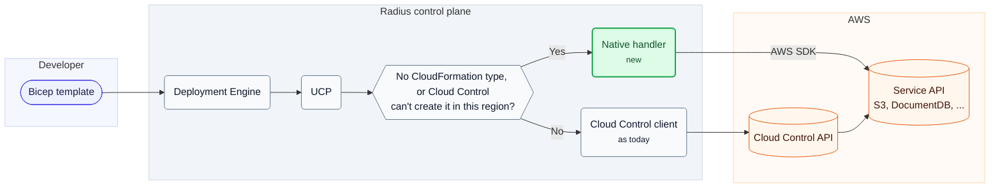

# Full AWS coverage for Radius Bicep

- **Author**: Karishma Chawla (@kachawla)
- **Date**: 2026-11
- **Status**: In review

## Summary

Today, a Bicep template can only declare the AWS types that Cloud Control fully manages. Types AWS can create and delete but not update, such as an EC2 placement group, and types AWS creates on its own, such as an AMI, have no Bicep type. Some widely used types, such as the DocumentDB cluster, can't be created through Cloud Control at all, and many AWS resources, such as an S3 object, have no CloudFormation type, so Radius can't deploy them in any way.

This design keeps Cloud Control as the default. For a type Cloud Control can't create in the request's region, or a resource with no CloudFormation type, UCP calls a native handler: code that calls the service's own API and uses the same record as every other AWS resource, so a redeploy behaves the same either way. Bicep gets a type for everything UCP can serve, and recipes can output values AWS returns only through a separate call, such as MSK broker addresses.

## Background

### How AWS resources are handled today

A Bicep template declares an AWS resource with an `AWS.*` type, such as `AWS.S3/Bucket`. The Deployment Engine sends it to UCP, and UCP calls the AWS Cloud Control API, one API that creates, reads, updates, and deletes CloudFormation resource types. Bicep recipes deploy AWS resources the same way. The Bicep types come from the `bicep-types-aws` repo, where a weekly workflow downloads the schema of every type Cloud Control fully manages and opens a pull request when they change.

UCP keeps a **resource record** for each AWS resource it deploys, as described in the [idempotent AWS deployments design](2026-10-idempotent-aws-deployments.md), stored under a resource ID that ends in the template's `alias`. It holds the **AWS identifier**, the value AWS finds the resource by, such as a cluster identifier, plus the owner, the properties Radius applied last time, and a keyed **fingerprint** of each write-only value, such as a password, so an unchanged password isn't sent again. UCP saves the record as in progress before calling AWS, and a UCP worker waits for AWS and then updates it.

When Cloud Control can't fully manage a type, UCP returns a clear 400 instead of the Cloud Control error:

| Type                                                                   | What UCP returns today                                              |
|------------------------------------------------------------------------|---------------------------------------------------------------------|
| Can't be created through Cloud Control, such as the DocumentDB cluster | 400 saying Cloud Control does not support the type                  |
| Create and delete only, such as the placement group                    | Create works. A change fails with 400 naming the changed properties |
| Read-only, created by AWS, such as an AMI                              | 400 on a deploy, saying the type can only be used with `existing`   |
| Legacy, with a replacement, such as `AWS::IAM::Policy`                 | 400 naming the replacement                                          |
| Deprecated service or CloudFormation template feature                  | 400 saying Radius does not support the type                         |

UCP reads whether Cloud Control supports a type from CloudFormation at run time, so a type starts working without a Radius release when AWS adds support for it. Recipes never mark a resource of a read-only type as managed by Radius, so deleting a recipe never deletes an AMI it referenced.

### How Azure differs

Every Azure service registers a resource provider in Azure Resource Manager, so every Azure type has one API that creates, updates, and deletes it, and Radius never calls a service's own API. AWS has no such guarantee: each service decides whether to support Cloud Control, and some never have.

## Problem

This template runs a server from a shared AMI in a placement group, next to a DocumentDB cluster, and puts the app's config file in a bucket. It is the running example for the rest of the doc.

```bicep
extension aws

@secure()
param dbPassword string

resource image 'AWS.EC2/Image@default' existing = {
  alias: 'base-image'
  properties: {
    ImageId: 'ami-0a1b2c3d'
  }
}

resource placement 'AWS.EC2/PlacementGroup@default' = {
  alias: 'app-placement'
  properties: {
    Strategy: 'cluster'
  }
}

resource server 'AWS.EC2/Instance@default' = {
  alias: 'app-server'
  properties: {
    ImageId: image.properties.ImageId
    InstanceType: 'c5.large'
    PlacementGroupName: placement.properties.GroupName
  }
}

resource docdb 'AWS.DocDB/DBCluster@default' = {
  alias: 'app-docdb'
  properties: {
    DBClusterIdentifier: 'contoso-app-docdb'
    MasterUsername: 'appadmin'
    MasterUserPassword: dbPassword
  }
}

resource assets 'AWS.S3/Bucket@default' = {
  alias: 'app-assets'
  properties: {
    BucketName: 'contoso-app-assets'
  }
}

resource config 'AWS.S3/Object@default' = {
  alias: 'app-config'
  properties: {
    Bucket: assets.properties.BucketName
    Key: 'config.json'
    Body: loadFileAsBase64('config.json')
    ContentType: 'application/json'
  }
}
```

Only the server and the bucket work today. The template fails to build, because Bicep has no type for the other four:

- **The AMI** is a read-only type. UCP can already read it, but the Bicep types leave out read-only types, so even `existing` can't reference it.
- **The placement group** is a create-and-delete-only type. UCP can already create and delete it, but the Bicep types leave out every type Cloud Control can't update.
- **The DocumentDB cluster** can't be created through Cloud Control. Even with a Bicep type, UCP would return 400.
- **The config file** is an S3 object. S3's API can create one, but CloudFormation has no type for it, so neither Cloud Control nor Bicep knows about it.

## Goals and non-goals

### Goals

- A user can deploy any AWS resource AWS lets customers create, from Bicep, in every region, except the non-goals.
- A user can reference read-only types, such as an AMI, with `existing`.
- Redeploying behaves the same whichever handler serves the type: it updates the same resource, clears removed properties, and never sends an unchanged password or returns one the user sent.
- Deleting a database or file system keeps a final snapshot or backup by default, where AWS supports one.
- A recipe can output connection values AWS returns only through a separate call, such as MSK broker addresses.

### Non-goals

- Types Radius can't serve: those in retired services or services closed to new customers, such as WAF Classic, FinSpace, WorkMail, and Managed Blockchain; those that can't work with AWS credentials or whose parent AWS no longer lets anyone create, such as the Alexa skill and Kinesis SQL application outputs; and those whose lost create AWS gives no way to find, the Chime SDK voice connector group and the WAF API key. There is nothing a new user can deploy to, or a crash during create can't be recovered safely. They keep today's 400, and types Cloud Control already manages in closed services keep working.
- Credentials AWS returns only once, such as IAM access keys, IAM service-specific credentials, Lightsail bucket access keys, and Grafana workspace API keys and service account tokens: a lost create response can't be recovered, and Radius uses role-based credentials (IRSA and EKS Pod Identity) instead. Left out for now; may revisit.
- Reading secret values from AWS in a recipe, like Azure's `listKeys()`: it needs its own authorization design.
- Watching AWS between deploys, for status or for changes made outside Radius: the app graph shows the Radius resource's status, and the next deploy changes back any property the template sets.
- Checking whether a template's author may do something: Radius acts with its configured AWS credential, so any template can do what that credential allows.

## Design overview

UCP sends each request either to Cloud Control or to a **native handler**, code that calls the service's own API through the AWS SDK, as described in [Which handler serves each type](#which-handler-serves-each-type).

A native handler replaces only the calls to Cloud Control. The record, the owner check, the comparison, the worker, and the operation status the Deployment Engine polls stay the same.



In the example:

- The AMI gets a Bicep type marked read-only, so a template can reference it with `existing`. A declaration that would try to create it gets a Bicep warning (BCP245), and UCP rejects the deploy with its existing 400 telling the user to use `existing`. The placement group gets a Bicep type. UCP already serves both through Cloud Control.
- The DocumentDB cluster can't be created through Cloud Control in any region today, so its native handler calls `CreateDBCluster`. UCP saves its record under `app-docdb`, so the next deploy updates the same cluster and doesn't resend an unchanged password.
- The config file goes to the S3 object's native handler, which calls `PutObject`. Deleting the app deletes the file.

MSK clusters also get an [extra read](#extra-read-for-msk-clusters) for their broker addresses.

## Detailed design

### Which handler serves each type

| Type in CloudFormation                                                     | Today                                  | With this design                                                                                                        |
|----------------------------------------------------------------------------|----------------------------------------|-------------------------------------------------------------------------------------------------------------------------|
| Fully managed by Cloud Control                                             | Cloud Control                          | No change                                                                                                               |
| Create and delete only                                                     | Cloud Control, with no Bicep type      | Cloud Control. Bicep type added                                                                                         |
| Read-only, created by AWS                                                  | Cloud Control read, with no Bicep type | Cloud Control read. Bicep type marked read-only                                                                         |
| Can't be created through Cloud Control in the request's region, still used | 400                                    | Native handler for 23 types. The rest keep the 400 (types Radius can't serve, and once-only credentials, are non-goals) |
| No CloudFormation type                                                     | No Bicep type                          | Native handler with a hand-written schema                                                                               |
| Legacy, with a replacement                                                 | 400 naming the replacement             | No change. `AWS::IAM::UserToGroupAddition` moves off this list to the native list                                       |
| Deprecated service or CloudFormation template feature                      | 400                                    | No change                                                                                                               |

UCP picks the handler in three steps:

1. **Hand-written type**, with no CloudFormation type: UCP recognizes it from the list of handlers in the Radius code and always uses its native handler. It never asks CloudFormation about it.
2. **One of the 23 native types**, also known from that list: UCP calls CloudFormation's `DescribeType` for the type in the request's region. If AWS reports it `NON_PROVISIONABLE`, meaning Cloud Control can't create it there, the native handler serves it. Otherwise Cloud Control does, because AWS maintains it.
3. **Every other type**: Cloud Control, as today.

UCP already calls `DescribeType` on every PUT to read the type's schema, and caches each answer for 15 minutes per region and type. So the check adds no AWS calls to a deploy, and a GET, DELETE, or list of a native type usually hits the cache. A region that gains Cloud Control support switches within 15 minutes, without a release.

Legacy types never get a handler, because their replacement already works. They include `AWS::Elasticsearch::Domain`, replaced by `AWS::OpenSearchService::Domain`, and `AWS::Route53::RecordSetGroup`, replaced by `AWS::Route53::RecordSet`.

### The 23 native types

| Service              | Types                                                                                                                                                                                                                                                                                    |
|----------------------|------------------------------------------------------------------------------------------------------------------------------------------------------------------------------------------------------------------------------------------------------------------------------------------|
| DocumentDB           | `DBCluster`, `DBInstance`                                                                                                                                                                                                                                                                |
| EC2                  | `ClientVpnEndpoint`, `ClientVpnTargetNetworkAssociation`, `NetworkAclEntry`, `NetworkInterfacePermission`, `VPNGatewayRoutePropagation`                                                                                                                                                  |
| IAM                  | `UserToGroupAddition`                                                                                                                                                                                                                                                                    |
| Kinesis Analytics v2 | `ApplicationCloudWatchLoggingOption`                                                                                                                                                                                                                                                     |
| Lake Formation       | `DataLakeSettings`, `Permissions`, `Resource`                                                                                                                                                                                                                                            |
| One type each        | AppSync `GraphQLSchema`, CloudWatch `AnomalyDetector`, CodeBuild `Project`, DAX `Cluster`, DMS `ReplicationInstance`, EMR `Cluster`, ELB v2 `ListenerCertificate`, FSx `FileSystem`, MediaLive `Channel`, SageMaker `ExperimentTrialComponent`, Service Catalog `AcceptedPortfolioShare` |

IAM `UserToGroupAddition` was a legacy type, replaced by the `Groups` property of `AWS::IAM::User`. That property only works for users the same template creates, so without this type a template can't add an existing user to its group.

A type is on this list when Cloud Control can't create it in at least one region, and leaves once every region supports it, because AWS adds support region by region. In November 2026, across 17 regions:

| Type                      | Cloud Control can create it     | Cloud Control can't create it                                       |
|---------------------------|---------------------------------|---------------------------------------------------------------------|
| CodeBuild `Project`       | 10 regions                      | 7 regions, including us-east-2, us-west-1, eu-west-2, and eu-west-3 |
| Lake Formation `Resource` | 10 regions                      | 7 regions, including us-east-2, us-west-1, eu-west-2, and eu-west-3 |
| DAX `Cluster`             | 10 regions                      | 3 regions. 4 regions don't offer DAX                                |
| EMR `Cluster`             | us-west-2 and eu-central-1 only | Every other region                                                  |

Some types behave differently from what their CloudFormation schema suggests:

| Type                      | Behavior                                                                                                                                                                                                                                      |
|---------------------------|-----------------------------------------------------------------------------------------------------------------------------------------------------------------------------------------------------------------------------------------------|
| AppSync `GraphQLSchema`   | AppSync has no call to delete a schema, so its metadata sets `onDelete: nothing`. A failed schema creation is a rejected outcome, so the next deploy sends the create again                                                                   |
| DAX `Cluster`             | `Tags` is an object in the schema, not a list                                                                                                                                                                                                 |
| DocumentDB `DBCluster`    | A restore, from a snapshot or another cluster, takes fewer properties than a create. A template that restores and also sets one the restore can't take, such as `MasterUserPassword`, gets 400 naming the properties to set in a later deploy |
| DocumentDB `DBInstance`   | `AutoMinorVersionUpgrade` is now a cluster setting. `ModifyDBInstance` rejects it, and the user gets AWS's 400                                                                                                                                |
| Lake Formation `Resource` | `DescribeResource` doesn't return `ResourceArn`, so the handler takes it from the identifier                                                                                                                                                  |
| MediaLive `Channel`       | A `ChannelClass` change needs `UpdateChannelClass`, which can't carry other changes, so a template that changes the class and other settings is rejected before any call                                                                      |

### One record, either handler

A region can switch a type to Cloud Control later, so a record must work with either handler:

- **Both store the same AWS identifier**: the native schema's primary identifier, computed as the handler declares, even when the service API finds the resource by another value. A type's CloudFormation schema can differ by region. Where Cloud Control serves it, the schema has handlers and its own primary identifier, such as CodeBuild `Name`, Client VPN association `ClientVpnEndpointId|AssociationId`, Service Catalog share `PortfolioId`, and DAX `ClusterName`. Elsewhere the schema has no handlers and a read-only `Id`, which then has no defined value. The native schema copies the version with handlers. For the 13 types with no handlers in any region, the handler defines `Id`, such as `DBClusterIdentifier` for a DocumentDB cluster or `NetworkAclId|RuleNumber|Egress` for a network ACL entry. 19 of the 23 native schemas use `Id`.
- **Both use the same property names**, because each native schema is in CloudFormation format, so the last-applied properties mean the same to both.
- **Both apply the native schema's write-only marks**, so a password the CloudFormation schema doesn't mark is never stored, even when Cloud Control serves the request.
- **An operation in progress finishes with the handler that started it.** The record saves which one, so a resumed create finds the resource the way it was sent.

### How a native handler works

Each handler is hand-written Go, one file per type, built on shared code for retries, waiters, AWS error mapping, and tags. A deploy of the DocumentDB cluster goes through the same steps as a Cloud Control type:

1. UCP asks CloudFormation for the provisioning type of `AWS::DocDB::DBCluster` in the request's region. It is `NON_PROVISIONABLE`, so UCP uses the native handler for the rest of the request.
2. UCP reads the record for `app-docdb` and checks the owner. With no record, it takes over a cluster AWS already has, found by `DBClusterIdentifier`, or creates one.
3. With a record, UCP reads the cluster through the handler and compares it with the template and the last-applied properties. If nothing changed, it returns 200 without calling AWS. A change to a create-only property gets 400 from the native schema before the handler is called, because a service API may ignore a change Cloud Control would reject.
4. UCP saves the record as in progress, with the new last-applied properties and fingerprints as pending values, and which handler serves the operation.
5. The handler makes the service's start call, such as `CreateDBCluster` or `ModifyDBCluster`. If AWS rejects it, the user gets 400 with AWS's message, and UCP drops the pending values.
6. UCP saves the operation and returns the same response a Cloud Control type returns.
7. A UCP worker polls the handler's read until the cluster is `available`, then saves the AWS identifier and moves the pending values to last-applied.

Only steps 5 and 7 differ from Cloud Control, which returns a request token for the worker to poll. A service API returns none, so UCP makes its own operation ID, and the worker reads the resource itself. Waiting only reads AWS, so a restarted worker can safely run it again. Reads, including `existing`, also go through the handler where it serves the type.

Many native operations take more than one AWS call: an update followed by tag calls (DocumentDB, DAX, EMR, FSx, MediaLive), CodeBuild's visibility and webhook calls, a Client VPN endpoint with its authorization policy, members applied one per call (IAM user-to-group, ELB v2 listener certificates, VPN gateway route propagation), and Lake Formation permissions (revoke, then grant) and resources (deregister, then register to switch to the service-linked role). Any of them can fail partway, so UCP sorts each failed operation into one of four outcomes:

| Outcome                                               | What UCP does                                                                                                                                 |
|-------------------------------------------------------|-----------------------------------------------------------------------------------------------------------------------------------------------|
| Rejected before any change                            | Drops the pending values, as if nothing happened                                                                                              |
| Partly applied                                        | Keeps the pending values as possibly applied, so a later removal clears them. The next deploy reads AWS and makes only the calls still needed |
| Unknown, because UCP stopped before it saw the result | The same as partly applied                                                                                                                    |
| Fully applied                                         | Moves the pending values to last-applied, as for any success                                                                                  |

UCP reconciles from what AWS shows instead of saving progress for each call, because a normal update already reads AWS and makes only the changes still needed.

Four types add members to a parent: IAM `UserToGroupAddition`, ELB v2 `ListenerCertificate`, `VPNGatewayRoutePropagation`, and Lake Formation `Permissions`. Each manages only the members its template lists, so members added outside Radius stay through take-over, update, and delete. For the first three, the identifier is the parent plus a name from the operation ID. An update removes members first, and a failure while removing counts as rejected, so the record keeps every member it may still have to remove. Lake Formation `DataLakeSettings` with `MutationType: APPEND` works the same way for data lake admins.

Each handler also declares:

- **Its schema**, in CloudFormation format, which UCP uses instead of the schema CloudFormation returns, with either handler, so validation, comparison, and Bicep types work as for other types.
- **How to compute and encode its identifier.** Today UCP joins top-level strings with `|`, but a DynamoDB item's key sits inside `Item`, typed by the table's key schema, and an S3 key can contain any character, including `|` and `/`. The AWS identifier stays as AWS gives it, such as a Lake Formation resource ARN with an S3 path. Only the resource address escapes it into one segment. Create, `existing`, recovery, and delete all use the same identifier.
- **Which operations it supports**, because some types can't list, and some list only under a parent, such as a bucket for S3 objects or a key for KMS grants.
- **Every secret as write-only**, including ones the CloudFormation schema doesn't mark.
- **Input-only properties as write-only**, ones a call takes but AWS never returns, so UCP compares them by fingerprint instead of seeing a change on every deploy. Examples are DocumentDB's restore inputs, such as `SnapshotIdentifier` and `RestoreToTime`, AppSync `Definition`, DMS `AllowMajorVersionUpgrade`, FSx `BackupId`, and MediaLive `DryRun`. Arrays AWS returns in its own order get `insertionOrder: false`.
- **Create-only marks AWS's schema leaves out**, such as DMS `ReplicationInstanceIdentifier` and `AvailabilityZone`, IAM `GroupName`, and FSx fields `UpdateFileSystem` can't change.
- **Values AWS returns in another form**, such as engine version `5.0` that comes back as `5.0.0`, or a DAX cluster name AWS stores in lowercase, so they don't count as changes. Where it can, it uses the schema's `propertyTransform`, as UCP already does for Cloud Control types.
- **A filter when the API also returns other products.** The DocumentDB API also returns RDS and Neptune clusters, so the handler checks `Engine=docdb` before every read and delete, and never changes or deletes an Aurora cluster. A delete that finds the identifier now names another product treats it as not found: the managed resource is gone and the identifier was reused, so UCP removes the record and the delete succeeds.
- **Create, update, and delete timeouts**, such as how long a DocumentDB cluster may take to become `available`.
- **The property that holds the resource's ARN**, so recipes save it on their output resources.

Write-only values are fingerprinted, never stored, and removed from every response: create, read, `existing`, list, and operation results. Today UCP removes only secrets copied from the request, but some APIs return secrets too, such as MediaLive's `CreateChannel`, `UpdateChannel`, `DeleteChannel`, and `DescribeChannel`. Four of the 23 types take secrets, and AWS's schema already marks EMR's, so 3 types need a fix in their native schema:

| Type                   | Secret property                                                                                   | AWS marks it write-only |
|------------------------|---------------------------------------------------------------------------------------------------|-------------------------|
| DocumentDB `DBCluster` | `MasterUserPassword`                                                                              | No                      |
| EMR `Cluster`          | `KerberosAttributes/ADDomainJoinPassword`, `CrossRealmTrustPrincipalPassword`, `KdcAdminPassword` | Yes                     |
| FSx `FileSystem`       | `OntapConfiguration/FsxAdminPassword`                                                             | No                      |
| FSx `FileSystem`       | `WindowsConfiguration/SelfManagedActiveDirectoryConfiguration/Password`                           | No                      |
| MediaLive `Channel`    | `.../StaticKeySettings/StaticKeyValue`, an HLS encryption key                                     | No                      |
| MediaLive `Channel`    | `.../HlsAkamaiSettings/Salt`, the shared secret for Akamai token auth                             | No                      |

The other 19 types take none, as listed in the [appendix](#appendix-native-types-with-no-secrets). A property that only points to a secret stored elsewhere, such as MediaLive's `PasswordParam` or FSx's `DomainJoinServiceAccountSecret`, is not a secret.

### Finding a create after a crash

If UCP stops after AWS accepted a create but before it saved the result, the next deploy must find that resource instead of creating a second one. Cloud Control does this with the record's client token, a UUID saved before the first create. A service API doesn't, so each native handler says how it finds the resource:

| Types                                                                                                                                                                           | How the handler finds the resource                                                                                                                                                                                                                             |
|---------------------------------------------------------------------------------------------------------------------------------------------------------------------------------|----------------------------------------------------------------------------------------------------------------------------------------------------------------------------------------------------------------------------------------------------------------|
| The identifier is known before the create, because the template sets it or the handler generates it: DocumentDB cluster, DAX cluster, DMS replication instance, and most others | UCP saves the identifier on the record before the create and reads AWS by it. If AWS has the resource, UCP waits for it. Otherwise it sends the create again                                                                                                   |
| AWS assigns the identifier, and the API takes an idempotency token: EC2 Client VPN endpoint and association, FSx file system, MediaLive channel                                 | The handler sends the record's client token as that token, so a resent create returns the first resource                                                                                                                                                       |
| The call is safe to repeat: IAM user-to-group addition                                                                                                                          | The handler sends it again. Adding a user who is already in the group changes nothing                                                                                                                                                                          |
| AWS assigns the identifier, and the API takes no token: EMR cluster, EC2 network interface permission, Kinesis Analytics logging option                                         | Where the API takes tags, such as for an EMR cluster, the handler tags the create with the operation ID and finds the resource by that tag. Otherwise it finds the resource by values AWS keeps unique, such as the network interface, account, and permission |

When AWS lets the caller choose the identifier but the template leaves it out, as the Cloud Control type allows for CodeBuild `Project.Name`, the handler generates `radius-` followed by 12 lowercase hex characters from a hash of the operation ID, such as `radius-3f9a1c0b7d2e`, cut and lowercased to fit the type's name rules from its schema, and saves it on the record before calling AWS. It never makes the property required, because the same template must also work through Cloud Control in another region.

So every in-scope type has an idempotency token, a tag marker, or a name saved before the call. For the OpenSearch outbound connection and the Outposts capacity task, implementation checks that AWS rejects duplicates, and any that it doesn't joins the types Radius can't serve. AWS allows one Kinesis Analytics logging option per application, so a duplicate is always rejected. The EC2 network interface permission stays in scope: its handler finds a lost create by the network interface, account, and permission, which works whether or not AWS rejects duplicates. AWS grants this permission only to receiving accounts it authorizes, so its duplicate behavior couldn't be tested.

A DELETE of a record whose create may have reached AWS uses the same steps to find the resource first. That resend has no write-only values, and FSx rejects the reused token with `IncompatibleParameterError`, so the FSx handler also tags the create with the operation ID and finds the resource by that tag.

### Deleting a resource

A DELETE goes through the record and the owner check as for any AWS type. By default, two native types keep a copy of their data, as Cloud Control does for RDS, because deleting it without one can't be undone:

- **DocumentDB cluster**: takes a final snapshot named `<identifier>-final-<UTC time>`.
- **FSx file system**: takes a final backup where FSx supports one. FSx takes none for NetApp ONTAP, Lustre scratch file systems, or Lustre linked to S3, including PERSISTENT_2 with data repository associations.

Before the delete call, UCP saves a delete token on the record, so a retried delete never takes a second copy. A create or update clears it:

- **DocumentDB cluster**: the token is the final snapshot name, which `DeleteDBCluster` takes as `FinalDBSnapshotIdentifier`.
- **FSx file system**: `DeleteFileSystem` takes no name for the final backup, so UCP sends the token as `ClientRequestToken` on every attempt, and a retry is the same delete.

Radius never deletes these snapshots or backups. Letting a user skip the final snapshot is tracked separately; Cloud Control types like RDS have the same behavior today.

### Types with no CloudFormation type

These AWS resources have no CloudFormation type, and no property of another type covers them. They fall in four groups:

| Group                       | Examples                                                                                    |
|-----------------------------|---------------------------------------------------------------------------------------------|
| Resources                   | KMS grant, main route table association, AMI made from an instance, OpenSearch VPC endpoint |
| Account and region settings | IAM password policy, account-wide S3 public access block, EBS encryption by default         |
| Purchases                   | RDS reserved instance, Savings Plan, domain registration                                    |
| Data writes                 | S3 object, DynamoDB item, CloudFront key-value entry                                        |

The per-type list is kept in the implementation issues.

**Schema.** Each type gets a schema written by hand in CloudFormation's JSON schema format: properties, primary identifier, and create-only, read-only, and write-only properties, with a `handlers` section that names the AWS calls each operation makes. Because the format is the same, everything else works as for the 23 native types. The schema lives next to its handler in the Radius repo, the only copy, and `bicep-types-aws` reads it from a pinned Radius commit. For the config file:

```json
{
  "typeName": "AWS::S3::Object",
  "properties": {
    "Bucket": { "type": "string" },
    "Key": { "type": "string" },
    "Body": { "type": "string" },
    "ContentType": { "type": "string" },
    "CopySource": { "type": "string" },
    "VersionId": { "type": "string" }
  },
  "primaryIdentifier": ["/properties/Bucket", "/properties/Key"],
  "createOnlyProperties": ["/properties/Bucket", "/properties/Key"],
  "readOnlyProperties": ["/properties/VersionId"],
  "writeOnlyProperties": ["/properties/Body"],
  "handlers": {
    "create": { "permissions": ["s3:PutObject", "s3:GetObject"] },
    "read": { "permissions": ["s3:GetObject"] },
    "update": { "permissions": ["s3:PutObject", "s3:GetObject"] },
    "delete": { "permissions": ["s3:ListBucketVersions", "s3:DeleteObject", "s3:DeleteObjectVersion"] }
  }
}
```

**Per-type behavior.** CloudFormation's schema format has no field for how far a type's identity reaches or what delete does, so each type has a small metadata file next to its schema, which stays the source for properties and Bicep types. For the IAM password policy:

```json
{
  "typeName": "AWS::IAM::AccountPasswordPolicy",
  "identityScope": "account",
  "onDelete": "nothing"
}
```

`identityScope` is `account` or `region`, and `onDelete` is one of `delete`, `reset`, `nothing`, `reject`, or `leave`.

**Property names.** Properties use the AWS API's own parameter names, in CloudFormation's PascalCase, such as `Bucket`, `Key`, `Body`, `ContentType`, and `CopySource` from S3's `PutObject` and `CopyObject`. Users learn no new names, and a new API field can be matched to a property by its name.

**Type name.** Each type uses the name AWS would use, following CloudFormation's naming, such as `AWS::S3::Object` (`AWS.S3/Object` in Bicep), so a template reads like one that uses AWS's own types.

**When AWS publishes a CloudFormation type with the same name.** UCP never asks CloudFormation about a hand-written type, so nothing changes for users. The weekly type refresh keeps the Radius type, skips AWS's, and opens or updates one issue instead of failing. A person then compares the two:

| AWS's schema                                                                                                                                                                                     | What happens                                                                                                 |
|--------------------------------------------------------------------------------------------------------------------------------------------------------------------------------------------------|--------------------------------------------------------------------------------------------------------------|
| Cloud Control can create the type in every region Radius supports, and it behaves the same: primary identifier, property names and types, create-only properties, and what removal and delete do | Cloud Control takes over new operations, and Radius removes its schema. The record works with either handler |
| Anything else                                                                                                                                                                                    | Radius keeps its own schema and handler                                                                      |

A handover, here or when one of the 23 native types leaves the list, changes only where new operations go. The handler stays, so an operation it started still finishes with it. A later release can remove the handler only with an upgrade preflight check that refuses to upgrade while any record has an unfinished native operation of that type, because unfinished operations live in each installation's records.

### Data writes, settings, and purchases

These types write data, change a setting that has one value per account or region, or buy something, so delete differs by kind:

| Kind                                                                                                           | What delete does in AWS                                                                                                       | Reason                                                                                                                                  |
|----------------------------------------------------------------------------------------------------------------|-------------------------------------------------------------------------------------------------------------------------------|-----------------------------------------------------------------------------------------------------------------------------------------|
| Data writes: S3 object and object copy, DynamoDB item, CloudFront key-value entries, Customer Profiles profile | Deletes the object, item, or entry, and UCP removes the record                                                                | The app wrote the data, so it goes with the app                                                                                         |
| Account and region settings                                                                                    | What the setting's metadata says: reset it to AWS's default, or nothing in AWS where a reset is risky. UCP removes the record | Radius never restores the earlier value. That would need recording it, and would surprise anyone who changed the setting outside Radius |
| Purchases, such as a reserved instance, a Savings Plan, or a domain registration                               | Nothing, and UCP keeps the record. A later deploy of the same alias finds it and buys nothing                                 | A purchase can't be undone, and buying again costs money                                                                                |

**Data writes.** An S3 object's content comes from one of two places:

- **Inline**, in `Body`, from Bicep's `loadFileAsBase64` at compile time, for any file, text or binary, within its 96 KB limit, which suits small files such as the config file. `Body` is always base64, because AWS's API models type it as binary, and AWS's JSON tools send binary as base64.
- **Copy**, in `CopySource`, from another S3 object. There is no size limit, but something else, usually CI, must upload the source first.

```bicep
resource logo 'AWS.S3/Object@default' = {
  alias: 'app-logo'
  properties: {
    Bucket: assets.properties.BucketName
    Key: 'logo.png'
    Body: loadFileAsBase64('logo.png')
    ContentType: 'image/png'
  }
}

resource site 'AWS.S3/Object@default' = {
  alias: 'app-site'
  properties: {
    Bucket: assets.properties.BucketName
    Key: 'site.zip'
    CopySource: 'contoso-ci-artifacts/site/1.4.2/site.zip'
  }
}
```

Uploading a local file through `rad deploy` isn't supported. Recipes run in the cluster, where the user's local files don't exist, and inline content and copies cover both cases.

`Body` is write-only, so it never appears in a response, and the record keeps only its fingerprint. To catch changes made in S3, UCP uploads every object with a SHA-256 checksum, which S3 stores, and on a redeploy compares it with the checksum of the template's content. Neither checksum is saved, because the content may hold a secret. `ContentType` and other ordinary properties are compared separately, like any property.

| Checksums                                                                         | What UCP does                  |
|-----------------------------------------------------------------------------------|--------------------------------|
| Same                                                                              | Nothing                        |
| Different, because the template changed or the app changed the object at run time | Uploads the template's version |
| S3 has none, because something outside Radius uploaded the object without one     | Uploads the template's version |

A copy is compared differently, because a source uploaded in parts can have a different checksum from its copy even when the bytes match. The record keeps a keyed fingerprint of the source's ETag and of the destination's checksum, never the ETag itself, because a single-part ETag can be the MD5 of the content. A redeploy copies again when either fingerprint changed. A copy over 5 GB uses multipart copy: the record keeps the upload ID, the finished parts, and the source ETag's fingerprint, so a retry continues where it stopped. Every part copy sends `CopySourceIfMatch` with the source's ETag, so S3 refuses a part if the source changed during the copy. A resumed copy reads the source's ETag again and checks it against the saved fingerprint first. On any mismatch, UCP aborts the upload and starts the copy over from the current source, so the destination never mixes two versions. UCP also aborts an upload it no longer needs.

In a bucket with versioning on, the record keeps only the latest version ID. Delete lists every version of the key, including ones Radius didn't upload, and removes them all, because the object belongs to the app, and leftover versions keep its content and block deleting the bucket. A version under Object Lock fails the delete with an error naming the key and version.

DynamoDB items and CloudFront entries are compared with what AWS returns, but the record keeps only a fingerprint of each value, and responses leave them out, because they may hold secrets. A redeploy overwrites an object, item, or entry the app changed at run time, so data the app writes at run time belongs in ones the template doesn't declare.

Route 53 record sets that remove every record the template doesn't list aren't covered, because they would delete DNS records someone else added to the zone.

**Settings.** A setting's metadata declares its identity scope: the account, such as the IAM password policy, or the account and region, such as EBS encryption by default. The check for an identifier another alias holds searches that whole scope, so a second alias gets 409. Today it searches only the request's region, which would let an alias in each region manage the same account-wide setting. As in the idempotency design, the search and the save are separate steps, so two aliases taking over the same setting at the same moment can both succeed.

A setting that protects the account or region does nothing in AWS on delete, because deleting one app must not weaken a control other apps rely on. For example:

| Setting                                                                                                  | What delete does  |
|----------------------------------------------------------------------------------------------------------|-------------------|
| IAM password policy, account-wide S3 public access block, EBS encryption by default, EBS default KMS key | Nothing in AWS    |
| GuardDuty organization configuration                                                                     | Nothing in AWS    |
| IAM account alias                                                                                        | Deletes the alias |

**Long-running creates.** Some creates run for hours, such as fine-tuning a Bedrock custom model or training a Transcribe language model. Each type's handler sets its own create timeout, and the worker waits until it passes.

### Actions

Some AWS operations accept a request, take over something AWS made, run something, or set a state. Each gets a hand-written schema, so a template declares it like any other resource:

| Kind                                  | Examples                                                                                                                   | What a deploy does                                                                     | What delete does in AWS                                                                    |
|---------------------------------------|----------------------------------------------------------------------------------------------------------------------------|----------------------------------------------------------------------------------------|--------------------------------------------------------------------------------------------|
| Accept a request from another account | VPC peering, a RAM resource share, a Transit Gateway attachment, a Direct Connect interface                                | Accepts the request the template names. The type's resource is the acceptance          | What AWS allows for the type, as its schema says: reject the request, leave it, or nothing |
| Take over a resource AWS created      | The default VPC, subnet, security group, network ACL, and route table, and a Cognito user pool client another service made | Finds the resource and applies the template's settings                                 | Nothing, because AWS created it and other things may depend on it                          |
| Run something during a deploy         | A Lambda invocation, a Redshift Data SQL statement, a SageMaker training job                                               | Runs it and waits like a create, only when its inputs changed                          | Nothing. Radius never undoes what a run did                                                |
| Set an instance's running state       | An EC2 or RDS instance kept `running` or `stopped`                                                                         | Compares the state like any property, and starts or stops the instance when it differs | Nothing. The instance stays as it is                                                       |

**Running something.** A run happens at least once, so what it runs must be safe to repeat. Before calling AWS, UCP saves the run's identity on the record, such as a job name, and passes it where AWS drops duplicates, such as a Redshift Data client token. The record keeps a fingerprint of the run's inputs, never the inputs, and responses leave them out, because a payload can hold a secret. A deploy runs again only when the fingerprint of the template's inputs changed:

| Outcome                                               | What happens                                                                                                                                                              |
|-------------------------------------------------------|---------------------------------------------------------------------------------------------------------------------------------------------------------------------------|
| Succeeds                                              | UCP saves the input fingerprint                                                                                                                                           |
| Fails                                                 | The deploy fails with AWS's error. The fingerprint isn't saved, so the next deploy runs it again                                                                          |
| Unknown, because UCP stopped before it saw the result | UCP looks the run up by its saved identity where AWS allows. Otherwise the deploy fails with an error saying the run may have happened, and the next deploy runs it again |

Left out: a call that creates nothing in AWS, such as KMS encryption, because there's nothing for a record to point to, and a call that needs a browser sign-in mid-deploy, such as connecting an AppFabric app, because a deploy can't wait for a person.

Validating an ACM certificate and verifying an SES domain need no type, because the certificate's and the domain identity's own create already waits for them.

### Extra read for MSK clusters

A recipe that creates a Kafka cluster on MSK needs to output where clients connect, but the schemas for `AWS::MSK::Cluster` and `AWS::MSK::ServerlessCluster` return only `Arn` and `CurrentVersion` as read-only properties. The broker addresses come only from MSK's `GetBootstrapBrokers` call.

These two types keep Cloud Control for create, update, and delete. When UCP reads one, by GET or POST `/:get`, it also calls `GetBootstrapBrokers` and adds each address as a read-only property named after AWS's field, such as `BootstrapBrokerString`, `BootstrapBrokerStringTls`, and `BootstrapBrokerStringSaslIam`, so a recipe can output `cluster.properties.BootstrapBrokerStringSaslIam`. A field AWS leaves empty, because the cluster doesn't use that access method, is left out. A list doesn't make the extra call, so it never makes one call per cluster.

| Rule                                                                                                                                                                                                    | Reason                                                                                          |
|---------------------------------------------------------------------------------------------------------------------------------------------------------------------------------------------------------|-------------------------------------------------------------------------------------------------|
| Each type has a short, explicit list of extra properties, kept in the Radius repo                                                                                                                       | UCP and the Bicep type generator read the same list, so the Bicep type matches what UCP returns |
| UCP adds the extra values only to its response. It compares and patches against the Cloud Control read, and drops them from a request that sets them, unless AWS's schema has a property with that name | A redeploy never sends them to AWS, and they never enter the last-applied properties            |
| If `GetBootstrapBrokers` fails, the read fails with an error naming `kafka:GetBootstrapBrokers`                                                                                                         | A recipe that outputs a missing property would fail later with a less clear error               |
| Only these two MSK types get an extra read. Another type is added only when a recipe needs it                                                                                                           | Each one adds a call and a permission                                                           |

The addresses exist only once the cluster is active. Cloud Control finishes a create only then, and a GET by alias returns 404 until it does, so the Deployment Engine's read after a deploy always gets them.

Reading secrets back from AWS is a non-goal, but it doesn't block recipes. A recipe sets the passwords and tokens it creates, so it never needs to read one back. When AWS generates a secret, such as RDS's managed master password, the recipe outputs the secret's ARN, and the app reads it through EKS Pod Identity.

### Bicep types

`bicep-types-aws` changes in five ways:

1. **Read-only types**, such as an AMI: it downloads them and sets Bicep's read-only resource flag, which the generator doesn't set today. A template can reference them with `existing`. A declaration that would create one gets a Bicep warning (BCP245), not an error, and bicepconfig can't raise it, so UCP rejects the deploy with its existing 400 telling the user to use `existing`. A read-only type keeps its primary identifier settable, or every `existing` reference fails with BCP073.
2. **Types AWS can create and delete but not update**, such as the placement group: it downloads them too.
3. **The 23 native types and the types with no CloudFormation type**: it reads their schemas from a pinned Radius commit, so one AWS extension holds every type. For a type Cloud Control also manages in some regions, such as CodeBuild `Project`, the Radius schema replaces the downloaded one. A name clash with a new AWS type follows [When AWS publishes a CloudFormation type with the same name](#types-with-no-cloudformation-type).
4. **Extra read-only properties**, such as the MSK broker addresses: it adds each type's list from the Radius repo, so the Bicep type differs from the CloudFormation schema only by that list. If AWS adds a property with the same name, AWS's property wins in both places: UCP returns and sends Cloud Control's value as for any property, and the refresh skips the extra property in Bicep and opens or updates one issue instead of failing. So the Bicep type still matches what UCP returns.
5. It accepts types with no last-updated time. Legacy types such as the DocumentDB cluster have none, and the downloader would crash on them.

Today the AWS extension holds only AWS's schemas, so any version works with any Radius. The Radius schemas make it depend on a Radius version for the first time, and a versioned extension such as `aws:0.62` must never offer a type the matching Radius release can't deploy:

- `bicep-types-aws` main pins a Radius main commit, and its merges publish the edge extension (`latest`), which edge `rad` uses.
- Before a release tags `bicep-types-aws`, its release branch pins the Radius commit the release plan ships, `source.productCommit` in `.github/release-plans/vX.Y.Z.yaml`. The release check fails if they differ.

## Failure handling

Every failure the [idempotent AWS deployments design](2026-10-idempotent-aws-deployments.md) covers applies here too, such as a failed read of the record, another owner holding the alias, or an operation already in progress. Partial native operations, purchases, settings that do nothing on delete, and runs during a deploy follow the tables in their sections. This table lists the rest:

| Scenario                                                                                                                                                  | What the user sees                                                                                                                                                                                                                                             |
|-----------------------------------------------------------------------------------------------------------------------------------------------------------|----------------------------------------------------------------------------------------------------------------------------------------------------------------------------------------------------------------------------------------------------------------|
| AWS rejects the start call                                                                                                                                | 400 with AWS's message. Pending values are dropped, so the previous last-applied properties stay                                                                                                                                                               |
| A template changes a create-only property of a native type                                                                                                | 400 naming the property. Nothing is sent to AWS                                                                                                                                                                                                                |
| Reading the resource fails for any reason except "not found"                                                                                              | The deploy fails. Nothing is created or changed                                                                                                                                                                                                                |
| The identifier now names another product, such as an Aurora cluster                                                                                       | A deploy or read fails, naming the identifier. A delete treats it as not found: UCP removes the record and the delete succeeds, so deleting the app isn't blocked. UCP never changes or deletes the other product's resource                                   |
| Waiting passes the type's timeout, including a long-running create such as model fine-tuning                                                              | The operation fails, naming the state UCP waited for. The next deploy reads the resource and continues                                                                                                                                                         |
| The worker restarts                                                                                                                                       | The wait runs again. Nothing is changed in AWS twice                                                                                                                                                                                                           |
| UCP stopped after AWS accepted a create                                                                                                                   | The next deploy finds the resource, as in [Finding a create after a crash](#finding-a-create-after-a-crash)                                                                                                                                                    |
| The final snapshot or backup fails                                                                                                                        | The delete fails, and the resource stays. A retry reuses the saved DocumentDB snapshot name, or sends the saved FSx delete token again                                                                                                                         |
| `DescribeType` fails for a native type, such as a throttle, a missing `cloudformation:DescribeType` permission, or a type AWS doesn't offer in the region | The request fails with that error. UCP never guesses the handler                                                                                                                                                                                               |
| `GetBootstrapBrokers` fails, such as a missing permission                                                                                                 | The read fails with an error naming `kafka:GetBootstrapBrokers`. UCP never leaves the addresses out silently                                                                                                                                                   |
| An `existing` read finds an MSK cluster that isn't active yet                                                                                             | The read fails with AWS's message, because the addresses don't exist yet                                                                                                                                                                                       |
| The type refresh finds a name clash with AWS, for a type or an extra property                                                                             | For a type, it keeps the Radius type and skips AWS's. For an extra property, AWS's property wins, in Bicep and in what UCP returns, and the extra is skipped. Either way it opens or updates one issue, and nothing breaks for users until a person reviews it |
| A template declares a read-only type, such as an AMI, without `existing`                                                                                  | Bicep warns (BCP245) and the template builds. UCP rejects the deploy with 400 telling the user to use `existing`. Nothing changes in AWS                                                                                                                       |
| A file loaded with `loadFileAsBase64` is over Bicep's 96 KB limit                                                                                         | The template fails to build. Nothing is sent to UCP                                                                                                                                                                                                            |
| An S3 object's `Body` isn't valid base64                                                                                                                  | 400 naming `Body`. Nothing is sent to AWS                                                                                                                                                                                                                      |
| Two aliases set the same setting, even from different regions for an account-wide setting                                                                 | The second gets 409 naming the alias that holds it. Nothing changes in AWS                                                                                                                                                                                     |
| A multipart copy stops partway, and the source is unchanged                                                                                               | The next deploy continues from the saved parts                                                                                                                                                                                                                 |
| The source of a multipart copy changes during the copy or while it's stopped                                                                              | S3 refuses the next part, or the resumed copy finds a different ETag. UCP aborts the upload and copies again from the current source                                                                                                                           |
| Deleting an S3 object finds a version under Object Lock                                                                                                   | The delete fails with an error naming the key and version. The record stays                                                                                                                                                                                    |
| Another account's request to accept doesn't exist, or was already rejected                                                                                | The deploy fails with AWS's error. Nothing is created                                                                                                                                                                                                          |

## Security

- Every secret is write-only in the Radius schema and removed from every response, including values AWS returns, as described in [How a native handler works](#how-a-native-handler-works). S3 `Body`, DynamoDB items, CloudFront values, and run inputs are never returned or stored either. The record keeps only keyed fingerprints of them.
- A native handler uses the same AWS credential as Cloud Control, which already needs the service's permissions, such as `rds:CreateDBCluster`. It also needs permission for the final snapshot or backup, such as `rds:CreateDBClusterSnapshot`.
- The product filter stops a DocumentDB handler from changing or deleting an RDS or Neptune cluster that shares the API.
- The MSK extra read needs `kafka:GetBootstrapBrokers`. Broker addresses are not secrets.
- Account and region settings and purchases need permissions an app's credential usually doesn't have, such as `iam:UpdateAccountPasswordPolicy` or `savingsplans:CreateSavingsPlan`. Without them, the deploy fails with AWS's access denied error, and nothing changes.
- Inline file content is part of the compiled template, so a secret doesn't belong in a file loaded with `loadFileAsBase64`.
- Radius doesn't check what a template's author may do (authorization is a non-goal). With this design, a template can change account-wide settings, accept cross-account requests, take over default resources, buy things, run code, and copy from any bucket the credential can read. Platform teams limit this by scoping the credential's IAM policy, such as leaving out purchases, IAM account settings, or `s3:GetObject` outside approved buckets.

## Test plan

Unit tests cover every rule and table row in [Detailed design](#detailed-design) and every row in [Failure handling](#failure-handling). Beyond those:

- **Shared suite for each native handler**: create, read, update, delete, and list where the type supports it; redeploy with no change; resource deleted outside Radius; create-only change; unchanged and changed write-only values; removed property; worker restart while waiting; finding a lost create; delete with a final snapshot or backup, and a retried delete that reuses the saved snapshot name or FSx delete token and takes no second copy. Also:
  - create with one handler, then read, update, and delete with the other, in both orders, including a template that leaves out an optional identifier, where the generated name is the same on a retry of one operation and fits the type's name rules
  - the identifier round-trips through create, `existing`, recovery, and delete, including an S3 key with `|` and `/` and a typed DynamoDB key
  - for a multi-call operation, a failure between every two calls, then a redeploy that ends fully applied
  - for a member type, a member added outside Radius stays through take-over, update, and delete
  - an identifier that now names another product: a delete removes the record, succeeds, and makes no change or delete call in AWS, while a PUT and a GET fail naming the identifier

  Recorded AWS responses run in CI, and a nightly run uses real AWS. Live tests for purchases and other types that can't be undone are opt-in, with a budget. Live tests use sizes every test region offers, such as `dms.t3.small`, because us-west-2 doesn't offer `dms.t3.micro`.
- **Secrets**: no secret appears on any response path, including the DocumentDB password and MediaLive's `StaticKeyValue` and `Salt` from every channel call, and the record holds no `Body`, item, CloudFront value, run input, plain checksum, or plain ETag.
- **Redeploys send nothing unchanged**: the MSK broker addresses, an S3 object with the same content (while a changed `ContentType` alone is sent), a copy from a source uploaded in parts, and a run with the same inputs.
- **Multipart copy**: a source overwritten between two part copies, and while the copy is stopped, both restart the copy and never complete a mixed object.
- **Functional tests through the Deployment Engine**: deploy the example template, then delete it and check the config file is gone; deploy the placement group and change it; reference the AMI with `existing`, and check that declaring it without `existing` fails the deploy with UCP's 400; deploy a recipe with an MSK serverless cluster that outputs `BootstrapBrokerStringSaslIam`, then redeploy and check nothing is sent to AWS.
- **Bicep types**: a type with no last-updated time; read-only types are marked, keep their primary identifier settable for `existing`, and a declaration without `existing` gets the BCP245 warning; the MSK extra properties; hand-written types from the pinned Radius commit; the release check fails when the release branch's pinned Radius commit differs from the release plan's `productCommit`; a type name clash keeps the Radius type, an extra property clash keeps AWS's property in Bicep and in UCP's response, and each opens one issue that a second run updates.

## Alternatives considered

- **Build native handlers only when users ask**: leaves users blocked, and the goal is every AWS resource customers can create.
- **Generate handlers from AWS's Smithy API models**: the models describe API calls, not resources. Which calls create, read, update, and delete a resource has to be written by hand, the same as in CloudFormation's own handlers.
- **Native handlers for every type, without Cloud Control**: gives up the types AWS maintains through Cloud Control.
- **One CloudFormation stack per resource for these types**: needs a stack per resource, hits account stack limits, and doesn't help outside CloudFormation.
- **Native handlers for the legacy types**: Cloud Control already manages their replacements.
- **Always use the native handler for a native type, in every region**: gives up Cloud Control where AWS already supports the type, and needs a Radius release to switch.
- **Decide the native list from one region**: AWS adds support region by region, so a type that works in us-west-2 can still be missing in us-east-2.

## Appendix: native types with no secrets

Checked against each type's published CloudFormation schema in `us-west-2` and the service's API reference.

| Type                                                      | Secret properties                                                                                                                  |
|-----------------------------------------------------------|------------------------------------------------------------------------------------------------------------------------------------|
| AppSync `GraphQLSchema`                                   | none                                                                                                                               |
| CloudWatch `AnomalyDetector`                              | none                                                                                                                               |
| CodeBuild `Project`                                       | none. `PLAINTEXT` environment variables can hold secrets, so templates should use `SECRETS_MANAGER` or `PARAMETER_STORE` variables |
| DAX `Cluster`                                             | none                                                                                                                               |
| DMS `ReplicationInstance`                                 | none                                                                                                                               |
| DocumentDB `DBInstance`                                   | none                                                                                                                               |
| EC2 `ClientVpnEndpoint`                                   | none                                                                                                                               |
| EC2 `ClientVpnTargetNetworkAssociation`                   | none                                                                                                                               |
| EC2 `NetworkAclEntry`                                     | none                                                                                                                               |
| EC2 `NetworkInterfacePermission`                          | none                                                                                                                               |
| EC2 `VPNGatewayRoutePropagation`                          | none                                                                                                                               |
| ELB v2 `ListenerCertificate`                              | none                                                                                                                               |
| IAM `UserToGroupAddition`                                 | none                                                                                                                               |
| Kinesis Analytics v2 `ApplicationCloudWatchLoggingOption` | none                                                                                                                               |
| Lake Formation `DataLakeSettings`                         | none                                                                                                                               |
| Lake Formation `Permissions`                              | none                                                                                                                               |
| Lake Formation `Resource`                                 | none                                                                                                                               |
| SageMaker `ExperimentTrialComponent`                      | none                                                                                                                               |
| Service Catalog `AcceptedPortfolioShare`                  | none                                                                                                                               |
